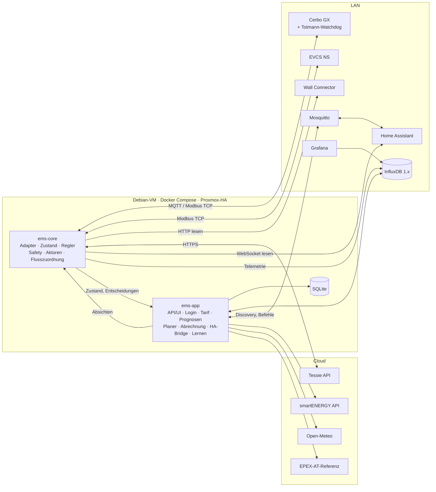

# BindaEMS – Design-Spezifikation

| | |
|---|---|
| Stand | 2026-10-08 |
| Status | Entwurf zur Freigabe |
| Umfang | Gesamtsystem, Phasen 1–6 |
| Branch | `main` |

## 0. Kurzfassung

BindaEMS ist ein lokal betriebenes Energiemanagementsystem für einen Hausakku (Victron ESS), eine AC-gekoppelte PV-Anlage (Huawei) und zwei Wallboxen (Victron EV Charging Station NS, Tesla Wall Connector Gen 3). Es senkt die Stromkosten bei dynamischem Tarif (smartENERGY smartCONTROL, Netz Niederösterreich) und erhöht den Eigenverbrauch. Energiehandel betreibt es nicht.

Sicherheit geht vor Funktion. Harte Grenzen werden unabhängig von Planung, Bedienoberfläche und Lernmodellen durchgesetzt. Ein Totmann-Watchdog direkt am Cerbo GX stellt bei einem Ausfall des EMS den Victron-Standardbetrieb wieder her.

Architektur in zwei Sätzen: Der kleine, kritische Prozess `ems-core` liest alle Geräte, regelt jede Sekunde und prüft jeden Befehl gegen die harten Grenzen. Der zweite Prozess `ems-app` plant alle 15 Minuten (gemischt-ganzzahlige Optimierung), erstellt Prognosen, führt die Abrechnung und stellt Web-UI, API und die Home-Assistant-Anbindung bereit.

---

## 1. Ziel und Rahmen

### 1.1 Ziele

- **Kosten und Eigenverbrauch:** Stromkosten minimieren und Eigenverbrauch maximieren. Akku und Autos werden dazu gemeinsam geplant, auf Basis von Preis-, PV- und Lastprognosen.
- **Lastspitzen:** Den Hausanschluss je Phase schützen. Ab 2027 ist die monatliche 15-Minuten-Spitze kostenrelevant (ElWG) und wird deshalb gezielt begrenzt.
- **Nachvollziehbarkeit:** Jede Aktion ist im UI begründet, etwa „Warum lädt der Akku gerade?“.
- **Bedienung:** Eigenes Web-UI und vollständige, bidirektionale Steuerung aus Home Assistant.
- **Wärme und Kälte (Phase 6):** Klimaanlage und später die Wärmepumpe nehmen PV-Überschuss auf, den Akku und Autos nicht brauchen, und halten sich bei teurem Strom und drohenden Spitzen zurück.
- **Lernen:** Last- und Ladebedarf aus Historie und HA-Sensoren lernen. Fallen die Modelle schlechter aus als einfache Profile, nutzt das System automatisch die Profile.

### 1.2 Harte Randbedingungen

1. **USV-Reserve:** Der Akku versorgt den Proxmox-Cluster als USV. Das EMS unterschreitet den konfigurierten Mindest-SOC nie.
2. **Hausanschluss:** Die Phasenströme bleiben unter der konfigurierten Absicherung.
3. **Kein Energiehandel:** Strom fließt nie vom Akku ins Netz. Netzladen ist nur für späteren Eigenverbrauch erlaubt.
4. **„Nicht einspeisen und danach billig kaufen“:** PV-Überschuss geht zuerst in Akku und Autos. Netzladen ist nur nach Regel R (Abschnitt 9.3) erlaubt.
5. **Sicherer Zustand** bei Absturz, Verbindungsverlust oder unplausiblen Werten (Abschnitt 8).
6. **Externe Ausfälle:** Fallen Tessie, Home Assistant oder das Internet aus, gefährdet das weder das Lastmanagement noch die USV-Reserve.
7. **Dry-Run** vor dem Live-Betrieb, für jeden Aktor einzeln freigegeben.

### 1.3 Erfolgskriterien

- **Aufzeichnung (Phase 1):** 7 Tage ohne Lücken. Die Tages-Energiebilanz weicht höchstens ±2 % von VRM ab.
- **Grenzen eingehalten:** Die Hausanschlusssicherung löst nie aus, die USV-Reserve wird nie verletzt. Das belegen Messdaten und Entscheidungslog.
- **Kein Flattern:**
  - Im PV-Modus höchstens 4 Start/Stopp-Zyklen je Auto und Stunde, auch bei wechselnder Bewölkung.
  - Der Tesla-Ladestrom ändert sich höchstens alle 90 s.
- **Ersparnis:** messbar gegenüber dem Fixtarif und gegenüber „Victron-ESS allein“, belegt durch Szenario-Tests in Phase 3.
- **Statistik (Phase 4):** stimmt auf ±1 % mit den Zählerständen überein.

### 1.4 Nicht-Ziele

- Energiehandel und Einspeisung aus dem Akku.
- ESS Mode 3 bzw. eine eigene, sekundenschnelle Netzregelung.
- Abregelung des Huawei-Wechselrichters. Sie ist nicht nötig, weil die OeMAG-Vergütung nie negativ wird; die Adapter-Schnittstelle bleibt dafür offen.
- 1/3-Phasen-Umschaltung. Die Hardware fehlt; die Schnittstelle ist vorbereitet.
- Steuerung im Netzausfall: Das EMS überwacht dann nur.
- Herunterfahren des Proxmox-Clusters (NUT o. Ä.).
- Öffentlicher Internetzugang: Zugriff von unterwegs läuft über VPN.
- Cloud-Abhängigkeiten für sicherheitsrelevante Funktionen.

---

## 2. Anlage (Ist-Stand)

| Bereich | Ist-Stand | Anbindung | Richtung |
|---|---|---|---|
| Wechselrichter/Lader | 3 × MultiPlus-II 48/5000 im ESS, Netzmessung „Summe aller Phasen“. Erwartet: 3-Phasen-System mit einem Gerät je Phase (Prüfung in Phase 1). | über Cerbo | lesen; schreiben ab Phase 2 |
| Steuerung | Cerbo GX mit aktuellem Venus OS Large. Modbus TCP, MQTT und VRM sind aktiv. | MQTT; Modbus TCP | – |
| Akku | Typ, nutzbare Kapazität, Lade- und Entladeleistung konfigurierbar. BMS-Grenzen (CCL/DCL) liefert der Cerbo. | über Cerbo | lesen |
| PV | Huawei-Wechselrichter an AC-Out. Gemessen über einen Victron-Zähler (VM-3P75CT) in der Rolle PV-Wechselrichter. Flächen und Leistung konfigurierbar, weitere PV geplant. | über Cerbo; Detaildaten optional über HA | lesen |
| Netzzähler | Victron-Zähler | über Cerbo | lesen |
| Subzähler | Victron-Zähler Obergeschoss | über Cerbo | lesen |
| Wallbox EVCS | Victron EV Charging Station NS, aktuelle Firmware, netzseitig angeschlossen, max. 16 A, ohne Phasenumschaltung | Modbus TCP direkt | lesen; schreiben ab Phase 2 |
| Wallbox TWC | Tesla Wall Connector Gen 3, netzseitig, max. 16 A | lokale HTTP-API | nur lesen |
| Auto Tesla | Model 3 Long Range 2021, 11 kW, 3-phasig | Tessie-API (Token); zusätzlich in HA (Tessie-Integration) | lesen; schreiben ab Phase 2 |
| Auto e-Golf | VW e-Golf 2021, Kapazität laut Angabe 38,6 kWh (konfigurierbar), lädt 2-phasig bis 16 A | SOC u. a. über HA; Start/Stop über die EVCS | lesen |
| Zuordnung | Standard: Tesla ↔ TWC, e-Golf ↔ EVCS. Wechsel kommt vor. Am TWC ist der e-Golf nicht steuerbar. | Erkennung plus manuelle Übersteuerung | – |
| Tarif | smartENERGY smartCONTROL, Netz Niederösterreich, Smart Meter mit 15-min-Opt-in | REST-API | lesen |
| Einspeisung | OeMAG zum Marktpreis; negative Preise werden nicht weitergegeben | Konfiguration | – |
| Home Assistant | HAOS (aktuell) in einer Proxmox-VM, mehrjährige Recorder-Historie, Mosquitto-Add-on, schreibt nach InfluxDB | WebSocket-API, MQTT | lesen; Discovery-Entitäten |
| Datenhaltung | InfluxDB 1.x (separat), Grafana | HTTP | lesen/schreiben |
| Infrastruktur | Proxmox-Cluster mit 3 Knoten und ZFS-Replikation, Reverse Proxy, Fernzugriff über VPN | – | – |
| Klimaanlage (Nachtrag 18.10.2026) | kühlt und heizt; geregelt von einer UVR610 (Technische Alternative) über ein KNX-Gateway, C.M.I. am LAN; Verbrauch in HA | CoE V2 (UDP) über das C.M.I.; HA | lesen; schreiben (Sollwertversatz) ab Phase 6a |
| Wärmepumpe (geplant, frühestens Herbst 2027) | Solarfocus vampair mit Regler ecomanager-touch | Modbus TCP direkt | lesen; schreiben ab Phase 6b |

---

## 3. Rechercheergebnisse und Folgen (Stand Oktober 2026)

Alles, was in diesem Abschnitt als „zu prüfen“ markiert ist, wird im Prüfprotokoll (Abschnitt 17) an der Anlage bestätigt.

### 3.1 Victron: Steuerwege und Timeouts

- **ESS Mode 3** (externe Regelung, Register 37/40/41 je Phase) hat als einziger Steuerweg einen Victron-Watchdog: Ohne regelmäßiges Schreiben gehen die Multis nach höchstens 60 s in Passthru, laut Feldberichten teils schon nach 10–15 s. Mode 3 verlangt aber eine eigene, sekundenschnelle Netzregelung. **Folge:** Mode 3 wird nicht verwendet.
- **ESS Mode 2:** Victron regelt selbst, das EMS gibt nur Sollwerte vor. Grid-Setpoint, Min-SOC, maximale Entladeleistung und DVCC-Ladestrom haben **keinen Timeout**.
  - Die klassischen Register (z. B. 2700) sind persistente Settings. Häufiges Schreiben verschleißt den Flash und erzeugt VRM-Logging.
  - Seit Venus OS 3.50 empfiehlt Victron für häufiges Schreiben den 32-Bit-Setpoint 2716/2717. Laut Community bildet er auf den flüchtigen Override `com.victronenergy.hub4 /Overrides/Setpoint` ab. Der Wert übersteht keinen Neustart, hat aber ebenfalls keinen Timeout. **Prüfprotokoll Teil 2 vom 12.10.2026:** Der Override verschwand nach 5 min ohne Auffrischen; er hat also doch einen Timeout.
  - **Folgen:** Totmann-Watchdog am Cerbo (8.6), flüchtige Overrides bevorzugt, Schreibbudget für persistente Settings.
- Beim 32-Bit-Schreiben von 2716 kann Register 2717 mitüberschrieben werden. **Folge:** 2717 wird nicht separat verwendet.

### 3.2 Dynamic ESS und andere mitregelnde Systeme

- Der Schalter ist `/Settings/DynamicEss/Mode` (0 = aus, 1 = VRM, 4 = Node-RED). Ist DESS aktiv, werden externe Overrides genullt.
- Weitere mögliche Konkurrenten:
  - Victron-Ladefenster (Scheduled Charge)
  - der Automodus der EVCS
  - Ladepläne in Tesla-App oder Tessie
  - bestehende HA-Automationen (werden abgelöst)
- **Folge:** Das EMS erkennt solche Systeme und sperrt dann das Schreiben auf das betroffene Gerät (7.9).

### 3.3 Victron Peak Shaving (Netz-Importlimit)

- Seit Venus OS 3.30 gibt es systemweite Grenzen für Import- und Exportstrom, wenn ein externer Zähler vorhanden ist (Einstellung „immer“).
- Sie erfassen auch Wallboxen auf der Netzseite.
- Für 3.70 gibt es bei 3-Phasen-Anlagen einen Bericht, dass das Peak-Shaving-Fenster den Setpoint begrenzt.
- **Folge:** Das Importlimit dient als unabhängiger Backstop (Ebene 0); sein Verhalten wird im Prüfprotokoll getestet.

### 3.4 MQTT am Cerbo

- Ab Venus OS 3.50 bestimmt das Netzwerk-Sicherheitsprofil, ob MQTT im Klartext über Port 1883 läuft oder TLS mit Passwort verlangt.
- Lokale Daten fließen nur, solange regelmäßig ein Keepalive kommt (`R/<portal>/keepalive`, mindestens alle 60 s).
- **Folge:** Das EMS unterstützt TLS mit Passwort und sendet den Keepalive alle 30 s.

### 3.5 Victron EVCS NS

- Modbus TCP direkt an der Wallbox, Unit-ID 1. Die Register laut Victrons eigenem GX-Treiber (`dbus-modbus-client`, `ev_charger.py`, Stand v1.83). Sie gelten für alle Modelle mit den Produkt-IDs 0xC023–0xC027; die AC22NS hat 0xC026.

  | Register | Bedeutung |
  |---|---|
  | 5000 | Produkt-ID |
  | 5007–5008 | Firmware |
  | 5009 | Modus (0 = manuell, 1 = automatisch, 2 = geplant) |
  | 5010 | Start/Stop |
  | 5011–5014 | Leistung L1–L3 und gesamt (W) |
  | 5015 | Status |
  | 5016 | Sollstrom (A) |
  | 5017 | Maximalstrom (A) |
  | 5018 | Ist-Strom (A × 10) |

- Über Modbus TCP antwortet die EVCS nur Adressen auf ihrer IP-Whitelist. Andere Adressen bekommen trotzdem eine Verbindung, aber nur Nullen (Prüfprotokoll Teil 1 vom 10.10.2026, Ursache am 11.10.2026 gefunden). Die Adresse der VM gehört deshalb auf die Whitelist.
- Der Cerbo findet die EVCS per mDNS (`_victron-car-charger._tcp`) und nutzt den dort angekündigten Port.
- Es gibt **keinen Kommunikations-Watchdog**: Fällt das EMS aus, lädt die Wallbox mit dem zuletzt gesetzten Strom weiter.
- **Folge:** Der Watchdog setzt bei Ausfall einen sicheren Strom (8.6).

### 3.6 Tesla Wall Connector Gen 3

- Die lokale API ist nur lesend (Vitals). OCPP gibt es nicht.
- Gesteuert werden kann nur das Fahrzeug, über Tessie.
- **Folge:** Ein e-Golf am Wall Connector zählt als nicht steuerbare Last.

### 3.7 Tessie und Tesla

- `set_charging_amps` wartet standardmäßig auf die Bestätigung durch das Fahrzeug (`wait_for_completion`).
- Die Tesla Fleet API erlaubt je Fahrzeug unter anderem 30 Befehle pro Minute und 3 Wake-ups pro Minute. Befehle und Wake-ups sind kostenpflichtig.
- **Folgen:**
  - Befehle selten senden (mindestens 90 s Abstand) und nur bei ausreichend großer Änderung.
  - Für das Überschussladen das Auto nie aufwecken.
  - Fahrzeugdaten aus dem Tessie-Cache lesen.

### 3.8 smartENERGY-API

- Die API liefert 15-Minuten-Werte (EPEX AT). Das Feld `interval` wird ausgewertet.
- **Mehrwertsteuer strittig:** Laut Doku ist sie mit 20 % enthalten, laut verschiedenen Integrationen sind die Werte seit Februar 2024 netto.
- Aufschlag laut Preisblatt: 1,2 ct netto (1,44 ct brutto).
- Bekannter Ausfall: ein Tag mit durchgehend 0-ct-Werten (September 2025).
- **Folge:** Plausibilitätsprüfung, automatische Brutto/Netto-Erkennung gegen eine EPEX-Referenz und eine Ersatzquelle.

### 3.9 Netzentgelte in Österreich

- **SNAP (Sommer-Nieder-Arbeitspreis), seit 2026:**
  - 20 % Rabatt auf den Netznutzungs-Arbeitspreis.
  - Gilt vom 1. 4. bis 30. 9. jeweils 10–16 Uhr, auf Netzebene 7.
  - Nur mit 15-min-Opt-in.
- **ElWG, laut Entwurf der SNE-G-V ab 1. 1. 2027:**
  - Leistungspreis auf die höchste 15-min-Durchschnittsleistung je Monat, mit einer Stufe bei 10 kW.
  - Mindestverrechnung 2 kW bzw. 20 % der vereinbarten Leistung.
  - Einstieg ca. 19 €/kW/Jahr (je Netzgebiet ca. 15–26 €), Endausbau 2030 ca. 34 €/kW bzw. 68 €/kW oberhalb der Stufe.
  - Die endgültigen Sätze legt die SNE-T-V gegen Jahresende 2026 fest.
- **Folge:** Preisbestandteile mit Zeitfenstern, ein Leistungspreis mit Gültigkeitsdatum und der 15-min-Wächter.

### 3.10 OeMAG

- Die Vergütung ist ein monatlicher Marktpreis, der nachträglich festgelegt wird (2026 ca. 6,1–8,8 ct/kWh). Er ist nie negativ.
- **Folge:** ein konfigurierbarer Monatswert.

### 3.11 PV-Prognose

- **Open-Meteo:** kostenlos für nicht-kommerzielle Nutzung, liefert die Einstrahlung je Dachfläche (GTI).
- **Forecast.Solar (gratis):** stündlich, 12 Abrufe pro Stunde.
- **Solcast Hobbyist:** 10 Abrufe pro Tag, 30-min-Raster.
- **Folge:** Open-Meteo ist die Standardquelle; die anderen Anbieter sind als optionale Adapter möglich.

---

## 4. Grundsatzentscheidungen

| Nr. | Entscheidung | Begründung | Verworfen |
|---|---|---|---|
| E1 | Eigenbau | gemeinsame Optimierung von Akku und Autos, eigene Safety-Schicht, Statistik und Lernen aus einem Guss | evcc als Wallbox-Schicht (zwei Regler) |
| E2 | Victron ESS Mode 2 | Victron behält die schnelle Netzregelung, das EMS gibt nur Sollwerte vor | Mode 3 |
| E3 | Zwei Prozesse: `ems-core` und `ems-app` | Fehler in UI, Planung oder Lernen erreichen die Regelung nicht | Monolith; Microservices |
| E4 | Totmann-Watchdog direkt auf dem Cerbo | greift auch, wenn VM, Netzwerk oder Docker ausfallen | Watchdog-Container auf einem anderen Knoten |
| E5 | Zeitreihen in der bestehenden InfluxDB 1.x, relationale Daten in SQLite | nutzt vorhandene Infrastruktur und Grafana, kein zusätzlicher DB-Server | TimescaleDB |
| E6 | UI mit SvelteKit, TypeScript und ECharts | schlank und schnell am Handy | Vue, React |
| E7 | Debian-VM mit Docker Compose als Proxmox-HA-Ressource | robuster als Docker in LXC, startet automatisch neu | LXC |
| E8 | HA über MQTT Discovery am bestehenden Mosquitto | Standardweg, bidirektional | eigene HACS-Integration |
| E9 | Zweistufige Konfiguration | Harte Grenzen sind nur per Datei änderbar; UI, HA und Lernen können sie nie aushebeln | alles im UI |
| E10 | Gemischt-ganzzahlige Optimierung (MILP) mit HiGHS plus regelbasierter Ersatzplan | optimale Planung inklusive Binärentscheidungen (Mindestladeleistung); robust bei Solverproblemen | reine Heuristik |
| E11 | Open-Meteo mit eigenem PV-Modell und Kalibrierung | kostenlos, Einstrahlung je Fläche | Solcast oder Forecast.Solar als Standard |
| E12 | Python ≥ 3.12 (asyncio, FastAPI, pymodbus, aiomqtt, httpx) | Vorschlag der Spec; gutes Ökosystem für Optimierung und ML | – |
| E13 | Fernzugriff über VPN, TOTP optional | kein öffentlicher Angriffspunkt | öffentlicher Zugriff mit Pflicht-2FA |

---

## 5. Architektur

### 5.1 Überblick



### 5.2 Prozesse und Module

**ems-core** ist kritisch und klein: wenige Abhängigkeiten und eine hohe Testabdeckung. Module:

| Modul | Aufgabe |
|---|---|
| `adapters/` | Cerbo (MQTT, Modbus), EVCS, Wall Connector, Tessie, Home Assistant (lesend) |
| `state/` | typisierter Zustand mit Zeitstempel und Qualität je Signal, Plausibilitätsprüfungen, abgeleitete Größen (Phasenströme, Hauslast ohne Wallboxen) |
| `control/` | Regelzyklus, Phasenwächter, 15-min-Wächter, Wallbox-Regler, Akku-Ausführung, Zuordnung Auto ↔ Wallbox, Erkennung mitregelnder Systeme |
| `safety/` | harte Grenzen, Validator, Rate-Limits, Schreibbudget, Freigaben je Aktor |
| `actuators/` | Ausführung der Befehle mit Dry-Run und Rücklese-Prüfung |
| `accounting/` | sekündliche Zuordnung der Energieflüsse, Summen je Viertelstunde |
| `telemetry/` | InfluxDB-Schreiber mit Puffer auf Platte |
| `api/` | interne HTTP-/WebSocket-Schnittstelle zur app |
| `persistence/` | Absichts-Snapshot und Spool-Dateien |
| `watchdog_client/` | Heartbeat an den Cerbo-Watchdog |

**ems-app** übernimmt alles Rechenintensive und Interaktive. Module:

| Modul | Aufgabe |
|---|---|
| `api/` | REST und WebSocket für das UI, liefert auch das statische UI aus |
| `auth/` | Benutzer, Rollen, Sitzungen, TOTP |
| `settings/` | Laufzeit-Einstellungen mit Validierung und Änderungsprotokoll; erzeugt die Absicht für den core |
| `tariff/` | Preisbestandteile und Preisberechnung |
| `prices/` | Preisquellen und Preis-Pipeline |
| `forecast/` | PV-, Last- und Fahrzeugprognosen |
| `planner/` | Optimierungsmodell, Solver-Prozess, Ersatzplan, Erklärungen |
| `ledger/` | Viertelstunden-Abrechnung, Ladesessions, Statistik |
| `ha/` | MQTT Discovery, Befehlsannahme, Benachrichtigungen |
| `history/` | InfluxDB-Leser, Import der HA-Historie |
| `learning/` | ab Phase 5 |

**shared** enthält, was beide Prozesse brauchen: das Domänenmodell (pydantic), das Schema von `config.yaml`, Zeit- und Slot-Hilfen und Einheiten.

**Grenzregel:** `core` und `app` importieren nur aus `shared`, nie aus dem jeweils anderen Prozess. Durchgesetzt wird das mit import-linter in der CI.

### 5.3 Schnittstelle core ↔ app

- **Transport:** HTTP und WebSocket mit JSON im internen Docker-Netz. Nach außen ist die Schnittstelle nicht veröffentlicht; Authentifizierung über ein gemeinsames Token.
- **Endpunkte:**

  | Endpunkt | Zweck |
  |---|---|
  | `GET /v1/health` | Betriebszustand, Degradationsstufe, Watchdog-Status |
  | `GET /v1/state` | vollständiger Zustandsschnappschuss |
  | `WS /v1/stream` | Meldungen: `state` (1 Hz), `decision`, `alarm`, `slot_flows` (am Ende jeder Viertelstunde), `mode_change` |
  | `PUT /v1/intent` | vollständige Absicht mit Versionsnummer. Antwort: `accepted`, `clamped` (mit Details) oder `rejected` (mit Gründen) |
  | `GET /v1/intent` | die gültige Absicht |
  | `GET /v1/decisions?since=…` | Rückstand aus dem Spool nach einem Neustart der app |

- **Inhalt einer Absicht:**
  - Laufzeit-Einstellungen mit Versionsnummer
  - optional ein Plan (`id`, `created_at`, `valid_until`, Slots)
  - Übersteuerungen (manuelle Zuordnung, Boost, erzwungene Modi)
  - Betriebsart je Aktor (Dry-Run oder live). „Live“ wirkt nur, wenn `config.yaml` den Aktor dafür freigibt.
- **Verarbeitung im core:**
  - Er ignoriert Absichten mit älterer Version.
  - Die zuletzt angenommene Absicht speichert er auf Platte.
  - Nach einem Neustart verwendet er sie weiter, solange der enthaltene Plan gültig ist.
- **Stand Plan 2a** (`docs/superpowers/plans/2026-10-10-phase-2a-sicherheitsbasis.md`, Präzisierung 8):
  - Die Absicht enthält zunächst nur die Version, den Regelbetrieb und die Betriebsart je Aktor. Lademodi, Übersteuerungen und der Plan kommen mit den Plänen 2c, 2d und Phase 3.
  - Die Version ist eine streng steigende Zahl. Die app nimmt dafür Millisekunden seit 1970 (ab Plan 2d), damit auch eine aus der Sicherung wiederhergestellte app neuere Versionen erzeugt.
  - Gespeichert wird die angenommene, also geklemmte Absicht (`intent.json` unter `core.data_dir`): „Live“ gilt nur für Aktoren, die `config.yaml` bei der Annahme freigibt.
  - Nach einem Neustart gilt die gespeicherte Absicht weiter. Der core durchläuft trotzdem immer OBSERVE und das Gate (8.1, Ebene 4).
- **Stand Plan 2b** (`docs/superpowers/plans/2026-10-11-phase-2b-aktoren.md`, Präzisierung 7):
  - `GET /v1/decisions?since=<ISO-Zeit mit Zeitzone>&limit=<n>` liefert `{"decisions": […], "more": bool}`: die Entscheidungen mit `ts` nach `since`, aufsteigend. `since` ist Pflicht, `limit` hat den Standard 1000 und höchstens 5000; sonst antwortet der core mit 422.
  - Entscheidungen gleicher Zeit (die eines Zyklus) bleiben beisammen, die Antwort kann deshalb `limit` überschreiten. `more` sagt, ob weitere folgen. Wer weiterliest, nimmt das `ts` der letzten gelieferten als neues `since`; im Query steht das `+` einer Zeitzone als `%2B`.
  - Der Stream sendet jede Entscheidung sofort als `{"type": "decision", "data": …}`. In den Spool gehen die Entscheidungen eines Zyklus an dessen Ende in einem Zug; der Abruf zeigt sie also erst danach. Die app speichert Entscheidungen erst ab Plan 2d.
- **Stand Plan 2c-1** (`docs/superpowers/plans/2026-10-12-phase-2c1-laderegelung.md`, Präzisierungen 2 und 3, Design 3.1 und 11):
  - **Neue Felder der Absicht:** `vehicles.<Schlüssel>` mit `mode` (`pv`, `min_pv`, `now`, `off`; Standard `pv`), `boost_until` (Zeitpunkt mit Zeitzone) und `wallbox` (Schlüssel einer Wallbox; übersteuert die Zuordnung). Dazu kommen `priority` (die Fahrzeug-Schlüssel in der Reihenfolge der Zuteilung; Standard: die Reihenfolge unter `vehicles` in `config.yaml`) und `surplus_priority` (`cars_first`, `battery_first` oder `battery_until_soc` mit `soc_pct`; Standard `battery_until_soc` mit 30 %, siehe 7.5). Ein Fahrzeug ohne Eintrag lädt im PV-Überschuss, und eine gespeicherte Absicht aus Plan 2b lädt mit diesen Standardwerten.
  - **Ablehnung `invalid`** (Status 422, die Gründe stehen in `details`): ein unbekanntes Fahrzeug, eine unbekannte Wallbox, eine Wallbox, die mehreren Fahrzeugen zugeordnet ist, und eine Priorität, die nicht jedes Fahrzeug genau einmal nennt. Unbekannte Aktoren lehnt der core weiter mit `unknown_actuator` ab.
  - **Klemmung des Boosts:** Der core klemmt `boost_until` auf höchstens 12 h nach dem Empfang. Empfang ist die Annahme der Version (`accepted_at`, gespeichert in `intent.json`); die Antwort ist dann `clamped` mit dem Hinweis „{Name}: Boost auf 12 h begrenzt, bis {HH:MM}.“ (Wiener Zeit). Eine Wiederholung derselben Version klemmt gegen denselben Zeitpunkt und bleibt so eine Wiederholung, auch nach einem Neustart. Ein `boost_until` in der Vergangenheit ist kein Fehler; es gibt dann keinen Boost.
  - **Bindung an den Ansteckvorgang:** Boost und Übersteuerung gelten bis zum Ende des Ansteckvorgangs der Wallbox, an der das Fahrzeug laut Absicht hängt (7.8), danach erst wieder mit einer neuen Version. Eine neue Version bindet jedes Fahrzeug neu, das `boost_until` oder `wallbox` nennt. Wer eine neue Absicht aus der gültigen ableitet (die app ab Plan 2d), darf deshalb einen abgelaufenen Boost nicht zurückschicken.
  - **Health:** `GET /v1/health` hat `vehicles`, je Fahrzeug in der Reihenfolge von `config.yaml` den Stand der Laderegelung (`ChargeController.health`): `id`, `name`, `mode`, `boost_until`, `wallbox`, `assignment`, `limit_a`, `plugged`, `charging`, `wakes_today` und `reason`, der letzte Grund des letzten Befehls.
  - **Gespeicherte Absicht und Konfiguration:** Der core prüft die gespeicherte Absicht beim Laden nicht gegen `config.yaml`; sie kann aus einem Lauf mit anderer Konfiguration stammen. Die Regelung ignoriert Einträge für unbekannte Fahrzeuge und eine Übersteuerung auf eine unbekannte Wallbox (ein `boost_until` desselben Eintrags gilt weiter, an der Standard-Wallbox). Eine Priorität, die nicht genau die Fahrzeuge der Konfiguration nennt, fällt auf deren Reihenfolge zurück.
- **Stand Plan 2c-2a** (`docs/superpowers/plans/2026-10-14-phase-2c2a-akku-spitzen.md`, Präzisierungen 1, 4 und 16, Design 2c-2, 3.1 und 9):
  - **Neues Feld der Absicht:** `guest.mode` (`pv`, `min_pv`, `now`, `off`; Standard `pv`) ist der Modus eines Gastes, also eines Autos, das nicht in der Konfiguration steht, an einer Wallbox ohne zugeordnetes Fahrzeug. Boost und Übersteuerung der Wallbox gibt es für ihn nicht; unter `vehicles` lehnt der core ihn weiter als unbekannt ab (422). In 2c-2a zählt der Modus nur für den Akku-Sollwert (7.6), die Auswahl in UI und HA folgt mit 2d.
  - **Health:** `GET /v1/health` hat zusätzlich `battery` (Akku-Sollwert) und `peak` (15-min-Wächter); was fehlt, ist `null` (7.1; Betriebshandbuch, „Akku und Spitzen“).
- **Stand Plan 2c-2b** (`docs/superpowers/plans/2026-10-15-phase-2c2b-zuordnung.md`, Präzisierungen 6 und 11, Design 2c-2, 3.1 und 9):
  - **`guest.mode`** gilt jetzt auch für die Laderegelung: Ein Gast an einer EVCS wird in diesem Modus geregelt (7.8). Die Auswahl in UI und HA folgt weiter mit 2d.
  - **Bindung:** Ein Boost ohne Übersteuerung bindet an den Ansteckvorgang der Wallbox, an der das Fahrzeug steht (erkannt oder angenommen), solange er läuft, sonst wie bisher an die Standard-Wallbox (7.8, „Boost ohne Übersteuerung“).
  - **Health:** `GET /v1/health` hat zusätzlich `wallboxes`: je Wallbox, wer dort steht, die Art der Zuordnung und die Indizien (7.8; Betriebshandbuch, „Zuordnung Auto und Wallbox“). `vehicles[].assignment` kennt zusätzlich `detected`.
- **Stand Plan 2d** (`docs/superpowers/plans/2026-10-15-phase-2d-bedienung.md`, Präzisierungen 2, 6 und 16; Bedienung: `docs/betrieb.md`, Abschnitt 13, „Absicht und Regelbetrieb“):
  - **Absicht aus der app:** Jede Bedienung (UI und HA) ist eine Änderung an der gültigen Absicht. Die app holt sie mit `GET /v1/intent`, ändert genau das Bediente, setzt die Version und sendet sie mit `PUT /v1/intent`. Ohne gültige Absicht ist die Basis `Intent(version=1)`: Regelbetrieb aus, alles Dry-Run, alle Fahrzeuge im PV-Überschuss.
  - **Version:** `max(Millisekunden seit 1970 nach der Uhr der app, gültige Version + 1)`. Die app führt Änderungen nacheinander aus. Antwortet der core mit 409 (die Version ist veraltet, etwa nach einer Absicht per `curl`), holt sie die gültige Absicht neu und wendet die Änderung genau einmal neu an; ein zweites 409 geht als 409 an den Aufrufer. `accepted` und `clamped` sind Erfolg, 422 geht mit den Sätzen aus `details` hinaus, ein nicht erreichbarer core wird zu 503.
  - **Ableitung:** Beim Ableiten behält ein Fahrzeug `boost_until` nur, wenn Health für es einen Boost zeigt (`vehicles[].boost_until`) oder er auf seinen Ansteckvorgang wartet (`boost_pending`), und `wallbox` nur, wenn Health `assignment: "override"` an genau dieser Wallbox zeigt oder die Übersteuerung wartet (`override_pending`); ein `boost_until` in der Vergangenheit entfällt immer. Health gilt dafür nur, wenn `intent_version` mindestens die gültige Version erreicht; sonst, bei ausgeschaltetem Regelbetrieb und für ein Fahrzeug mit `vehicles[].mode` `null`, ist der Stand unbekannt: Ein Boost in der Zukunft und die Übersteuerung bleiben, ein abgelaufener Boost entfällt. Die Regel gilt auch für das Fahrzeug, das die Bedienung gerade ändert, vor der Änderung. Der core merkt sich zudem je Fahrzeug den `boost_until` einer Bindung, deren Ansteckvorgang geendet hat; eine neue Version mit demselben `boost_until` bindet ihn nicht wieder, nur ein anderer `boost_until` (ein neuer Boost). Das schließt auch eine Bedienung mit gleich altem Health, den unbekannten Stand und `curl`. So springt ein abgelaufener Boost nie beim nächsten Anstecken an (Stand Plan 2c-1, „Bindung an den Ansteckvorgang“).
  - **Health:** `GET /v1/health` hat zusätzlich `intent_version` (die Version der Absicht, mit der die Regelung im letzten Zyklus regelte; `null`, solange sie ruht), je Fahrzeug `boost_pending`, `override_pending` und `commands_hour` (die Befehle der letzten Stunde im Fenster der Safety-Schicht, nur für Fahrzeuge mit Tessie) sowie `watchdog.armed` und je Aktor `watchdog_needed` (Victron und EVCS).
  - **Quittierung:** `POST /v1/locks/{actuator}/ack` (7.9). Der core antwortet sofort aus dem Stand des letzten Zyklus (202 angenommen, 409 ohne Sperre oder bei bestehender Ursache, 404 unbekannt) und wendet die Quittierung im nächsten Zyklus an; die API läuft in einem anderen Thread als der Zyklus.
  - **Rollen (14):** Die Routen der Bedienung in der app verlangen „Bedienen“; Live-Schaltung und Quittierung verlangen „Admin“.
- **Stand Plan 3c** (`docs/superpowers/plans/2026-10-17-phase-3c-planausfuehrung.md`, Präzisierungen 2 bis 5 und 11, Entscheidungen 1, 4, 7 und 8; Betrieb: `docs/betrieb.md`, „Laderegelung“, „Absicht per PUT /v1/intent“, und „Planung“, „Übergabe an den core“):
  - **Neue Felder der Absicht:** `plan` mit `id`, `created_at`, `valid_until`, `grid_charge_allowed` und 1 bis 8 Slots (`start`, `intent`, `budget_kw`, `import_ct`, `support_soc_pct`) sowie `support` mit `allowed` (Standard wahr) und `soc_pct` (Standard `null`, dann gilt `control.support_soc_pct`). Gespeicherte Absichten ohne die Felder laden mit den Standardwerten. Einen eigenen Endpunkt `PUT /v1/plan` gibt es nicht.
  - **Nur der bindende Teil:** Die app schickt die Slots vor `valid_until`, höchstens 8 (rund 2 KB statt 66 KB). Ist „Netzladen erlaubt“ aus, werden `NETZLADEN`-Slots zu `EIGENVERBRAUCH`.
  - **Prüfung im core:** Abgelehnt (`invalid`, 422) werden Slots außerhalb des 15-min-Rasters, mit Lücken oder mehr als 8, eine Gültigkeit, für die nicht `slots[0].start ≤ created_at < valid_until ≤` Ende des letzten Slots und höchstens 45 min zwischen `created_at` und `valid_until` gilt, und `NETZLADEN` bei ausgeschaltetem Schalter. Geklemmt (`clamped`) werden `valid_until` auf 45 min nach der Annahme der Version („Plan bis {HH:MM} begrenzt.“), die Netzladeleistung auf `victron.max_grid_charge_setpoint_w` („Netzladen auf {W} W begrenzt (maximaler Netzladesetpoint).“) und `support.soc_pct` unter `battery.reserve_soc_pct` auf die Reserve („Unterstützungsschwelle {soc} % auf die USV-Reserve ({reserve} %) angehoben.“; Gesamtreview: sonst scheiterte nach einer höheren Reserve jede Bedienung, auch „Regelbetrieb aus“). Ein bei der Annahme schon abgelaufener Plan gilt als angenommen und wirkt nicht; so scheitert keine Bedienung an einem alten Plan.
  - **Gültigkeit:** Der core prüft sie auf seiner Wanduhr (`created_at ≤ jetzt < valid_until`), wie der 15-min-Wächter; ohne gültigen Slot gilt `EIGENVERBRAUCH`. Nach einem Neustart gilt die gespeicherte Absicht weiter (Stand Plan 2a), ihr Plan aber nur bis `valid_until`.
  - **Übergabe:** Jeder neue Plan ist eine neue Version der Absicht über denselben Weg wie eine Bedienung (Stand Plan 2d, Akteur `planung`, Quelle `system`), ohne Eintrag im Änderungsprotokoll (rund 100 Pläne am Tag; der Nachweis ist das Plan-Archiv der app). Die app gleicht nach jedem Planungslauf, nach jeder Verbindung zum core, nach jeder Abfrage von Health, nach jeder Änderung der Einstellungen und sonst alle 30 s ab; der core hat den Plan, wenn `intent.plan` in Health dieselbe `id` und dasselbe `grid_charge_allowed` trägt. Ohne gültigen Plan sendet sie nichts, und sie sendet nur auf einem Health, dem sie traut (`intent_version ≥ intent.version`, wie bei Boost und Übersteuerung, Stand Plan 2d): Jede neue Version bindet Boost und Übersteuerung im core neu und gilt als nach dem Start angenommen, so bände ein Plan nach einem Neustart sonst einen wiederhergestellten oder verbrauchten Boost an das nächste Anstecken (Gesamtreview I1). Nach einer Trennung verwirft die app das alte Health. Bedienungen behalten den Plan.
  - **Health:** `GET /v1/health` hat zusätzlich `plan` (`id`, `state` mit `none`, `valid` oder `expired`, `valid_until` und für den Slot, der bindet, `slot`, `intent`, `grid_charge_w`, `budget_kw`, `support_soc_pct` und `price_ct`) und unter `battery` die wirksame Schwelle der Unterstützung (`support_soc_pct`) mit ihrer Quelle (`support_source`: `config`, `intent` oder `plan`).
  - **Bedienung:** „Akku-Unterstützung erlaubt“ und die Unterstützungsschwelle ändert die app wie den Gast-Modus (`PUT /api/control/support`, ab „Bedienen“, Aktion `control.support` im Änderungsprotokoll).

- **Stand Plan 4b** (`docs/superpowers/plans/2026-10-18-phase-4b-geplantes-laden.md`, Präzisierungen 1 bis 3 und 7, Entscheidungen 2, 9 und 13; Betrieb: `docs/betrieb.md`, „Laderegelung“, „Geplant“ und „Absicht per PUT /v1/intent“):
  - **Neue Felder der Absicht:** `vehicles.<Schlüssel>.mode` kennt `planned` („Geplant“, 7.5); dazu je Fahrzeug `target_soc_pct` (ganze Zahl 20 bis 100, Standard 80) und `departure` (die tägliche Abfahrt als Uhrzeit `HH:MM` in Wiener Zeit, Standard `07:00`). Beide bleiben auch in den anderen Modi stehen. Es gilt das nächste Vorkommen der Abfahrt nach jetzt (`next_departure`); gibt es die Uhrzeit an einem Tag nicht (Sommerzeit, 02:30), gilt die erste gültige Zeit danach (03:00), gibt es sie zweimal (Winterzeit), das erste Vorkommen. Jeder Plan-Slot trägt zusätzlich `vehicles`, die Ladeleistung je Fahrzeug-Schlüssel in ganzen W. **Festlegung bei der Umsetzung:** Darin steht jedes Auto des Plans in jedem Slot vor seiner Abfahrt, auch mit 0 W; ein Auto, das ein gültiger Slot nicht nennt, kennt der Plan nicht (etwa nach dem Plan angesteckt), und für es gilt die späteste Startzeit (7.5). Ein Plan aus 4a nennt kein Auto. Gespeicherte Absichten ohne die Felder laden mit den Standardwerten.
  - **Prüfung im core:** Abgelehnt (`invalid`, 422) werden `guest.mode = planned` („Ein Gast kann nicht „Geplant“ laden.“), im Plan ein unbekanntes Fahrzeug („Plan nennt unbekanntes Fahrzeug „{key}“.“) und eine negative Leistung („Plan hat negative Ladeleistung für „{key}“.“). Geklemmt (`clamped`) wird die Leistung eines Fahrzeugs im Plan auf `max_a · U · Phasen` des Fahrzeugs, abgerundet („Plan für {Name} auf {W} W begrenzt.“).
  - **Rückweg:** Ein core vor Plan 4b kann eine Absicht mit Ziel, Abfahrt oder Autos im Plan nicht lesen (die Modelle verbieten unbekannte Felder); er startet dann ohne Absicht mit dem Alarm `intent.file`, und die Migration `0012` hindert eine ältere app am Start (Betriebshandbuch, Abschnitt 4, „Rollback auf einen Stand vor Plan 4b“).
  - **Health:** je Fahrzeug zusätzlich `soc_pct` und `soc_source` (`measured`, `estimated` oder `assumed`, 7.5), `charge_limit_pct` (das Ladelimit im Auto, nur mit Tessie) und `planned`: in „Geplant“ an einer Wallbox `state` (`plan`, `surplus`, `due`, `reached`), `target_soc_pct` (das wirksame Ziel), `departure_at` (UTC), `need_kwh`, `latest_start` (UTC, `null` ohne Bedarf) und `plan_w` (die Leistung des gültigen Slots für das Auto, `null` ohne gültigen Slot und wenn der Slot das Auto nicht nennt), sonst `null`. Daraus nimmt die app die Autos für den Planer (9.3) und „Fertig um“ ohne Plan (12).
  - **Bedienung:** `PUT /api/control/vehicles/{key}/target` mit `target_soc_pct` und `departure` (ein Feld `null` lässt den Wert, wie er ist), ab „Bedienen“, wie jede Bedienung als neue Version der Absicht (Stand Plan 2d); im Änderungsprotokoll mit der Aktion `intent.target` („Ziel geändert“, Kommentar „Ziel {soc} %, Abfahrt {HH:MM}“). Die app lehnt „Ziel-SOC „{Wert}“ liegt außerhalb von 20–100 %.“ und „Abfahrt „{Wert}“ ist keine Uhrzeit (HH:MM).“ ab.

### 5.4 Datenflüsse

1. **Telemetrie:** Die Geräte liefern an die Adapter im core. Der core schreibt den Zustand
   - direkt in InfluxDB (Rohdaten) und
   - per Stream an die app (für UI und HA).
2. **Bedienung:** UI und HA → Einstellungsdienst der app (Validierung, Änderungsprotokoll) → neue Absicht an den core.
3. **Planung:** Der Planer der app erzeugt einen Plan und schickt ihn als Teil der Absicht an den core.
4. **Abrechnung:** Der core ordnet die Energieflüsse sekündlich zu und schickt je Viertelstunde eine Zusammenfassung an die app. Die app schreibt sie in SQLite (maßgeblich) und spiegelt sie nach InfluxDB.
5. **Entscheidungen:** Der core schreibt jede Entscheidung in einen Spool und den Stream. Die app speichert sie in SQLite und als Markierung in InfluxDB (für Grafana).

### 5.5 Zeitbasis und Slots

- Intern sind alle Zeitstempel zeitzonenbewusst in UTC; angezeigt wird Europe/Vienna. Uhrzeiten auf VM und Cerbo kommen per NTP.
- Ein Slot dauert 15 Minuten und beginnt um :00, :15, :30 oder :45. Das entspricht dem Raster des Smart Meters.
- An den Tagen der Zeitumstellung hat ein Tag 92 bzw. 100 Slots. Gerechnet wird durchgehend in UTC.
- Preisintervalle beliebiger Länge werden auf Slots abgebildet: Lange Intervalle gelten für jeden enthaltenen Slot; kürzere werden zeitgewichtet gemittelt.
- Planungshorizont: vom aktuellen Slot bis zum letzten bekannten Preis, höchstens 36 h.
  - Sind weniger als 4 h Preise bekannt, ergänzt der Planer Schätzpreise und markiert sie als geschätzt (9.2).

**Stand Plan 3b** (`docs/superpowers/plans/2026-10-16-phase-3b-optimierer-zeitplan.md`, Präzisierung 4; Betrieb: `docs/betrieb.md`, „Planung“): Gegenüber dem Text oben gilt:
- **Grundlage:** `PriceService.planning(aktueller Slot, + 60 h, jetzt)`. Ohne Preis (auch ohne Schätzung) für den aktuellen Slot gibt es keinen Plan.
- **Horizont:** Bekannt sind die Slots ab dem aktuellen ohne Lücke mit Herkunft `primary` oder `fallback`, höchstens 144 (36 h). Sind es weniger als 16 (4 h), kommen lückenlos Slots mit Herkunft `estimated` dazu, bis 16 erreicht sind. Der Horizont endet vor dem ersten Slot ohne PV- oder Lastprognose; unter 4 Slots gibt es keinen Plan.
- **Restwert** am Horizontende: `v_end = max(0, (η_dis · Median der Bezugspreise in [Horizontende, +24 h) − Verschleiß) · Vorsichtsfaktor)` in ct je kWh im Akku; ohne Preise dort 0.

### 5.6 Repository und Werkzeuge

```
bindaems/
├── src/bindaems/
│   ├── shared/       Domänenmodell, Konfig-Schema, Zeit/Slots, Einheiten
│   ├── core/         ems-core
│   ├── app/          ems-app
│   └── tools/        Prüfprotokoll-Werkzeuge, config.ini-Erzeugung für den Watchdog (laufen im Image)
├── ui/               SvelteKit-Frontend
├── cerbo-watchdog/   Watchdog-Dienst für Venus OS + Installationsskript
├── deploy/           docker-compose.yml, Beispiel-config.yaml, .env.example
├── tools/            Anlagensimulator, Datenimport
├── tests/            unit/, property/, scenario/, contract/
└── docs/             superpowers/specs/, superpowers/plans/, verification/
```

- **Python:** eine Distribution `bindaems` mit den Extras `[core]`, `[app]` und `[dev]`. Werkzeuge:
  - uv mit Lockfile
  - ruff (Lint und Format)
  - mypy im strict-Modus, für `src` und das Paket `cerbo-watchdog/bindaems_watchdog`
  - pytest, hypothesis, pytest-cov
  - import-linter; ein Vertrag hält `core/safety` und `core/control` rein: Sie importieren nichts aus Adaptern, Aktoren, API, Laufzeit, Telemetrie, Abrechnung und Selbstprüfung.
- **Frontend:** pnpm, SvelteKit mit adapter-static, TypeScript, ECharts, Vitest.
- **CI (GitHub Actions):** Lint, Typprüfung, Tests mit Abdeckungsgrenzen (16), UI-Build und Container-Images nach GHCR.
- **`cerbo-watchdog/`** (Plan 2a, `docs/superpowers/plans/2026-10-10-phase-2a-sicherheitsbasis.md`):

  ```
  cerbo-watchdog/
  ├── README.md             Installation, Prüfen, Aktualisieren, Entfernen
  ├── install.sh            Installation, Update und Entfernen per ssh (Übertragung mit tar)
  ├── config.ini.example    Beispiel der erzeugten config.ini
  ├── ruff.toml             Lint für Python 3.8
  ├── bindaems-watchdog.py  Startskript
  ├── bindaems_watchdog/    das Paket: config, logic, state_file, actions, service
  └── service/              run und log/run für daemontools
  ```

  - Der Watchdog braucht nur Python ≥ 3.8 und die D-Bus-Bibliotheken des Geräts (`dbus`, `GLib`, `vedbus`); er importiert nichts aus `bindaems`.
  - Seine Logik ist rein und läuft in der CI ohne D-Bus; die D-Bus-Anbindung ist dünn.

---

## 6. Adapter für Geräte und Datenquellen

### 6.1 Grundsätze

- **Einheitliche Schnittstelle:** `start()`, `stop()` und `health()`. Messwerte gehen typisiert, mit Zeitstempel und Qualität (`ok`, `stale`, `invalid`) in den Zustand.
- **Aktoren** (`core/actuators`) bieten zusätzlich `capabilities()`, `present()`, `send()` und `confirm()` (Protokoll `Actuator` in `core/control`); jeder Schreibbefehl wird bestätigt, bei Victron und EVCS durch Zurücklesen, beim Tesla durch die Antwort von Tessie (6.5).
- **Testbarkeit:** Zu jedem Adapter gibt es einen Mock bzw. eine Simulator-Variante und aufgezeichnete Antworten für Vertragstests.
- **Verbindungsabbrüche:** Neuverbindung mit exponentiellem Backoff von 1 s bis 60 s; Timeouts für jede Anfrage.
- **Frischegrenzen (Defaults):**

  | Signal | Grenze |
  |---|---|
  | Netz, Akku, PV (Cerbo) | 5 s |
  | EVCS | 5 s |
  | Wall Connector | 10 s |
  | Tessie | 15 min |
  | HA-Werte (z. B. e-Golf-SOC) | 30 min |

### 6.2 Cerbo GX

- **Lesen über MQTT (dbus-flashmq):**
  - Keepalive alle 30 s.
  - TLS mit Passwort oder Klartext, je nach Sicherheitsprofil (konfigurierbar).
- **Signale:** Die genauen Pfade werden im Prüfprotokoll Teil 1 bestätigt. Erwartet werden u. a.:

  | Service | Signale |
  |---|---|
  | `system` | Netzleistung je Phase, Verbrauch je Phase, Akku-SOC, -Leistung, -Spannung und -Strom, PV an AC-Out |
  | `grid` | Leistung, Strom und Spannung je Phase; Zählerstände Bezug und Einspeisung |
  | `pvinverter` (VM-3P75CT) | Leistung je Phase, Zählerstand |
  | `acload` (Obergeschoss) | Leistung, Zählerstand |
  | `vebus` | Phasenzahl, Zustand, Modus, AC-In/AC-Out je Phase |
  | `battery` | SOC, CCL/DCL, Kapazität |
  | `settings` | `CGwacs/Hub4Mode`, `BatteryLife/State`, `MinimumSocLimit`, `AcPowerSetPoint`, `MaxDischargePower`, DVCC `MaxChargeCurrent`, `DynamicEss/Mode`, Ladefenster, Peak-Shaving-Grenzen |
  | `hub4` | vorhandene Overrides |

- **Schreiben (ab Phase 2):** Der endgültige Weg wird im Prüfprotokoll Teil 2 festgelegt (17.2).

  | Zweck | Bevorzugter Weg | Ersatzweg |
  |---|---|---|
  | Grid-Setpoint | flüchtiger Override (`hub4`-Override bzw. Register 2716) | – |
  | Entladesperre | flüchtiger Override, falls vorhanden | persistentes `MaxDischargePower` |
  | Min-SOC | persistent, nur ≥ USV-Reserve, selten | – |
  | DVCC-Ladestrom | persistent, selten | – |

- **Schreibbudget für persistente Settings:** höchstens 12 pro Stunde und 100 pro Tag, durchgesetzt in der Safety-Schicht.
- **Modbus TCP** ergänzt MQTT. Die Unit-IDs stammen aus der Dienstliste des Cerbo; Register 2717 wird nie separat beschrieben.

**Stand Plan 2b** (`docs/superpowers/plans/2026-10-11-phase-2b-aktoren.md`, Präzisierung 1): Das EMS schreibt am Cerbo nur per MQTT (`W/<portal>/…`) und nur auf Pfade aus einer festen Liste (`writable_paths`); alles andere bleibt lesend.
- **Netz-Sollwert:** flüchtiger Override `hub4/0/Overrides/Setpoint` in W. `null` hebt ihn auf, und ohne Override meldet der Cerbo `null` (bestätigt im Prüfprotokoll Teil 2 vom 12.10.2026). Ohne Auffrischen verschwindet ein Override nach 5 min.
- **Entladegrenze:** persistent, `settings/0/Settings/CGwacs/MaxDischargePower` in W (−1 = unbegrenzt). Einen flüchtigen Override dafür gibt es (`ess.override.maxdischargepower`, Prüfprotokoll Teil 2 vom 12.10.2026); das EMS schreibt ihn in 2b nicht.
- **Min-SOC:** persistent, `settings/0/Settings/CGwacs/BatteryLife/MinimumSocLimit` in %.
- **Zurückgelesen** wird über `ess.override.setpoint`, `ess.max_discharge_w` und `ess.min_soc_pct`.
- Dazu kommen der Heartbeat an den Watchdog (8.6) und die beiden Pfade der EVCS (6.3). Modbus TCP zum Cerbo (Register 2716/2717) bleibt ungenutzt; einen DVCC-Ladestrom und einen flüchtigen Entlade-Override gibt es in 2b nicht.

### 6.3 Victron EVCS NS

- **Modbus TCP direkt** an der Wallbox, Unit-ID 1, zum Lesen (Schreiben: siehe Stand Plan 2b unten).
- **Lesen jede Sekunde:** Status, Modus, Start/Stop, Soll- und Ist-Strom, Leistung, Session- und Gesamtenergie. Die Firmware wird beim Start gelesen.
- **Schreiben:**
  - Start/Stop.
  - Strom von 6 bis 16 A in ganzen Ampere, höchstens alle 5 s und mit 1 A Totband. Geschrieben wird der Sollstrom (5016), nie der Maximalstrom (5017).
  - Jede Änderung wird durch Zurücklesen bestätigt.
- **Modus:** Das EMS stellt ihn **nie** selbst um. Steht er nicht auf „manuell“, sperrt das EMS das Schreiben und meldet einen Alarm (7.9).
- **Phasenzuordnung** (konfigurierbar): auf welchen Netzphasen die Wallbox-Phasen 1–3 liegen. Der e-Golf nutzt die ersten beiden Wallbox-Phasen (konfigurierbar je Fahrzeug). Die Zuordnung wird über Messungen plausibilisiert.

**Stand Plan 2b** (`docs/superpowers/plans/2026-10-11-phase-2b-aktoren.md`, Präzisierung 1, Entscheidung des Betreibers vom 11.10.2026): Das EMS beschreibt die EVCS über den GX-Dienst `evcharger` des Cerbo, nicht direkt per Modbus. Gelesen wird weiter direkt per Modbus.
- **Sollstrom:** `W/<portal>/evcharger/<Instanz>/SetCurrent` in ganzen Ampere. **Laden:** `W/<portal>/evcharger/<Instanz>/StartStop`, 1 = an, 0 = aus. Die Instanz steht in `victron.instances.evcharger`; ohne sie ist die EVCS nicht steuerbar.
- **Zurückgelesen** wird aus dem eigenen Modbus-Abbild (`wallbox.<n>.set_current_a`, `wallbox.<n>.start_stop`), sonst aus den GX-Werten (`gx_set_current_a`, `gx_start_stop`).
- Den Modus und den Maximalstrom (5017) schreibt das EMS nie. EMS und Watchdog nutzen damit denselben GX-Dienst; dass die EVCS die Werte übernimmt, bestätigt Teil 2 (17.2-5 und 17.2-6).

### 6.4 Tesla Wall Connector Gen 3

- **HTTP-Abfragen:**

  | Endpunkt | Takt | Inhalt (u. a.) |
  |---|---|---|
  | `/api/1/vitals` | alle 2 s | `vehicle_connected`, `contactor_closed`, Ströme und Spannungen je Phase, `session_energy_wh`, `evse_state` |
  | `/api/1/lifetime` | alle 60 s | Gesamtenergie |
  | `/api/1/version` | beim Start | Version |

- Die Leistung berechnet das EMS aus Strom × Spannung je Phase.
- Der Wall Connector lässt sich nicht beschreiben.

### 6.5 Tessie (Tesla)

- **Lesen** aus dem Tessie-Cache, das Auto wird dabei nie geweckt:
  - Takt: alle 30 s beim Laden, alle 60 s wenn eingesteckt, sonst alle 10 min.
  - Werte: SOC, Ladelimit, Ladezustand, angeforderter und tatsächlicher Strom, Phasen, Ladeleistung, eingesteckt ja/nein, Ladeplan, Standort (zu Hause ja/nein), online/schlafend.
- **Schreiben:**
  - `start_charging`, `stop_charging`, `set_charging_amps` (5–16 A).
  - Ab Phase 4 optional `set_charge_limit`.
- **Limits** (durchgesetzt in der Safety-Schicht):
  - Strom höchstens alle 90 s ändern, nur bei mindestens 2 A Unterschied.
  - Höchstens 20 Befehle pro Stunde, davon höchstens 6 Start/Stopp.
  - In PV-Modi nie aufwecken. In den Modi Sofort und Geplant nur, wenn konfiguriert. (Stand Plan 2c-1: ersetzt durch die Weckregeln unten.)
- **Fehlerbehandlung:**
  - Timeout je Befehl 60 s.
  - Nach 3 Fehlern innerhalb von 15 min gilt der Tesla als „nicht steuerbar“ (8.4).
- **Tesla an der EVCS:** Das EMS setzt `charging_amps` einmalig auf den Maximalwert. Danach regelt nur die EVCS, es gehen keine weiteren Ampere-Befehle an das Auto.

**Stand Plan 2b** (`docs/superpowers/plans/2026-10-11-phase-2b-aktoren.md`, Präzisierung 1 und 6): Die Befehle gehen als `POST https://api.tessie.com/{vin}/command/start_charging`, `…/stop_charging` und `…/set_charging_amps?amps=N`, jeweils mit `wait_for_completion=true` und höchstens 60 s insgesamt. **Nachtrag 12.10.2026 (Prüfprotokoll Teil 2):** Tessie bestätigt einen Strombefehl auf oder von 5 A, ohne dass das Auto ihn übernimmt; erst der zweite wirkt. Der Tesla-Aktor prüft den Strom deshalb nach der Bestätigung im Tessie-Cache. Es zählt die erste Meldung ab 10 s nach der Bestätigung (`SETTLE_S`), bis 75 s danach (`VERIFY_S`) und höchstens bis 5 s vor der Frist des Ausführers (85 s ab dem Senden, `confirm_timeout_s`; das bleibt unter den 90 s bis zum nächsten erlaubten Strombefehl). Die 10 s sind eine ungemessene Annahme: So lange braucht Tessies eigener Cache höchstens, bis er das Auto zeigt. Der Lauf vom 12.10.2026 (dritter Bericht) hat sie nicht widerlegt, aber auch nicht gemessen, denn die erste gewertete Meldung kam dort erst nach rund 30 s. Davon zu trennen ist der Abstand der Abfragen des Adapters: beim Laden 30 s, angesteckt ohne zu laden 60 s, jeweils plus die Dauer der Abfrage. Die Startfolge sendet den Strom, solange das Auto angesteckt ist, aber noch nicht lädt; Tessie fragt dann nur alle 60 s ab. Das Fenster von 65 s (10 bis 75 s nach der Bestätigung) fängt auch eine solche Abfrage, solange sie höchstens 5 s dauert (10 s + 60 s + 5 s = 75 s). Das frühere Fenster von 40 s fing sie nur mit etwa zwei Dritteln Wahrscheinlichkeit; ein verlorener Befehl auf oder von 5 A blieb sonst unbemerkt. **Annahme:** Das Fenster trägt, wenn Tessie binnen etwa 5 s nach dem Senden bestätigt, denn die Prüfung endet spätestens 80 s nach dem Senden (Frist 85 s minus 5 s). Bestätigt Tessie erst nach L > 5 s, bleiben nur 70 − L s; eine 60-s-Abfrage fängt es dann nur, solange L und die Dauer der Abfrage zusammen höchstens 10 s sind. Zeigt die Meldung einen anderen Strom, ist das Ergebnis „nicht übernommen“ (`NOT_TAKEN`): ein Fehler dieses Schreibvorgangs, aber kein Fehler von Tessie, er zählt nicht zu den 3 Fehlern unten. Der Aktor sendet nicht selbst nach. Einen neuen Versuch gibt der Aufrufer: in der Laufzeit wie jeden Befehl durch die Safety-Schicht, im sicheren Zustand als nächsten Versuch (8.5); das Prüfwerkzeug Teil 2 wiederholt einmal direkt (nur Regeln 1–3, wie alle seine Befehle). Ohne eine solche Meldung gilt die Bestätigung von Tessie. Laden an und aus prüft er nicht im Cache. **Für Plan 2c** (umgesetzt mit 2c-1, siehe unten): Die Regelung muss einen Strom nach `NOT_TAKEN` erneut anfordern. Ein nicht dringender Befehl darf den Strom aber höchstens alle 90 s ändern (Rate-Limit); ein Neuversuch „von 5 A weg“ dauert so mindestens 90 s plus die Prüfung, wenn 2c dafür keine Ausnahme vorsieht.
- **Bestätigt** ist ein Befehl, wenn Tessie `{"result": true}` liefert. Beim Strom prüft der Aktor zusätzlich im Tessie-Cache, ob der Wert angekommen ist (Nachtrag oben); weil der Cache dem Fahrzeug hinterherhinkt, gilt ohne Meldung zwischen 10 und 75 s nach der Bestätigung die Bestätigung von Tessie.
- **Nie wecken:** Tessie weckt das Fahrzeug bei Befehlen selbst. Der core sendet deshalb nur, wenn der Cache `online` meldet und das Fahrzeug zu Hause und angesteckt ist (3.7). Die Weckregeln für den Start stehen im Stand Plan 2c-1 unten; für Geplant folgen sie mit Phase 4. Ohne Tessie-Token (`BINDAEMS_TESSIE_TOKEN`) ist Tessie für den Tesla nie erreichbar.
- **Fehler:** Der Befehl läuft als Hintergrundaufgabe, der Zyklus wartet nie. Nach 3 Fehlern in 15 min ist der Tesla für 15 min nicht steuerbar (8.4); dazu kommt der Alarm `actuator.unavailable.vehicle.<name>`.

**Stand Plan 2c-1** (`docs/superpowers/plans/2026-10-12-phase-2c1-laderegelung.md`, Präzisierungen 10 bis 12, Design 7):
- **Weckstart mit Erlaubnis:** Der core weckt den Tesla nur für einen gewollten Start. Der Start (`start_charging`) trägt dafür eine ausdrückliche Weckerlaubnis (`Command.wake`); einen eigenen Befehl zum Wecken gibt es nicht, Tessie weckt das Auto dabei selbst. Nur damit nimmt der Aktor einen Start an ein Fahrzeug an, das laut Tessie schläft, und nur, wenn die letzten Werte mit Qualität OK „zu Hause“ und „angesteckt“ zeigen (`wake_capabilities`; `capabilities` bleibt unverändert). Strom, Stopp und jeder Befehl ohne Erlaubnis gehen weiter nur an ein waches Auto. Das ersetzt die Regel „In PV-Modi nie aufwecken“: Die Regelung weckt in jedem Modus, aber nur für einen Start, den der Modus will (Sofort und Boost nach dem Anstecken, nach einem Moduswechsel oder nach einem Inselbetrieb; PV-Überschuss, wenn der Überschuss `control.start_after_s` lang reicht; Min+PV, sobald das Auto laden soll).
- **Kontingent:** Zwischen zwei Weckstarts liegen mindestens `vehicles.<name>.wake.interval_s` (Standard 1800 s), und je Kalendertag in Wiener Zeit sind höchstens `wake.per_day` (Standard 6) erlaubt. Der Tag wechselt um 0 Uhr Wiener Zeit, auch am Tag der Zeitumstellung; der Mindestabstand läuft auf der Uhr der Safety-Schicht. Das Kontingent zählt jedes Urteil mit Wert für einen Weckstart, live wie im Dry-Run; so bleibt der Dry-Run-Vergleich ehrlich. Es lebt nur im Speicher und beginnt nach einem Neustart leer; die Safety-Schicht begrenzt die Befehle je Stunde weiter. Die Entscheidung trägt den Grund `wake`.
- **Strom des Tesla:** `floor(min(Mittel des Wunschstroms über control.tesla_average_s, niedrigster freier Wert über control.tesla_caution_s))`, begrenzt auf `min_a` und `max_a`. Ein unbekannter freier Wert zählt im Fenster als 0. Beide Fenster beginnen mit jedem neuen Ansteckvorgang und nach einer Pause neu. Die Safety-Schicht lässt eine Änderung ab 2 A Unterschied und höchstens alle 90 s zu.
- **Erneut anfordern nach „nicht übernommen“:** Meldet der Aktor `NOT_TAKEN`, fordert die Regelung denselben Wert erneut an, mit dem Grund `not_taken_retry`. Jeder solche Neuversuch ist ein normaler Befehl und nie dringend, auch der einer Senkung wegen Überlast oder an der Sicherung: Er wartet auf die 90-s-Regel und die Stundenlimits (7.3). Ein Wechsel auf oder von 5 A dauert dadurch etwa 2 min länger. Ein Befehl wegen Überlast, der neu entsteht, weil die Stufe stieg, ist kein Neuversuch und bleibt dringend, höchstens einmal je Stufe.
- **Tesla an der EVCS:** Hängt der Tesla laut Übersteuerung an einer EVCS, setzt der core seinen Strom einmal je Ansteckvorgang auf `max_a`, sobald er wach und die EVCS geregelt ist; danach regelt nur die EVCS (7.8).

**Stand Plan 4b** (`docs/superpowers/plans/2026-10-18-phase-4b-geplantes-laden.md`, Entscheidung 11, Präzisierung 9; Betrieb: `docs/betrieb.md`, „Laderegelung“, „Tesla“, „Ladelimit“): `set_charge_limit` ist umgesetzt, als Befehlsart `CommandKind.CHARGE_LIMIT` (`charge_limit`, Wert in %).
- **Aktor:** `POST https://api.tessie.com/{vin}/command/set_charge_limit?percent=N`, wie die übrigen Befehle mit `wait_for_completion=true`. Bestätigt wie der Strom: Der Aktor prüft im Tessie-Cache, ob `charge_limit_pct` den Wert zeigt, mit derselben Regel für 10 bis 75 s nach der Bestätigung.
- **Safety-Schicht:** nur an `vehicle.<Schlüssel>`, ganze Zahl; unter 50 % abgelehnt (`range.invalid`), über 100 % geklemmt; Mindestabstand 600 s; zählt im Stundenbudget des Fahrzeugs (`per_hour`), ist nie dringend und wird nicht auf fremde Änderungen überwacht (7.9): Eine Änderung des Limits in der Tesla-App ist kein fremder Eingriff.
- **Regelung:** Nur mit `vehicles.<Schlüssel>.charge_limit_sync` (Standard aus, verlangt `tessie`) und nur in „Geplant“ an einer Wallbox, angesteckt und mit bekanntem Limit: Liegt es nicht bei `max(Ziel, 50)` %, sendet der core diesen Wert, höchstens einmal je Ansteckvorgang und Wert. Erledigt ist er mit einem Urteil mit Wert, auch im Dry-Run, oder wenn das Auto den Wert schon zeigt; nach einem gescheiterten Ergebnis und nach einem Wechsel der Betriebsart ist er wieder offen. Ist die Reserve des Stundenbudgets erreicht (Stand Plan 2d), wartet er. Das alte Limit stellt der core nicht zurück. Grund `charge_limit` („Ladelimit“, 7.10).
- **Wecken:** Das Ladelimit geht nur an ein waches Auto, nie mit Weckerlaubnis. Damit ist die Weckregel für „Geplant“ (oben, „folgen mit Phase 4“) dieselbe wie für die anderen Modi: Der core weckt den Tesla nur für einen Start, den der Modus will, aus PV-Überschuss oder aus festem Bedarf (7.5, Stand Plan 4b), im Kontingent des Stands Plan 2c-1.
- **„Geladen“ je Ladelimit:** Ändert sich das Ladelimit im Auto während eines Ansteckvorgangs, gilt „geladen“ (7.5, Stand Plan 2c-1) nicht mehr, in jedem Modus. Ein höheres Limit heißt, der Fahrer will mehr; bei einem niedrigeren meldet der Tesla gleich wieder „Complete“. Das gilt auch, wenn der core das Limit selbst gesetzt hat.

### 6.6 Home Assistant (lesend)

- **WebSocket-API** mit Long-Lived Token. Abonniert werden die konfigurierten Entitäten:
  - e-Golf: SOC, Reichweite, Ladezustand
  - Anwesenheit (Personen)
  - weitere Verbraucher (Leistung/Energie)
  - Außentemperatur
  - optional Huawei-Detailwerte
- **Wenn HA ausfällt:** Die letzten Werte werden als veraltet markiert. Nichts Sicherheitsrelevantes hängt von HA ab.

### 6.7 Preise

- **Hauptquelle:** smartENERGY (`GET https://apis.smartenergy.at/market/v1/price`).
  - Ausgewertet werden `tariff`, `unit`, `interval` und `data[{date, value}]`; jede Intervalllänge wird unterstützt.
  - Die Rohantworten werden archiviert.
- **EPEX-AT-Referenz:** über eine Adapter-Schnittstelle. Standard ist Energy-Charts, Alternativen sind aWATTar und ENTSO-E (mit Token). Die Verfügbarkeit wird in Phase 1 geprüft.
- **Abruf:** stündlich, zwischen 12:30 und 16:00 Uhr alle 15 min, bis der Folgetag vollständig ist.
- **Plausibilität:** Ein Datensatz gilt als verdächtig, wenn
  - ein Wert außerhalb von −50 bis +100 ct/kWh netto liegt,
  - Slots fehlen oder doppelt vorkommen (Zeitumstellung beachtet) oder
  - alle Werte eines Tages gleich sind, etwa durchgehend 0.

  Ist smartENERGY verdächtig und die Referenz verfügbar, rechnet das EMS mit „Referenz + Aufschlag“, markiert als **Ersatzquelle**.
- **Brutto/Netto-Erkennung (`auto`):**
  - Basis: der Median des Verhältnisses smartENERGY/Referenz über mindestens 24 Slots, berücksichtigt werden nur Slots mit |Referenz| > 2 ct.
  - Bewertung: ≈ 1,0 bedeutet netto, ≈ 1,2 brutto (Toleranz ±0,05).
  - Sonst: Warnung, und es gilt die konfigurierte Ersatzeinstellung.

### 6.8 PV-Prognose

- **Open-Meteo** je Dachfläche (Breite, Länge, Neigung, Azimut, kWp):
  - Einstrahlung (GTI) und Temperatur.
  - Abruf stündlich.
  - Wo verfügbar im 15-min-Raster, sonst stündlich und interpoliert.
  - Azimut nach Open-Meteo-Konvention (0° = Süd, −90° = Ost, 90° = West); wird beim Einrichten geprüft.
- **Forecast.Solar und Solcast** sind optionale Adapter derselben Schnittstelle.

### 6.9 Huawei

- Detailwerte nur über die vorhandenen HA-Entitäten. Eine direkte Modbus-Verbindung gibt es nicht (der SDongle erlaubt meist nur eine).
- Keine Steuerung.

---

## 7. Regelung im core

### 7.1 Regelzyklus (jede Sekunde)

1. **Zustand prüfen:** Daten frisch und plausibel? Sonst greift eine Degradationsstufe (8.4).
2. **Phasenwächter** (7.3).
3. **15-min-Leistungswächter** (7.4).
4. **Wallbox-Regler** je Modus und Auto-Priorität (7.5), einschließlich Akku-Unterstützung (7.6).
5. **Akku-Sollwert:** Absicht des aktuellen Plan-Slots plus Kompensation „kein Akku ins Auto“ (7.7).
6. **Befehle ausführen:**
   - Erst Safety-Prüfung (8.3), dann Totband und Mindestabstände je Aktor, dann Ausführung bzw. bei Dry-Run nur Protokoll.
   - Jede Änderung kommt mit Begründung ins Entscheidungslog (7.10).
7. **Heartbeat** an den Cerbo, nur wenn die Schritte 1–6 fehlerfrei waren.

Zeitbudget: Ein Zyklus dauert höchstens 200 ms. Netzwerkzugriffe laufen asynchron mit Timeouts; langsame Aktoren wie Tesla laufen in Hintergrundaufgaben und blockieren den Zyklus nie. Wird das Budget wiederholt überschritten, gibt es einen Alarm.

**Rangfolge bei Konflikten:**
1. harte Grenzen
2. 15-min-Budget
3. Lademodi nach Auto-Priorität
4. Plan-Absicht für den Akku

**Stand Plan 2b** (`docs/superpowers/plans/2026-10-11-phase-2b-aktoren.md`, Präzisierung 5): Schritt 7 gilt so: Ein Zyklus ist fehlerfrei, wenn keine Ausnahme auftrat, für keinen Victron- oder EVCS-Aktor ein Schreibvorgang scheiterte (Fehler, Timeout, nicht gesendet) und keine Sicherwert-Art dieser Aktoren gescheitert ist (8.5).
- Ein einzelner Fehler lässt nur diesen Heartbeat ausfallen; der nächste fehlerfreie Zyklus holt ihn nach. Erst anhaltende Fehler lassen den Watchdog auslösen.
- Fehler beim Tesla zählen nicht.
- Die Schritte 2 bis 5 folgen mit Plan 2c. In 2b entstehen Befehle nur aus dem sicheren Zustand und der Übergabe (8.5).

**Stand Plan 2c-1** (`docs/superpowers/plans/2026-10-12-phase-2c1-laderegelung.md`, Präzisierungen 9 und 10, Design 4):
- **Umfang:** Schritt 4 gilt in 2c-1 für die beiden Ladepunkte, mit dem Phasenwächter aus Schritt 2 (7.3) und ohne Akku-Unterstützung (7.6). Der 15-min-Wächter (Schritt 3), die Akku-Unterstützung und der Akku-Sollwert (Schritt 5) folgen mit 2c-2. Die Regelung schreibt nur EVCS-Strom und -Laden sowie Tesla-Strom und -Laden, nie Victron.
- **Wann:** Die Regelung rechnet nur in CONTROL und DEGRADED bei eingeschaltetem Regelbetrieb. In START, OBSERVE und SAFE, ohne Absicht und bei ausgeschaltetem Regelbetrieb ruht sie, auch während der Übergabe nach dem Ausschalten des Regelbetriebs.
- **Reihenfolge im Zyklus:**
  1. Rücklesen, offene Schreibvorgänge und Betriebszustand wie in 2b. Jedes abgeschlossene Ergebnis geht auch an die Regelung.
  2. Berechnet werden zuerst die Befehle der Regelung, dann die des sicheren Zustands und der Übergabe (`SafeStateKeeper`). Der Keeper zählt seine Versuche schon beim Berechnen; eine Ausnahme der Regelung darf keinen verbrauchen.
  3. Ausgeführt werden erst die Befehle des Keepers, dann die der Regelung, durch einen gemeinsamen `SafetyContext`. Der Keeper hat Vorrang: Für einen Aktor in der Übergabe sind alle Arten für die Regelung blockiert, ebenso jede Art mit offenem Schreibvorgang. Jedes Urteil über einen Befehl der Regelung geht an sie zurück.
  4. Heartbeat, wie in 2b.
- **Nur Änderungen:** Die Regelung sendet einen Wert nur, wenn er vom letzten eigenen Wert dieser Art abweicht. Als eigener Wert zählt ein Urteil mit Wert (gesendet oder Dry-Run) und `UNCHANGED`, denn dann hat das Gerät den Wert schon. `DEFERRED` und `REJECTED` setzen ihn nicht; die Regelung bietet den Befehl im nächsten Zyklus erneut an. `ERROR`, `TIMEOUT` und `NOT_SENT` löschen ihn. Ohne diese Regel entstünde im Dry-Run alle 5 s eine Entscheidung, weil evcc andere Werte einstellt.
- **Die Regelung vergisst ihre letzten eigenen Werte** für einen Aktor, wo sich das Gerät ohne sie geändert haben kann (hat es den Wert schon, antwortet die Safety-Schicht mit `UNCHANGED`):
  - wenn seine wirksame Betriebsart wechselt (Dry-Run ↔ live); sonst gälte nach dem Scharfschalten der letzte Dry-Run-Wert als gesendet,
  - wenn der Keeper ihm einen Wert übergeben hat (sicherer Zustand, Übergabe),
  - wenn ein anderes System ihn übernommen hat (7.9),
  - nach einer Pause, also nach jedem Zyklus, in dem die Regelung ruhte, für alle Aktoren.

  Dazu kommen Fälle innerhalb der Regelung: bei einem neuen Ansteckvorgang, wenn ein Ladepunkt wieder geregelt wird, und mit jeder höheren Stufe der Überlast (7.3).

**Stand Plan 2c-2a** (`docs/superpowers/plans/2026-10-14-phase-2c2a-akku-spitzen.md`, Präzisierungen 2, 3, 15 und 16, Design 2c-2, 4):
- **Umfang:** Die Schritte 3 bis 5 gelten jetzt: der 15-min-Wächter (7.4), die Akku-Unterstützung (7.6) und der Akku-Sollwert (7.7). Die Regelung schreibt an Victron nur den Netz-Sollwert-Override (`grid_setpoint`), als Zahl in W oder „kein Override“; Entladegrenze und Min-SOC schreibt weiter nur der Keeper. Die Planausführung (Absichten `HALTEN` und `NETZLADEN`) folgt mit Phase 3.
- **Regelungs-Kern:** Die Laufzeit spricht nur noch mit dem Kern (`Regulation` in `core/control/regulation.py`: `step`, `note_verdict`, `note_result`, `forget`, `idle`, `health`, `alarms`, `vehicle_wallbox`, `grid_budget_w`). Seine Verdrahtung (Eingaben bauen, Urteile und Ergebnisse zurückgeben, Health, Ausnahme) liegt in `core/regulation_link.py`. Der Umbau davor hat das Verhalten nicht geändert: `core/control/charging.py` gab die Ladepunkte und ihre Verteilung (`charge_points.py`), den Tesla-Teil (`charging_tesla.py`) und die Merker der letzten eigenen Werte (`last_values.py`) ab, und die doppelten Hilfen sind zusammengeführt (`timing.py`).
- **Reihenfolge im Kern** (Präzisierung 3): Die Rangfolge oben bleibt. Gerechnet wird in dieser Reihenfolge, weil jeder Schritt die Ergebnisse des vorigen braucht:
  1. die Laderegelung (7.5) mit dem Phasenwächter (7.3) und den Grenzen, die der 15-min-Wächter im vorigen Zyklus bestimmt hat,
  2. die Autos je Wallbox aus der Zuordnung und den Modi dieses Zyklus, dazu die Wallboxen ohne Fahrzeug,
  3. Fehlbetrag und erlaubter Akku-Anteil (7.6),
  4. der 15-min-Wächter: das Budget für diesen Zyklus, die Grenzen für den nächsten (7.4),
  5. der Override (7.7).

  Die Grenzen des Wächters wirken so einen Zyklus (1 s) später; dafür rechnen Akku-Sollwert und Wächter mit Zuordnung und Modi desselben Zyklus wie die Laderegelung. Die Befehle kommen in dieser Reihenfolge: erst die der Ladepunkte nach Priorität, dann der Override. Ausgeführt werden weiter erst die des Keepers, dann die der Regelung.
- **Uhren:** Lade- und Akku-Regelung laufen auf der Uhr der Safety-Schicht, auch Überbrückung und Auffrischen; der 15-min-Wächter läuft auf der Wanduhr, wie die Viertelstunden der Abrechnung.
- **Ausnahme in der Regelung** (zu Schritt 7): Wirft ein Aufruf des Kerns, gilt der Zyklus als gescheitert. Der Kern bekommt `idle` (wirft auch das, wird er neu gebaut), die Laufzeit führt keinen Befehl der Regelung mehr aus, und der Heartbeat bleibt aus. Die Befehle des Keepers, Stream, Alarme und Entscheidungslog laufen weiter; bisher brach eine solche Ausnahme den ganzen Zyklus ab. Der Alarm `control.exception` (Fehler) gilt, solange der letzte Zyklus mit Regelung scheiterte: Er endet erst mit einem Zyklus, in dem der Kern ohne Ausnahme regelte, auch wenn die Regelung zwischendurch ruht (etwa nach dem Ausschalten des Regelbetriebs); sein „seit“ ist der erste gescheiterte Zyklus der Folge. Während einer Folge gescheiterter Zyklen kann ein älterer Alarm `peak.exceeded` danebenstehen. Das Log nennt die erste Ausnahme einer Folge mit Traceback, jede weitere als eine Zeile.
- **Health:** `HealthReport` bekommt `battery` (Akku-Sollwert) und `peak` (15-min-Wächter); was fehlt, ist `null` (Betriebshandbuch, „Akku und Spitzen“).

### 7.2 Betriebszustände

| Zustand | Bedeutung |
|---|---|
| START | Konfiguration und letzte Absicht laden, Adapter verbinden |
| OBSERVE | nur lesen; Selbstprüfung läuft; das UI zeigt, was fehlt |
| CONTROL | Aktoren arbeiten je nach Freigabe (Dry-Run oder live) |
| DEGRADED | eingeschränkter Betrieb nach Tabelle 8.4 |
| SAFE | sicherer Zustand ist hergestellt; das EMS wartet auf Erholung |

Übergang OBSERVE → CONTROL nur, wenn
- alle kritischen Daten seit mindestens 30 s frisch sind,
- die Selbstprüfung bestanden ist:
  - 3 Phasen mit je einem Gerät
  - ESS Mode 2 mit „Optimiert ohne BatteryLife“
  - DESS aus
  - keine aktiven Victron-Ladefenster
  - EVCS auf manuell
  - Victron-Min-SOC nicht unter der USV-Reserve; ein höherer Wert erzeugt nur eine Warnung (Sollzustand laut 8.1: gleich)
- und der Watchdog erreichbar und scharf ist. Das gilt, sobald irgendein Victron- oder EVCS-Aktor live geschaltet ist.

**Stand Plan 2a** (`docs/superpowers/plans/2026-10-10-phase-2a-sicherheitsbasis.md`, Präzisierung 1): Die Selbstprüfung sperrt Teilsysteme, statt den ganzen core zu stoppen.
- Für OBSERVE → CONTROL gelten nur die Bedingungen, die den ganzen core betreffen:
  - Regelbetrieb in der Absicht
  - kritische Daten seit 30 s frisch
  - 3 Phasen mit je einem Gerät
  - Watchdog scharf, sobald ein Victron- oder EVCS-Aktor live gewünscht ist (Regelbetrieb und Betriebsart live; Stand Plan 2b unten)
  - kein Grund für SAFE (Cerbo-Daten veraltet, Netzausfall)
- Fehlgeschlagene oder nicht prüfbare Victron-Punkte sperren das Teilsystem Victron. Das sind ESS-Modus, BatteryLife, DESS, Ladefenster und Min-SOC unter der Reserve. Ein EVCS-Modus ungleich „manuell“ sperrt diese EVCS.
- Das wirkt wie die Sperre bei mitregelnden Systemen (7.9), samt Freigabe nach 60 s ohne Ursache. Der core steht dann in DEGRADED, die Sperre ist der Grund.
- **Grund:** Der Betreiber lässt Dynamic ESS an, bis Victron live geht; der 2-wöchige Dry-Run muss trotzdem laufen.
- **Abweichung:** Für Victron ist das so streng wie die Liste oben, denn ein gesperrtes Teilsystem schreibt nie. Die EVCS darf dagegen regeln, obwohl ein Victron-Punkt fehlschlägt. Das ist vertretbar: Die EVCS-Regelung braucht nur Netzmessung und Phasenwächter, nicht den ESS-Modus. Ein Netzladen durch DESS erhöht den gemessenen Bezug, und der Phasenwächter nimmt dann die EVCS zurück.
- **Übergänge:**
  - START → OBSERVE im ersten Zyklus, immer.
  - Ohne Absicht oder bei ausgeschaltetem Regelbetrieb steht der core in OBSERVE, bei laufender Übergabe erst danach (Stand Plan 2b unten).
  - CONTROL und DEGRADED → SAFE bei veralteten Cerbo-Daten, Netzausfall (Inselbetrieb) oder nicht bestätigten Phasen. Zurück geht es nur durch das Gate.
  - DEGRADED statt CONTROL gilt bei einem gesperrten Teilsystem, einer nicht erreichbaren EVCS, einem nicht erreichbaren Wall Connector oder Tessie und einem Watchdog, der gebraucht wird und nicht scharf ist.

**Stand Plan 2b** (`docs/superpowers/plans/2026-10-11-phase-2b-aktoren.md`, Präzisierung 2 und 3):
- **Bedarf:** Den Watchdog braucht der Betrieb, solange ein Victron- oder EVCS-Aktor mit `live_allowed` live gewünscht ist (Regelbetrieb an und Betriebsart live) oder gerade übergeben wird. Ohne Regelbetrieb besteht kein Bedarf.
- **Scharf** zählt der Watchdog nur für diesen core: `/State` = 1, `/Heartbeat` zeigt einen der drei zuletzt gesendeten Zähler des core, und `/TimeoutSeconds` entspricht `victron.watchdog.timeout_s`. Nur das zählt für das Gate und für die wirksame Betriebsart. Weicht der Timeout ab, kommt der Alarm `watchdog.timeout`.
- **Heartbeat-Regel:** Den Zähler sendet der core nur bei Bedarf und aus einem fehlerfreien Zyklus (7.1), und zwar
  - in CONTROL, DEGRADED und SAFE oder
  - in OBSERVE zum Scharfschalten: wenn alle übrigen Gate-Bedingungen erfüllt sind (Regelbetrieb, Messwerte seit 30 s frisch, Phasen bestätigt, kein Grund für SAFE), der Watchdog nicht schon für diesen core scharf ist, seinen Zustand meldet und sein gemeldeter Timeout zur Konfiguration passt. Sonst bleibt der Heartbeat aus.
  - Hängt der core nach einem Neustart in OBSERVE, löst der Watchdog deshalb nach `timeout_s` aus und setzt die Sicherwerte. Ein Neustart, der samt 30 s Frische unter 90 s bleibt, löst nichts aus.
- **Übergabe:** Ein Aktor, der Werte des EMS hält (8.5) und nicht mehr live gewünscht ist (Dry-Run oder Regelbetrieb aus), bekommt seine Sicherwerte als dringende Befehle. Während der Übergabe ist er wirksam live, falls `live_allowed` gilt und bei Victron und EVCS der Watchdog für den core scharf ist. Der Grund lautet „Übergabe: Sicherwerte werden gesetzt.“, und geschrieben werden nur seine Sicherwerte.
- **Wirksame Betriebsart:** Ein Aktor, der nicht übergeben wird, ist nur im Regelbetrieb wirksam live (8.7). Bei ausgeschaltetem Regelbetrieb zeigt „Wirksam“ Dry-Run mit dem Grund „Regelbetrieb ist aus.“, außer während einer Übergabe. Genannt wird der erste zutreffende Grund in dieser Reihenfolge: nicht freigegeben (`live_allowed`), Regelbetrieb aus, Watchdog nicht scharf.
- **Regelbetrieb aus bei laufender Übergabe:** Aus CONTROL und DEGRADED steht der core in DEGRADED mit dem Grund „Regelbetrieb wird beendet: Übergabe der Aktoren läuft.“ Liegen Gründe für SAFE vor (veraltete Daten, Inselbetrieb, nicht bestätigte Phasen), steht er in SAFE mit diesen Gründen und dem Übergabe-Grund. Aus SAFE bleibt er in SAFE mit den aktuellen Gründen für SAFE und dem Übergabe-Grund, bis die Übergabe fertig ist. Erst danach geht er nach OBSERVE.
- **Kann der core nicht schreiben,** etwa in OBSERVE nach einem Neustart, übergibt er nicht und gibt den Watchdog nicht frei (8.6).

**Stand Plan 2c-1** (`docs/superpowers/plans/2026-10-12-phase-2c1-laderegelung.md`, Präzisierung 15, Design 11): Die Selbstprüfung hat zwei neue Prüfpunkte, die nur warnen und nichts sperren:
- **`multi_mode`:** Der Multi steht auf „Ein“ (`vebus.mode` 3). Sonst wirkt das Importlimit nicht: In einem Vorlauf zum zweiten Lauf von Teil 2 Victron am 12.10.2026 stieg L3 mit „Nur Laden“ auf 33,3 A (festgehalten in `docs/uebergabe.md`, „Stand der Installation“; das Prüfprotokoll Teil 2 Victron enthält nur den ersten Lauf). Ist der Modus nicht lesbar, ist der Punkt `unknown`.
- **`import_limit`:** Das Importlimit am Cerbo (`settings.cgwacs.acinputlimit`) entspricht `grid.import_limit_a`. Eine Abweichung über 0,5 A, −1 („aus“) und ein fehlender Wert sind eine Warnung.
- Der Phasenwächter bleibt auch dann sicher, denn er rechnet ohne die Hilfe des Akkus (7.3).

### 7.3 Phasenwächter (Hausanschluss)

Größen je Phase p:
- `I_import_p = P_grid_p / U_p`, positiv bei Bezug.
- Last ohne die eigenen Wallboxen: `I_base_p = I_import_p − Σ I_wallbox_p`. Die Wallbox-Ströme werden dabei über die Phasenzuordnung auf die Netzphasen abgebildet.
- Freie Kapazität: `I_free_p = I_fuse − I_margin − I_base_p`. Default für `I_margin`: 2 A.

Jede Wallbox erhält höchstens das Minimum von `I_free_p` über die Phasen, die sie nutzt. Teilen sich mehrere Wallboxen eine Phase, wird nach Priorität verteilt.

**Reaktion bei Überlast:**
- Droht eine Überlast, reduziert die EVCS im nächsten Zyklus.
- Der träge Tesla bekommt eine vorsichtige Zuteilung: den niedrigsten freien Wert der letzten 60 s.
- Liegt eine Phase gemessen 3 s lang über `I_fuse − I_margin`: EVCS auf Mindeststrom, Tesla-Befehl auf Mindeststrom. Hält die Überlast weitere 3 s an, stoppt die EVCS.
- Liegt eine Phase 10 s lang über `I_fuse`: alle Ladevorgänge stoppen.

Kurzfristig puffern das ESS und das Victron-Importlimit (Ebene 0).

**Stand Plan 2c-1** (`docs/superpowers/plans/2026-10-12-phase-2c1-laderegelung.md`, Präzisierungen 6 bis 8 und 11, Design 5): Der Phasenwächter (`core/control/phase_guard.py`) wird von der Laderegelung je Zyklus aufgerufen und gilt für beide Ladepunkte. Gegenüber den Größen oben gilt:
- **Ziel je Phase nach Modus** (Entscheidung des Betreibers vom 12.10.2026):

  | Modus | Ziel je Phase |
  |---|---|
  | PV-Überschuss, Min+PV | `grid.import_limit_a − control.import_margin_a` (20 − 1 = 19 A) |
  | Sofort, Boost | `grid.fuse_a − grid.fuse_margin_a` (35 − 2 = 33 A) |
  | Sofort, Boost bei SOC unter USV-Reserve + `control.reserve_guard_pct` (5 %) oder unbekanntem SOC | wie PV-Überschuss, Grund `reserve_guard` |

  Sofort und Boost laden damit auch aus dem Akku: unter dem Importlimit über den Eigenverbrauch von ESS, darüber über Peak Shaving. Die Absicherung verhindert, dass Peak Shaving den Akku unter die USV-Reserve zieht.
- **Last ohne Akku-Hilfe:** `I_last_p = I_netz_p + I_akku_p − I_wb_p`. `I_akku_p = max(0, P_ac_out_p − P_ac_in_p) / U_p` ist das, was der Multi auf der Phase aus dem Akku liefert. So bleibt die Sicherung auch dann geschützt, wenn der Akku plötzlich nicht mehr liefert (Reserve, BMS-Grenze). `I_wb_p` ist der gemessene Strom der geregelten Ladepunkte, auf jeder Phase, für die er einen Wert hat. Geregelt ist ein Ladepunkt, wenn sein Aktor steuerbar ist (beim Tesla genügt weckbar), seine Zuordnung nicht unklar ist (7.8) und seine Wallbox erreichbar ist oder er ein Tesla mit Strom aus Tessie ist. Der Strom eines nicht geregelten Ladepunkts bleibt Last, bei einem Ausfall mit Zuschlag (8.4).
- **Fehlende Werte:** Fehlt der Netzstrom, der Akkustrom oder der Strom eines geregelten Ladepunkts auf einer Phase, gilt die Phase als voll: Ein ladendes Auto bekommt höchstens seinen Mindeststrom, ein Start unterbleibt.
- **Verteilung** nach der Reihenfolge `priority`: Frei ist für ein Auto das Minimum über seine Phasen von Ziel − Last − Zuteilung an die Autos davor. Für die folgenden Autos zählt bei jedem früheren das Größere aus Zuteilung und gemessenem Strom; eine Senkung, die noch nicht wirkt, bleibt so reserviert. Die EVCS folgt der Grenze jede Sekunde unter den Mindestabständen der Safety-Schicht, der Tesla bekommt den niedrigsten freien Wert der letzten `control.tesla_caution_s` (60 s).
- **Start nur, wenn die Grenze trägt:** „Laden an“ folgt nur, solange die Grenze des Wächters für das Auto mindestens seinen Mindeststrom beträgt, auch beim Weckstart. Liegt sie darunter oder ist sie unbekannt, startet das Auto nicht (Design 5.3 und 5.5); trägt sie wieder, startet es nach den Regeln seines Modus. In Min+PV zählt die Grenze an der Sicherung, denn dort geht der Mindeststrom dem Importlimit vor. Ein Auto, das schon lädt, geht auf den Mindeststrom.
- **Überlast-Stufen** (in allen Modi, am echten Netzstrom):
  - Liegt eine Phase 3 s lang über `grid.fuse_a − grid.fuse_margin_a`, gehen EVCS und Tesla auf den Mindeststrom. Hält das weitere 3 s an, stoppt die EVCS.
  - Liegt eine Phase 10 s lang über `grid.fuse_a`, stoppt alles Laden.
  - Aufgehoben wird die Stufe, wenn alle Phasen 60 s lang höchstens bei `fuse_a − fuse_margin_a` liegen. Ein unbekannter Netzstrom einer Phase zählt weder als darüber noch als darunter.
  - Überlast startet und weckt nichts. Ein Auto, das lädt, obwohl sein Modus aus will (etwa weil es selbst gestartet hat), stoppt sie. Nach einem Stopp wegen Überlast gilt die Mindestpause `control.min_off_s`, gegen Schleifen aus Stopp und Neustart; die Überlast hebt nur die Mindestlaufzeit auf.
  - Jede höhere Stufe bietet ihre Reaktion neu an: Die Regelung vergisst dafür ihre letzten Werte.
- **Dringend** (`urgent`, 8.3) sind nur Senkungen unter den Ist-Strom, wenn das Ziel die Sicherung ist (Sofort oder Boost ohne Absicherung der Reserve), und alle Befehle wegen Überlast. Alle anderen Befehle sind normal, auch Senkungen am Importlimit; diese fängt Peak Shaving ab.
  - **Ausnahme:** Jeder erneute Versuch nach „nicht übernommen“ ist ein normaler Befehl, auch der einer Senkung wegen Überlast oder an der Sicherung (6.5). Er wartet auf die 90-s-Regel und die Stundenlimits; die Sicherheit trägt dann die Eskalation der Überlast, deren Stopps („Laden aus“, eine andere Art) dringend bleiben.
  - Ein Befehl wegen Überlast, der neu entsteht, weil die Stufe stieg, ist kein Neuversuch und bleibt dringend, höchstens einmal je Stufe.
- Regel 4 der Safety-Schicht prüft jeden Befehl weiterhin unabhängig vom Phasenwächter (8.3).

### 7.4 15-min-Leistungswächter (ElWG)

- **Messung:** In jeder Viertelstunde (:00, :15, :30, :45) wird der Netzbezug `E_bisher` aufintegriert, also die positive Summe über die Phasen.
- **Budget `B`:**
  - Es ist die vom Plan akzeptierte Monatsspitze, mindestens aber die bisherige Monatsspitze und die Mindestverrechnung von 2 kW.
  - Vor dem Gültigkeitsdatum des Leistungspreises gilt nur ein optionaler Zielwert (Default: aus).
- **Hochrechnung:** Zulässig ist im Rest der Viertelstunde die Durchschnittsleistung `P_zul = (B · 0,25 h − E_bisher) / t_rest − Marge`, Default-Marge 0,3 kW.
- **Reaktion,** wenn die Hochrechnung über `B` liegt, in dieser Reihenfolge:
  1. **Wallboxen drosseln,** in umgekehrter Priorität: zuerst PV-Modi, dann Min+PV bis auf das Minimum, dann Geplant, zuletzt Sofort.
  2. **Mehr Akku-Entladung:** Setpoint Richtung 0 W, „halten“ bzw. die Unterstützungsschwelle wird aufgehoben. Gilt nur, solange der SOC über USV-Reserve + 5 % liegt (konfigurierbar).
  3. **Sonst:** neue Monatsspitze akzeptieren und protokollieren; das Budget folgt.
- In den letzten 2 Minuten einer Viertelstunde startet keine Wallbox mehr, wenn das Budget dadurch überschritten würde.
- **Boost** hebt das Budget für das gewählte Auto auf: bis zum Abstecken, höchstens 12 h. Das UI zeigt die geschätzten Mehrkosten (Zusatz-kW × Monatssatz).

**Stand Plan 2c-2a** (`docs/superpowers/plans/2026-10-14-phase-2c2a-akku-spitzen.md`, Präzisierungen 9 bis 14, Design 2c-2, 6 und 11.2): Der 15-min-Wächter (`core/control/peak_guard.py`) ist umgesetzt. Gegenüber dem Text oben gilt:
- **Budget (Abweichung):** `B` ist bis Phase 3 der Zielwert `control.peak_target_kw` (Standard: keiner, der Wächter ruht); Monatsspitze und Mindestverrechnung folgen mit dem Leistungspreis. Eine Überschreitung nimmt der Wächter hin und warnt (`peak.exceeded`, unten), statt eine neue Monatsspitze zu akzeptieren. `P_zul` rechnet mit `t_rest = max(1 s, Ende − Wanduhr)` und der Marge `control.peak_margin_kw` (0,3 kW) und ist damit immer endlich.
- **Messung:** `E_bisher` ist die Summe der Flüsse `grid>*` des laufenden Slots der Abrechnung (`SlotAccumulator.current`), also dieselbe Quelle wie die Viertelstunden-Bilanz (11.4); die Leistung des Zyklus ist die Summe der Flüsse `grid>*` aus `allocate`. Der Wächter rechnet ganz auf der Wanduhr.
- **Boost:** Den Netzanteil der Wallboxen der Autos in Boost (`grid>wb:<w>`) integriert der Wächter selbst und zieht ihn ab, nach dem Halteprinzip der Abrechnung und über dieselben Lücken (`HOLD_MAX_S` = 5 s in `shared/timeutil.py`, auch Standard von `SlotAccumulator`); sonst passten `E_bisher` und die abgezogene Boost-Energie nach einem Stocken nicht zusammen. Diesen Netzanteil rechnet die Verdrahtung der Regelung mit einer zweiten Zuordnung derselben Werte, in der die Wallboxen in Boost PV und Akku zuerst bekommen: So lädt der Akku-Sollwert (Boost aus dem Akku, die anderen Autos aus dem Netz, 7.7), und der Netzbezug eines anderen Autos zählt nie als Boost. **Bekannte Grenze:** `E_bisher` kommt aus der Abrechnung (Design 2c-2, 6.1). Kurze Lücken, die sie nicht überbrückt (Intervalle über 5 s, ein Zyklus ohne Bilanz), fehlen darin, solange der Wächter sie nicht als Lücke erkennt (über 10 s); `P_zul` ist dann etwas zu hoch.
- **Lückenhaft** ist eine Viertelstunde bis zu ihrem Ende, wenn zwischen zwei Zyklen mit bekannter Leistung mehr als 10 s liegen, der erste Zyklus mit bekannter Leistung später als 10 s nach ihrem Beginn kommt (etwa nach dem Start des core mitten in der Viertelstunde), die Regelung ruhte oder die Wanduhr innerhalb der Viertelstunde zurückspringt. Der Wächter ruht dann (Design 2c-2, 6.1): keine Drosselung, und `grid_budget_w` ist `None`. Die nächste Viertelstunde beginnt normal.
- **Vergleich (Abweichung von Design 2c-2, 6.2):** Die verlangte Senkung ist `Bedarf − P_zul` statt `Mittel − P_zul`; das Mittel ist der Netzbezug der letzten 30 s ohne Boost, `W` der gewollte Netzbezug der Autos vor dem Wächter (7.7). Mit Victron live begrenzt Regel 2 den Override auf `P_zul` (8.3). ESS hielte den Netzbezug so immer unter `P_zul`, ganz aus dem Akku, und die Wallboxen würden nie gedrosselt, gegen die Reihenfolge der Reaktion. Mit `W` drosselt der Wächter, sobald die Autos mehr Netz wollen, als das Budget trägt; das Mittel fängt den Rest, etwa einen Akku am Min-SOC. Der Bedarf hängt am Budget für den Akku (Reaktion 2). Mit Budget ist er `max(Mittel, min(Basis + W + S, C) − S)`, mit der festen Grenze `C` von Regel 2 ohne Budget (`victron.max_grid_charge_setpoint_w`, Absicherung, `grid.max_import_kw`) und der Summe `S` der Senkungen der Grenzen, die der Wächter gerade hält: Mehr als `C` setzt kein Override durch, den Rest liefert der Akku wie ohne Ziel (Design 2c-2, Entscheidung 3), und der Wächter senkt insgesamt nur um `min(Basis + W ohne Senkung, C) − P_zul`, einmal. Ohne Budget hält Regel 2 den Override bei `C`: Solange `P_zul` unter `C` liegt, ist der Bedarf `max(Mittel, Basis + W)`, denn unter `P_zul` bringt den Netzbezug dann nur die ganze Senkung; sonst ist er `max(Mittel, min(Basis + W, C))`, und es braucht keine Senkung. Solange Victron gesperrt oder nicht steuerbar ist, zählt nur das Mittel.
- **Drosselung (Reaktion 1):**
  - Gesenkt wird der Netzanteil eines Autos, sein Beitrag zu `W`; ein Auto ohne Netzanteil wird nicht gedrosselt, auch nicht in PV-Überschuss. Je Auto entsteht eine Leistungsgrenze in W, frühestens im nächsten Zyklus wirksam. Die Laderegelung rechnet sie in Ampere um (`W / (U · Phasen des Ladepunkts)`) und nimmt sie wie die Grenze des Phasenwächters: Liegt sie unter dem freien Strom, gilt sie, und der Grund ist `peak_guard` statt des Grunds des Wächters. Ist der freie Strom unbekannt, bleibt er unbekannt.
  - Der Boden ist in PV-Überschuss 0 W, in Min+PV und Sofort die Mindestleistung des Ladepunkts (`min_a × U × Phasen`); Boost und Aus drosselt der Wächter nie, und die Laderegelung übergeht für ein Auto in Boost jede Grenze. „Geplant“ gibt es erst mit Phase 4.
  - Eine neue Drosselung kommt nur bei einer Senkung über 0 und frühestens 30 s (`SETTLE_S`) nach der letzten Änderung einer Grenze, die erste einer Viertelstunde sofort. Zu senken ist `Senkung − ausstehend`, wobei `ausstehend` die Summe von `max(0, Leistung − Grenze)` der gedrosselten Autos ist. Die Reihenfolge ist PV-Überschuss, Min+PV, Sofort, innerhalb einer Stufe zuerst das Auto mit der niedrigsten Priorität. Je Auto setzt die Senkung beim kleineren von Grenze und Leistung an (ohne bekannte Leistung bei der Grenze, ohne Grenze bei der Leistung); eine Grenze weit über der Leistung schluckt so keine Senkung.
  - Aufgehoben wird höchstens eine Grenze je Zyklus, ebenfalls frühestens 30 s nach der letzten Änderung, in umgekehrter Reihenfolge: die erste, für die `P_zul − Bedarf ≥ ihre Senkung + 1000 W` gilt, mit dem Bedarf des Vergleichs. Mit dem Ende der Viertelstunde fallen alle Grenzen weg.
  - **Wer gedrosselt wird:** nur ein Auto an einem Ladepunkt, den die Laderegelung regelt; ein ungeregeltes Auto in Boost zählt nur für den Boost-Anteil. Verlässt ein gedrosseltes Auto die Liste, wechselt es den Modus oder geht es in Boost oder Aus, fällt seine Grenze still weg, ohne neue Wartezeit.
  - **Dringend:** Eine Senkung wegen der Grenze des Wächters ist nie dringend. Was die Sicherung allein verlangt (Sofort und Boost ohne Reserve-Schutz), bleibt dringend, auch wenn die Grenze des Wächters niedriger liegt; sonst wartete ein Tesla bis zu 90 s über dem Ziel an der Sicherung.
- **Akku (Reaktion 2, Abweichung von Design 2c-2, 4.3):** Das Budget `P_zul` geht als `PeakLimits.budget_w` an den Akku-Sollwert (7.7) und als `grid_budget_w` an Regel 2 (8.3), aber nur solange der SOC über `battery.reserve_soc_pct + control.reserve_guard_pct` (5 %) liegt; sonst, auch bei unbekanntem SOC, ist es `None`. Der Akku überbrückt so genau, was die Wallboxen nicht oder noch nicht bringen, und die Schwelle der Unterstützung (7.6) gilt dafür nicht. Unter der Schwelle des SOC senkt weder der Akku-Sollwert noch Regel 2 den Override für den Wächter; dann bleiben die Wallboxen, die er um die ganze Senkung drosselt, solange `P_zul` unter der festen Grenze von Regel 2 liegt (Vergleich), sonst gilt die Überschreitung.
- **Überschritten (Reaktion 3):** Liegt die Hochrechnung `(E_bisher + Mittel · t_rest) / 0,25 h` 60 s lang ohne Unterbrechung über dem Ziel (`EXCEEDED_AFTER_S`), ist die Viertelstunde überschritten, bis zu ihrem Ende. Der Alarm `peak.exceeded` (Warnung) nennt die Hochrechnung in diesem Moment auf 0,1 kW und das Ende der Viertelstunde in Wiener Zeit; Text und `since` bleiben bis dahin fest. Der Alarm endet mit der Viertelstunde, auch wenn die Regelung ruht; `health().peak` zeigt dann weiter den letzten Zustand mit seinem `quarter_end`.
- **Letzte 120 s:** Ab 120 s vor dem Ende der Viertelstunde startet kein Auto in PV-Überschuss, Min+PV oder Sofort, dessen Mindestleistung über `P_zul − Mittel` liegt (`PeakLimits.no_start`). Die Laderegelung behandelt das wie eine Grenze, die den Mindeststrom nicht trägt; ein Auto, das lädt, betrifft es nicht.
- **Boost** hebt das Ziel für sein Auto auf: Sein Netzanteil zählt weder in `E_bisher` noch ins Mittel, und gedrosselt wird es nie.

**Stand Plan 3c** (`docs/superpowers/plans/2026-10-17-phase-3c-planausfuehrung.md`, Präzisierung 9, Entscheidungen 5 und 12; Betrieb: `docs/betrieb.md`, „Akku und Spitzen“, „15-min-Wächter“): Das Budget des Plans erreicht den Wächter. Gegenüber Stand Plan 2c-2a gilt:
- **Budget:** Hat der gültige Plan-Slot ein `budget_kw`, ist es das Ziel des Wächters; sonst gilt `control.peak_target_kw`, ohne beides ruht er. `budget_kw` ist die Monatsspitze, die der Plan akzeptiert (9.3, Stand Plan 3b), seit dem Gesamtreview von 3c für Optimierer und Ersatzplan mit einer Formel: auf 0,1 kW aufgerundet das Größte aus bisheriger Monatsspitze (mindestens `minimum_kw`), Spitze des Optimierers (nur Optimierer), höchstem Bezug der Nachrechnung im Monat und `control.peak_target_kw` (ohne Wert 0); ist das 0 kW, der kleinste Ladestrom des größten Autos, `max(min_a · phases · grid.voltage_nominal_v)` über die Fahrzeuge. Damit ist `B` wie im Text oben und liegt nie unter dem Bezug des Plans. Das Ziel kommt mit jedem Schritt (`guard_target_kw`), `P_zul` folgt ihm auch mitten in einer Viertelstunde, und Health `peak.target_kw` und der Stand `off` folgen dem Ziel des letzten Schritts.
- **Überschreitung:** Der Wächter warnt weiter nur (`peak.exceeded`) statt eine neue Monatsspitze zu akzeptieren (Reaktion 3). Der nächste Plan sieht die neue Monatsspitze (Auslöser `month_peak`) und hebt das Budget; so folgt das Budget, wie der Text oben es verlangt, über den Plan.
- **Ablauf mitten in der Viertelstunde:** Bringt allein der Plan das Ziel und läuft er ab, ruht der Wächter sofort: Laufende Viertelstunde, Grenzen und ein Alarm `peak.exceeded` fallen weg, und die Autos laden im Rest der Viertelstunde ohne Ziel.
- **Bedarf unter einem Plan:** Bei `HALTEN` und `NETZLADEN` ist `W` der gewollte Netzbezug des Plans (7.7, Stand Plan 3c), und als Netzanteil eines Autos zählt sein ganzer Fehlbetrag, auch in Boost, denn dann lädt jedes Auto aus dem Netz.
- **Mehrkosten des Boosts:** Die Seite „Laden“ zeigt „bis zu {€} € Leistungspreis im Monat“, also den Leistungspreis für `max(Monatsspitze laut Abrechnung, minimum_kw)` plus die volle Ladeleistung des Autos (`max_a · Phasen · grid.voltage_nominal_v`) minus den für die Monatsspitze allein, mit dem Satz des aktuellen Monats (Wiener Zeit); nur, wenn im Monat ein Leistungspreis mit Satz gilt (`GET /api/control/boost-cost`). Das ist eine Obergrenze für „Zusatz-kW × Monatssatz“.
- **Ohne Leistungspreis** (bis Sätze eingetragen sind, frühestens 2027) hat der Plan kein Budget, und es ändert sich nichts gegenüber Stand Plan 2c-2a.
- **Untergrenze (Gesamtreview, behoben):** Vorher konnte das Budget am Monatsanfang mit `minimum_kw` 0 bei 0 kW liegen und im Ersatzplan unter seinem eigenen Bezug (`HALTEN`, `NETZLADEN`); der Wächter hätte dann den Override gestrichen, die Autos bis zu ihrem Boden gedrosselt und gewarnt. Die Untergrenze mit dem Ladestrom eines Autos kann die akzeptierte Monatsspitze um diesen Boden heben, ohne dass der Betreiber es wählt; `control.peak_target_kw` und `minimum_kw` setzen eine andere.

### 7.5 Lademodi und Wallbox-Regler

- **Modi je Auto:** Sofort, PV-Überschuss, Min+PV, Geplant, Aus. Dazu der Boost als Zusatz.
- **Priorität:** eine geordnete Liste der Autos.
- **Überschuss-Priorität gegenüber dem Akku:** `autos_zuerst`, `akku_zuerst` oder `akku_bis_soc(X)`. Default ist `akku_bis_soc(30 %)`.
- **Verfügbarer Überschuss:** `P_verf = P_auto_jetzt − P_netz − Marge`, Default-Marge 100 W; `P_netz` ist positiv bei Bezug.
  - Haben die Autos Vorrang vor der Akkuladung, kommt die aktuelle Akku-Ladeleistung hinzu.
- **PV-Überschuss:**
  - Start, wenn `P_verf ≥ P_min(Auto)` für `t_start` gilt (Default 2 min).
  - Stopp, wenn `P_verf < P_min` für `t_stop` gilt (Default 5 min). Ausnahme: Die Akku-Unterstützung (7.6) überbrückt die Lücke.
  - Ladestrom: `floor(P_verf / (U · Phasen))`, begrenzt auf [min, max]. Es gelten Totband und Mindestabstände je Aktor.
- **Min+PV:** immer mindestens der Mindeststrom; darüber wie PV-Überschuss.
- **Geplant:**
  - Folgt den Leistungsvorgaben des Plans je Slot und nutzt zusätzlichen PV-Überschuss, wenn vorhanden.
  - Ohne gültigen Plan gilt die Regel der spätesten Startzeit: Laden mit voller zulässiger Leistung so spät, dass der Ziel-SOC bis zur Abfahrt noch erreicht wird.
- **Sofort:** maximaler Strom innerhalb der Wächter.
- **Aus:** Ladung gestoppt.
- **Ziel-SOC:** Ist er erreicht, stoppt das EMS. Der Tesla beachtet zusätzlich sein eigenes Ladelimit. Ist der SOC des e-Golf unbekannt, schätzt das EMS ihn aus der Session-Energie.
- **EVCS und Tesla gemeinsam:** Die EVCS regelt die schnellen Schwankungen aus. Der Tesla folgt einem gleitenden Mittel über 90 s.
- **Mindestleistungen:**

  | Auto | Phasen | Mindestleistung |
  |---|---|---|
  | Tesla | 3 | 3 × 5 A ≈ 3,5 kW |
  | e-Golf | 2 | 2 × 6 A ≈ 2,8 kW |

**Stand Plan 2c-1** (`docs/superpowers/plans/2026-10-12-phase-2c1-laderegelung.md`, Präzisierungen 4, 7, 9 und 10, Design 6):
- **Überschuss:** `P_verf = P_autos − P_netz + P_akku_anrechenbar − control.surplus_margin_w` (100 W).
  - `P_autos` ist die Ladeleistung der geregelten Ladepunkte, deren Auto laden kann (angesteckt, nicht „geladen“, nicht Aus). Die Leistung eines Autos, das die Regelung nicht steuert, bleibt Last.
  - Entlädt der Akku, zählt seine Leistung immer, negativ: Der Anteil eines PV-Autos rechnet so nie mit Leistung aus dem Akku, auch nicht, wenn Dynamic ESS gerade ins Netz verkauft. Aus dem Akku lädt es trotzdem, wo es dem Überschuss nicht sofort folgt: in den Stopp-Minuten am Mindeststrom, in Übergängen, bis die Regelung nachgezogen hat, und beim Tesla unter schnellen Wolken (Betriebshandbuch, „Laderegelung“). Lädt er, zählt sie nur, wenn die Autos Vorrang haben: bei `cars_first` immer, bei `battery_first` nie, bei `battery_until_soc` ab dem SOC `soc_pct`.
  - Fehlt eine der Größen, ist der Überschuss unbekannt: PV-Autos starten nicht, und ein ladendes PV-Auto geht auf seinen Mindeststrom, bis die Stopp-Zeit abläuft.
- **Verteilung** (gierig nach `priority`):
  1. Sofort und Boost ziehen ihren vollen Strom `max_a × U × Phasen` vom Überschuss ab, bevor PV-Autos ihren Anteil bekommen; der Phasenwächter bleibt dabei außen vor. Das ist vorsichtig, wenn der Wächter sie kappt.
  2. Ein PV-Auto in seinen Stopp-Minuten verbraucht seinen Mindeststrom vom Überschuss.
  3. Den Rest bekommen PV-Überschuss und Min+PV in der Reihenfolge `priority`, jedes bis zu seinem Höchststrom. Strom = abgerundet Leistung / (`grid.voltage_nominal_v` · Phasen), begrenzt auf Mindest- und Höchststrom. **An der EVCS mit Hysterese** (Design 2c-1, 6.5; Entscheidung des Betreibers vom 14.10.2026): Ihr Strom sinkt sofort mit dem Anteil, steigt aber erst, wenn der Anteil den zuletzt angeforderten Strom um 1 A plus `control.evcs_hysteresis_a` (0,5 A) übersteigt, und dann auf den abgerundeten Anteil minus die Hysterese. Die folgenden Autos bekommen den Rest nach dem gehaltenen Strom. Sonst folgte die EVCS dem Rauschen der Hauslast an jeder Ampere-Grenze.
  4. Danach gilt die Grenze des Phasenwächters (7.3).

  Wegen der gierigen Verteilung laden zwei PV-Autos bei höchstens 10 kW PV nacheinander, nicht gleichzeitig: Der Tesla nimmt bis zu 11 kW, der e-Golf bekommt erst, was er übrig lässt (Szenarien `sonnig` und `wolkig`, 16).
- **Zeiten gegen Flattern:** PV-Überschuss startet, wenn der Anteil den Mindeststrom `control.start_after_s` (120 s) lang trägt, und stoppt, wenn er `control.stop_after_s` (300 s) lang darunter liegt; bis dahin lädt das Auto am Mindeststrom weiter. Nach einem Start läuft es mindestens `control.min_on_s` (600 s), nach einem Stopp startet es frühestens nach `control.min_off_s` (600 s) wieder. Das sind höchstens 3 Start/Stopp-Zyklen je Auto und Stunde (Spec 1.3: höchstens 4) und im Limit des Tesla von 6 Start/Stopp-Befehlen je Stunde (6.5). Ein Moduswechsel wirkt sofort, ohne diese Zeiten. Min+PV lädt immer mindestens mit dem Mindeststrom; dieser geht dem Importlimit vor, nicht der Sicherung.
- **Wann ein Auto lädt:**
  - **Abgesteckt:** Die Regelung will „Laden aus“. Die EVCS bekommt das einmal; der nächste Ansteckvorgang startet so nicht von selbst.
  - **Neuer Ansteckvorgang:** PV-Überschuss und Aus beginnen mit „Laden aus“, auch wenn das Auto selbst gestartet hat. Sofort, Boost und Min+PV starten sofort.
  - **Erster Regelzyklus nach dem Start des core und nach einer Pause** (kein Regelzyklus, etwa in SAFE, OBSERVE oder bei „Regelbetrieb aus“): PV-Überschuss übernimmt den beobachteten Zustand. Ein ladendes Auto wird nicht sofort gestoppt; ohne Überschuss stoppt es frühestens nach `stop_after_s` ab diesem Zyklus. Die Mindestlaufzeit gilt dann als erfüllt.
  - **Geladen:** Meldet ein Auto „Complete“ bzw. lädt die Wallbox bei angestecktem Auto nicht mehr (EVCS-Status 3), startet die Regelung nicht erneut, bis es abgesteckt war.
- **Kein Ziel-SOC:** Die Autos stoppen an ihrem eigenen Ladelimit, der e-Golf lädt bis voll. Der Ziel-SOC kommt mit „Geplant“ (Phase 4).

**Stand Plan 2d** (`docs/superpowers/plans/2026-10-15-phase-2d-bedienung.md`, Präzisierungen 9 bis 11, Entscheidung 6; Betrieb: `docs/betrieb.md`, Abschnitt „Laderegelung“, „Tesla“): Die Tesla-Punkte vor der Live-Schaltung sind umgesetzt.
- **„Aus“ wirkt sofort:** Ein Stopp (`charging=False`), weil der geltende Modus „Aus“ ist, ist dringend. Die Safety-Schicht lässt ihn ohne Mindestabstand und Stundenlimits durch (`urgent.bypass`). Das gilt für den Tesla und die EVCS.
- **Reserve im Stundenbudget:** `control.tesla_reserve_commands` (Standard 4, ganze Zahl ≥ 0, kleiner als `commands.per_hour` jedes Fahrzeugs mit Tessie). `ChargeInputs.commands_hour` nennt je Aktor eines Fahrzeugs mit Tessie die Befehle im gleitenden Stundenfenster der Safety-Schicht. Erreicht die Zahl `per_hour − tesla_reserve_commands`, sendet die Regelung dem Tesla einen Strombefehl nur noch, wenn er den Strom senkt und der Ist-Strom über der Grenze des Wächters liegt. Starts, Stopps, der Höchststrom „Tesla an der EVCS“ und dringende Befehle sind frei. Ein zurückgehaltener Strombefehl erscheint nicht im Log (wie die 90-s-Regel).
- **Selbststart:** Lädt ein Fahrzeug mit Tessie laut Tessie (`charging` wahr, Ist-Strom mindestens 1 A) an einem geregelten Ladepunkt, während sein Modus „nicht laden“ ergibt und die Zuordnung klar ist, `control.tesla_against_s` (Standard 120 s) ohne Unterbrechung, vergisst die Regelung ihren letzten Wert für `charging` des Aktors. So geht „Laden aus“ erneut hinaus (Gründe: Modus, `self_start`), je Fahrzeug höchstens alle `control.tesla_against_retry_s` (Standard 600 s). Der Befehl zählt im Start/Stopp-Budget, außer im Modus „Aus“.
- **Ansteckerkennung (6.5):** Tessie fragt alle 30 s ab, solange das Auto lädt, alle 60 s, solange es angesteckt oder zu Hause ist, sonst alle 600 s. Erscheint an einer Wallbox ein Fahrzeug, fragt der Adapter sofort nach, frühestens 10 s nach der letzten Abfrage.
- `vehicles.tesla.min_a` bleibt im Code bei 5 A (7.2); für die `config.yaml` der Anlage empfiehlt sich 6 A, das entscheidet der Betreiber dort. Der sichere Zustand bei Netzausfall (8.5) bleibt unverändert.

**Stand Plan 4b** (`docs/superpowers/plans/2026-10-18-phase-4b-geplantes-laden.md`, Entscheidungen 3 bis 5 und 11, Präzisierungen 5 bis 8; Betrieb: `docs/betrieb.md`, „Laderegelung“, „Geplant“): Der Modus „Geplant“ ist umgesetzt (`core/control/vehicle_soc.py`, `planned.py`, `charging.py`, `charge_modes.py`). Gegenüber dem Text oben gilt:
- **Ladestand** je Fahrzeug (`SocTracker`): `measured`, wenn ein Wert mit Qualität OK vorliegt, beim Tesla aus Tessie, höchstens 900 s alt, beim e-Golf aus `soc_entity` in Home Assistant (der core liest sie jetzt selbst als `vehicle.<Schlüssel>.soc_pct`). Jede Messung ist ein Anker; Tessie liefert bei jeder Abfrage einen neuen. Ohne frische Messung `estimated`: Anker plus die Energie, die der Zähler der Wallbox seither zählt, mal Wirkungsgrad, geteilt durch `usable_kwh`, höchstens 100 %. Ein Anker gilt nur, wenn er höchstens 60 min vor dem Anstecken oder danach gemessen wurde. **Festlegung bei der Umsetzung:** Liegt die Messung vor dem Anstecken oder fehlt zur Messzeit ein Zählerstand, nimmt der Anker den ersten Zählerstand des Ansteckvorgangs (vor dem Anstecken lädt das Auto nicht, und ein älterer Stand kann Energie eines anderen Autos enthalten). Ein Zähler, der sinkt (Tausch), macht den Anker ungültig. Ohne jeden Wert `assumed` mit 0 %: „Geplant“ lädt dann früh genug, erkennt das Ziel aber nicht und lädt, bis das Auto selbst aufhört.
- **Wirksames Ziel:** das Ziel der Absicht; ohne `charge_limit_sync` und mit einem bekannten Ladelimit darunter das Limit.
- **Bedarf** an der Wallbox: `max(0, Ziel − SOC) / 100 · usable_kwh / η` mit `vehicles.<Schlüssel>.charge_efficiency_pct` (Standard 90, 50 bis 100). Volle Leistung `P_voll = min(max_a des Fahrzeugs, max_a der Wallbox) · U · Phasen`.
- **Späteste Startzeit:** `Abfahrt − Bedarf / P_voll · 1,1 − 15 min`. **Festlegung bei der Umsetzung:** ohne zweites η, denn der Bedarf steht schon auf der Seite der Wallbox (Entscheidung 4 meint dasselbe η einmal). Beispiel: 22,08 kWh bei 11,04 kW für 07:00 ergibt 04:33. Ohne Bedarf gibt es keine.
- **Stand** je Zyklus, der erste zutreffende: `reached` (bekannter Ladestand am wirksamen Ziel; zurück erst, wenn er 3 Prozentpunkte darunter fällt oder das Ziel steigt), `plan` (ein gültiger Slot nennt das Auto mit Leistung über 0), `due` (kein gültiger Slot nennt das Auto, und die späteste Startzeit ist erreicht; das hält bis zum Ziel oder zum Ende des Ansteckvorgangs, außer ein gültiger Slot nennt das Auto wieder mit Leistung), sonst `surplus`.
- **Regelung:** `plan` und `due` sind ein fester Bedarf (die Leistung des Slots bzw. `P_voll`), den die Verteilung vor den PV-Autos vom Überschuss abzieht; zusätzlicher PV-Überschuss kommt obendrauf. Mit festem Bedarf gilt „Geplant“ wie Sofort (Ziel des Phasenwächters wie bei voller Leistung, Zeiten wie Sofort), sonst wie PV-Überschuss, auch ein Slot mit 0 W. **Festlegung bei der Umsetzung:** Setzt der feste Bedarf ein, verfällt eine Pause aus einem PV-Stopp wie beim Wechsel auf Sofort, nur eine Pause aus einem erzwungenen Stopp bleibt; sonst fräßen 10 min Pause den Puffer der spätesten Startzeit. `reached` stoppt wie „geladen“ („Laden aus“ einmal, kein Start); über dem Ziel lädt „Geplant“ auch keinen PV-Überschuss.
- **Dringend** (Festlegung bei der Umsetzung): Mit festem Bedarf ist nur eine Senkung dringend, die schon die Sicherung allein verlangt (7.3); die Leistung des Plans liegt oft unter dem Ist-Strom, und eine Senkung auf sie wartet auf Mindestabstand, Stundenlimit und Reserve des Tesla. Befehle wegen Überlast bleiben dringend, die anderen Modi sind unverändert.
- **„Geladen“** gilt je Ansteckvorgang und Ladelimit, in jedem Modus (6.5, Stand Plan 4b).
- **15-min-Wächter:** Er drosselt „Geplant“ nach PV-Überschuss und Min+PV und vor Sofort, bis zum Mindeststrom.
- **Weckstart:** wie in den anderen Modi nur für einen Start, den der Modus will (6.5, Stand Plan 4b).
- **Akku:** „Geplant“ bekommt keine Akku-Unterstützung (unten, 7.6); sein Fehlbetrag geht über den Override ans Netz, wie bei Sofort.
- **Nicht in 4b:** eine Anwesenheitsprognose für nicht angesteckte Autos und Vorschläge für Ziel und Abfahrt (Phase 5, 10.4).

### 7.6 Akku-Unterstützung beim Autoladen

- **Parameter (Defaults):**

  | Parameter | Default |
  |---|---|
  | SOC-Schwelle | 70 % |
  | Hysterese | 5 % |
  | Max. Akkuleistung fürs Auto | 3 kW |
  | Max. Überbrückungsdauer | 15 min |
  | Aktiv in Modi | PV-Überschuss und Min+PV (Sofort und Geplant: aus) |

- **Effektive Schwelle:** das Maximum aus konfigurierter Schwelle und Plan-Schwelle. Der Optimierer kann die Schwelle anheben, etwa „Akku für 18–21 Uhr reserviert“; das UI zeigt die Begründung.
- **Erlaubt** ist die Unterstützung nur, wenn alle drei Bedingungen gelten:
  - SOC ≥ effektive Schwelle (mit Hysterese),
  - der Plan-Slot erlaubt sie,
  - sie ist für den aktuellen Modus aktiviert.
- **Mechanismus:** Victron deckt im Standardbetrieb (Setpoint ≈ 0 W) alle Lasten aus dem Akku, also auch die Wallboxen.
  - **Nicht erlaubt:** Der Grid-Setpoint-Override wird auf die gemessene Ladeleistung der Autos gesetzt. Die Autos laufen dann aus PV und Netz, der Akku versorgt nur das Haus; der Überschussregler reduziert wie üblich.
  - **Erlaubt:** Überschreitet die dem Auto zugeordnete Akkuleistung `B_auto` das Maximum, steigt der Setpoint um die Differenz. Dauert die Unterstützung länger als die maximale Überbrückungsdauer, reduziert der Überschussregler auf den echten Überschuss.
- Die Energie vom Akku ins Auto wird in der Abrechnung getrennt ausgewiesen.

**Stand Plan 2c-2a** (`docs/superpowers/plans/2026-10-14-phase-2c2a-akku-spitzen.md`, Präzisierungen 4 bis 6 und 12, Design 2c-2, 5.1 bis 5.4 und 11.2): Die Akku-Unterstützung und der Akku-Sollwert (`core/control/battery.py`) sind umgesetzt. Gegenüber dem Text oben gilt:
- **Mechanismus (Abweichung):** Der Override verschiebt nur den **Fehlbetrag** der Autos aufs Netz, nicht ihre ganze Ladeleistung (Design 2c-2, 5.1). Der Text oben setzt den Override bei nicht erlaubter Unterstützung auf die ganze Ladeleistung; bei Sonne holte das auch den Teil aus dem Netz, den die PV deckt, und der Akku lüde dafür (6 kW PV, 1 kW Haus, 5 kW Auto: Ein Override von 5 kW gäbe 5 kW Netzbezug, und der Akku lüde 5 kW). Die 3 kW gelten für alle Autos in PV-Überschuss und Min+PV zusammen, verteilt in der Reihenfolge der Priorität.
- **Fehlbetrag:** Die PV (`Derived.pv_total_w`, mindestens 0) deckt zuerst die Hauslast (`Derived.house_load_w`, mindestens 0), dann die Autos in der Reihenfolge der Priorität, wie `allocate` der Abrechnung. Was einem Auto danach fehlt, ist sein Fehlbetrag. Gemessen wird an der Wallbox (`WallboxObs.power_w`); fehlt sie bei einem Fahrzeug mit Tessie, zählt `actual_current_a × phases × grid.voltage_nominal_v`, wenn Tessie erreichbar ist und beides kennt. Fehlen PV, Hauslast oder die Leistung eines Autos, von dem nicht sicher ist, dass es nicht lädt (`charging` ist nicht `False`), ist der gewollte Netzbezug unbekannt; ein Auto, das sicher nicht lädt, zählt ohne Messwert mit 0 W.
- **Welche Autos zählen:** erst die Fahrzeuge mit Ladepunkt nach Priorität (wie die Laderegelung), dann die Wallboxen ohne Fahrzeug in der Reihenfolge von `config.yaml`, diese mit dem Modus `intent.guest.mode`. Es zählt der geltende Modus des Fahrzeugs (mit Boost), auch solange evcc die Ladepunkte regelt.
- **Modi (Abweichung):** **Boost darf aus dem Akku laden** (Entscheidung des Betreibers vom 14.10.2026), ohne SOC-Schwelle und ohne die Grenzen von Leistung und Dauer; ihn begrenzt nur der Schutz der USV-Reserve (Design 2c-1, 5.2). In PV-Überschuss und Min+PV gilt die Unterstützung, in Sofort und Aus bekommt der Akku nichts: Sofort bleibt beim vollen Strom, und was über die Grenzen des Overrides hinausgeht (8 kW, Importlimit), liefert der Akku.
- **Unterstützung:** Sie wird möglich, wenn der SOC `control.support_soc_pct` (70 %) erreicht, und gesperrt, wenn er unter `support_soc_pct − support_hysteresis_pct` (65 %) fällt; ein unbekannter SOC sperrt sie im Zyklus, ändert den Stand der Hysterese aber nicht. Die Überbrückung beginnt mit dem ersten Zyklus mit Fehlbetrag (die Autos in PV-Überschuss und Min+PV zusammen mindestens `setpoint_deadband_w / 2`, 100 W) und endet nach 60 s ohne; ab `support_max_s` (900 s) ist die Unterstützung gesperrt, bis sie endet. Nach einer Pause beginnt der Stand neu. Den Stand zeigt Health als `on` oder als Grund der Sperre (`mode`, `soc`, `time`). Eine Plan-Schwelle gibt es erst mit Phase 3.
- **Budget des Wächters:** Der Akku überbrückt, was die Wallboxen nicht oder noch nicht bringen, und die Schwelle der Unterstützung gilt dafür nicht (7.4, 7.7).

**Stand Plan 3c** (`docs/superpowers/plans/2026-10-17-phase-3c-planausfuehrung.md`, Präzisierungen 6 und 8, Entscheidungen 6 und 7; Betrieb: `docs/betrieb.md`, „Akku und Spitzen“, „Akku-Sollwert“ und „Akku-Unterstützung bedienen“, sowie „Planung“, „Erklärungen“): Die Plan-Schwelle und der Schalter sind umgesetzt. Gegenüber Stand Plan 2c-2a gilt:
- **Wirksame Schwelle:** das Maximum aus der Unterstützungsschwelle der Absicht (ohne Angabe `control.support_soc_pct`) und der Plan-Schwelle des gültigen Slots (ohne Slot 0). Die Hysterese gilt gegen die wirksame Schwelle jedes Zyklus; steigt sie, gilt das neue Band sofort.
- **Plan-Schwelle** (app, je Slot): der SOC, den der Plan für seine späteren Entladungen noch braucht, rückwärts über den Horizont gerechnet: `R_N = 0`, `R_t = max(0, d_t + R_{t+1})` mit der Entladung `d_t` des Slots in Prozentpunkten aus der Nachrechnung, die Schwelle `min(100, ceil(Reserve + R_t))`. Liegt sie in einem `EIGENVERBRAUCH`-Slot über der Unterstützungsschwelle, mit der der Plan gerechnet wurde, erklärt das der Grundcode `UNTERSTUETZUNG_RESERVIERT` („Akku-Unterstützung fürs Auto erst ab {soc} %, weil der Plan den Akku bis {um} Uhr braucht.“); das ist das „Akku für 18–21 Uhr reserviert“ des Texts oben.
- **Erlaubt** (die Bedingungen oben): „Der Plan-Slot erlaubt sie“ heißt kein `HALTEN` und kein `NETZLADEN`; dann gibt der Akku keinem Auto etwas, auch nicht in Boost (Grund `plan`). Dazu kommt der Schalter „Akku-Unterstützung erlaubt“ der Absicht (Grund `off`). Health nennt den ersten zutreffenden Grund in der Reihenfolge `mode`, `off`, `plan`, `soc`, `time`.
- **Bedienung:** Schalter und Schwelle gehören zur Absicht (5.3, Stand Plan 3c), wie der Gast-Modus; Standard erlaubt mit `control.support_soc_pct` (70 %), Bereich USV-Reserve bis 100 %. „Bedienen“ und Admin ändern sie auf der Seite „Laden“ und in Home Assistant (12, 13).
- **Nicht in 3c:** eine Optimierung der Unterstützung im MILP; sie braucht die Autos im Planer (Phase 4).

**Stand Plan 4b** (`docs/superpowers/plans/2026-10-18-phase-4b-geplantes-laden.md`, Entscheidungen 4 und 6, Präzisierung 8): „Geplant“ bekommt keine Akku-Unterstützung (`SUPPORT_MODES` bleibt PV-Überschuss und Min+PV), auch nicht über die Planung: Im Optimierer gibt es keinen Fluss Akku → Auto (9.3, Stand Plan 4b). Was einem Auto in „Geplant“ fehlt, verschiebt der Override wie bei Sofort ans Netz. Die Optimierung der Unterstützung für PV-Autos im MILP bleibt offen; sie braucht die Anwesenheitsprognose (Phase 5).

### 7.7 Akku-Steuerung (Planausführung)

- **Absichten je Plan-Slot und ihre Umsetzung bei Victron** (die endgültigen Wege legt das Prüfprotokoll Teil 2 fest):

  | Absicht | Umsetzung |
  |---|---|
  | `EIGENVERBRAUCH` | kein Override, Basis-Setpoint (Default 0 W) |
  | `HALTEN` | Entladesperre, PV darf weiter laden |
  | `NETZLADEN(P)` | Setpoint = Hauslast + P, dynamisch nachgeführt; alternativ Force-Charge-Override |

- **Zusammensetzung:** Zur Absicht kommen die Kompensation aus 7.6 und die Vorgaben des 15-min-Wächters.
- **Begrenzung durch die Safety-Schicht:**
  - Setpoint ≥ 0 W, also nie Akku ins Netz.
  - Setpoint ≤ maximaler Netzladesetpoint, ≤ Budget und ≤ Absicherung.
- **Abgelaufener Plan:** Ist der Plan nicht mehr gültig, gilt `EIGENVERBRAUCH`.
- **Min-SOC bei Victron:** bleibt auf der USV-Reserve. Als Steuergröße dient er nur, falls das Prüfprotokoll keinen besseren Weg für `HALTEN` findet.

**Stand Plan 2c-2a** (`docs/superpowers/plans/2026-10-14-phase-2c2a-akku-spitzen.md`, Präzisierungen 6 bis 8 und 12, Design 2c-2, 5.3 bis 5.6 und 8): Der Akku-Sollwert schreibt den Override aus dem gewollten Netzbezug. Er setzt die Absicht `EIGENVERBRAUCH` mit der Kompensation aus 7.6 und dem Budget des 15-min-Wächters (7.4) um; die Absichten `HALTEN` und `NETZLADEN`, die Planausführung und ein Override der Entladegrenze (`ess.override.maxdischargepower`) folgen mit Phase 3. Gegenüber dem Text oben gilt:
- **Ziel:** Der gewollte Netzbezug `W` ist die Summe über die Autos von `max(0, Fehlbetrag − erlaubter Akku-Anteil)`; die Hauslast deckt der Akku immer. Nach dem Wächter ist `W' = max(0, min(W, floor10(Budget) − Basis))` mit `floor10(x) = 10 · floor(x / 10)`, ohne Budget `W' = W`. Das Ziel ist `T = round10(Basis + W')` mit `round10(x) = 10 · floor(x / 10 + 0,5)` und der Basis `ess.grid_setpoint_w` (`AcPowerSetPoint`); ist die Basis unbekannt, ist das Ziel unbekannt. So liegt `T` nie über dem Budget und bleibt auf dem Raster von 10 W, und Regel 2 muss nicht auf einen Wert außerhalb davon klemmen.
- **Totband:** Ein Override entsteht ab `W' ≥ control.setpoint_deadband_w` (200 W) und fällt weg („kein Override“, `None`), wenn `W'` unter die Hälfte (100 W) sinkt. Dazwischen gilt `T` erst, wenn es mindestens `setpoint_deadband_w` vom letzten eigenen Wert abweicht; die Safety-Schicht verlangt nur 50 W. „Kein Override“ geht nur hinaus, wenn der letzte eigene Wert eine Zahl ist oder, ohne eigenen Wert, der Cerbo einen Override meldet; sonst gäbe es nach jedem Start und jedem `forget` eine Entscheidung „aufheben“ für nichts.
- **Boost** darf aus dem Akku laden (7.6): Dafür entsteht kein Override, und es begrenzen nur der Schutz der USV-Reserve und Regel 2.
- **Unbekanntes Ziel:** Es geht kein Befehl hinaus, auch kein Auffrischen. Ein Override verfällt so nach 300 s.
- **Sperren:** Gesperrt ist Victron, wenn `SafetyContext.locks` für `victron` Gründe nennt (7.9), nicht steuerbar nach seinen Fähigkeiten. In beiden Fällen sendet der Akku-Sollwert nichts, auch im Dry-Run nicht, und vergisst seine Werte; Fehlbetrag, Unterstützung und Ziel rechnet er für Health weiter. Ein vorhandener Override verfällt nach 300 s von selbst, das ist der gewollte Rückfall. Ein offener Schreibvorgang oder eine Übergabe von Victron hält nur den Befehl dieses Zyklus zurück.
- **Auffrischen:** Der Cerbo verwirft den Override nach 300 s ohne Schreiben (Prüfprotokoll Teil 2 vom 12.10.2026). Ist der letzte eigene Wert eine Zahl und steht kein neuer an, sendet die Regelung ihn `control.override_refresh_s` (240 s, höchstens 280 s) nach dem letzten Urteil mit Wert über einen Override-Befehl erneut, auf der Uhr der Safety-Schicht, mit dem letzten eigenen Wert, `Command.refresh` und den Gründen dieses Zyklus. Fehlt ein solches Urteil, ist es sofort fällig. Ein zurückgestelltes oder blockiertes Auffrischen folgt im nächsten möglichen Zyklus, nach einem gescheiterten Schreiben sendet die Regelung den Wert neu, als normalen Befehl. Regel 5 für das Auffrischen: 8.3; Eintrag im Log: 7.10.
- **Erkennung fremder Änderungen (7.9):** Die Erwartung eines Overrides (einer Zahl) verfällt `OVERRIDE_TIMEOUT_S` (300 s) nach ihrer Bestätigung, wie der Override selbst; ein Auffrischen bestätigt sie neu. So ist der gewollte Rückfall keine fremde Änderung: wenn die Regelung ruht, Victron gesperrt ist, das Ziel unbekannt ist oder die Regelung eine Ausnahme wirft.

**Stand Plan 3c** (`docs/superpowers/plans/2026-10-17-phase-3c-planausfuehrung.md`, Präzisierung 7, Entscheidungen 2, 3, 4 und 14; Betrieb: `docs/betrieb.md`, „Akku und Spitzen“, „Absicht des Plans“): Der Akku-Sollwert führt den Plan aus. Gegenüber der Tabelle oben und Stand Plan 2c-2a gilt:
- **Umsetzung (Abweichung):** Alle drei Absichten laufen über den Netz-Sollwert-Override, den der core schon schreibt; einen neuen Schreibweg an Victron gibt es nicht. Der gewollte Netzbezug über der Basis ist bei `EIGENVERBRAUCH` die Kompensation aus 7.6 (Stand Plan 2c-2a), bei `HALTEN` `max(0, Hauslast + Autos − PV − Basis)` und bei `NETZLADEN(P)` dasselbe plus `P`. Der Akku gibt bei `HALTEN` nichts ab, ein PV-Überschuss lädt ihn weiter; das entspricht dem Akkumodell der Planung. Danach gelten Budget des Wächters, Raster von 10 W, Totband, Auffrischen, Sperren und Regel 2 unverändert. Entladesperre, Force-Charge-Override und der flüchtige Override `ess.override.maxdischargepower` bleiben ungenutzt, der Min-SOC bleibt auf der USV-Reserve.
- **Folgen:** Wegen des Totbands (200 W) entlädt der Akku auch bei `HALTEN` etwas, höchstens rund 0,05 kWh je Viertelstunde. Wollen Haus und Autos mehr als `victron.max_grid_charge_setpoint_w`, kappt Regel 2 den Override, und den Rest liefert der Akku. Ohne Basis ist das Ziel unbekannt.
- **Boost** lädt bei `HALTEN` und `NETZLADEN` aus dem Netz, denn die Entladesperre gilt für alles; im Eigenverbrauch darf er weiter aus dem Akku laden (7.6, Stand Plan 2c-2a).
- **Abgelaufener Plan:** Ohne gültigen Slot auf der Wanduhr des core gilt `EIGENVERBRAUCH`, wie der Text oben es verlangt.
- **Nichts geht von selbst live:** Der Plan wirkt nur mit Regelbetrieb und nur in der Betriebsart, die Victron hat; im Dry-Run stehen die Befehle nur im Entscheidungslog. Live bleibt hinter den vier Bedingungen aus 8.7. Die app zeigt in Zeitplan und HA, ob der core den Plan ausführt (13, Stand Plan 3c).

### 7.8 Zuordnung Auto ↔ Wallbox

- **Hypothesen:**
  - Standard (Tesla ↔ TWC, e-Golf ↔ EVCS)
  - getauscht
  - nur ein Auto an Wallbox X
  - unbekanntes Fahrzeug
- **Indizien:**
  - Wall Connector: `vehicle_connected`, `contactor_closed`, Ströme je Phase
  - EVCS: Status und Strom
  - Tessie: Ladezustand, Ist-Strom, Phasenzahl, Ladeleistung, eingesteckt, zu Hause
  - HA: Lade- bzw. Steckerstatus des e-Golf
  - zeitliche Korrelation beim Einstecken und Starten
  - Phasensignatur: Tesla 3-phasig, e-Golf 2-phasig
- **Entscheidung:**
  - Eine Hypothese gilt, wenn mindestens 2 unabhängige Indizien sie mindestens 60 s lang stützen.
  - Die Standardzuordnung ist der Ausgangspunkt. Ohne bestätigendes Indiz (z. B. Tessie offline) wird sie mit dem Vermerk „angenommen“ verwendet.
- **Unklar** (widersprüchliche Indizien):
  - Hinweis in UI und HA.
  - Die Wallboxen werden nur über das Lastmanagement geregelt, ohne SOC-Ziele.
  - Tesla-Befehle pausieren.
- **Manuelle Übersteuerung:** im UI und in HA, gültig bis zum Abstecken.

**Stand Plan 2c-1** (`docs/superpowers/plans/2026-10-12-phase-2c1-laderegelung.md`, Präzisierungen 3 bis 5, Design 8): Bis 2c-2 gilt eine vereinfachte Zuordnung ohne Hypothesen und Zeitkorrelation.
- **Standard:** Jedes Fahrzeug hängt an seiner `default_wallbox` (Tesla am Wall Connector, e-Golf an der EVCS). Eine aktive Übersteuerung eines Fahrzeugs auf eine Wallbox nimmt diese den anderen Fahrzeugen als Standard weg; sie haben dann keinen Ladepunkt.
- **Ansteckvorgänge** zählt der core je Wallbox. Ein neuer beginnt nur mit dem Wechsel von bekannt „kein Fahrzeug“ zu „Fahrzeug“, „kein Fahrzeug“ beendet ihn, ein unbekannter Wert ändert nichts. Die Wallbox meldet ein Fahrzeug so: EVCS mit Status ≠ 0, Wall Connector mit „Fahrzeug verbunden“.
- **Angesteckt, lädt, geladen:**
  - EVCS-Status nach dem GX-Dienst `evcharger`: 0 getrennt, 1 verbunden, 2 lädt, 3 geladen; jeder andere Code heißt „verbunden, lädt nicht“ (Annahme). Der Wall Connector lädt, wenn die Summe seiner Phasenströme mindestens 1 A beträgt.
  - Ein Fahrzeug mit Tessie an der Wallbox w ist angesteckt, wenn w ein Fahrzeug meldet. Meldet w keins, aber Tessie „zu Hause und angesteckt“, ist es unbekannt; der Widerspruch klärt sich über die Zuordnung. Ohne Wert von w gilt Tessie. Ein Fahrzeug ohne Tessie hat nur den Wert von w.
  - Ist „angesteckt“ unbekannt, hält die Regelung still: kein „Laden an/aus“ nach dem Modus, und der Strom sinkt nur, wenn der Phasenwächter es verlangt. Nur die Überlast stoppt weiter.
- **Boost und Übersteuerung** bindet der core an den Ansteckvorgang der Wallbox, an der das Fahrzeug laut Absicht hängt: Meldet sie ein Fahrzeug, an den laufenden Vorgang, sonst an den nächsten. Sie gelten bis zu seinem Ende. Für eine Absicht, die vor dem Start der Regelung angenommen wurde, gilt die Bindung nach einem Neustart nur, wenn die Wallbox bei der ersten Auswertung ein Fahrzeug meldet; ein Boost vom Vortag springt so nicht beim nächsten Anstecken an.
- **Unklar** wird die Zuordnung, wenn die Hinweise 60 s lang ohne Unterbrechung widersprechen, und wieder klar nach 60 s ohne Widerspruch. Der Widerspruch ist das Bild „Tesla an der EVCS“: Ein Fahrzeug mit Tessie, das am Wall Connector stehen sollte, meldet über Tessie „zu Hause“ und „angesteckt“, der Wall Connector meldet kein Fahrzeug, eine EVCS aber eines. Unbekannte Werte widersprechen nie. Eine aktive Übersteuerung hebt „unklar“ sofort auf. Solange die Zuordnung unklar ist:
  - Es gibt einen Hinweis in Health und im Entscheidungslog (Grund `assignment_unclear`).
  - Tesla-Befehle pausieren.
  - Die EVCS behält ihren Strom; nur der Phasenwächter senkt ihn, nie unter ihren Mindeststrom. Start und Stopp nach Modus entfallen, die Überlast wirkt weiter.
  - Der Wächter rechnet die EVCS mit allen Phasen ihrer `phase_map` und ihrem eigenen Mindest- und Höchststrom.
- **Tesla an der EVCS** (laut Übersteuerung): Der core setzt den Tesla-Strom einmal je Ansteckvorgang auf `max_a`, sobald das Auto steuerbar und die EVCS geregelt ist; danach regelt nur die EVCS (6.5).

**Stand Plan 2c-2b** (`docs/superpowers/plans/2026-10-15-phase-2c2b-zuordnung.md`, Präzisierungen 2 bis 11, Design 2c-2, 7 und 9; Bedienung und Health: `docs/betrieb.md`, Abschnitt „Zuordnung Auto und Wallbox“): Die Zuordnungserkennung ist umgesetzt (`core/control/clues.py`, `detection.py`, `fleet.py` und `assignment.py`, rein). Sie ersetzt die Hypothesen oben und die vereinfachte Zuordnung aus dem Stand Plan 2c-1; Ansteckvorgänge, „angesteckt, lädt, geladen“ und die Wirkung von „unklar“ gelten weiter. Gegenüber dem Text oben gilt:
- **Wer steht wo (statt der Hypothesen):** Je Wallbox mit laufendem Ansteckvorgang bestimmt die Zuordnung, wer dort steht: ein Fahrzeug der Konfiguration oder ein Gast. Ein Fahrzeug steht höchstens an einer Wallbox. Je Zyklus, solange die Zuordnung nicht unklar ist:
  1. jede Übersteuerung an ihrer Wallbox (`override`),
  2. je Wallbox mit Vorgang, in der Reihenfolge von `config.yaml`, das erkannte Fahrzeug, sonst ein erkannter Gast (`detected`),
  3. je übrige Wallbox mit Vorgang ihr Standardfahrzeug (das erste Fahrzeug der Konfiguration mit dieser `default_wallbox`), wenn es dort nicht ausgeschlossen ist und noch an keiner Wallbox steht, sonst „Gast, angenommen“; beides ist `default` („angenommen“),
  4. jedes Fahrzeug, das nirgends steht, an seiner Standard-Wallbox, wenn dort kein Vorgang läuft und keine Übersteuerung sie belegt (`default`; angesteckt ist es dann nicht, wie in 2c-1), sonst an keiner Wallbox.

  Neu erkannt ist ein Auto, das an seiner Wallbox erkannt ist, wenn dort im vorigen Aufruf ein anderes Auto oder keins stand; ein angenommenes Auto, das die Erkennung bestätigt, ist nicht neu erkannt (`VehicleState.fresh`).
- **Indizien:** Es gibt sie je Wallbox mit Vorgang und je Fahrzeug der Konfiguration, ohne Vorgang keine. Jedes stützt das Fahrzeug an der Wallbox, schließt es dort aus oder sagt nichts; unbekannte Werte sprechen für nichts und schließen nichts aus. In der Reihenfolge der Tabelle von Design 7.2 (`Clue`, zugleich der Name im Health):
  - **Tessie** (`tessie`, Fahrzeug mit `tessie`): „zu Hause und angesteckt“ (`home_and_plugged`) stützt das Fahrzeug an einer Wallbox mit Vorgang, wenn Stromvergleich oder Phasen-Signatur es an jeder anderen Wallbox mit Vorgang ausschließen (Elimination, Abweichung unten), bei genau einem Vorgang also immer; sicher nicht (nicht angesteckt oder nicht zu Hause, auch wenn der andere Wert fehlt) schließt es an jeder Wallbox mit Vorgang aus.
  - **Stromvergleich** (`current`, mit `tessie`): Beide laden, die Wallbox (`charging`, Ströme bekannt) und das Auto laut Tessie (`charging`, Ist-Strom mindestens 1 A, Phasenzahl wie `vehicles.<name>.phases`). Sie passen, wenn die Wallbox auf genau so vielen Netzphasen mindestens 1 A (`PHASE_ON_A`) misst, wie das Auto Phasen hat, und jeder dieser Ströme höchstens 1 A (`MATCH_A`) vom Ist-Strom abweicht. 60 s (`HOLD_S`) ohne Unterbrechung passend stützt, 60 s nicht passend schließt aus; „nicht passend“ zählt erst mit einem Tessie-Wert, der mindestens 60 s nach der letzten Änderung der Ströme der Wallbox abgefragt wurde (Abweichung unten). Unter 1 A lädt das Auto hier nicht: Tessie meldet „Charging“ schon, bevor Strom fließt.
  - **Zeitliche Korrelation** (`timing`, mit `tessie`): Das Fenster reicht von Tessies letzter Meldung „nicht angesteckt“ bis zur ersten „angesteckt“ danach, nach den Zeitstempeln der Werte. Es stützt, wenn der Vorgang der Wallbox im Fenster begann (der Anfang zählt 60 s früher, `TESSIE_SETTLE_S`) und in derselben Zeit an keiner anderen Wallbox ein Vorgang begann, auch kein schon beendeter. Ohne beide Grenzen, ohne bekannten Beginn des Vorgangs oder bei leerem Fenster gibt es kein Indiz; es schließt nie aus.
  - **Phasen-Signatur** (`phases`): Die Wallbox lädt und misst auf n ≥ 1 Netzphasen mindestens 1 A, 60 s lang dasselbe n. Das stützt jedes Fahrzeug mit `phases` = n und schließt jedes andere aus. Einen Gast stützt kein Indiz; er wird über Ausschlüsse erkannt.
  - **Home Assistant** (`home`, Fahrzeug mit `home_entity`, auch eins mit Tessie): `home` stützt an einer Wallbox mit Vorgang nach derselben Elimination (Abweichung unten); jeder andere Zustand schließt an jeder Wallbox mit Vorgang aus.
  - **Ausschluss** (`elsewhere`, mit `tessie`): Tessie meldet „zu Hause und angesteckt“, und jede andere Wallbox meldet sicher kein Fahrzeug. Das stützt das Fahrzeug an dieser Wallbox.
  - Fehlt eine Bedingung von Stromvergleich oder Phasen-Signatur, beginnen ihre 60 s neu.
- **Tessie-Werte vor dem Vorgang (Abweichung vom Design):** Tessie fragt ein abgestecktes Auto nur alle 600 s ab, und die Tesla-API meldet das Anstecken mit Verzug; ein Wert aus einer Abfrage vor oder kurz nach dem Beginn eines Vorgangs sagt über diesen Vorgang nichts. Tessie, Stromvergleich und Ausschluss zählen an einer Wallbox darum nur mit Werten, deren Abfrage (`VehicleObs.plugged_at`, der Zeitstempel des Werts `vehicle.<name>.plugged`) mindestens 60 s (`TESSIE_SETTLE_S`) nach dem Beginn ihres Vorgangs lag. Ist der Beginn unbekannt (der Vorgang lief schon beim Start des core), zählen sie immer; ohne `plugged_at` an einer Wallbox mit bekanntem Beginn nie. So bleibt der Tesla, der am Wall Connector ankommt, dort „angenommen“ und geregelt wie in 2c-1, bis Tessie ihn neu abgefragt hat; sonst schlösse ihn sein letzter Wert „nicht angesteckt“ für bis zu 10 min aus, und er lüde als angenommener Gast ungeregelt mit dem Höchststrom des Wall Connectors. Für Home Assistant gilt das nicht, sein Zustand kommt mit jeder Änderung. Meldet `home_entity` das Ankommen des e-Golf spät, gilt er bis dahin als Gast (angenommen).
- **Tessie-Werte nach dem Ende eines Vorgangs (Abweichung vom Design, nach dem Gesamtreview):** Dieselbe Regel gilt für Enden. Endet an einer Wallbox ein Vorgang (sie fällt aus den laufenden Vorgängen, oder an ihr beginnt ein neuer), stützen Tessie und Ausschluss ein Fahrzeug an einer anderen Wallbox erst wieder mit einem Wert, dessen Abfrage (`plugged_at`) mindestens 60 s (`TESSIE_SETTLE_S`) nach diesem Ende lag; ohne `plugged_at` nicht mehr. Der core merkt sich je Wallbox das letzte Ende auf der Wanduhr. Ein Ausschluss durch Tessie gilt sofort; Stromvergleich, zeitliche Korrelation und Home Assistant bleiben unverändert. Grund: Fährt der Tesla vom Wall Connector weg, meldet Tessie ihn bis zur nächsten Abfrage (alle 60 s, solange er angesteckt nicht lädt) noch „zu Hause und angesteckt“. An der EVCS, an der der e-Golf steckt und nicht lädt, stützten ihn Tessie und Ausschluss; nach 60 s war er dort erkannt, bekam `max_a`, und die EVCS lud im Modus des Tesla, bis Tessie ihn abgesteckt meldete. Kosten, falls falsch: Eine Erkennung, die auf Tessie und Ausschluss beruht, kommt nach dem Ende eines Vorgangs an einer anderen Wallbox erst 60 s nach der ersten Abfrage, die mindestens 60 s nach dem Ende liegt; bis dahin bleibt das Fahrzeug angenommen. Das unterbricht auch eine laufende Erkennung: Ist der Tesla nicht ladend an der EVCS über Tessie und zeitliche Korrelation erkannt und verlässt ein zweiphasiger Gast den Wall Connector, zeigt die EVCS rund 2 min lang „angenommen“ (e-Golf oder Gast), dann ist der Tesla neu erkannt, mit einem neuen `assignment_detected`.
- **Stromvergleich nach einer Änderung (Abweichung vom Design, nach dem Gesamtreview):** Meldet Tessie eine andere Phasenzahl als `vehicles.<name>.phases`, sagt der Stromvergleich nichts; ein unplausibler Wert zählt als unbekannt. „Passt nicht“ zählt an einer Wallbox erst mit einem Wert, dessen Abfrage (`plugged_at`) mindestens 60 s nach der letzten Änderung der Ströme dieser Wallbox lag; erst dann beginnen die 60 s des Ausschlusses. Eine Änderung ist: Eine Phase weicht um mehr als 1 A (`MATCH_A`) vom vorigen Zyklus ab, eine Phase beginnt oder endet zu laden (`PHASE_ON_A`), Laden beginnt oder endet, die Ströme werden bekannt oder unbekannt, oder es ist der erste beobachtete Zyklus der Wallbox. „Passt“ zählt wie bisher. Grund: Tessies Ist-Strom hinkt dem Wall Connector 60 s und mehr nach (Abfrage alle 30 s aus Tessies Cache), und welche Phasenzahl Tessie beim dreiphasigen Laden meldet, ist an der Anlage nicht geprüft. Sonst schloss der Stromvergleich den Tesla an seinem eigenen Wall Connector aus, wenn Tessie eine Stromänderung der Regelung erst nach 60 s meldete oder eine falsche Phasenzahl: Dort stand ein Gast, 60 s später war die Zuordnung unklar, und die Tesla-Befehle pausierten. Kosten, falls falsch: Ein Fahrzeug, das nur der Stromvergleich an einer Wallbox ausschließt, ist dort frühestens 60 s nach der ersten Abfrage ausgeschlossen, die 60 s nach der letzten Stromänderung liegt, und nie, solange sich der Strom öfter ändert; bei falscher Phasenzahl gibt es für das Fahrzeug keinen Stromvergleich.
- **Tessie sieht das Auto nicht zu Hause (Abweichung vom Design):** Stromvergleich und zeitliche Korrelation geben dann kein Indiz (ein unbekannter Ort zählt nicht als „woanders“), und der Ausschluss verlangt „zu Hause und angesteckt“, nicht schon „angesteckt“. Ein Auto, das woanders lädt oder angesteckt ist, steht an keiner Wallbox der Anlage, und Tessie schließt es dort ohnehin aus; sonst stützten Stromvergleich oder Ausschluss und die Phasen-Signatur den Tesla an einer Wallbox, an der ein dreiphasiger Gast mit demselben Strom lädt, während Tessie ihn ausschließt: ein falscher Widerspruch.
- **Elimination (Abweichung von Design 2c-2, 7.2, und von Präzisierung 2 des Plans):** Tessie und Home Assistant stützen ein Fahrzeug an einer Wallbox mit Vorgang nur, wenn Stromvergleich oder Phasen-Signatur es an jeder anderen Wallbox mit Vorgang ausschließen; bei genau einem Vorgang ist die Bedingung leer und gilt. Dafür zählen nur diese beiden: Die zeitliche Korrelation schließt nie aus, ein Ausschluss durch Tessie oder Home Assistant gilt an jeder Wallbox gleich, und eine Übersteuerung eines anderen Fahrzeugs an die andere Wallbox zählt nicht (ein übersteuertes Fahrzeug ist an jeder anderen Wallbox ohnehin ausgeschlossen). Ausschließen tun Tessie und Home Assistant wie bisher an jeder Wallbox mit Vorgang; der Ausschluss (`elsewhere`) und die Regel für Tessie-Werte vor dem Vorgang bleiben, wie sie sind. Grund: „Zu Hause (und angesteckt)“ sagt nicht, an welcher Wallbox das Fahrzeug steht. Ohne die Bedingung erkannten Tessie und Home Assistant mit der Phasen-Signatur einen dreiphasigen Gast an der EVCS als den Tesla, der nicht ladend am Wall Connector steckt (der Wall Connector zeigte dann „Gast, angenommen“), und einen zweiphasigen Gast am Wall Connector als den e-Golf, der „geladen“ an der EVCS steckt; an der anderen Wallbox lädt dort nichts, also bleibt es jetzt „angenommen“. Lädt dagegen der e-Golf zweiphasig am Wall Connector und der Tesla dreiphasig an der EVCS, schließen die Phasen jeden an der Wallbox des anderen aus, und beide sind erkannt. Kosten, falls falsch: Kommt ein zweiter Vorgang hinzu, fällt eine Erkennung, die auf Tessie oder Home Assistant beruht, auf „angenommen“ zurück, bis die andere Wallbox das Fahrzeug ausschließt (60 s Laden dort) und es 60 s Kandidat war, und so lange, wie dort nichts lädt. Grenze: Ein Gast mit zwei Phasen ist als e-Golf erkannt, solange dieser laut Home Assistant zu Hause ist, auch wenn der e-Golf gar nicht angesteckt ist, denn er meldet kein „angesteckt“; das gilt allein an einer Wallbox und neben einem zweiten Auto, das den e-Golf an seiner Wallbox über die Phasen ausschließt.
- **Entscheidung:**
  - **Kandidat** ist ein Fahrzeug an einer Wallbox mit mindestens 2 stützenden Indizien (`CANDIDATE_SUPPORTS`) und keinem, das es ausschließt.
  - **Erkannt** ist es dort, wenn es 60 s ohne Unterbrechung Kandidat ist und an keiner anderen Wallbox Kandidat ist. Die 60 s zählen die Kandidatur an der Wallbox, „an keiner anderen Wallbox“ gilt in jedem Zyklus neu: Nach einem kurzen Konflikt ist ein Fahrzeug sofort erkannt, wenn seine 60 s an der verbliebenen Wallbox schon liefen. Sind an einer Wallbox zwei Fahrzeuge erkannt, gilt keins; das ist kein Widerspruch, die Wallbox fällt auf „angenommen“ zurück.
  - **Ausgeschlossen** ist ein Fahrzeug an einer Wallbox, wenn ein Indiz es dort ausschließt oder es laut Übersteuerung an einer anderen Wallbox steht. Ein **Gast** ist an einer Wallbox erkannt, an der jedes Fahrzeug der Konfiguration 60 s ohne Unterbrechung ausgeschlossen ist.
  - Die Reihenfolge je Zyklus: erst die Indizien, dann Kandidaten, Ausschlüsse und Widerspruch, zuletzt die 60 s. Ein Ausschluss, der in einem Zyklus zu zählen beginnt, verhindert in diesem Zyklus schon die Erkennung. Die 60 s beginnen neu, sobald die Bedingung einen Zyklus lang fehlt, und enden mit dem Vorgang.
  - **Beobachtete Zeit (nach dem Gesamtreview):** „60 s ohne Unterbrechung“ heißt beobachtete Zeit. Liegen zwischen zwei Zyklen der Erkennung mehr als 60 s auf der Uhr der Safety-Schicht (die Regelung ruhte, etwa in OBSERVE oder SAFE), beginnen alle 60 s der Indizien (Stromvergleich, Phasen-Signatur) und der Entscheidung (Kandidat, Gast) neu; der erste Zyklus danach zählt wie der erste überhaupt, auch als Änderung der Ströme jeder Wallbox. Die Zeiten von „unklar“ bleiben unverändert.
  - **Übersteuerung geht vor (7.1 des Designs):** An ihrer Wallbox entscheidet die Erkennung nicht (kein Fahrzeug, kein Gast, kein Kandidat), und das übersteuerte Fahrzeug ist an jeder anderen Wallbox ausgeschlossen und widerspricht sich nicht. Die Indizien einer übersteuerten Wallbox widersprechen nicht und stehen trotzdem im Health.
- **Widerspruch (Abweichung vom Wortlaut von Design 7.3):** Ein Fahrzeug ist an zwei Wallboxen Kandidat; oder es ist nirgends Kandidat und hat an einer Wallbox 2 stützende Indizien und eins, das es ausschließt. Nach dem Wortlaut wäre auch ein Fahrzeug, das an einer Wallbox Kandidat ist und an der anderen 2 Stützen und einen Ausschluss hat, ein Widerspruch. Beschlossen wurde die Abweichung, als Tessie und Phasen-Signatur den Tesla noch an jeder Wallbox stützten, an der ein Auto mit drei Phasen lädt: Ein dreiphasiger Gast an der EVCS neben dem Tesla am Wall Connector machte die Zuordnung dann immer unklar, obwohl der Stromvergleich beide trennt. Seit der Elimination (oben) stützen Tessie und Home Assistant an der anderen Wallbox nicht, solange das Fahrzeug an der einen Kandidat ist; der Fall kommt darum nur noch vor, wenn dort die zeitliche Korrelation stützt.
- **Unklar:** Wie in 2c-1 (`UNCLEAR_AFTER_S`, `CLEAR_AFTER_S`): Ein Widerspruch 60 s ohne Unterbrechung macht die Zuordnung unklar, 60 s ohne Widerspruch wieder klar, und eine aktive Übersteuerung hebt „unklar“ sofort auf. Solange sie unklar ist, gilt alles wie in 2c-1: jedes Fahrzeug ohne Übersteuerung an seiner Standard-Wallbox, sofern keine Übersteuerung sie belegt, mit der Art `unclear`, und kein Gast. Das Bild „Tesla an der EVCS“ aus 2c-1 ist kein Widerspruch mehr, sondern eine Erkennung; einen echten Widerspruch zeigt das Szenario `zuordnung` (16).
- **Gast in der Regelung (7.4 des Designs):** Je Wallbox gibt es einen Gast mit dem Schlüssel `guest@<Wallbox>` (`fleet.guest_key`). Die Laderegelung behandelt ihn wie ein Fahrzeug ohne Tessie: Priorität hinter allen Fahrzeugen in der Reihenfolge der Wallboxen, Modus `intent.guest.mode`, kein Boost, keine Übersteuerung. Sein Ladepunkt hat alle drei Phasen der `phase_map`. An einer EVCS gelten `min_a` und `max_a` der EVCS, und sie wird geregelt wie jede EVCS; am Wall Connector hat er keinen Aktor und ist Last, wobei das `max_a` des Wall Connectors für den Zuschlag bei dessen Ausfall gilt und `min_a` 6 A ist (`GUEST_MIN_A`). Für Akku-Sollwert und 15-min-Wächter ist ein Gast ein Auto mit Ladepunkt (`CarView`) und dem Modus des Gastes, wie bisher eine Wallbox ohne Fahrzeug (7.6); einen Gast an der EVCS kann der Wächter drosseln. `health().vehicles` nennt nur die Fahrzeuge der Konfiguration, den Gast zeigt `wallboxes`.
- **Tesla an der EVCS (7.4 des Designs):** Ein Fahrzeug mit Tessie, das an einer EVCS erkannt ist, regelt die Laderegelung wie mit Übersteuerung (`EvcsOverrides`): Mit jeder Ankunft an der EVCS bekommt es einmal `max_a`, danach regelt die EVCS mit seinen Phasen und Grenzen in seinem Modus. Wechselt an derselben EVCS nur die Art (erkannt ↔ Übersteuerung), ist das keine Ankunft. Der e-Golf am Wall Connector und ein Gast dort sind Last.
- **Boost ohne Übersteuerung (Abweichung von 2c-1):** Er bindet an den Ansteckvorgang der Wallbox, an der das Fahrzeug im vorigen Zyklus stand (erkannt, angenommen oder an seiner Standard-Wallbox mit laufendem Vorgang), solange dieser Vorgang noch läuft; sonst wie bisher an die Standard-Wallbox (laufender oder nächster Vorgang). Sonst wirkte ein Boost für den an der EVCS erkannten Tesla dort nicht und spränge beim nächsten Vorgang am Wall Connector an. Bekannte Grenze: Ein Boost für den e-Golf, während der erkannte Tesla die EVCS belegt, bindet an den Vorgang des Tesla und geht verloren (wie in 2c-1 bei Übersteuerung).
- **Grund und Health (9 des Designs):** Ab einer neuen Erkennung tragen die Befehle des Autos zuletzt den Grund `assignment_detected` („Zuordnung erkannt“), bis zum ersten Zyklus mit Befehlen für das Auto, `max_a` an den Tesla eingeschlossen; ist das Auto vorher nicht mehr erkannt, entfällt er. Ein zurückgestellter erster Befehl kommt ohne Grund wieder, und ist der Tesla bei der Erkennung nicht steuerbar, trägt sein späteres `max_a` ihn nicht. `HealthReport.wallboxes` nennt je Wallbox in der Reihenfolge von `config.yaml` `id`, `occupant` (der Schlüssel des Fahrzeugs, `guest` oder `null`), `name` (der Name des Fahrzeugs, `Gast` oder `null`), `assignment` (`detected`, `default`, `override`, `unclear` oder `null`) und `indicators`, die Indizien des letzten Zyklus, je `{"vehicle", "clue", "supports"}` mit `clue` aus `tessie`, `current`, `timing`, `phases`, `home` und `elsewhere`. Ohne Vorgang sind `occupant`, `name` und `assignment` `null` und `indicators` ist leer, ebenso vor dem ersten Zyklus und nach `idle`; `occupant` ist auch während eines Vorgangs `null`, solange die Zuordnung unklar ist und an der Wallbox kein Fahrzeug der Konfiguration steht. `vehicles[].assignment` kennt zusätzlich `detected`.
- **Eingaben und Uhren:** `vehicles.<name>.home_entity` (ein `device_tracker`; `home` heißt zu Hause, `unknown` und `unavailable` unbekannt) abonniert der core selbst unter dem Signal `vehicle.<name>.home_state` (`home_signal`), zusätzlich zu `homeassistant.entities` (`ha_entities`); `home_entity` verlangt wie `soc_entity` einen Abschnitt `homeassistant`. `ChargeInputs.homes` nennt je Fahrzeug mit `home_entity` `True` bei `home`, `False` bei einem anderen Text, sonst `None`. Der Beginn eines Vorgangs ist die Wanduhr des Zyklus, in dem er beginnt, nur nach bekanntem „kein Fahrzeug“; sonst ist er unbekannt. Die 60 s der Indizien und der Entscheidung laufen auf der Uhr der Safety-Schicht, wie „unklar“; die zeitliche Korrelation, die Ausnahme für Tessie-Werte und die Regeln für Enden und Stromänderungen rechnen auf der Wanduhr, denn von ihr kommen die Zeitstempel der Signale. Springt die Wanduhr zurück, kann ein Fenster leer sein; dann gibt es kein Indiz und keine Ausnahme.
- **Schreibwege:** Die Erkennung schreibt nichts und hat keine neue Befehlsart; es gehen nur die bestehenden Befehle an EVCS und Tesla hinaus, jetzt auch für einen erkannten Tesla an der EVCS und einen Gast an der EVCS. Home Assistant wird nur gelesen (`subscribe_entities`).

### 7.9 Erkennung mitregelnder Systeme

- **Prüfung alle 10 s:**
  - DESS-Modus ≠ 0
  - aktive Victron-Ladefenster
  - ESS-Modus oder BatteryLife-Zustand geändert
  - EVCS nicht auf manuell
  - EVCS-Strom oder Victron-Override ändert sich, ohne dass das EMS ihn geschrieben hat; gewertet erst nach 3 aufeinanderfolgenden Treffern
  - Tesla-Ladeplan aktiv oder Strom von außen geändert
- **Reaktion:**
  - Das EMS sperrt das Schreiben auf das betroffene Teilsystem.
  - Alarm in UI und HA, Eintrag im Entscheidungslog.
- **Freigabe:** automatisch, wenn die Ursache 60 s lang weg ist (konfigurierbar), sonst durch Quittierung.
- **Stand Plan 2a** (`docs/superpowers/plans/2026-10-10-phase-2a-sicherheitsbasis.md`, Präzisierung 1):
  - Gesperrt wird je Aktor: `victron`, `wallbox.<name>` und `vehicle.<name>`. Die Gründe sind die Texte der Alarme und der Selbstprüfung.
  - Die Freigabe geschieht nur automatisch, nach `safety.lock_release_s` (Standard 60 s) ohne Ursache. Kehrt die Ursache zurück, beginnt die Wartezeit von vorn. Die „Quittierung“ kommt mit der Bedienung in Plan 2d.
  - Erkannt werden DESS, Ladefenster, ESS-Modus und BatteryLife (über die Selbstprüfung), EVCS-Modus und Tesla-Ladeplan. Die Erkennung fremder Änderungen von EVCS-Strom, Victron-Override und Tesla-Strom kam mit Plan 2b (siehe unten).
- **Stand Plan 2b** (`docs/superpowers/plans/2026-10-11-phase-2b-aktoren.md`, Präzisierung 8):
  - Beobachtet werden der EVCS-Strom, der Victron-Netz-Sollwert-Override und der Tesla-Strom, aber nur bei Aktoren, die Werte des EMS halten (8.5), und erst, nachdem der core einen Wert bestätigt hat. Die Prüfung läuft alle 10 s, zusammen mit der Selbstprüfung: Weicht der Ist-Wert vom erwarteten ab und ist kein eigener Schreibvorgang offen, ist das ein Treffer. Nach 3 Treffern in Folge gilt der Wert als fremd geändert, und ab dann wird der neue Wert erwartet.
  - Folge ist der Alarm `competitor.foreign.<aktor>` (Fehler). Er besteht `safety.lock_release_s` ab der letzten Erkennung, auch wenn der Aktor danach „vergessen“ wird. Er sperrt den Aktor wie jede andere Ursache (2a), HA zeigt „Mitregelndes System“, und der gesperrte Aktor hält keine Werte des EMS mehr: Er wird nicht übergeben, denn ein anderes System regelt ihn.
  - Die Erkennung erzeugt Alarm und Sperre, aber noch keinen eigenen Eintrag im Entscheidungslog (kommt mit Plan 2d).
  - Nach einem gescheiterten Schreibvorgang (Fehler, Timeout) wird die Erwartung für diesen Aktor verworfen: Ein eigener Wert, den das Gerät verspätet übernimmt, sähe sonst fremd aus.
  - Beim Tesla bestätigt Tessie den Befehl (6.5), sein Cache hinkt dem Fahrzeug hinterher. Ein bestätigter Strom gilt deshalb erst als Erwartung, wenn der Cache ihn zeigt.
  - Der Tesla-Ladeplan bleibt wie in 2a.
- **Stand Plan 2c-1** (`docs/superpowers/plans/2026-10-12-phase-2c1-laderegelung.md`, Design 10, Task 11): Meldet der Watchdog „ausgelöst“, vergisst der core in jedem Zyklus die Erwartungen der Erkennung für Victron und EVCS. Was der Watchdog setzt, ist keine fremde Änderung. Neue Erwartungen entstehen erst wieder aus bestätigten Werten (8.6).
- **Stand Plan 2d** (`docs/superpowers/plans/2026-10-15-phase-2d-bedienung.md`, Präzisierungen 6 und 8):
  - **Quittierung:** Eine Sperre gibt außer dem Ablauf der Wartezeit auch ein Admin frei (`POST /v1/locks/{actuator}/ack`, 5.3; im UI die Taste „Quittieren“ in der Spalte „Hinweise“ der Karte „Aktoren“). Quittierbar ist eine Sperre, deren Ursache fehlt (die Wartezeit `safety.lock_release_s` läuft noch) oder deren einzige Ursache der Alarm einer fremden Änderung ist. Die Quittierung gibt die Sperre frei und lässt den Alarm der fremden Änderung fallen; die Erwartung der Erkennung bleibt beim neuen Wert. Der core lässt die Erkennung vor der Prüfung des Zyklus fallen: Eine fremde Änderung, die derselbe Zyklus neu erkennt, behält Alarm und Sperre. Besteht eine andere Ursache (DESS aktiv, EVCS nicht manuell, Ladeplan aktiv, ein Prüfpunkt nicht lesbar), lehnt der core mit 409 ab und nennt sie; ohne Sperre 409, bei unbekanntem Aktor 404. Die Quittierung steht im Änderungsprotokoll (`lock.acknowledge`).
  - **Eintrag im Entscheidungslog:** Jede neue Erkennung einer fremden Änderung wird eine Entscheidung: `kind` wie erkannt, `requested` der erwartete Wert, `applied` der gefundene, `dry_run` falsch, `outcome` `none` (kein Urteil der Safety-Schicht), `result` `foreign`, Grund `foreign_change` (7.10).

### 7.10 Entscheidungslog

- **Was protokolliert wird:**
  - jede Aktoränderung
  - wichtige Nicht-Änderungen, z. B. „Budget begrenzt“ oder „Unterstützung gesperrt“
- **Felder:**
  - Zeit und Aktor
  - angeforderter und angewendeter Wert
  - Dry-Run ja/nein
  - Grundcodes und deutscher Begründungstext
  - wichtigste Eingangsgrößen: Preis, SOC, verfügbarer Überschuss, Budget, Planabsicht
  - Ergebnis: ok, Fehler oder Timeout
- **„Warum?“** im UI setzt sich aus den aktuellen Entscheidungen und der Begründung des Plan-Slots zusammen.

**Stand Plan 2b** (`docs/superpowers/plans/2026-10-11-phase-2b-aktoren.md`, Präzisierung 7):
- **Umfang:** Protokolliert werden jeder gesendete Befehl mit seinem Ergebnis (ok, Fehler, Timeout oder nicht gesendet), jedes Dry-Run-Urteil, das einen Wert ergäbe, und jede Ablehnung der Safety-Schicht; dieselbe Ablehnung desselben Aktors und derselben Art höchstens alle 60 s. Unveränderte und aufgeschobene Befehle (`UNCHANGED`, `DEFERRED`) erscheinen nicht.
- **Felder:** `id`, `ts` (Wanduhr, UTC), `actuator`, `kind`, `requested` und `applied`, `dry_run`, `outcome` (Urteil der Safety-Schicht), `result` (`ok`, `error`, `timeout`, `not_sent`, `dry_run` oder `rejected`), `codes` (Gründe des Befehls, dann Befunde der Safety-Schicht), `text` auf Deutsch und `inputs`. In 2b sind das SOC, Akkuleistung und Netzstrom je Phase; Preis, Überschuss, Budget und Plan kommen mit Plan 2c.
- **Spool:** JSON-Zeilen je Tag unter `core.data_dir/decisions/` (`decisions-JJJJ-MM-TT.jsonl`), höchstens 7 Tage und 50 MB. Ein Fehler beim Schreiben unterbricht den Zyklus nicht, er kommt ins Log. Abruf und Stream: 5.3.

**Stand Plan 2c-1** (`docs/superpowers/plans/2026-10-12-phase-2c1-laderegelung.md`, Präzisierung 13, Design 12):
- **Gründe und Eingaben:** Die Entscheidungen der Laderegelung tragen den Modus und den Grund als Codes (`mode_pv`, `mode_min_pv`, `mode_now`, `mode_off`, `boost`, dann etwa `pv_surplus`, `phase_limit`, `import_limit`, `reserve_guard`, `overload`, `wake`, `not_taken_retry`, `assignment_unclear`, `resume_after_outage`). Zu den Eingaben aus 2b kommen `surplus_w`, `limit_a`, `actual_current_a` und `actual_charging` (1 lädt, 0 nicht; im Dry-Run die Ist-Werte des fremden Reglers). Preis, Budget und Plan folgen mit 2c-2 bzw. Phase 3.
- **Zurückgestellt:** Stellt ein Stundenlimit des Tesla einen Befehl zurück (`DEFERRED` mit dem Befund `rate.per_hour` oder `rate.start_stop`), steht das als Entscheidung mit dem neuen Ergebnis `deferred` („zurückgestellt“) im Log, dieselbe Zurückstellung (Aktor, Art, angeforderter Wert, Befund-Codes) höchstens alle 60 s; Ablehnungen und Zurückstellungen halten einander dabei nicht zurück. Den Wert unterscheidet die Drossel seit dem 14.10.2026, für Ablehnungen ebenso (Nacharbeit aus dem Gesamtreview): Ohne ihn fehlte ein zurückgestellter Stopp kurz nach einem zurückgestellten Start bis zu eine Minute im Log. Sonst bräche der Dry-Run-Vergleich am Stundenlimit stumm ab. `applied` nennt bei einer Zurückstellung den Wert nach der Safety-Schicht, der gesendet worden wäre; angewendet wurde er nie. Andere Zurückstellungen (etwa die 90-s-Regel) und `UNCHANGED` erscheinen weiter nicht. `result` ist damit `ok`, `error`, `timeout`, `not_sent`, `dry_run`, `rejected` oder `deferred`.

**Stand Plan 2c-2a** (`docs/superpowers/plans/2026-10-14-phase-2c2a-akku-spitzen.md`, Präzisierungen 7 und 16, Design 2c-2, 5.5 und 9):
- **Auffrischen (Abweichung):** Ein Auffrischen des Overrides ist keine Änderung. Gelingt es (`OK`) oder ergibt es im Dry-Run ein Urteil, steht es nicht im Log; abgelehnt, zurückgestellt oder gescheitert (`ERROR`, `TIMEOUT`, `NOT_SENT`) steht es dort wie jeder Befehl. Das Log zeigt so nur Änderungen des Overrides.
- **Gründe:** `battery_comp` („Akku nicht ins Auto“), `battery_support` („Akku-Unterstützung“) und `peak_guard` („15-min-Wächter“). `battery_support` steht, wenn der erlaubte Akku-Anteil zusammen über 0 liegt, sonst `battery_comp`; dahinter folgt `peak_guard`, wenn das Budget des Wächters den gewollten Netzbezug gesenkt hat. Bei einer Wallbox ersetzt `peak_guard` den Grund des Phasenwächters, wenn die Grenze des Wächters kappt. Beispiel: `Victron (ESS) (Akku nicht ins Auto): Netz-Sollwert 2340 W – Dry-Run, nicht gesendet.`
- **Eingaben** einer Entscheidung des Overrides, zusätzlich zu denen aus 2b und 2c-1: `pv_w`, `house_w`, `cars_w` (Ladeleistung der Autos), `deficit_w` (Fehlbetrag zusammen), `allowed_w` (erlaubter Akku-Anteil zusammen), `target_w` (gewollter Netzbezug nach dem Wächter) und `actual_setpoint_w` (Override laut Cerbo; im Dry-Run unter ESS „kein Override“). Das Budget steht nur mittelbar darin (`target_w`); Preis und Plan folgen mit Phase 3.
- **Health:** Der Stand des Akku-Sollwerts (`battery`) und des Wächters (`peak`) steht in `GET /v1/health` (Betriebshandbuch, „Akku und Spitzen“).

**Stand Plan 2c-2b** (`docs/superpowers/plans/2026-10-15-phase-2c2b-zuordnung.md`, Präzisierung 8, Design 2c-2, 9):
- **Grund:** `assignment_detected` („Zuordnung erkannt“) steht an den Befehlen eines Autos nach einer neuen Erkennung (7.8), hinter den Gründen der Laderegelung. Beispiel: `Tesla Model 3 (Sofort, Zuordnung erkannt): Strom 16 A – gesendet und bestätigt.`

**Stand Plan 2d** (`docs/superpowers/plans/2026-10-15-phase-2d-bedienung.md`, Präzisierungen 7 bis 10):
- **Ergebnis `foreign`:** `result` kennt zusätzlich `foreign` („von außen geändert“) für eine erkannte fremde Änderung (7.9), mit dem Detail „von außen geändert: erwartet {Wert}“. Beispiel: `EVCS „evcs“ (Änderung von außen): Strom 10 A – von außen geändert: erwartet 8 A.` `outcome` ist dabei `none`: Es gibt kein Urteil der Safety-Schicht, denn die Entscheidung stammt nicht von einem Befehl des EMS.
- **Gründe:** `foreign_change` („Änderung von außen“) steht an dieser Entscheidung; `self_start` („Selbststart“) an dem erneuten „Laden aus“ nach einem Selbststart des Tesla (7.5, Stand Plan 2d). Beispiel: `Tesla Model 3 (Aus, Selbststart): Laden aus – Dry-Run, nicht gesendet.`
- **In der app:** Die app speichert die Entscheidungen in SQLite (11.3), zeigt sie auf der Seite „Entscheidungen“ und mit „Warum?“ auf der Übersicht (13) und schreibt je neu gespeicherte Entscheidung einen Punkt `decision` nach InfluxDB (Retention Policy `raw`; Tags `actuator`, `kind`, `result`, `dry_run`; Felder `text` und `codes`; der Tag `kind` hält die Entscheidungen eines Zyklus, die denselben `ts` tragen, in getrennten Serien) als Markierung für Grafana. Der Stream füllt die Tabelle; nach jedem Verbindungsaufbau holt die app den Rückstand mit `GET /v1/decisions` ab dem jüngsten `ts` der Tabelle minus 10 min (ohne Eintrag ab jetzt minus 7 Tage), seitenweise, und übergeht doppelte `id`. Die Überlappung fängt Rücksprünge der Wanduhr bis 10 min. Die Begründung des Plan-Slots für „Warum?“ kommt mit Phase 3.

**Stand Plan 3c** (`docs/superpowers/plans/2026-10-17-phase-3c-planausfuehrung.md`, Präzisierung 10, Entscheidung 9; Betrieb: `docs/betrieb.md`, Abschnitt 13, „Entscheidungslog“, und „Akku und Spitzen“, „Gründe“):
- **Gründe:** `plan_hold` („Plan: Halten“) und `plan_grid_charge` („Plan: Netzladen“) stehen an den Entscheidungen des Overrides bei `HALTEN` bzw. `NETZLADEN`, an Stelle von `battery_comp` oder `battery_support`; dahinter folgt `peak_guard`, wenn das Budget gesenkt hat. Beispiel: `Victron (ESS) (Plan: Halten): Netz-Sollwert 840 W – Dry-Run, nicht gesendet.`
- **Eingaben:** Solange ein Plan-Slot gilt, tragen alle Entscheidungen der Regelung (Ladepunkte und Override) `plan_slot_ts` (Beginn des Slots in Sekunden seit 1970), `price_ct` (Bezugspreis des Slots, nur wenn bekannt) und `budget_kw` (das Ziel des Wächters, nur wenn gesetzt); die an Victron zusätzlich `plan_grid_charge_w` (`P`, sonst 0). Sicherer Zustand, Übergabe und erkannte fremde Änderungen tragen sie nicht. Ohne gültigen Slot bleiben die Entscheidungen wie vorher. Damit stehen Preis, Budget und Planabsicht in den Eingaben, wie die Felder oben es verlangen.
- **Noch nicht:** „Warum?“ zeigt die Begründung des Plan-Slots nicht; der Satz steht auf der Seite „Zeitplan“.

**Stand Plan 4b** (`docs/superpowers/plans/2026-10-18-phase-4b-geplantes-laden.md`, Präzisierungen 7 und 9; Betrieb: `docs/betrieb.md`, „Laderegelung“, „Gründe“):
- **Gründe:** `mode_planned` („Geplant“) als Modus des Fahrzeugs, `plan_power` („Plan: Laden“) solange der Strom der Leistung des Plan-Slots folgt, `latest_start` („Späteste Startzeit“) ab der spätesten Startzeit ohne gültigen Slot, `target_reached` („Ziel-SOC erreicht“) am Stopp am Ziel und `charge_limit` („Ladelimit“) am Befehl für das Ladelimit; ohne festen Bedarf trägt „Geplant“ `pv_surplus` wie PV-Überschuss.
- **Befehl:** Das Ladelimit erscheint als „Ladelimit {N} %“, etwa `Tesla Model 3 (Geplant, Ladelimit): Ladelimit 80 % – Dry-Run, nicht gesendet.`

---

## 8. Sicherheitskonzept

### 8.1 Ebenen

**Ebene 0 – Geräte, unabhängig vom EMS:** Diese Werte stellt der Mensch am Gerät ein; das EMS prüft sie nur und meldet Abweichungen.
- Victron-Min-SOC = USV-Reserve.
- Victron-Netz-Importlimit (Peak Shaving „immer“) knapp unter der Hausanschlusssicherung oder darunter. An der Anlage steht es bewusst bei 20 A je Phase (Entscheidung des Betreibers vom 11.10.2026); Bezug darüber deckt der Akku.
- EVCS und Wall Connector auf je maximal 16 A.
- BMS-Grenzen.

**Ebene 1 – Totmann-Watchdog am Cerbo:** Er greift, wenn der Heartbeat ausbleibt (8.6).

**Ebene 2 – Safety-Schicht im core:**
- Jeder Befehl wird gegen die harten Grenzen geprüft (8.3).
- Phasenströme werden für die Lage *nach* dem Befehl vorhergesagt.
- Dazu kommen Rate-Limits, das Schreibbudget und die Plausibilitätsprüfung der Eingangsdaten.

**Ebene 3 – Degradationsstufen:** siehe 8.4.

**Ebene 4 – Betriebsarten:**
- Dry-Run je Aktor und ein globaler Nur-Lesen-Modus.
- Nach dem Start steht der core immer in OBSERVE.
- „Live“ verlangt zwei Dinge: die Freigabe in der Datei (`live_allowed`) und das Umschalten durch einen Admin (8.7).

### 8.2 Harte Grenzen (nur in `config.yaml`)

- **Netz:**
  - Absicherung je Phase in A und Sicherheitsmarge in A
  - optional maximale Bezugsleistung in kW
- **Akku:**
  - USV-Reserve in %
  - maximale Lade- und Entladeleistung
  - maximaler SOC für die Planung
- **Victron:**
  - maximaler Setpoint fürs Netzladen
  - Schreibbudget für persistente Settings
  - Heartbeat-Intervall und Timeout des Watchdogs
  - `live_allowed`
- **Wallboxen (je Gerät):**
  - Minimal-, Maximal- und sicherer Strom
  - Phasenzuordnung
  - `live_allowed`
- **Fahrzeuge (je Fahrzeug):**
  - Phasen, Minimal- und Maximalstrom
  - Befehlslimits (Tesla)
  - `live_allowed`
- **Wärmeerzeuger (je Gerät, Stand Plan 6a):**
  - größter Sollwertversatz `max_offset_k` (höchstens 3 K, ein Vielfaches der Stufe) und Stufe `step_k` (0,5 K)
  - kleinster Abstand `step_interval_s` zwischen zwei Erhöhungen des Betrags (mindestens 60 s, Standard 600 s)
  - `live_allowed`

UI, HA, Planer und Lernmodelle können diese Werte nur lesen.

**Aktoren** (Plan 2a, `docs/superpowers/plans/2026-10-10-phase-2a-sicherheitsbasis.md`, Präzisierung 9): Sie heißen `victron`, `wallbox.<name>` für jede EVCS und `vehicle.<name>` für jedes Fahrzeug mit Tessie. Der Wall Connector und Fahrzeuge ohne Tessie, etwa der e-Golf, sind keine Aktoren. Victron bekommt `live_allowed`, denn 8.7 verlangt die Freigabe für jeden Aktor. `live_allowed` bei einem Fahrzeug verlangt `tessie`, bei einer EVCS ihren Eintrag in `victron.instances.evcharger`: Nur über diese Instanz findet der Watchdog sie für den sicheren Strom (8.6).

### 8.3 Regeln der Safety-Schicht

1. Jeder Sollwert wird in seine Grenzen geklemmt oder abgelehnt; beides wird protokolliert.
2. Der Grid-Setpoint ist nie negativ und nie größer als `min(max. Netzladesetpoint, Budget, Absicherung)`.
3. Ein Min-SOC unter der USV-Reserve wird abgelehnt.
4. Phasenvorhersage: Ein Befehl, der eine Phase über `I_fuse − I_margin` brächte, wird reduziert.
5. Rate-Limits und Totbänder je Aktor:
   - EVCS ≥ 5 s, 1 A Totband
   - Victron-Override ≥ 2 s, 50 W Totband
   - Tesla wie in 6.5
6. Für persistente Settings gilt das Schreibbudget; ist es erschöpft, gilt Ablehnung mit Alarm.
7. Eingangsdaten werden auf Frische und Plausibilität geprüft:
   - Wertebereiche
   - Sprungerkennung
   - Abgleich der Energiebilanz: Netz + PV + Akku ≈ Verbrauch, Abweichung höchstens 15 % oder 500 W über 60 s
8. Ein Aktor schreibt nur, wenn er live geschaltet ist, das betroffene Teilsystem nicht gesperrt ist (7.9) und der core in CONTROL oder DEGRADED steht.

**Stand Plan 2a** (`docs/superpowers/plans/2026-10-10-phase-2a-sicherheitsbasis.md`, Präzisierungen 4 bis 7):
- **Dringende Befehle:** Gemeint ist ein Befehl mit `urgent=True`, der nachweislich Richtung sicherer Zustand geht: weniger Strom, Stopp, ein niedrigerer Netz-Sollwert, ein aufgehobener Override oder ein Sicherwert. Nachweislich heißt: Sowohl der angeforderte als auch der tatsächlich gesendete Wert (nach dem Klemmen) gehen in diese Richtung.
  - Er umgeht Mindestabstände, Stundenlimits und Totbänder (außer bei gleichem Wert). Das Schreibbudget umgeht er nur mit dem exakten Sicherwert der Art, damit auch fehlerhaft „dringende“ Folgen den Flash nicht erschöpfen. Er wird aber mitgezählt.
  - Das Zustands-Gate (Regel 8) umgeht er nur in SAFE, damit der sichere Zustand hergestellt werden kann (8.4, 8.5). In START und OBSERVE bleibt der core auch für ihn lesend; in CONTROL und DEGRADED ist das Gate ohnehin offen.
  - Sperren (7.9) gelten auch für ihn.
  - Geht ein als dringend markierter Befehl nicht Richtung Sicherheit, wird er normal geprüft.
  - **Grund:** 7.3 verlangt, dass die EVCS im nächsten Zyklus reduziert und der Tesla bei Überlast sofort auf Mindeststrom geht.
- **Regel 4 (Phasenvorhersage)** ist bewusst vorsichtig:
  - Eine Wallbox, die gerade nicht lädt, kann auf allen drei Phasen ihres `phase_map` ziehen. Lädt sie, zählen die Phasen mit mindestens 0,5 A.
  - Ein Tesla an einer unbekannten Wallbox kann auf allen drei Phasen ziehen.
  - Eine Änderung des Netz-Sollwerts verteilt sich gleichmäßig auf die drei Phasen (3-Phasen-ESS mit einem Gerät je Phase).
  - Bei unbekanntem Ist-Strom ist ein Wert bis zum sicheren Strom keine Erhöhung. Ein Start rechnet mit mindestens dem Mindeststrom. Fehlt der Ist-Wert des Overrides, gilt als Sollwert `min(Basis-Sollwert, 0)`.
  - Verringerungen werden nie abgelehnt. Reicht selbst der Mindeststrom nicht, wird auf ihn reduziert; über den Stopp entscheidet die Regelung (Plan 2c).
- **Regel 5 (Rate-Limits)** gelten je Aktor und Befehlsart:

  | Aktor | Grenze |
  |---|---|
  | EVCS | Strom und Start/Stopp je mindestens 5 s auseinander; beim Strom 1 A Totband |
  | Victron | Netz-Sollwert mindestens 2 s auseinander; 50 W Totband |
  | Tesla | Strom mindestens 90 s auseinander und ab 2 A Unterschied; höchstens 20 Befehle je Stunde, davon höchstens 6 Start/Stopp (die Werte stehen unter `vehicles.<name>.commands`) |

  - Die Stundenfenster gleiten.
  - Dry-Run-Entscheidungen zählen wie echte, damit das Dry-Run-Protokoll zeigt, was live passieren würde. Auch das Schreibbudget verbraucht der Dry-Run deshalb.
- **Regel 7 (Sprungerkennung)** gilt nur für den Akku-SOC:
  - Ändert er sich zwischen zwei Messungen innerhalb von 60 s um mehr als 5 Prozentpunkte, gilt er 60 s lang als unplausibel.
  - Verglichen wird mit der letzten gültigen Beobachtung, gezählt ab der Auswertungszeit und nicht ab dem Zeitstempel der letzten Änderung: Bei Victron-MQTT mit `suppress-republish` bleibt der Zeitstempel beim letzten Wertwechsel stehen, obwohl der Wert seither gültig war.
  - Netzleistungen springen legitim, etwa beim Start einer Wallbox. Für sie bleiben die Wertebereiche und die Energiebilanz aus Phase 1.

Für diese Schicht gibt es Tests mit zufälligen Eingaben (hypothesis). Sie belegen: Kein ausgehender Befehl verletzt je eine harte Grenze, egal welche Eingabe kommt.

**Stand Plan 2c-2a** (`docs/superpowers/plans/2026-10-14-phase-2c2a-akku-spitzen.md`, Präzisierungen 7 und 12, Design 2c-2, 4.3, 5.4 und 8):
- **Regel 2 und das Budget (Abweichung von Design 2c-2, 4.3):** `grid_budget_w` im `SafetyContext` kommt vom 15-min-Wächter und ist nie NaN oder ±∞. Es ist nicht immer `P_zul`, sondern nur solange der SOC über USV-Reserve + `control.reserve_guard_pct` (5 %) liegt; sonst, auch bei unbekanntem SOC, in einer lückenhaften Viertelstunde, ohne Ziel und solange die Regelung ruht, ist es `None`. Sonst entlüde Regel 2 den Akku bis zum Min-SOC. Der Akku-Sollwert rechnet mit dem Budget auf 10 W abgerundet (7.7); so klemmt Regel 2 den Override nie auf einen Wert außerhalb des 10-W-Rasters.
- **Regel 5 und das Auffrischen (Abweichung vom Wortlaut von Design 2c-2, 8):** Ein Befehl mit `Command.refresh` frischt einen Override auf, nur beim Netz-Sollwert; bei anderen Arten hat das Merkmal keine Wirkung. Die Safety-Schicht überspringt für ihn das Totband, Schritt 9 in `SafetyLayer.authorize`, ganz, also nicht nur `rate.unchanged`, sondern auch `rate.deadband` (50 W): Regel 2 und Regel 4 ändern den Wert eines Overrides von Zyklus zu Zyklus leicht, und ein Auffrischen, das der Cerbo um weniger als 50 W anders hält, wäre sonst `UNCHANGED`, und der Override verfiele. Alle anderen Schritte gelten unverändert, auch der Mindestabstand von 2 s, Sperren und Betriebsart. Ein Auffrischen ist nie dringend (`urgent.ignored`).
- **Dringend:** Eine Senkung wegen der Grenze des 15-min-Wächters ist nie dringend (7.4). Was die Sicherung allein verlangt, bleibt dringend.
- Die Property-Tests der Schicht decken `refresh` und das Budget mit ab.

### 8.4 Degradationsstufen

| Ausfall | Reaktion |
|---|---|
| Cerbo-Daten älter als 5 s | Wallboxen auf sicheren Strom, Victron-Overrides zurücknehmen; ist der Cerbo nicht erreichbar, übernimmt das der Watchdog |
| EVCS nicht erreichbar | EVCS gilt als unbekannte Last mit sicherem Strom; der Tesla wird vorsichtig zugeteilt |
| Wall Connector nicht erreichbar | Tesla-Ladeleistung kommt aus Tessie bzw. aus der Netzbilanz; vorsichtige Zuteilung |
| Tessie nicht erreichbar | Tesla gilt als nicht steuerbar; EVCS und Akku gleichen aus |
| HA nicht erreichbar | letzte Werte als „veraltet“ markiert; das Lastmanagement braucht HA nicht |
| app ausgefallen | letzter Plan bis zu seinem Ablauf, danach `EIGENVERBRAUCH` und die Lademodi; „Geplant“ nach der spätesten Startzeit |
| Internet weg | Preise und Prognosen aus dem Cache; Tessie-Regel greift; nach Planablauf der Ersatzplan mit gecachten Preisen |
| InfluxDB nicht erreichbar | Telemetrie in den Spool auf Platte (höchstens 500 MB bzw. 7 Tage); die Regelung ist nicht betroffen |
| mitregelndes System erkannt | Schreibsperre für das betroffene Teilsystem und Alarm |
| Netzausfall | alle Ladevorgänge stoppen, keine Planausführung, nur überwachen |

**Stand Plan 2c-1** (`docs/superpowers/plans/2026-10-12-phase-2c1-laderegelung.md`, Präzisierung 6, Design 9): Für die Ladepunkte reagiert die Laderegelung so:

| Ausfall | Reaktion |
|---|---|
| EVCS nicht erreichbar | Der Phasenwächter rechnet sie als Last mit `safe_a` auf allen Phasen ihrer `phase_map`; der Tesla wird vorsichtig zugeteilt; an die EVCS geht nichts. |
| Wall Connector nicht erreichbar | Den Ladestrom des Tesla nimmt der Wächter aus Tessie (Ist-Strom auf den ersten `phases` Phasen der `phase_map`). Fehlt der, gilt der Tesla als Last mit `max_a` auf allen drei Phasen. |
| Tessie nicht erreichbar | Der Tesla ist nicht steuerbar; sein gemessener Strom zählt als Last, die EVCS gleicht aus. Der Adapter trennt die Quelle bei fehlschlagenden Abfragen nicht (nur beim Abbruch): Nicht steuerbar wird der Tesla, wenn seine Werte veralten (900 s) oder 3 Befehle in 15 min scheitern (6.5). |
| Cerbo-Daten veraltet, Netzausfall | wie in 2b: SAFE (8.5). Danach nimmt die Regelung das Laden nach dem Modus wieder auf (Grund `resume_after_outage`): Sofort sofort, PV nach `control.start_after_s`; der Tesla wird nach den Weckregeln geweckt (6.5). |
| Ein anderer Regler schreibt (etwa evcc nach der Live-Schaltung) | Die Erkennung fremder Änderungen sperrt den Aktor nach 3 Treffern (7.9). |

### 8.5 Sicherer Zustand

- **Victron:** Standard-ESS „Eigenverbrauch optimieren“ ohne EMS-Overrides; die Entladegrenze ist auf „unbegrenzt“ zurückgesetzt, Min-SOC = USV-Reserve.
- **EVCS:** konfigurierter sicherer Strom (Default 6 A) bzw. Stopp, wenn konfiguriert.
- **Tesla:** sicherer Strom per Tessie, falls erreichbar; sonst begrenzt der am Wall Connector eingestellte Maximalstrom.

**Stand Plan 2b** (`docs/superpowers/plans/2026-10-11-phase-2b-aktoren.md`, Präzisierung 3 und 4):
- **Sicherwerte:** Victron: Netz-Sollwert-Override aufgehoben, Entladegrenze −1 (unbegrenzt), Min-SOC = USV-Reserve. EVCS: `safe_a`. Tesla: der Mindeststrom des Fahrzeugs (`min_a`). Bei „Netzausfall (Inselbetrieb).“ kommt für EVCS und Tesla zusätzlich „Laden aus“ dazu (8.4).
- **Ziele:** In SAFE bekommt jeder nicht gesperrte Aktor seine Sicherwerte. Dazu kommt die Übergabe (unten) in jedem Zustand, in dem der core schreibt (CONTROL, DEGRADED, SAFE).
- **Ablauf** (`SafeStateKeeper`): Für einen wirksam live geschalteten Aktor sendet der core je Art einen dringenden Befehl, wenn der zurückgelesene Wert nicht der Sicherwert ist, kein Schreibvorgang offen ist und der letzte Versuch mindestens 10 s her ist. Beim Strom gilt ein zurückgelesener Wert bis zum Sicherwert (mit der Toleranz des Rücklesens, 0,4 A) als erreicht, auch bei der Übergabe: Ein niedrigerer Strom bleibt stehen, denn der sichere Zustand erhöht nie einen Strom. Je Vorfall gibt es höchstens 3 Versuche. Danach gilt die Art als gescheitert (Alarm `actuator.failed.<aktor>`), bis der Wert stimmt – auch nach einer Auslösung des Watchdogs, damit kein Heartbeat einen ausgelösten Watchdog wieder schärft. Dry-Run-Aktoren bekommen je Vorfall einmal die Entscheidung „Dry-Run“, ohne Wiederholung. Ein Vorfall endet, sobald der Aktor kein Ziel mehr ist; der nächste beginnt mit neuen Versuchen. Die Befehle tragen den Grund `safe_state`, `handback` oder `grid_outage` und gehen wie jeder Befehl durch die Safety-Schicht (dringend, 8.3).
- **Tesla (Nachtrag 12.10.2026):** Ein Strom ist erst bestätigt, wenn auch der Tessie-Cache ihn zeigt; kommt keine Meldung, gilt die Bestätigung von Tessie (6.5). Meldet der Aktor „nicht übernommen“, ist der Versuch gescheitert, und der nächste folgt; an der Anlage wirkt ein Befehl auf oder von 5 A erst beim zweiten Mal. Der zweite Versuch kommt damit 10 bis 75 s nach dem ersten (nach dessen Bestätigung durch Tessie, spätestens 80 s nach dem Senden), der Sicherwert wirkt entsprechend später. Das Laden stoppt davon unabhängig sofort, falls es dazugehört (Netzausfall). Mit `min_a` 5 A verbraucht der Wechsel auf den Sicherwert planmäßig 2 der 3 Versuche; es bleibt einer Reserve. Ein weiterer Fehlschlag im Vorfall (Tessie lehnt ab, nicht gesendet, der Cache braucht länger als 10 s) führt zum Alarm `actuator.failed.vehicle.<name>`, bei einer Übergabe mit Regelbetrieb aus zu DEGRADED. Bewusst so belassen; bevor der Tesla in der Laufzeit live geht, sind die Zahl der Versuche oder `min_a` 6 zu prüfen.
- **Übergabe am Ende des Live-Betriebs:** Ein Aktor hält Werte des EMS (owned), sobald der core ihm einen Wert gesendet hat. Beim Start gilt jeder Aktor als solcher, den die gespeicherte Absicht live anfordert und `config.yaml` freigibt, denn sein Gerät kann noch Werte vom letzten Lauf halten. Ist ein solcher Aktor nicht mehr live gewünscht (Dry-Run oder Regelbetrieb aus), bekommt er seine Sicherwerte (Grund `handback`). Sind alle zurückgelesen, ist er übergeben. Dann folgt, wenn kein Victron- oder EVCS-Aktor mehr Werte des EMS hält, die Freigabe 0 des Watchdogs (8.6). Bei Regelbetrieb aus geht der core erst danach nach OBSERVE (7.2). Gesperrte Aktoren (7.9) werden nicht übergeben. Regelt nachweislich ein anderes System den Aktor (der Alarm eines mitregelnden Systems, auch eine fremde Änderung, oder ein Prüfpunkt mit Status `fail`), hält er sofort keine Werte des EMS mehr. Sperrt ihn nur ein Prüfpunkt, der nicht lesbar ist (`unknown`), etwa im ersten Zyklus nach dem Start, behält er sie: Seine Übergabe lehnt die Sperre ab, und der Watchdog übernimmt.
- **Scheitert die Übergabe** (3 Versuche), gibt es einen Alarm und keinen Heartbeat mehr. Bei Victron und EVCS löst der Watchdog aus und setzt die Sicherwerte; sobald der core sie zurückliest, gilt die Übergabe als erledigt, und er gibt frei. Beim Tesla bleibt eine gescheiterte Übergabe offen: Bei Regelbetrieb aus steht der core in DEGRADED mit dem Übergabe-Grund, und der Alarm `actuator.failed.vehicle.<name>` bleibt, bis der Strom des Fahrzeugs den Sicherwert zeigt oder der Tesla wieder live gewünscht ist.
- **Kann der core nicht schreiben,** etwa in OBSERVE nach einem Neustart, übergibt er nicht und gibt nicht frei. Der Watchdog löst aus, weil der Heartbeat ausbleibt; danach geht es weiter wie oben.

**Stand Plan 2c-1** (`docs/superpowers/plans/2026-10-12-phase-2c1-laderegelung.md`, Design 10, Tasks 11 und 15):
- **Prüfung im Cache:** Das Fenster des Tesla-Aktors reicht von 10 bis 75 s nach der Bestätigung, die Frist beträgt 85 s ab dem Senden (6.5). Der zweite Versuch des Keepers kommt deshalb 10 bis 75 s nach dem ersten; bisher galten 10 bis 50 s.
- **Tesla ohne Ladevorgang:** In SAFE gehört ein Tesla nicht zu den Zielen des Keepers, bei dem Tessie `online`, `at_home` oder `plugged` mit Qualität OK als `False` meldet: Er schläft, ist nicht zu Hause oder nicht angesteckt und lädt dann nicht. Für ihn gäbe es nur Versuche, die nicht gesendet werden, dazu den Alarm `actuator.failed.vehicle.<name>` und Einträge im Rate-Limiter. Ein fehlender oder veralteter Wert schließt ihn nicht aus. Bei einer Übergabe wartet ein schlafender Tesla dagegen weiter auf seine Sicherwerte, bis er aufwacht; Versuche und Alarm sind bis dahin möglich.
- **„Laden aus“ im Inselbetrieb:** Der Keeper sendet dem Tesla „Laden aus“ alle 10 s erneut, bis der Tessie-Cache es zeigt. Beim Laden fragt Tessie nur alle 30 s ab; das dauert also bis zu 30 s. Das kostet bis zu 3 der 6 Start/Stopp-Befehle je Stunde und alle 3 Versuche des Vorfalls. Zeigt der Cache es später, folgt der Alarm `actuator.failed.vehicle.<name>`. Vor der Live-Schaltung des Tesla sind die Zahl der Versuche, ihr Abstand oder `min_a` zu prüfen (siehe den Nachtrag oben).

### 8.6 Totmann-Watchdog am Cerbo

Der Aufbau von `cerbo-watchdog/` steht in 5.6. Plan 2a (`docs/superpowers/plans/2026-10-10-phase-2a-sicherheitsbasis.md`, Präzisierungen 2 und 3) legt die Einzelheiten fest.

- **Installation:**
  - Python-Dienst unter `/data/bindaems-watchdog/` (übersteht Firmware-Updates).
  - `/data/rc.local` hängt ihn bei jedem Start unter die Dienstüberwachung von Venus OS.
  - Zusätzliche Abhängigkeiten braucht er nicht, nur die auf dem Gerät vorhandenen D-Bus-Bibliotheken.
- **D-Bus-Dienst** `com.victronenergy.bindaems` (DeviceInstance 0):

  | Pfad | Beschreibung |
  |---|---|
  | `/Heartbeat` | beschreibbar; das EMS schreibt per MQTT `W/<portal>/bindaems/0/Heartbeat`. Angenommen werden ganze Zahlen ab 0. Der Pfad startet ungültig |
  | `/State` | 0 = wartet, 1 = scharf, 2 = ausgelöst, 3 = deaktiviert |
  | `/TripCount` | Zahl der Auslösungen |
  | `/LastTripTime` | Zeitpunkt der letzten Auslösung (Unix-Sekunden, 0 = nie) |
  | `/LastTripFailures` | Zahl der Aktionen, die bei der letzten Auslösung trotz Wiederholungen fehlschlugen. Sie steht mit jeder Auslösung auf 0 und zeigt den Endstand, wenn der Aktionslauf endet |
  | `/TimeoutSeconds` | Timeout (nur lesbar) |
  | `/Version` | Version |

- **Heartbeat nur bei Bedarf, Freigabe mit 0:**
  - **Wann:** Das EMS schreibt alle 10 s einen Heartbeat (einen Zähler 1, 2, 3, …), aber nur, solange der core regelt: Mindestens ein Victron- oder EVCS-Aktor ist im Regelbetrieb live gewünscht (Absicht und `live_allowed`) oder wird gerade übergeben, und der Zyklus war fehlerfrei (7.1, Schritt 7).
  - **Dry-Run:** Ohne Live-Aktor bleibt der Watchdog „wartend“ und greift nie ein. Sonst würde er bei jedem Neustart des EMS, der länger als 90 s dauert, die EVCS auf den sicheren Strom setzen, obwohl das EMS sie gar nicht steuert.
  - **Freigabe:** Fällt der Bedarf weg und sind alle Aktoren übergeben (8.5), sendet das EMS einmal den Wert 0. Der Watchdog geht dann ohne Auslösung zurück auf „wartet“.
  - **Herunterfahren:** Dabei sendet das EMS keine 0. Dauert ein Neustart zu lange, löst der Watchdog deshalb aus.
  - **Grenze:** Ein laufendes EMS kann den Watchdog so abschalten. Es könnte aber ohnehin falsch schreiben; der Watchdog schützt nur vor einem ausgefallenen EMS.
- **Zeiten:** Bleibt der Heartbeat 90 s aus, löst der Watchdog aus.
- **Aktionen bei Auslösung:** einmalig, mit Wiederholungen bei Fehlern (6-mal im Abstand von 5 s).
  - Jede Aktion liest zuerst und schreibt nur, wenn der Wert vom Sicherwert abweicht. Danach liest sie zurück und vergleicht.
  - In Plan 2a:
    - EVCS auf den sicheren Strom über den GX-Dienst `evcharger` (`/SetCurrent`); laut Prüfprotokoll Teil 1 liest der Cerbo die EVCS bereits per Modbus TCP
    - Min-SOC auf die USV-Reserve
    - Entladegrenze auf unbegrenzt (−1)
  - Das Löschen der EMS-Overrides (hub4) kam mit Version 1.1.0 (Plan 2b, siehe unten).
  - Der Aktionslauf endet, sobald der Watchdog den Zustand „ausgelöst“ verlässt (Freigabe mit 0 oder wieder scharf). Eine offene Aktion, die schon gescheitert ist, zählt dann als fehlgeschlagen; eine noch nie versuchte bleibt offen.
- **Konfiguration:**
  - Sicherwerte und Pfade stehen in `/data/bindaems-watchdog/config.ini`.
  - Ein Werkzeug erzeugt die Datei aus `config.yaml` (`python -m bindaems.tools.watchdog_config`). So stehen USV-Reserve, sicherer EVCS-Strom und Zeiten nur an einer Stelle. 2,5 × `heartbeat_s` muss kleiner sein als `timeout_s`, sonst lehnt der Watchdog die Datei ab.
  - Das EMS kann sie zur Laufzeit nicht ändern.
  - Bei einer ungültigen Datei loggt der Dienst den Fehler und wartet 60 s, bevor er endet.
- **Scharf schalten:** Nach einer Auslösung wird der Watchdog wieder scharf, sobald der Heartbeat 30 s lang stabil läuft.
- **Neustart des Cerbo:** Der Watchdog merkt sich „scharf“ in `/data/bindaems-watchdog/state.json` und startet danach wieder scharf. Eine unlesbare Datei gilt als scharf. Schlägt das Speichern fehl, wiederholt er es bis zum Erfolg.
- **Kein Eingreifen im Normalbetrieb:** Solange der Watchdog wartet oder scharf ist, schreibt er nichts.
- **Wartung:** Installation und Update über ein SSH-Skript aus dem Repository (Übertragung mit `tar` über ssh). Das EMS prüft die installierte Version und den Status.

**Stand Plan 2b** (`docs/superpowers/plans/2026-10-11-phase-2b-aktoren.md`, Präzisierung 2 und 10):
- **Version 1.1.0:** Der core erwartet 1.1.0. Läuft noch 1.0.0, meldet er die Warnung „bitte mit install.sh aktualisieren“. Die `config.ini` wird neu erzeugt; sie enthält jetzt eine Kommentarzeile zur Override-Aktion.
- **Override-Aktion:** Mit `victron.live_allowed` kommt die Aktion „Netz-Sollwert-Override aufheben“ dazu (`com.victronenergy.hub4`, `/Overrides/Setpoint`, Wert `null`). Ohne Victron-Freigabe gehört der Override nicht dem EMS, denn DESS nutzt ihn; er bleibt dann unberührt.
- **„Ausgelöst“ übersteht einen Neustart des Cerbo als „scharf“:** Bleibt der Heartbeat danach aus, löst der Watchdog erneut aus. Die Aktionen lesen zuerst und schreiben nur, was abweicht. `state.json` und die Dateien des core sichern nach `os.replace` auch das Verzeichnis (`fsync`).
- **Freigabe-Regeln des core:**
  - Die 0 sendet er nur ohne Bedarf und wenn kein Victron- oder EVCS-Aktor mehr Werte des EMS halten kann (8.5).
  - Zeigt der Watchdog 2 × `heartbeat_s` nach der Freigabe noch „scharf“ und keinen fremden Zähler, ging die 0 verloren, und der core sendet sie erneut.
  - Steht der Watchdog ohne Bedarf und ohne Werte des EMS seit 60 s auf „ausgelöst“, räumt der core mit der 0 auf.
  - Der core gibt einen Watchdog nur frei (auch beim Aufräumen), wenn er in diesem Lauf für ihn verantwortlich war: Es bestand Bedarf, oder ein Victron- oder EVCS-Aktor hielt Werte des EMS. Eine Probe oder das Teil-2-Werkzeug, die den Watchdog mit eigenen Heartbeats schärfen und auslösen, stört der laufende core damit nicht.
  - Beim Herunterfahren sendet der core weiter nichts. Den Timeout vergleicht er mit `int(timeout_s)`, weil der Watchdog ihn ganzzahlig meldet.
- **Probe:** Sie liest `/LastTripFailures` erst nach „Wieder scharf“; nur dann ist die Zahl der Endstand. Sieht sie „Wieder scharf“ nicht, ist die Zeile zur Auslösung eine Warnung mit Zusatz.

**Stand Plan 2c-1** (`docs/superpowers/plans/2026-10-12-phase-2c1-laderegelung.md`, Design 4.5 und 10, Task 11):
- **Freigabe erst ohne offenen Schreibvorgang:** Der core sendet die 0 nur, wenn für keinen Victron- oder EVCS-Aktor ein Schreibvorgang offen ist, gleich ob ihn der Keeper oder die Laderegelung sendete. Sonst könnte ein Wert nach der Freigabe am Gerät ankommen und stünde ohne Watchdog.
- **Startwert des Zählers je Lauf:** Der erste Zähler eines Laufs ist `1_000_000 + Unix-Sekunden mod 1_000_000_000`. So unterscheidet er sich von den Zählern früherer Läufe und von denen der Probe und des Teil-2-Werkzeugs (1, 2, 3, …), und ein Echo von dort gilt nicht als Zähler dieses core.
- **Bestätigte Freigabe:** Der Watchdog hat die Freigabe angenommen, wenn er in jedem Zustand das Echo 0 meldet oder „wartet“ meldet und sein Echo keiner der eigenen Zähler ist. Erst dann vergisst der core seine Zähler. Das ersetzt die ältere Formulierung „WAITING oder Echo 0“: „Wartet“ allein genügt nicht, denn der Watchdog zeigt es vor dem Scharfschalten auch, wenn die 0 nie ankam. Dann steht noch einer der eigenen Zähler im Echo, und der core muss die 0 erneut senden können. Der Zustand des Zyklus, in dem die 0 hinausgeht, bestätigt sie nicht.
- **Auslösung:** Meldet der Watchdog „ausgelöst“, vergisst der core die Erwartungen der Erkennung fremder Änderungen für Victron und EVCS (7.9).

### 8.7 Freigabe von Aktoren (Dry-Run → live)

Ein Aktor geht nur live, wenn alle vier Bedingungen erfüllt sind:
1. `live_allowed: true` in `config.yaml`
2. Prüfprotokoll Teil 2 für diesen Aktor bestanden
3. Umschalten durch einen Admin im UI, mit Bestätigung
4. Watchdog scharf (gilt für Victron und EVCS)

Reihenfolge der Inbetriebnahme: EVCS, dann Victron-Setpoint, dann Tesla.

**Stand Plan 6a** (`docs/superpowers/plans/2026-10-19-phase-6a-klimaanlage.md`; Betrieb: `docs/betrieb.md`, Abschnitt „Klimaanlage (Phase 6a)“): Die Klimaanlage folgt als Aktor `thermal.<name>` nach EVCS, Victron-Setpoint und Tesla und ist von ihnen unabhängig. Er startet im Dry-Run (sendet zyklisch 0) und geht erst nach dem Prüfprotokoll Teil 2, Punkt `thermal` (17.2-9), mit `live_allowed` und dem Live-Schalter eines Admins live. Bedingung 4 entfällt: Er braucht keinen Watchdog, denn die UVR setzt den Versatz nach 5 min ohne Paket selbst auf 0. Der Live-Dialog verlangt für ihn die Bestätigung „evcc ist ganz abgeschaltet.“ nicht.

**Stand Plan 2c-1** (Design 14): Abweichend davon gehen EVCS und Tesla gemeinsam live, erst nach 2d und mit ganz abgeschaltetem evcc; Victron folgt nach 2c-2 (Abschnitt 18, Stand Plan 2c-1).

**Stand Plan 2d** (`docs/superpowers/plans/2026-10-15-phase-2d-bedienung.md`, Präzisierung 4): Der Live-Schalter ist umgesetzt (UI, System-Seite, Karte „Bedienung“).
- **Wer und wie:** Nur ein Admin schaltet live oder auf Dry-Run, mehrere Aktoren in einem Zug (`PUT /api/control/actuators`). Wechselt mindestens ein Aktor auf live, verlangt die app das Passwort des Admins (erneut eingegeben; falsch: 403) und die Bestätigung „Prüfprotokoll Teil 2 für die gewählten Aktoren ist bestanden.“ (fehlt sie: 422); im Dialog kommt bei jedem Aktor außer Victron, also bei EVCS und Tesla, „evcc ist ganz abgeschaltet.“ dazu. Ändert sich die Auswahl, entfallen die Bestätigungen. Zurück auf Dry-Run geht es ohne Passwort, mit einfacher Bestätigung; der Dialog wählt alle live angeforderten Aktoren vor. Die app prüft das bei jedem Versuch gegen dessen Basis, auch beim zweiten nach einem 409: Ein Aktor, der dort nicht live ist und für den die Route Passwort und Bestätigung nicht geprüft hat, geht nicht live (403 ohne geprüftes Passwort, sonst 422). Eine leere Auswahl beantwortet sie mit 422 „Keine Aktoren gewählt.“.
- **Die vier Bedingungen:** (1) `live_allowed` prüft der core (er klemmt die Absicht und nennt den Grund in `details`); (2) Prüfprotokoll Teil 2 bestätigt der Admin mit dem Häkchen, denn ein Merkmal dafür gibt es nicht; (3) die Bestätigung im UI ist der Dialog mit Passwort; (4) den Watchdog prüft der core (Health `watchdog.armed`, `actuators[].watchdog_needed`). Der Dialog zeigt je Aktor „live erlaubt“, „Watchdog scharf“ (nur Victron und EVCS), „Regelbetrieb an“ und „nicht gesperrt“ und lässt nur Aktoren mit `live_allowed` wählen; die übrigen sind Hinweise, denn der core wartet von selbst.
- Home Assistant hat keinen Live-Schalter (12).

---

## 9. Planung und Optimierung (app)

### 9.1 Tarifmodell

**Preisbestandteil** (alle Werte konfigurierbar, im UI editierbar):
- `id`, `name`
- Art: `energie_pro_kwh`, `leistung_pro_kw_jahr`, `fix_pro_monat` oder `einspeisung_pro_kwh`
- Wert, Einheit, `ust` (ja/nein)
- `gueltig_von` und `gueltig_bis`
- Zeitfenster: Monate, Wochentage, Uhrzeit von/bis, jeweils mit Faktor oder Wert
- `gilt_fuer`: Bezug oder Einspeisung
- nur beim Leistungspreis: Stufen und Mindestverrechnung

**Standardbestandteile:** Die Werte trägt der Admin bei der Inbetriebnahme aus den Preisblättern von smartENERGY und Netz NÖ ein; die Spec legt sie nicht fest.
1. **Börsenpreis:** aus der Preisquelle, normalisiert auf netto.
2. **Lieferantenaufschlag:** laut Preisblatt 1,2 ct netto.
3. **Netznutzungsentgelt-Arbeitspreis Netzebene 7:** mit SNAP-Fenster (Faktor 0,8, 1. 4.–30. 9., 10–16 Uhr).
4. **Netzverlustentgelt.**
5. **Abgaben:** Elektrizitätsabgabe und Erneuerbaren-Förderbeitrag, gemäß gültiger Rechtslage.
6. **Leistungspreis ElWG:**
   - gültig ab 2027-01-01
   - €/kW/Jahr mit Stufe bei 10 kW
   - Mindestverrechnung 2 kW
   - Messgröße: höchster 15-min-Mittelwert je Monat
7. **Grundgebühren:** fließen nur in die Statistik ein.
8. **OeMAG-Einspeisevergütung:** Monatswert, nie negativ.
9. **Umsatzsteuer:** 20 %.

**Daraus berechnet das EMS:**
- Bezugspreis je Slot: Summe der zutreffenden Energiebestandteile × (1 + USt, wo sie gilt).
- Einspeisepreis: der OeMAG-Wert.
- Monatssatz des Leistungspreises: Jahressatz ÷ 12.
- **Fixtarif-Vergleich:** 30 ct/kWh brutto, all-in (konfigurierbar).

**Stand Plan 3a** (`docs/superpowers/plans/2026-10-16-phase-3a-tarif-prognosen.md`, Präzisierungen 2, 3 und 11; Betrieb: `docs/betrieb.md`, Abschnitt 8): Das vollständige Tarifmodell ist umgesetzt (`shared/settings.py`, `app/tariff/calc.py`). Gegenüber dem Text oben gilt:
- **Arten (Abweichung):** Die Art heißt `energy_per_kwh`, `power_per_kw_year`, `fixed_per_month` oder `feed_in_per_kwh` und bestimmt auch die Richtung: Bezug (Energie), Monatsspitze (Leistungspreis), Kosten (Gebühr) und Einspeisung. Ein Feld `gilt_fuer` gibt es nicht. Gespeicherte Einstellungen ohne `kind` (vor Plan 3a) laden als Energie; ein Wert `None` heißt „noch nicht eingetragen“, zählt als 0 und löst eine Warnung aus.
- **Einspeisung (Abweichung):** Der Einspeisepreis ist der OeMAG-Monatswert plus die am Tag gültigen Bestandteile `feed_in_per_kwh` (netto, darf negativ sein, `vat` standardmäßig falsch, Zeitfenster wie bei Energie). Ohne OeMAG-Wert ist er unbekannt.
- **Leistungspreis (Abweichung):** `value_eur` gilt bis zur Stufe `tier_kw` (Standard 10 kW), `value_above_eur` darüber (leer: wie `value_eur`); die Mindestverrechnung ist ein fester Wert `minimum_kw` (Standard 2 kW), nicht „20 % der vereinbarten Leistung“ (3.9). Verrechnet wird `max(Monatsspitze, minimum_kw)`; Kosten je Monat `(value_eur · min(kW, Stufe) + value_above_eur · max(0, kW − Stufe)) / 12`, mal `1 + USt.` bei `vat`. Es gilt der Bestandteil, der am übergebenen Tag gültig ist; Leistungspreise dürfen sich zeitlich nicht überschneiden. Der Standardbestandteil „Leistungspreis (ElWG)“ gilt ab 1. 1. 2027 und hat keine Sätze: Sie trägt der Betreiber nach der SNE-T-V ein (19.3). Die Rechnung steht bereit, eine Anzeige der Kosten und das Budget des 15-min-Wächters (7.4) folgen mit 3b und 3c.
- **Gebühren:** `fixed_per_month` (€/Monat netto, `vat`) zählt als Summe der am Tag gültigen Bestandteile, brutto; nur für Statistik und Kostenanzeige, nie im Bezugspreis.
- **Warnungen:** `Kein Leistungspreis eingetragen; nach ElWG gilt er ab 1. 1. 2027.`, wenn kein Bestandteil dieser Art besteht; bestehende Einstellungen bekommen den Bestandteil nicht von selbst, der Editor bietet ihn an.
- **Editor (Spec 13, „Bewusst offen gelassen“):** Admins ändern im UI alle Felder samt Zeitfenstern und Gültigkeit, fügen Bestandteile der vier Arten hinzu und entfernen sie; der Börsenpreis bleibt. Die ID eines neuen Bestandteils entsteht aus dem Namen und bleibt fest.
- **Entscheidung 5 des Plans** (freigegeben am 16. 10. 2026): Der Leistungspreis hat Stufe, Mindestverrechnung und Gültigkeit, aber keine Sätze; die Mindestverrechnung als Anteil der vereinbarten Leistung entfällt.

### 9.2 Preisdaten

- **Abruf und Prüfung:** wie in 6.7.
- **Planungsbasis:** Die gültigen Bezugspreise je Slot werden mit Version und Herkunft gespeichert: Hauptquelle, Ersatzquelle oder geschätzt.
- **Schätzpreise** für Slots ohne bekannten Preis:
  - Median der letzten 4 Wochen für dieselbe Viertelstunde und denselben Tagestyp (Werktag/Samstag/Sonntag), plus die aktuellen Netzbestandteile.
  - Schätzpreise dienen für den Restwert am Horizontende. Sind weniger als 4 h echte Preise bekannt, verlängern sie den Horizont auf 4 h (5.5); diese Slots sind im Plan als „geschätzt“ markiert.
- **Neuplanung:** Sobald neue Preise vorliegen, wird neu geplant.

**Stand Plan 3a** (`docs/superpowers/plans/2026-10-16-phase-3a-tarif-prognosen.md`, Präzisierungen 5 und 6; Betrieb: `docs/betrieb.md`, „Prognosen“): Die Schätzpreise sind umgesetzt (`app/prices/estimate.py`, `PriceService.planning`); die gespeicherte Planungsbasis mit Version gehört zu den Eingangsdaten des Plans (3b). Gegenüber dem Text oben gilt:
- **Schätzung:** Der Börsenpreis (netto) eines Slots ohne gespeicherten Preis ist der Median der gespeicherten `spot_net_ct` derselben lokalen Uhrzeit und desselben Tagestyps in den 28 Tagen vor jetzt (mindestens 2 Werte), sonst derselbe Median ohne Tagestyp, sonst gibt es keinen Schätzpreis. Darauf kommen die Tarifbestandteile wie bei echten Preisen, mit den aktuellen Einstellungen (nicht „plus die aktuellen Netzbestandteile“ auf einen Bruttowert).
- **Tagestyp (Abweichung):** `workday`, `saturday`, `sunday`; Sonntage und die bundesweiten Feiertage in Österreich (`holidays.country_holidays("AT")`) sind `sunday`. Maßgeblich ist das lokale Datum; an der Zeitumstellung teilen sich beide Durchläufe der Stunde 02:00 bis 03:00 einen Schlüssel.
- **Herkunft:** `PriceService.planning(start, end, now)` liefert je Slot einen `PlanningPrice` mit Herkunft `primary`, `fallback` oder `estimated`; Slots ohne jeden Preis fehlen. Übersicht, Abrechnung und HA zeigen weiter nur echte Preise. Die Verlängerung des Horizonts auf 4 h (5.5) und die Markierung „geschätzt“ im Plan folgen mit 3b.
- **Entscheidung 4 des Plans** (freigegeben am 16. 10. 2026): Feiertage zählen wie Sonntage, auch bei den Schätzpreisen.

### 9.3 Optimierungsmodell

**Grundlage:** gemischt-ganzzahliges lineares Modell, gelöst mit HiGHS über PuLP; Zeitlimit 20 s, MIP-Gap 0,5 %.
- Slots t mit Δ = 0,25 h; Autos c.
- PV-Eingang ist die Median-Prognose P50. Wo angegeben, kommt die vorsichtige Prognose P25 zum Einsatz.

**Energieflüsse je Slot** (alle ≥ 0, getrennt nach Quelle wie in der Abrechnung):

| Quelle | Ziele |
|---|---|
| PV | Haus (`pv_h`), Auto (`pv_ev_c`), Akku (`pv_b`), Einspeisung (`pv_x`) |
| Netz | Haus (`gr_h`), Auto (`gr_ev_c`), Akku (`gr_b`) |
| Akku | Haus (`bt_h`), Auto (`bt_ev_c`) |

Weitere Variablen:
- Ladeleistung je Auto `e_ct` mit Ein/Aus-Binärvariable `u_ct`
- SOC `s_t` in kWh
- Binärvariable `a_t`: Akku-Unterstützung erlaubt
- Binärvariable `y_t`: Laden schließt Entladen aus
- Monatsspitze `peak` mit den Stufenanteilen `Δpeak₁` und `Δpeak₂`

**Nebenbedingungen:**
- **Bilanzen:**
  - `PV_t = pv_h + Σ pv_ev + pv_b + pv_x`
  - Haus: `pv_h + gr_h + bt_h = L_t`
  - Auto: `pv_ev_c + gr_ev_c + bt_ev_c = e_ct`
  - Eingespeist wird nur PV (`pv_x`). Damit ist Akku → Netz ausgeschlossen.
- **SOC:** `s_{t+1} = s_t + Δ·(η_ch·(pv_b + gr_b) − (bt_h + Σ bt_ev)/η_dis)`, mit `Reserve·Kap ≤ s_t ≤ SOC_max·Kap`.
- **Akkuleistung:**
  - Laden ≤ `P_ch_max · y_t`, Entladen ≤ `P_dis_max · (1 − y_t)`.
  - Zusätzlich gelten die BMS-Grenzen CCL/DCL zum Planungszeitpunkt.
- **Akku → Auto:** `Σ bt_ev ≤ M·a_t` und `s_t ≥ Schwelle·Kap − M·(1 − a_t)`.
- **Autos:**
  - `P_min_c · u_ct ≤ e_ct ≤ P_max_c · u_ct`
  - `u_ct ≤ anwesend_ct`
  - Bis zur Abfahrt muss gelten: `Σ η_ev · e_ct · Δ + Fehlmenge_c ≥ Bedarf_c`. Die Fehlmenge ist sehr teuer bestraft.
- **Netz:**
  - `g⁺_t = gr_h + Σ gr_ev + gr_b ≤ P_netz_max`
  - `g⁺_t ≤ peak`
  - `peak = peak₀ + Δpeak₁ + Δpeak₂` mit `Δpeak₁ ≤ max(0, 10 kW − peak₀)`. Dabei ist `peak₀` das Maximum aus bisheriger Monatsspitze und Mindestverrechnung.
- **Regel R** („nicht einspeisen und danach billig kaufen“):
  - **R1 (Akku):**
    - Netzladen in Slot t nur, wenn laut P50 im restlichen Horizont nicht eingespeist wird, d. h. die PV füllt den Akku nicht ohnehin. Seit Plan 3d gilt das nur, bis der Akku wieder leer ist (Stand Plan 3d unten).
    - Formuliert mit der Binärvariable `z_t`: `gr_b_t ≤ P_ch_max · z_t` und `Σ_{τ≥t} pv_x_τ ≤ M·(1 − z_t) + ρ_t`.
    - `ρ` ist hoch bestraft.
  - **R2 (Autos):**
    - Netzenergie für Auto c bis zur Abfahrt ist höchstens `E_netz_erlaubt_c + ρ_c`.
    - `E_netz_erlaubt_c` wird vor dem Lösen berechnet: der Bedarf, den der PV-Überschuss nach **P25** während der Anwesenheit nicht deckt.
    - Ausnahmen: Sofort, Boost und das Minimum von Min+PV sind ausdrückliche Wünsche und unterliegen R2 nicht.
  - **Rangfolge über die Strafgewichte:** Ziel-SOC bis zur Abfahrt vor R1/R2 vor Kosten.
  - **Wirtschaftlichkeit:** Netzladen des Akkus muss sich zusätzlich rechnen: später vermiedener Preis × Roundtrip-Wirkungsgrad (Default 88 %) − Ladepreis − Verschleiß ≥ Marge (Default 2 ct).
  - **Schalter Netzladen:** Default aus, bis Phase 3 freigegeben ist.
- **Planträgheit:** Für die nächsten 4 Slots kostet jede Abweichung von Akku- und Autoleistung gegenüber dem letzten Plan eine kleine Strafe. So springt der Plan nicht hin und her.

**Stand Plan 3d (20.10.2026)** (`docs/superpowers/plans/2026-10-20-phase-3d-regel-r1.md`, Entscheidungen 1 bis 6, vom Betreiber am 20.10.2026 freigegeben; Betrieb: `docs/betrieb.md`, „Planung“, „Regel R“): Regel R1 sperrt Netzladen in Slot t nur, wenn laut P50 PV eingespeist wird, **bevor der Akku wieder leer ist**; ein Netzladen, das der Akku bis zur nächsten Einspeisung verbraucht, ist erlaubt (heute trüb, morgen sonnig: heute laden, was bis morgen verbraucht ist). Leer heißt SOC am Slotende höchstens Reserve + 0,05 kWh im Optimierer (`R1_EMPTY_TOL_KWH`) und Reserve + 0,1 kWh an der Nachrechnung (`EMPTY_TOL_KWH`, Rundung der Absichten auf 100 W). Formuliert mit der Binärvariable `e_t` (Akku am Ende von Slot t leer) und der stetigen Variable `c_t` (Netzenergie im Akku, 0 bis 1): `c_t ≥ z_t`, `c_t ≥ c_{t−1} − e_{t−1}`, `pv_x_t ≤ PV_t · (1 − c_t)`; die Bedingung gilt erst ab dem ersten Slot mit `z_t`. Sie bleibt hart, ohne `ρ`, und das `M_t` der Fassung oben entfällt. Das Fenster der Nachrechnung reicht vom `NETZLADEN`-Slot bis zum Ende des ersten Slots, dessen SOC höchstens Reserve + 0,1 kWh beträgt; die Einspeisung darin (`export_while_charged_kwh`) darf 0,1 kWh nicht übersteigen. Dieselbe Rechnung gilt für die Plausibilität, das Kürzen der Absicht (9.5), den Ersatzplan, die Erklärung und das Szenario. Die Erklärung lautet „Kein Netzladen: Ab {um} Uhr speist die PV laut Prognose {kwh} kWh ein, bevor der Akku leer ist (Regel R).“ (`um` ist der erste Einspeise-Slot im Fenster). Die Lösezeit blieb gleich (längstes Planungsszenario rund 90 s, wie vorher). **Offen:** Ein Netzladen von höchstens rund 0,1 kWh endet innerhalb der Toleranz und zählt als leer; das ist gewollt. Die Regel wirkt erst, wenn Victron live ist und der Schalter „Netzladen erlaubt“ an ist.

**Zielfunktion** (minimiert):

```
Σ_t Δ·(π_t·g⁺_t − φ·pv_x_t + w·(bt_h_t + Σ bt_ev_ct))
+ r₁/12·Δpeak₁ + r₂/12·Δpeak₂
+ Strafen (Fehlmenge, ρ, Trägheit)
− v_end · s_T
```

- `w`: Verschleiß, Default 2,0 ct pro entladener kWh.
- `v_end`: Restwert je kWh am Horizontende = η_dis × Median der Schätzpreise der nächsten 24 h nach dem Horizont − Verschleiß, mal einem Vorsichtsfaktor (Default 0,9).

**Ausgabe je Slot:**
- Akku-Absicht (`EIGENVERBRAUCH`, `HALTEN` oder `NETZLADEN(P)`)
- Unterstützung erlaubt ja/nein und effektive Schwelle
- Ladeleistung je Auto
- akzeptierte Monatsspitze (Budget)
- erwarteter SOC, erwartete Flüsse und Kosten
- Grundcodes für die Erklärung

**Stand Plan 3b** (`docs/superpowers/plans/2026-10-16-phase-3b-optimierer-zeitplan.md`, Präzisierungen 5 bis 8, 11 und Entscheidungen 1 bis 5; Betrieb: `docs/betrieb.md`, „Planung“): Der Optimierer ist umgesetzt (`app/planning/optimizer.py`, `intents.py`, `battery_model.py`), nur für den Akku. Gegenüber dem Text oben gilt:
- **Ohne Autos:** Es entfallen `pv_ev`, `gr_ev`, `bt_ev`, `e`, `u`, `a_t`, die Fehlmenge und R2 (Phase 4); die Unterstützungsschwelle und der Akku → Auto (7.6) folgen mit 3c.
- **PV deckt zuerst das Haus:** Der Anteil `pv_h` ist auf `min(PV, Last)` festgelegt. Ohne diese Festlegung dürfte das Modell PV einspeisen und das Haus aus dem Netz versorgen, wenn Einspeise- und Bezugspreis es hergeben, und der Plan ließe sich nicht als Absicht ausführen.
- **Regel R1 hart, ohne `ρ`:** Ohne Autos ist `z_t = 0` immer zulässig, `ρ` hätte keine Aufgabe. `M_t` ist die PV-Energie ab Slot t (enger als ein festes M). Die Plausibilität prüft R1 zusätzlich an der Nachrechnung (9.5). Seit Plan 3d gilt R1 nur, bis der Akku leer ist; `M_t` entfällt (Stand Plan 3d oben).
- **Wirtschaftlichkeit als Kosten:** Netzladen zahlt Bezugspreis plus Marge (`m · gr_b` im Ziel), Entladen den Verschleiß `w`; der Roundtrip von 88 % gilt je Richtung als Wurzel (`η_ch = η_dis = √0,88`). Die Spread-Regel prüft die Plausibilität nach.
- **Planträgheit:** in den ersten 4 Slots `inertia_ct · Δ · |b_t − b_prev,t| / 1000` mit der Netto-Akkuleistung `b = Laden − Entladen` der Nachrechnung des vorigen Plans (Standard 0,5 ct je kWh Abweichung); Slots ohne vorigen Plan bleiben frei.
- **Akkugrenzen:** `lo = min(Reserve · Kap, SOC₀)`, `hi = max(SOC_max · Kap, SOC₀)`: Ein SOC außerhalb der Grenzen macht das Modell nicht unlösbar. In den ersten 4 Slots gelten zusätzlich die BMS-Grenzen (CCL und DCL mal Spannung), wenn beide bekannt sind. Netzladen je Slot höchstens `min(P_ch, max(0, Netz-Sollwert-Grenze − Last))`, denn der Sollwert bei `NETZLADEN(P)` ist Hauslast + P (7.7). Netzbezug höchstens `grid.max_import_kw`, sonst `(fuse_a − fuse_margin_a) · voltage_nominal_v · 3`.
- **Leistungspreis im Ziel** nur, wenn im Monat ein Leistungspreis mit Satz gilt; `peak₀ = max(bisherige Monatsspitze, minimum_kw)`. Ein Horizont über das Monatsende bekommt für den neuen Monat eine zweite Spitze mit `peak₀ = minimum_kw`.
- **Lösen:** HiGHS mit Zeitlimit 20 s und MIP-Gap 0,5 % in einem eigenen Kindprozess (`spawn`, Eingabe als JSON, Ergebnis über eine `Pipe`); die app beendet ihn nach 30 s. Ein Ergebnis „Zeitlimit mit Lösung“ gilt als Ergebnis (`time_limit`).
- **Absichten aus den Flüssen** (je Slot, mit dem SOC des Optimierers zu Slotbeginn): `NETZLADEN(P)`, wenn `gr_b ≥ 100 W`, mit `P` auf 100 W gerundet und nicht über der Grenze des Slots; sonst `HALTEN`, wenn der Eigenverbrauch mindestens 100 W entladen würde und das Modell weniger als die Hälfte davon entlädt (die Hälfte ist die Rundung auf die nächste ausführbare Absicht; Teilentladungen korrigiert die Neuplanung nach 15 min); sonst `EIGENVERBRAUCH`. Seit dem Nachtrag vom 18.10.2026 fällt ein `NETZLADEN` weg, das sich an der Nachrechnung nicht rechnet (9.5).
- **Nachrechnung:** Ein Akkumodell im Viertelstundenraster setzt die Absichten so um, wie der core es mit 3c tut. SOC, Flüsse, Kosten, Spitze und Budget des Plans kommen aus ihm, nicht aus dem Modell.
- **Budget** (akzeptierte Monatsspitze) je Monat mit Leistungspreis: `ceil(max(Spitze des Optimierers, höchster Bezug der Nachrechnung im Monat) · 10) / 10` kW; ohne Leistungspreis leer.
- **Schalter Netzladen:** Standard aus (`RuntimeSettings.planning.grid_charge_allowed`); dazu `margin_ct`, `roundtrip_pct`, `wear_ct`, `end_value_factor` und `inertia_ct`.

**Stand Plan 4b** (`docs/superpowers/plans/2026-10-18-phase-4b-geplantes-laden.md`, Entscheidungen 5 bis 7, Präzisierungen 10, 11 und 14; Betrieb: `docs/betrieb.md`, „Planung“, „Autos im Plan“): Die Autos in „Geplant“ stehen im Optimierer (`app/planning/vehicles.py`, `optimizer.py`, `battery_model.py`, `builder.py`). Gegenüber Stand Plan 3b gilt:
- **Welche Autos:** nur Autos, die laut Health in „Geplant“ an einer Wallbox stecken, wenn die app Health traut (`intent_version ≥ intent.version`) und die Abfahrt nach dem aktuellen Slot liegt; Ladestand, Quelle, Limit, wirksames Ziel und Abfahrt kommen aus Health. Andere Autos bleiben wie bisher außerhalb des Modells (keine Anwesenheitsprognose).
- **Variablen** je Auto `c` und Slot `t` vor dem ersten Slot ab der Abfahrt (höchstens bis zum Horizontende): Ladeleistung `e_ct = pv_ev_ct + gr_ev_ct` mit Ein/Aus `u_ct` (`min_w · u ≤ e ≤ max_w · u`); PV und Netzbezug zählen die Autos mit, auch gegen `grid_max_import_w` und das Budget. Kein Fluss Akku → Auto.
- **Vorrang:** PV deckt zuerst das Haus, dann die Autos, dann den Akku: Eine Binärvariable `w_t` je Slot schließt Netz ins Auto zusammen mit PV in den Akku oder Einspeisung aus (sonst schöbe das Modell Netz über das Auto in den Akku, an Regel R und „Netzladen erlaubt“ vorbei).
- **Bedarf auf der Seite der Wallbox** (Festlegung bei der Umsetzung, abweichend von Präzisierungen 11 und 14, die η doppelt gezählt hätten): `Σ_t e_ct · Δ + short_c ≥ horizon_need_c` mit `horizon_need = max(0, Bedarf − max_w · (Abfahrt − Horizontende))` ohne η; die Fehlmenge `short_c` kostet 2000 ct/kWh. Die Energie eines Autos im Horizont ist auf `max(Bedarf, min_w · Δ)` begrenzt.
- **Regel R2:** `Σ_t gr_ev_ct · Δ ≤ grid_allowed_c + ρ_c`, `ρ_c` kostet 200 ct/kWh. `grid_allowed` ist der Bedarf minus dem PV-Überschuss nach **P25** (`max(0, P25 − Last)`) bis zur Abfahrt, in der Reihenfolge `priority` auf die Autos verteilt; je Slot zählt für ein Auto höchstens `max_w · Δ` (Festlegung bei der Umsetzung), ein Überschuss unter `min_w` zählt weiter mit. Rangfolge: Ziel vor Regel R vor Kosten. Sofort, Boost und Min+PV stehen nicht im Modell und sind ausgenommen.
- **Trägheit** gilt in den ersten 4 Slots auch für die Ladeleistung jedes Autos, gegen die des vorigen Plans.
- **Nachrechnung:** PV deckt das Haus, dann die Autos, dann den Akku; der Akku entlädt nur für das Haus, der Rest der Autos kommt aus dem Netz.
- **Zusammenfassung je Auto** (`Plan.vehicles`, `PlanVehicle`): `planned_kwh = Σ e · Δ` an der Wallbox, `expected_soc_pct = SOC + Σ e · Δ · η / usable_kwh · 100` (höchstens das Ziel), `shortfall_kwh`, `reachable` (Fehlmenge höchstens 0,1 kWh; bei Abfahrt hinter dem Horizont gegen `horizon_need`) und `finish_at`, das Ende des letzten Slots, in dem der Plan das Auto mit `e ≥ 1 W` lädt. **Abfahrt hinter dem Horizont** (Festlegung bei der Umsetzung): `expected_soc_pct` ist der Ladestand an der Abfahrt, mit dem, was der core nach dem Horizont mit voller Leistung noch lädt (`min(Bedarf − planned_kwh, max_w · Stunden nach dem Horizont)`); `finish_at` ist leer, solange der Plan den Bedarf nicht schon im Horizont lädt.
- **Solver:** Mit Auto und Leistungspreis erreicht HiGHS in den Szenarien der CI einige Male das Zeitlimit von 20 s, mit einer Lösung, die dann gilt (16, Stand Plan 4b).

### 9.4 Regelbasierter Ersatzplan

Greift, wenn der Solver scheitert, das Zeitlimit überschritten ist oder das Ergebnis unplausibel ist:
- **Akku:** `EIGENVERBRAUCH`.
- **`HALTEN`**, wenn heute später ein Preis über dem 80. Perzentil erwartet wird und der SOC nur knapp reicht.
- **Netzladen** nur, wenn alle folgenden Bedingungen erfüllt sind:
  - der Schalter ist an,
  - der Spread inklusive Wirkungsgrad, Verschleiß und Marge ist positiv,
  - R1 ist erfüllt.

  Geladen wird dann in den günstigsten Slots vor dem teuren Zeitraum.
- **Geplant:** Zuerst PV, dann die günstigsten Slots vor der Abfahrt (Greedy), unter Beachtung von R2.
- **Budget:** die bisherige Monatsspitze.

**Stand Plan 3b** (`docs/superpowers/plans/2026-10-16-phase-3b-optimierer-zeitplan.md`, Präzisierung 10; Betrieb: `docs/betrieb.md`, „Planung“, „Ersatzplan“): Der Ersatzplan ist umgesetzt (`app/planning/fallback.py`), nur für den Akku. Gegenüber dem Text oben gilt:
- **Gründe:** „Zeitlimit ohne Lösung“ (HiGHS ohne Lösung im Zeitlimit), „Solver ohne Lösung (infeasible)“, „Solver nach 30 s abgebrochen“, „Solver fehlgeschlagen: …“ und „Plan unplausibel: {erster Befund}“. Sie stehen im Plan, in der Komponente `planning` und im Kopf der Seite „Zeitplan“.
- **Grundlage:** `EIGENVERBRAUCH` in allen Slots, nachgerechnet.
- **Teuer** sind die Slots des heutigen lokalen Tages ab dem aktuellen Slot mit einem Bezugspreis ab dem 80. Perzentil dieser Slots (`statistics.quantiles(…, n=10, method="inclusive")[7]`); bei einheitlichem Preis gibt es keinen. Der SOC **reicht nur knapp**, wenn die Nachrechnung in einem teuren Slot mehr als 100 W aus dem Netz bezieht, weil der Akku leer ist.
- **Halten:** gegen den ersten knappen teuren Slot bekommt unter den Slots davor, die nicht teuer sind und in der Nachrechnung entladen, der mit dem niedrigsten Preis (bei Gleichstand der frühere) `HALTEN`; neu nachrechnen, bis der Slot gedeckt ist oder kein Kandidat bleibt, dann der nächste knappe teure Slot.
- **Netzladen** nur bei eingeschaltetem Schalter und nur gegen den ersten teuren Slot, der trotz Halten knapp bleibt: in einem Kandidaten davor (nicht teuer, nach Preis aufsteigend), für den die Spread-Regel mit dem Preis des teuren Slots und R1 an der Nachrechnung (Einspeisung nur, bis der Akku leer ist, Stand Plan 3d) gelten; R1 muss danach für jeden `NETZLADEN`-Slot gelten, nicht nur für den Kandidaten (Fix-Welle Plan 3d). Die Leistung ist die höchste volle 100 W unter der Grenze des Slots.
- **Budget:** `max(bisherige Monatsspitze, minimum_kw)` in jedem Slot eines Monats mit Leistungspreis.
- **Geplant (Autos)** folgt mit Phase 4.

**Stand Plan 4b** (`docs/superpowers/plans/2026-10-18-phase-4b-geplantes-laden.md`, Entscheidung 8; Betrieb: `docs/betrieb.md`, „Planung“, „Ersatzplan“): Der Ersatzplan lädt die Autos in „Geplant“ (`fallback_vehicles`), je Auto in der Reihenfolge `priority` und nur vor der Abfahrt: zuerst der erwartete PV-Überschuss (P50 minus Last), den die Autos davor übrig lassen, in Slots, in denen er `min_w` erreicht, bis der Bedarf gedeckt ist; dann die günstigsten Slots (beim Gleichstand der frühere) mit voller Leistung, bis der Bedarf im Horizont gedeckt ist, der letzte nur mit dem Rest, mindestens `min_w`. Der Akku folgt danach wie im Stand Plan 3b. **Festlegung bei der Umsetzung:** Je Slot laden alle Autos zusammen höchstens `grid_max_import_w` plus PV minus Haus, wie im Optimierer; ohne Autos ist der Ersatzplan unverändert. Regel R2 hält er meist von selbst ein, denn P50 ≥ P25. **Offen:** Einen Überschuss unter `min_w` zählt R2 als PV für das Auto, der Ersatzplan lädt dort aber nicht; bei vielen solchen Slots kann er mehr aus dem Netz laden als erlaubt.

### 9.5 Planungsablauf

- **Auslöser:**
  - alle 15 min, eine Minute nach Slotbeginn
  - neue Preise oder Prognosen
  - Ein- oder Ausstecken
  - Änderung von Modus, Ziel oder Abfahrt
  - SOC weicht mehr als 5 Prozentpunkte vom Plan ab
  - neue Monatsspitze
- **Ablauf:**
  1. Eingangsdaten einfrieren: Preise, Prognosen, Zustand, Einstellungen. Sie werden mit dem Plan gespeichert.
  2. Lösen in einem eigenen Prozess.
  3. Plausibilitätsprüfung: Bilanzen, SOC-Verlauf, Grenzen.
  4. Veröffentlichen an core, UI und HA.
- **Gültigkeit:** 45 min.

**Stand Plan 3b** (`docs/superpowers/plans/2026-10-16-phase-3b-optimierer-zeitplan.md`, Präzisierungen 9, 13, 14 und 16, Entscheidungen 7 und 8; Betrieb: `docs/betrieb.md`, „Planung“): Der Planungsdienst ist umgesetzt (`app/planning/service.py`, `triggers.py`, `plausibility.py`, `process.py`). Gegenüber dem Text oben gilt:
- **Auslöser über Fingerabdrücke:** Statt Rückrufe in Preisen und Prognosen zu verdrahten, prüft der Dienst alle 30 s. Ohne die Auslöser der Autos (Phase 4) sind es:
  - `start` einmal beim Start,
  - `slot` eine Minute nach jedem Slotbeginn,
  - `prices`, wenn der letzte bekannte Preis-Slot wechselt oder die Zahl der `primary`-Slots in 48 h steigt (weniger löst nicht aus, denn das Fenster verliert mit jeder Viertelstunde einen),
  - `pv_forecast` und `load_forecast` bei neuer `issued_at`,
  - `soc`, wenn der SOC mehr als 5 Prozentpunkte vom Plan abweicht (linear im Slot gerechnet); nach einem Plan mit diesem Auslöser löst der SOC im selben Slot nicht erneut aus,
  - `month_peak`, wenn die Monatsspitze mehr als 0,05 kW über der des Plans liegt,
  - `settings`, wenn sich `planning`, `tariff` oder `feed_in` ändern (über `SettingsService.on_change`), und
  - `manual` für „Neu planen“ in UI, HA und API.
- **Ein Lauf zur Zeit:** Auslöser während eines Laufs ergeben genau einen weiteren.
- **Ablauf:** Eingangsdaten einfrieren (gespeichert in `plan_inputs`), Lösen im Kindprozess, Absichten ableiten, nachrechnen, prüfen; bei einem Fehler gilt der Ersatzplan (9.4); dann Erklärungen, Speichern, UI und HA. An den core geht der Plan erst mit 3c.
- **Plausibilität** (Schritt 3): Bilanz von PV und Haus um mehr als 1 W verletzt; SOC des Optimierers oder der Nachrechnung mehr als 0,01 kWh außerhalb `[lo, hi]`; Lade- oder Entladeleistung über der Grenze oder Laden und Entladen gleichzeitig (je mehr als 1 W); `NETZLADEN` bei ausgeschaltetem Schalter; R1 an der Nachrechnung verletzt (nach einem `NETZLADEN`-Slot mehr als 0,1 kWh Einspeisung, bevor der Akku leer ist, d. h. bis der SOC höchstens Reserve + 0,1 kWh beträgt; bis Plan 3d: bis Horizontende); Spread-Regel für einen `NETZLADEN`-Slot nicht erfüllt: kein späterer Slot mit Entladung über 1 W (bis zum Nachtrag vom 18.10.2026: ≥ 100 W) und `η_rt · (π_später − w) − π_t ≥ m` (Verschleiß wie im Optimierer auf die zurückgelieferten `η_rt` kWh), und auch kein Laden für den Restwert (End-SOC der Nachrechnung mindestens um die geladene Energie über `lo` und `η_ch · v_end − π_t ≥ m`). Die Spread-Regel entfällt, wenn im Horizont ein Leistungspreis gilt, denn dann darf Netzladen auch einer Spitze ausweichen.
- **Nachtrag vom 18.10.2026** (entschieden vom Betreiber: Optimierer und Plausibilität passen
  zusammen, beide Regeln angepasst): Der Optimierer kennt keine Mindestentladung; er lädt auch dann
  billig nach, wenn er die Energie später in mehreren teuren Slots je unter 100 W entlädt. Deshalb
  zählt in der Spread-Regel jede spätere Entladung über 1 W (`USED_ABOVE_W` in `plausibility.py`).
  Die 100 W der Spread-Regel gelten nur noch für die Erklärungen (`MENTION_W`, 9.6); in den
  Absichten gelten `GRID_CHARGE_MIN_W` und `HOLD_MIN_W` (je 100 W) weiter. Dazu streichen die
  Absichten ein `NETZLADEN`, das sich an der Nachrechnung nicht rechnet (dieselbe Rechnung wie die
  Plausibilität, `grid_charge_pays`), wie bei R1 nach der Kürzung: Der Slot bekommt die Absicht
  nach der Regel ohne Netzladen (`HALTEN` oder `EIGENVERBRAUCH`, 9.3), gestrichen wird je Runde der
  letzte betroffene Slot. Das deckt die Rundung ab: Fehlen in einem billigen Slot nach dem Netzladen
  weniger als 100 W, wird er `EIGENVERBRAUCH` und verbraucht die geladene Energie sofort. Für Pläne
  des Optimierers findet die Spread-Prüfung damit nichts mehr. Sie bleibt unverändert als Schutz:
  Gelangt doch ein solches `NETZLADEN` in die Absichten, gilt der Ersatzplan.
  Die Regel ist nicht mengenbezogen: Schon eine lohnende spätere Entladung über 1 W rechtfertigt
  jede Ladeleistung; ein Netzladen, das fast ganz sofort verbraucht wird und nur einen kleinen
  Rest für später lässt, bleibt bestehen (wirtschaftlich etwa ±0).
- **Fehlende Eingangsdaten** ergeben keinen neuen Plan, nur einen Status der Komponente `planning` („Kein Plan: kein SOC vom core“, „… kein Preis für den aktuellen Slot“, „… keine PV-Prognose“, „… keine Lastprognose“, „… zu wenig Daten für einen Plan“); der letzte Plan bleibt bis `valid_until` sichtbar.
- **Gültigkeit:** 45 min. Ob ein Plan gilt, sagt die API (`valid`), nicht die Uhr des Browsers.
- **Aufbewahrung:** Das Aufräumen läuft in der stündlichen Wartung der app. Nach 7 Tagen werden `plan_inputs` gelöscht und die Slots des Plans auf die vor `valid_until` gekürzt (`trimmed`); nach 30 Tagen wird der Plan gelöscht.

**Stand Plan 4b** (`docs/superpowers/plans/2026-10-18-phase-4b-geplantes-laden.md`, Entscheidungen 9 und 10, Präzisierungen 3 und 15; Betrieb: `docs/betrieb.md`, „Planung“): Gegenüber Stand Plan 3b gilt:
- **Auslöser `vehicles`** („Fahrzeug geändert“): bei einem Auto in „Geplant“ ändern sich Ein- oder Ausstecken, Wallbox, wirksames Ziel, Abfahrt, „Ladestand angenommen“ oder das Ladelimit des Tesla, oder ein Auto kommt in „Geplant“ oder verlässt den Modus. Ladestand, „lädt“ und späteste Startzeit lösen nicht aus; jede Viertelstunde plant die app ohnehin mit dem aktuellen Ladestand neu. Grundlage ist nur ein Health, dem die app traut. **Festlegung bei der Umsetzung:** Lief ein Plan, während Health die Absicht noch nicht bestätigt hatte und ein Auto in „Geplant“ steht, plant die app mit `vehicles` neu, sobald Health sie bestätigt.
- **Plausibilität:** Die Bilanz zählt die Autos mit; je Auto ist die Leistung 0 oder zwischen `min_w` und `max_w` (1 W Toleranz), und ab der Abfahrt lädt es nicht. Neue Befunde: „Auto {Name} lädt außerhalb seiner Grenzen um HH:MM“ und „Auto {Name} lädt nach der Abfahrt“; wie die übrigen führen sie zum Ersatzplan.
- **Übergabe:** Jeder Slot der Absicht trägt `vehicles` mit `round(ev_w)` je Auto und jedes Auto des Plans vor seiner Abfahrt, auch mit 0 W (5.3, Stand Plan 4b). Der core folgt damit nur Autos in „Geplant“; nach dem Ablauf des Plans und für ein Auto, das der Slot nicht nennt, gilt die späteste Startzeit.
- **Eingangsdaten:** `PlanInputs.vehicles` und je Slot `pv_p25_w` (für R2); alte gespeicherte Eingangsdaten und Pläne laden ohne Autos.

### 9.6 Erklärungen

- **Grundcodes je Slot,** zum Beispiel:
  - `NETZLADEN_GUENSTIG` (Spread x ct)
  - `HALTEN_FUER_SPITZE` (18–21 Uhr, y ct)
  - `PV_UEBERSCHUSS_ERWARTET`
  - `BUDGET_SPITZE`
  - `ZIEL_SOC_ABFAHRT`
  - `REGEL_R_BLOCKIERT_NETZLADEN`
  - `UNTERSTUETZUNG_RESERVIERT`
- Deutsche Textvorlagen machen daraus Sätze für UI und HA, etwa: „Akku hält 64 %, weil 18–20 Uhr 38 ct erwartet werden.“

**Stand Plan 3b** (`docs/superpowers/plans/2026-10-16-phase-3b-optimierer-zeitplan.md`, Präzisierung 12, Entscheidung 11; Betrieb: `docs/betrieb.md`, „Planung“, „Erklärungen“): Die Erklärungen sind umgesetzt (`shared/plan.py`, `app/planning/explain.py`). Gegenüber dem Text oben gilt:
- **Elf Grundcodes:** `NETZLADEN_GUENSTIG`, `HALTEN_FUER_SPITZE`, `BUDGET_SPITZE`, `HALTEN_RESTWERT`, `PV_LADEN`, `PV_UEBERSCHUSS_ERWARTET`, `REGEL_R_BLOCKIERT_NETZLADEN`, `NETZLADEN_AUS`, `EIGENVERBRAUCH`, `GESCHAETZT` und `ERSATZPLAN`. `ZIEL_SOC_ABFAHRT` kommt mit Phase 4, `UNTERSTUETZUNG_RESERVIERT` mit 3c.
- **Je Slot ein Hauptcode,** dazu `ERSATZPLAN` an erster Stelle im Ersatzplan und `GESCHAETZT` an letzter bei einem Schätzpreis. Der Hauptcode folgt der ersten passenden Regel: `NETZLADEN` → `NETZLADEN_GUENSTIG`; `HALTEN` → `HALTEN_FUER_SPITZE` (später ein Block teurerer Slots mit Entladung), sonst `BUDGET_SPITZE` (später würde ohne Akku das Budget überschritten), sonst `HALTEN_RESTWERT`; sonst `PV_LADEN` bei Laden aus PV ab 100 W; sonst `REGEL_R_BLOCKIERT_NETZLADEN` (Schalter an, Netzladen würde sich lohnen, danach speist die PV mehr als 0,1 kWh ein, bevor der Akku leer ist) oder `NETZLADEN_AUS` (Schalter aus, es würde sich lohnen); sonst `PV_UEBERSCHUSS_ERWARTET` (der Akku entlädt, später lädt ihn die PV); sonst `EIGENVERBRAUCH`. „Lohnt sich“ heißt: ein späterer Slot im Horizont bezieht in der Nachrechnung ≥ 100 W aus dem Netz und erfüllt die Spread-Regel mit dem Preis dieses Slots.
- **Gespeichert werden nur Codes und Parameter;** der Satz entsteht beim Lesen (`explain.sentence`), so ändern sich Wortlaute ohne Migration. Zahlen haben ein Dezimalkomma, Uhrzeiten sind lokal. Der Text eines Slots sind die Sätze seiner Codes, durch ein Leerzeichen getrennt.

**Stand Plan 4b** (`docs/superpowers/plans/2026-10-18-phase-4b-geplantes-laden.md`, Präzisierung 13; Betrieb: `docs/betrieb.md`, „Planung“, „Erklärungen“): Drei Grundcodes kommen dazu, nach dem Hauptcode je Auto in der Reihenfolge `priority`, vor `UNTERSTUETZUNG_RESERVIERT` und `GESCHAETZT`:
- `ZIEL_SOC_ABFAHRT` „{name} lädt {kw} kW, damit es um {um} Uhr {soc} % hat.“ in Slots, in denen das Auto mindestens 100 W aus dem Netz lädt;
- `AUTO_WARTET_AUF_PV` „{name} wartet auf PV-Überschuss (Regel R).“ in Slots vor der Abfahrt ohne Laden, wenn Regel R2 bindet (`grid_allowed_kwh < horizon_need_kwh`) und ein späterer Slot das Auto aus PV lädt;
- `ZIEL_SOC_UNERREICHBAR` „{name} erreicht bis {um} Uhr voraussichtlich nur {soc} %.“ im ersten Slot, wenn die Fehlmenge über 0,1 kWh liegt.

---

## 10. Prognosen und Lernen

### 10.1 PV

- **Modell je Fläche:**
  - `P = kWp · GTI/1000 · PR · (1 + γ·(T_zelle − 25 °C))`
  - mit `T_zelle = T_luft + GTI · (NOCT − 20)/800`
  - Defaults: PR 0,85, γ = −0,35 %/K, NOCT 45 °C
- **Gesamtleistung:** Summe über die Flächen, begrenzt auf die maximale AC-Leistung des Wechselrichters.
- **Kalibrierung:** nächtlich.
  - Robuste Regression von Messung (Victron-Zähler) gegen Prognose über die letzten 30 Tage, getrennt nach Stunde und Klarheitsklasse.
  - Korrekturfaktor begrenzt auf 0,5–1,5.
- **Quantile P25, P50 und P75:** aus der empirischen Fehlerverteilung, je Horizontklasse (0–6 h, 6–24 h, > 24 h) und Klarheitsklasse.

**Stand Plan 3a** (`docs/superpowers/plans/2026-10-16-phase-3a-tarif-prognosen.md`, Präzisierungen 7, 9 und 10; Betrieb: `docs/betrieb.md`, „Prognosen“): Kalibrierung, Quantile und Kennzahlen der PV-Prognose sind umgesetzt (`app/forecast/`). Gegenüber dem Text oben gilt:
- **Klarheit:** Open-Meteo liefert zusätzlich `shortwave_radiation` und `diffuse_radiation` (am Standort, aus der Antwort der ersten Fläche). `k = 1 − diffus / global`; `clear` ab 0,6, `mixed` ab 0,3, sonst `overcast`; unter 50 W/m² global keine Klasse. Fehlen die Variablen, bleibt die Klasse leer.
- **Kalibrierung (Abweichung: Median statt Regression):** je lokaler Stunde und Klarheitsklasse der Median von `Ist / roh` über die Archiv-Einträge der Vorlaufklasse bis 6 h der letzten 30 Tage mit `roh ≥ max(100 W, 2 % der Summe der kWp)`, mindestens 8 Paare; sonst die Stunde über alle Klassen (mindestens 8), sonst 1,0; jeder Faktor auf 0,5 bis 1,5 begrenzt. P50 ist `roh · Faktor`, begrenzt auf 0 bis `pv.inverter_ac_max_w`. Der Median ist unempfindlich gegen einzelne Ausreißer.
- **Quantile:** je Vorlaufklasse und Klarheitsklasse das 25. und 75. Perzentil (`statistics.quantiles`, `inclusive`) von `Ist / P50` über die Einträge der letzten 30 Tage mit `P50 ≥ Schwelle`, mindestens 20 Paare; sonst über die Vorlaufklasse allein, sonst die Faktoren 0,7 und 1,2. Es gilt `P25 ≤ P50 ≤ P75`, und P75 ist auf `inverter_ac_max_w` begrenzt.
- **Wann:** Kalibrierung und Quantile beim Start und nächtlich um 02:30 Uhr (lokal), im Speicher; die erste PV-Prognose nach dem Start wartet bis zu 60 s auf die erste Kalibrierung. Jede Ausgabe geht ins Archiv und nach InfluxDB (`forecast`, `kind=pv`, `quantile` `p25`, `p50`, `p75`, Feld `kw`).
- **Archiv (11.3):** je Slot und Vorlaufklasse (`h0_6`, `h6_24`, `h24`) bleibt die Ausgabe, deren Vorlauf der Klassenmitte (3 h, 15 h, 30 h) am nächsten liegt, bei Gleichstand die neuere. Ist-Werte kommen aus `ledger_slot`, nur aus vollständigen Slots (`covered_s ≥ 855`).
- **Kennzahlen (Abweichung: Anzeige):** MAE, Bias und relativer MAE je Art und Vorlaufklasse über 14 Tage stehen als Karte „Prognosegüte“ auf der System-Seite und in `GET /api/forecast/quality?days=`. Die Ansicht der Prognosegüte als eigene Seite folgt mit Phase 5 (18).

### 10.2 Hauslast v1 (Phase 3)

- **Definition:** Gesamtverbrauch ohne beide Wallboxen. Darin enthalten sind u. a. der Proxmox-Cluster und das Obergeschoss.
- **Profil:**
  - je Tagestyp (Werktag, Samstag, Sonn- und Feiertag in AT, über die Bibliothek `holidays`) und je Viertelstunde
  - gewichteter Median der letzten 8 Wochen, Halbwertszeit 2 Wochen
  - optional ein Temperaturterm
- **Startdaten:** sofort aus der InfluxDB-Historie (HA-Daten und, sobald vorhanden, EMS-Daten).

**Stand Plan 3a** (`docs/superpowers/plans/2026-10-16-phase-3a-tarif-prognosen.md`, Präzisierung 8, Entscheidungen 2 und 3; Betrieb: `docs/betrieb.md`, „Prognosen“): Die Lastprognose v1 ist umgesetzt (`app/forecast/load.py`). Gegenüber dem Text oben gilt:
- **Startdaten (Abweichung):** Die Historie kommt aus der Abrechnung (`ledger_slot`, Flüsse `*>house`, nur vollständige Viertelstunden). Für Zeiten ohne vollständigen Slot liest die app die HA-Datenbank, wenn `homeassistant.load_history` gesetzt ist: `entity` (W oder kW) minus die Entitäten unter `subtract`, je Viertelstunde aus Minutenmitteln (`fill(previous)`), mindestens 0; fehlt der Wert einer abzuziehenden Entität, fällt der Slot weg. Das verlangt `influxdb.ha_database`. Ohne diese Angabe beginnt das Profil mit den Daten von BindaEMS (seit Phase 1b) und erreicht die 8 Wochen erst nach und nach.
- **Profil:** je Tagestyp (9.2) und lokaler Uhrzeit der gewichtete Median der letzten 56 Tage, Gewicht `0,5^(Alter / 14 Tage)`. Gewichteter Median: der kleinste Wert, bei dem das kumulierte Gewicht die Hälfte erreicht. Rückfall bei weniger als 3 Stichproben: dieselbe Uhrzeit über alle Tagestypen (mindestens 3), dann der Median aller Stichproben, sonst keine Prognose.
- **Ausgabe:** stündlich zur Minute 9 für die Slots vom laufenden bis zum Ende des übernächsten lokalen Tages; das Profil wird beim Start und beim ersten Lauf eines neuen lokalen Tages gebaut. Jede Ausgabe geht ins Archiv und nach InfluxDB (`forecast`, `kind=load`, `quantile=p50`).
- **Kein Temperaturterm** (Entscheidung 3, freigegeben am 16. 10. 2026): Temperatur als Merkmal kommt mit dem Lernmodell (10.3, Phase 5).
- **Offen an der Anlage:** Die HA-Abfrage ist nur gegen nachgebaute Antworten getestet; die Prüfung steht in `docs/betrieb.md`, „An der Anlage prüfen“. Die Entscheidung 2 des Plans (freigegeben am 16. 10. 2026) fragt den Betreiber, welche HA-Entität die Hauslast ohne die Wallboxen zeigt.

### 10.3 Lernende Modelle (Phase 5)

- **Modell:** LightGBM. Merkmale:
  - Uhrzeit, Wochentag, Feiertag, Monat
  - Temperaturprognose, Anwesenheit
  - verzögerte Lastwerte
  - weitere im UI ausgewählte HA-Sensoren
- **Training:** nächtlich.
- **Backtest:** mit rollierendem Startpunkt über 4–8 Wochen.
- **Aktivierung:** nur wenn das Modell in den letzten 14 Tagen mindestens 10 % niedrigeren mittleren absoluten Fehler hat als das Profil. Sonst gilt automatisch das Profil.
- **Ablage:** Modelle versioniert (Registry in SQLite plus Dateien).
- **Anzeige im UI:** mittlerer absoluter Fehler, Bias und Verbesserung gegenüber dem Profil, je Horizont.

### 10.4 Fahrverhalten (Phase 5)

- **Gelernt** wird je Auto und Wochentag:
  - Verteilung von Abfahrt und Ankunft (aus Tessie-Standort und Stecker, HA-Anwesenheit)
  - SOC bei der Ankunft
- **Vorschläge:**
  - Abfahrtszeit: das 20. Perzentil der Abfahrten.
  - Ziel-SOC: typischer Verbrauch bis zur nächsten Rückkehr plus Puffer.
- **Automatik:** optional, nur für „Geplant“.
- **Für den Optimierer** entsteht daraus eine Anwesenheitsprognose (Wahrscheinlichkeit, dass das Auto eingesteckt ist).

### 10.5 Grenzen des Lernens

- Gelernte Werte sind nur Eingaben für die Planung.
- Sie werden auf konfigurierte Wertebereiche geklemmt.
- Sie erreichen die Safety-Schicht nie und ändern keine harte Grenze.

---

## 11. Datenmodell und Speicherung

### 11.1 Domänenmodell (`shared`, pydantic)

| Typ | Inhalt |
|---|---|
| `StateSnapshot` | Netz, PV, Akku, Verbraucher, Wallboxen, Fahrzeuge, Systemflags; je Wert Zeitstempel und Qualität |
| `Intent` | Version, Einstellungen, Plan, Übersteuerungen, Aktor-Betriebsarten |
| `Plan` | Slots, Gültigkeit, Herkunft (Optimierer oder Ersatz), Kennzahlen |
| `PlanSlot` | Akku-Absicht, Unterstützung, Ladeleistung je Auto, Budget, erwartete Werte, Grundcodes |
| `Command` und `Decision` | Aktor, Anforderung, angewendeter Wert, Gründe, Ergebnis |
| `Tariff` und `PriceComponent` | siehe 9.1 |
| `PriceSeries` | Quelle, Abrufzeit, Rohwerte, normalisierte Slotpreise |
| `Forecast` | Art, Quelle, Ausgabezeit, Werte je Slot mit Quantilen |
| `Vehicle` und `Wallbox` | technische Daten und Fähigkeiten |
| `Assignment` | Wallbox, Fahrzeug, Methode, Konfidenz |
| `ChargingSession` | eine Ladesession mit Energie und Kosten |
| `LedgerSlot` | Abrechnung einer Viertelstunde |

**Stand Plan 2a** (`docs/superpowers/plans/2026-10-10-phase-2a-sicherheitsbasis.md`, Präzisierungen 10 und 11):
- `Command`, die Befehlsarten, die Betriebsarten, die Betriebszustände und `Intent` liegen in `shared/control.py`. `Verdict` und `SafetyContext` liegen in `core/safety/types.py`, denn nur der core braucht sie. `Decision` liegt seit Plan 2b in `shared/decisions.py` (7.10).
- Befehlsarten: bei EVCS und Tesla `current` und `charging`, bei Victron `grid_setpoint` (flüchtig) sowie `max_discharge` und `min_soc` (beide persistent). DVCC-Ladestrom und ein flüchtiger Entlade-Override kommen, wenn das Prüfprotokoll Teil 2 die Wege bestätigt, mit Phase 3 (Plan 2b setzt sie nicht um).

**Stand Plan 4a** (`docs/superpowers/plans/2026-10-17-phase-4a-statistik.md`, Entscheidungen 2 und 3, Präzisierung 3; Betrieb: `docs/betrieb.md`, Abschnitt 8): `ChargingSession` liegt nicht in `shared`, sondern in `app/charging/sessions.py` (`ChargingSession`, `FlowSplit`, `SessionService`), denn nur die app braucht sie; der core und sein Image bleiben unverändert. Sie trägt Wallbox, Fahrzeug (Schlüssel aus `config.yaml`, `guest` oder `unknown`), Beginn, Ende (leer, solange sie läuft) und die Energie mit ihrer Herkunft (PV, Akku, Netz) und den Kosten (leer, wenn ein Preis fehlt). Die Herkunft eines `LedgerSlot` kennt neben `stream` und `influx` auch `estimate` (11.4), und `DaySummary` zählt die geschätzten Slots (`estimated_slots`).

**Stand Plan 4b** (`docs/superpowers/plans/2026-10-18-phase-4b-geplantes-laden.md`, Präzisierungen 1 bis 4 und 9): In `shared` kommen dazu: `ChargeMode.PLANNED`, `VehicleIntent.target_soc_pct` und `departure`, `next_departure`; `PlanSlot.ev_w` (Ladeleistung je Fahrzeug, W), `PlanVehicle` und `Plan.vehicles` (9.3, Stand Plan 4b), `IntentPlanSlot.vehicles`; drei `ReasonCode` (9.6) und der Auslöser `vehicles`; `CommandKind.CHARGE_LIMIT` (6.5). `VehicleConfig` bekommt `charge_efficiency_pct` (Standard 90, 50 bis 100) und `charge_limit_sync` (Standard aus, verlangt `tessie`), und `soc_entity` wird zum Signal `vehicle.<Schlüssel>.soc_pct` des core (ein anderer Eintrag für dasselbe Signal in `homeassistant.entities` macht die Konfiguration ungültig; der bisherige gleichlautende Eintrag dort kann entfallen). Die Prüfung der Konfiguration auf zusammenfallende Objekt-IDs kennt jetzt auch die Statistik-Sensoren aus 4a und die neuen Entitäten (12).

### 11.2 InfluxDB 1.x

- **Datenbank `bindaems`** mit zwei Retention Policies:
  - `raw`: 90 Tage, Default
  - `long`: unbegrenzt, gefüllt mit 1-Minuten-Mittelwerten per Continuous Query
- **Messungen:**

  | Messung | Tags | Felder | Takt |
  |---|---|---|---|
  | `power` | `source` (grid/pv/battery/load/wallbox/consumer/vehicle), `id`, `phase` (L1/L2/L3/total) | `p_w`, `i_a`, `u_v` | 2 s für Netz, Akku, PV, Wallboxen; sonst 10 s |
  | `energy` | `source`, `id`, `direction` | `kwh` | 60 s |
  | `soc` | `id` | `pct` | 30 s |
  | `status` | `id` | Modus- und Statuscodes | bei Änderung |
  | `price` | `kind` (spot_raw/import_gross/reference/feed_in) | `ct_kwh` | je Slot |
  | `forecast` | `kind` (pv/load), `quantile` | `kw` | je Slot, aktueller Stand |
  | `plan` | `kind` (soc/battery_kw/budget_kw/ev_kw), `id` | `value` | je Slot, aktueller Stand |
  | `ledger` | `flow` | `kwh`, `eur` | 15 min |
  | `decision` | `actuator`, `reason` | `text`, `value` | bei Ereignis |
  | `thermal` (Stand Plan 6a) | `id` (Gerät) | `actual_c`, `setpoint_c`, `offset_k` (Echo der UVR), `offset_sent_k` (nur bei Änderung) | 10 s |

  Die elektrische Leistung der Klimaanlage steht in `power` mit `source=thermal`. Der Leistungswunsch bleibt im Entscheidungslog, nicht in InfluxDB.

- **Schreiben:** gebündelt im Line Protocol (`/write`, gzip, Millisekunden), über einen eigenen schlanken httpx-Client. Bei Ausfall puffert ein Spool.
- **Lesen:** per InfluxQL (`/query`). Die HA-Datenbank wird nur gelesen. Je nach `measurement_attr` der HA-Integration ist die Messung die Einheit (`W`, `kW`; HA-Standard) oder die Entität (`sensor.kueche`; so in dieser Anlage, die Einheit steht dann im Feld `unit_of_measurement_str`). In beiden Fällen sind `domain` und `entity_id` (ohne Domain) Tags, und das Feld heißt `value`.

### 11.3 SQLite (app)

- **Tabellen:**
  - Benutzer und Sitzungen: `user`, `session`, `audit_log`
  - Einstellungen und Verbraucher: `settings_version`, `consumer`
    - Ein Verbraucher kann ein Elternelement haben. „Sonstiges“ wird je Ebene berechnet, damit nichts doppelt zählt.
  - Zuordnungen: `assignment_log`
  - Planung: `plan` und `plan_inputs`
  - Betrieb: `decision`, `charging_session`, `ledger_slot`, `month_peak`
  - Daten und Modelle: `price_raw`, `forecast_metric`, `model_registry` (Phase 5)
- **Migrationen** mit Alembic.
- **Backup:** nächtlich per SQLite-Online-Backup nach `/backup`, 14 Generationen. Bei einem Proxmox-Failover kann höchstens ein Replikationsintervall verloren gehen. Die Abrechnung lässt sich aus den InfluxDB-Zählerständen nachrechnen.

**Stand Plan 2d** (`docs/superpowers/plans/2026-10-15-phase-2d-bedienung.md`, Präzisierung 7): Die Tabelle `decision` (Migration `0007`) hat `seq` (aufsteigend, Primärschlüssel), `id` (die `id` des core, eindeutig), `ts`, `actuator`, `kind`, `requested` und `applied` (JSON), `dry_run`, `outcome`, `result`, `codes` (JSON-Liste), `text` und `inputs` (JSON); dazu ein Index auf `ts`. Aufbewahrt werden die Einträge `app.decisions_keep_days` Tage (Standard 180, 1 bis 3650); das Aufräumen gehört zur Wartung der app. `assignment_log` und `charging_session` folgen mit der Statistik (Phase 4): Manuelle Zuordnungen stehen bis dahin im Änderungsprotokoll, erkannte in den Entscheidungen und in Health.

**Stand Plan 3a** (`docs/superpowers/plans/2026-10-16-phase-3a-tarif-prognosen.md`, Präzisierungen 4, 7 und 10): Migration `0008` (`v0008_forecasts.py`) legt `forecast_record` und `forecast_metric` an. Die Tabelle `month_peak` entfällt: Die Monatsspitze rechnet `LedgerService.month_peak` bei jeder Abfrage aus `ledger_slot` (höchste `import_wh · 4 / 1000` kW im lokalen Monat, früherer Slot bei Gleichstand); das ist schnell genug und kann nicht auseinanderlaufen. Boost zählt mit, denn der Zähler sieht ihn. In Home Assistant erscheint sie als Sensor „Monatsspitze“ (`month_peak`, kW, Attribut `slot`).
- **`forecast_record`:** `kind` (`pv`, `load`), `slot_start`, `horizon` (`h0_6`, `h6_24`, `h24`), `issued_at`, `p50_w`, `raw_w` (PV: Modell ohne Kalibrierung; Last: wie `p50_w`), `clearness` (PV: `clear`, `mixed`, `overcast` oder leer); Primärschlüssel `(kind, slot_start, horizon)`. Aufbewahrt werden 60 Tage; das Aufräumen gehört zur nächtlichen Prognose-Wartung um 02:30 Uhr.
- **`forecast_metric`:** `day` (lokales Datum), `kind`, `horizon`, `n`, `abs_err_sum_w`, `err_sum_w`, `actual_sum_w`; Primärschlüssel `(day, kind, horizon)`. Fehler = P50 − Ist, nur Slots mit Ist-Wert; bei PV nur Slots, in denen P50 oder Ist die Schwelle erreichen. Nächtlich um 02:30 Uhr für gestern und vorgestern neu gerechnet, beim Start für heute, gestern und vorgestern.
- **Weiterhin offen:** `plan` und `plan_inputs` (3b), `price_raw` und `model_registry` (Phase 5).

**Stand Plan 3b** (`docs/superpowers/plans/2026-10-16-phase-3b-optimierer-zeitplan.md`, Präzisierungen 2 und 15, Entscheidung 9): Migration `0009` (`v0009_plans.py`) legt `plan` und `plan_inputs` an; damit ist das „offen“ für beide oben erledigt.
- **`plan`:** `id` (aufsteigend), `created_at`, `trigger`, `source` (`optimizer`, `fallback`), `solver_status`, `fallback_reason`, `valid_until`, `settings_version`, `expected_cost_ct`, `trimmed` und `data` (JSON: der `Plan` ohne `id`, mit Slots, Flüssen, Preisen, Kosten, Budget und Grundcodes); Index auf `created_at`.
- **`plan_inputs`:** `plan_id` (Primärschlüssel) und `data` (JSON: die eingefrorenen Eingangsdaten `PlanInputs`).
- **Aufbewahrung:** Nach 7 Tagen werden `plan_inputs` gelöscht und `plan.slots` auf die Slots vor `valid_until` gekürzt (`trimmed` wahr); nach 30 Tagen wird der Plan gelöscht. Ein Plan hat rund 40 KB, bei 100 bis 150 Plänen am Tag; ohne Kürzen wären es rund 190 MB je Monat in SQLite und in jeder der 14 Sicherungen.

**Stand Plan 4a** (`docs/superpowers/plans/2026-10-17-phase-4a-statistik.md`, Präzisierung 2; Betrieb: `docs/betrieb.md`, Abschnitt 8): Migration `0010` (`v0010_statistics.py`) legt fünf Tabellen an. Damit sind `assignment_log` und `charging_session` aus dem Stand Plan 2d erledigt (die Zuordnung steht jetzt neben dem Änderungsprotokoll und den Entscheidungen auch in `assignment_log`). Zeiten sind UTC (`UtcDateTime`) wie bei `ledger_slot`.
- **`assignment_log`:** `id` (aufsteigend), `ts`, `wallbox`, `occupant` (Schlüssel des Fahrzeugs, `guest` oder leer), `kind` (Wert von `AssignmentKind` oder leer); Index auf `(wallbox, ts)`. Eine Zeile entsteht, wenn sich `(occupant, kind)` einer Wallbox ändert, und für jede Wallbox bei der ersten Beobachtung nach dem Start.
- **`charging_session`:** `id`, `wallbox`, `vehicle` (Schlüssel, `guest` oder leer), `start`, `end` (leer, solange die Session offen ist), `last_seen`; Index auf `start`.
- **`ledger_cost`:** `slot_start` (Primärschlüssel), `stock_kwh`, `avg_ct` (Mittelwert der bepreisten Energie, leer ohne sie), `discharge_ct` (leer, solange der Einstandspreis unbekannt ist), `unpriced_kwh` (Inhalt aus Netzladung ohne Bezugspreis), dazu die Eingaben der Zeile `slot_updated_at` (`updated_at` des Slots), `wear_ct` und `usable_kwh`: der Einstandspreis des Akkus je Viertelstunde (11.4). Migration `0011` (`v0011_cost_basis.py`) lässt `discharge_ct` leer zu, ergänzt `unpriced_kwh` und die Eingaben und leert die Tabelle; die app rechnet sie beim Start neu.
- **`ledger_check`:** `day` (Text `JJJJ-MM-TT`), `signal`, `ledger_kwh`, `counter_kwh`, `deviation_pct` (beide leer ohne Zählerwert), `flagged`, `note`, `checked_at`; Primärschlüssel `(day, signal)`.
- **`consumer_day`:** `day`, `consumer_id`, `kwh` (leer, wenn unbekannt), `note` (der Grund); Primärschlüssel `(day, consumer_id)`. Die Zeilen eines gelöschten Verbrauchers entfallen mit ihm.
- **Aufbewahrung:** Es gibt kein Aufräumen für diese Tabellen; sie wachsen langsam (eine Zeile je Wechsel der Belegung, je Session, je Tag und Größe). Die Sicherung der app enthält sie (11.3). Was nach einer Wiederherstellung fehlt, holt die app nach, soweit es sich rechnen lässt (Einstandspreis, Abgleich der letzten 35 Tage, Verbraucher der letzten 31 Tage); Sessions und Belegung seit der Sicherung gehen verloren.

**Stand Plan 4b** (`docs/superpowers/plans/2026-10-18-phase-4b-geplantes-laden.md`, Entscheidung 15, Präzisierung 16; Betrieb: `docs/betrieb.md`, Abschnitt 8, „Statistik je Zeitraum“): Migration `0012` (`v0012_planned_charge.py`) legt die Tabelle `planned_charge` für die Abnahme „Ziel-SOC“ an und ändert keine vorhandene: `id`, `session_id` (FK `charging_session.id`), `vehicle`, `target_soc_pct`, `departure_at`, `started_at`, `start_soc_pct`, `start_soc_source`, `feasible`, `reached_at`, `end_soc_pct`, `end_soc_source`, `end_soc_at` und `outcome` (`open`, `reached`, `missed`, `early`, `unknown`, `changed`), Index auf `departure_at`. Gegenüber Präzisierung 16 legt die Umsetzung fest:
- **Beginn:** Eine Zeile entsteht je Session in „Geplant“ und Abfahrt erst, wenn das Auto für diese Abfahrt einen Bedarf hat (`planned.state` nicht `reached`, `need_kwh` über 0); angesteckt stehen ohne Bedarf zählt nirgends. Ist der Ladestand zu Beginn angenommen, ersetzt ihn der erste bekannte, und `started_at` rückt auf diesen Zeitpunkt.
- **Machbar:** zu Beginn reichte volle Leistung bis zur Abfahrt, und das Ladelimit liegt nicht unter dem Ziel; sinkt es später darunter, bevor das Ziel erreicht ist, wird die Ladung nicht machbar.
- **Erreicht:** der Ladestand des letzten Health vor der Abfahrt mindestens Ziel − 1 Prozentpunkt, oder ein bekannter Ladestand war vorher am Ziel; vor der Abfahrt abgesteckt `early`. Ist der letzte Ladestand angenommen oder älter als 15 min (`end_soc_at`, damit die Regel einen Neustart übersteht), `unknown`.
- **Zeilen werden nie gelöscht.** Ändern sich Ziel oder Abfahrt vor der Abfahrt oder wechselt das Auto auf PV, Min+PV oder Aus, ist das Ergebnis `changed` (eigener Zähler, nicht in der Quote); Sofort, Boost und ein unbekannter Modus lassen die Zeile offen.
- **Lücke ohne Health:** Beginnt nach einer Lücke von mehr als 30 min (ohne Health oder mit unbekanntem Steckzustand) für dasselbe Auto an derselben Wallbox eine neue Session, wandert die Zeile mit; lag die Abfahrt in der Lücke, `unknown`. Beginnt keine neue, bleibt die Zeile offen, bis eine beginnt oder die Abfahrt vorbei ist (`unknown`, nie `early`). Ein vor der Lücke erreichtes Ziel bleibt `reached`.

### 11.4 Viertelstunden-Abrechnung

- **Zuordnung, jede Sekunde im core:**
  - PV versorgt zuerst das Haus, dann die Autos nach Priorität, dann den Akku; der Rest wird eingespeist.
  - Die Akku-Entladung versorgt zuerst das Haus, dann die Autos.
  - Das Netz deckt den Rest von Haus, Autos und Netzladung.
  - Die Wandlungsverluste trägt der Akku.
- **Kosten je Slot:**
  - Bezug in kWh × Bezugspreis.
  - Einspeisung in kWh × OeMAG.
  - **Einstandspreis des Akkus** als gleitender Mittelwert:
    - PV-Ladung wird mit dem OeMAG-Wert bewertet, Netzladung mit dem Bezugspreis.
    - Bei der Entladung gilt der Mittelwert plus Verschleiß.
- **Kosten je Auto:** Netz → Auto × Bezugspreis + PV → Auto × OeMAG + Akku → Auto × Einstandspreis.
- **Kennzahlen:**
  - Autarkie = 1 − Bezug ÷ Verbrauch
  - Eigenverbrauchsquote = (PV − Einspeisung) ÷ PV
  - **Ersparnis gegenüber Fixtarif**, zwei Varianten:
    1. „Ohne Anlage“: Verbrauch × Fixpreis − Ist-Kosten
    2. „Gleicher Netzbezug zum Fixpreis“: Bezug × Fixpreis − Einspeiseerlös − Ist-Kosten
- **Abgleich:** täglich gegen die Zählerstände; ab mehr als 1 % Abweichung gibt es eine Markierung. Lücken, z. B. wenn der core ausgefallen war, werden aus den Zählerständen nachgerechnet; die Flüsse werden dann anteilig verteilt und als „geschätzt“ markiert.

**Stand Plan 4a** (`docs/superpowers/plans/2026-10-17-phase-4a-statistik.md`, Entscheidungen 4 bis 8, Präzisierungen 3 bis 10; Betrieb: `docs/betrieb.md`, Abschnitt 8): Der Einstandspreis, die Kosten je Auto, der Abgleich und die Nachrechnung sind umgesetzt (`app/ledger/costing.py`, `app/charging/`, `app/ledger/checks.py`, `counters.py` und `estimate.py`). Sie liegen alle in der app und lesen nur. Gegenüber dem Text oben gilt:
- **PV-Strom ins Auto ist kostenlos** (Entscheidung des Betreibers vom 17.10.2026, abweichend vom Text oben): PV-Ladung des Akkus zählt mit 0 ct statt mit dem OeMAG-Wert, Netzladung mit dem Bezugspreis, und PV → Auto kostet 0 ct. Der Einstandspreis ist damit der Netzanteil im Akku zum Bezugspreis. Der entgangene Einspeiseerlös gehört nicht zu den Kosten je Auto; die Tagesbilanz (Einspeiseerlös, Ersparnis) bleibt davon unberührt.
- **Einstandspreis je Viertelstunde** (Zustand `(Inhalt, Mittelwert der bepreisten Energie, davon ohne Preis)` aus dem Slot davor, Start `(0, leer, 0)`): Die Entladung kostet den Mittelwert zu Beginn des Slots plus `planning.wear_ct` (Standard 2 ct/kWh), bei leerem Inhalt nur den Verschleiß. Die Entladung mindert zuerst den Inhalt, dann kommt die Ladung: `pv>battery` zu 0 ct, `grid>battery` zu `import_price_ct`. Fehlt der Bezugspreis einer Netzladung, zählt diese Energie zum Anteil ohne Preis (`unpriced_kwh`), nicht zum Mittelwert; Entladung und Kappung nehmen den Anteil anteilig heraus, neue PV- oder bepreiste Ladung verdünnt ihn. Der Einstandspreis ist unbekannt (leer), bis der Preis da ist oder der Anteil ohne Preis unter 1 % des Akkubestands fällt (gemessen am Inhalt nach dem Slot davor; Inhalt 0 gilt als bekannt), darunter gilt der Mittelwert der bepreisten Energie (Nachtrag vom 18.10.2026, abweichend vom Plan): Die Entladung hat dann unbekannte Kosten, und Akku → Auto, die Kosten der Session und die Kosten je Auto sind unbekannt, wie die Tageskosten bei fehlendem Preis. Ein nachgetragener Preis macht ihn wieder bekannt (die app rechnet ab dort neu). Der Inhalt ist auf `battery.usable_kwh` begrenzt. Ändert sich ein Slot oder ein Preis, rechnet die app ab dem frühesten geänderten Slot neu; eine Änderung von `planning.wear_ct` rechnet alles neu. Beim Start sucht sie den frühesten Slot ohne passende Zeile (keine Zeile, oder eine zu einem anderen `updated_at` des Slots, Verschleiß oder `battery.usable_kwh`) und rechnet ab dort neu; so geht eine Änderung kurz vor einem Absturz oder Neustart nicht verloren.
- **Kosten je Auto:** Netz → Auto × Bezugspreis + PV → Auto × 0 + Akku → Auto × Einstandspreis. Jeder Slot gehört an einer Wallbox zu der Session mit der größten Überdeckung (bei Gleichstand der späteren); Energie ohne Session zählt als „Unbekannt“. Fehlt der Bezugspreis bei einem Netzanteil oder ist der Einstandspreis bei einem Akkuanteil unbekannt, sind die Kosten unbekannt (leer), nie 0.
- **Ladesessions** (`app/charging/tracker.py`): Eine Session ist die Zeit, in der an einer Wallbox ein Auto steckt. Den Steckzustand liest die app aus dem State des core (EVCS `status` ungleich 0, Wall Connector `vehicle_connected`), auch bei Regelbetrieb aus; das Fahrzeug kommt aus der Belegung in Health (`wallboxes[].occupant`, 11.3 `assignment_log`): Es ist das mit der längsten beobachteten Zeit in der Session, ohne Beobachtung „Unbekannt“; hat während der Session kein Fahrzeug Zeit (z. B. bei einer sehr kurzen Session), gilt die letzte nicht leere Belegung zwischen Beginn und Ende. Nach einer Pause der Beobachtung (core oder app aus) läuft eine Session weiter, wenn das Auto noch steckt und die Pause höchstens 30 min dauerte; sonst endet sie bei der letzten Beobachtung. Das Fahrzeug einer laufenden Session wird jede Minute neu bestimmt.
- **Abgleich** (`checks.py`, `counters.py`): jede Nacht um 02:45 Uhr (Wiener Zeit) für die letzten 7 vollständigen Tage, beim Start für die letzten 35 (der Start wartet auf den ersten Nachtrag der Abrechnung). Verglichen werden Netzbezug, Einspeisung und jede Wallbox: die Summe der Abrechnung (Schätzungen eingeschlossen) gegen die Differenz der Zählerstände um Mitternacht (`energy` in `raw`, wo jeder Wert seinen Lesezeitpunkt trägt; in `long` stempelt die CQ ihn mit dem Anfang seiner Minute; der Stand um Mitternacht ist linear interpoliert aus dem letzten Wert in der halben Stunde davor und dem ersten in der halben Stunde danach, denn der core schreibt die Zähler nur jede Minute; fehlt einer, gilt der andere, wenn er höchstens 2 min entfernt ist; ist der Zähler dazwischen zurückgesetzt, gilt der Wert davor), in einer Anfrage je Lauf (per POST, wie alle Abfragen der app an InfluxDB; weil InfluxDB per POST auch schreibende Anweisungen ausführt, schickt der Reader nur solche, die mit `SELECT` oder `SHOW` beginnen und kein `INTO` enthalten). PV wird gezeigt, aber nicht markiert, denn DC-gekoppelte PV hat keinen Zähler. **Markiert** wird bei mehr als 1 % und mehr als 0,1 kWh Abweichung, beide vor dem Vergleich auf 6 Nachkommastellen gerundet (genau an der Grenze nie). Fehlt ein Zählerstand, sinkt er (Zählertausch) oder steht er auf 0 kWh, steht der Tag ohne Markierung mit dem Grund da („Zählerstand fehlt“, „Zähler zurückgesetzt“, „Zähler zeigt 0 kWh“). Die Summen über einen Zeitraum lassen nur die Tage ohne Zählerwert aus (fehlender oder zurückgesetzter Zähler, `counter_kwh` leer); ein Tag mit 0 kWh am Zähler zählt mit, und steht in der Abrechnung dort mehr als 0 kWh, ist das ein Befund.
- **Nachrechnung von Lücken** (`estimate.py`): Eine Lücke ist eine Folge von Viertelstunden ohne Abrechnung, höchstens 7 Tage lang, mit Zählerständen an beiden Rändern (höchstens 15 min entfernt). Netzbezug und Einspeisung kommen aus dem Netzzähler, PV und Wallboxen aus ihren Zählern, der Akku aus dem Ladezustand an den Rändern mal `battery.usable_kwh`, das Haus aus der Bilanz; würde es negativ, ist der Rest nicht gezählte DC-PV. Die Energie verteilt sich gleichmäßig auf die Viertelstunden und wird nach der Regel des core (Zuordnung oben, dieselbe Wasserfall-Regel, ein Property-Test vergleicht beide) den Flüssen zugeordnet. Die Slots tragen die Herkunft `estimate` und `covered_s = 0`; echte Daten ersetzen sie, eine Schätzung ersetzt nie einen vorhandenen Slot. Sie läuft nachts vor dem Abgleich und sieht immer nur das Fenster der letzten 7 Tage: Bei einem längeren Ausfall bleibt der Teil davor leer, und der Teil im Fenster wird geschätzt, wenn an beiden Rändern Zählerstände da sind. Geschätzt wird nur, was der Nachtrag aus InfluxDB schon lückenlos gelesen hat; der erste Nachtrag nach dem Start beginnt deshalb um Mitternacht vor 7 Tagen, so früh wie das Fenster der Schätzung; danach liest er stündlich die letzten 6 h, nach gescheiterten Nachträgen ab dem Ende des gelesenen Zeitraums (höchstens ab dem Anfang des Fensters), und vor dem ersten gelungenen Nachtrag schätzt die app nichts.
- **Kennzahlen je Zeitraum** (`app/stats/service.py`) entstehen aus den Summen der Tage, nicht als Mittel der Tageskennzahlen; ein Verhältnis ist nur bei Nenner 0 leer, noch nicht begonnene Tage zählen als 0, ein laufender Zeitraum gilt also „bis jetzt“. Ein Geldbetrag ist leer, sobald ein Tag ihn nicht kennt. **Grundgebühren** zählen anteilig je Tag (`monthly_fees_eur(Tag) ÷ Tage des Monats`) bis einschließlich heute, der **Leistungspreis** (9.1) je Monat aus der Monatsspitze, nur in Monat und Jahr und nur, wenn in dem Monat ein Leistungspreis mit Satz gilt. Die **Ersparnis** (beide Varianten) bleibt ohne Grundgebühren und Leistungspreis, denn Grundgebühren fielen auch ohne Anlage an, und den Leistungspreis „ohne Anlage“ kennt niemand.
- **Energie je Verbraucher und Tag** (`consumers/days.py`): Die app speichert sie in `consumer_day`, beim Start für die fehlenden Tage der letzten 31 und nachts für die der letzten 3; es gilt dieselbe Rechnung wie für „heute“ (13, Verbraucher). Ältere Tage bleiben leer.

### 11.5 Konfiguration

- **`config.yaml`** enthält Geräte, Verbindungen und die harten Grenzen. Sie wird beim Start validiert; ist sie ungültig, startet der Dienst nicht.
- **Secrets** liegen in einer `.env`-Datei bzw. als Docker-Secrets mit Dateirechten 0600 und nie im Repository: Tessie-Token, HA-Token, MQTT-, InfluxDB- und internes Token, Sitzungsschlüssel.
- **Laufzeit-Einstellungen:** JSON-Schema (pydantic), versioniert in SQLite, als YAML export- und importierbar.
- **Beispiel (gekürzt, Werte nur zur Illustration):**

```yaml
site:
  timezone: Europe/Vienna
  location: { lat: 48.20, lon: 16.37 }
grid:
  phases: 3
  voltage_nominal_v: 230
  fuse_a: 35
  fuse_margin_a: 2
battery:
  usable_kwh: 30
  reserve_soc_pct: 20
  max_charge_w: 10000
  max_discharge_w: 12000
victron:
  mqtt: { host: cerbo.lan, port: 8883, tls: true, portal_id: "<vrm-id>" }
  modbus: { host: cerbo.lan, port: 502 }
  max_grid_charge_setpoint_w: 8000
  persistent_writes: { per_hour: 12, per_day: 100 }
  watchdog: { heartbeat_s: 10, timeout_s: 90 }
wallboxes:
  evcs: { type: victron_evcs_ns, host: evcs.lan, min_a: 6, max_a: 16,
          safe_a: 6, phase_map: [L1, L2, L3], live_allowed: false }
  twc:  { type: tesla_wall_connector_gen3, host: twc.lan, max_a: 16,
          phase_map: [L1, L2, L3] }
vehicles:
  tesla: { usable_kwh: 75, phases: 3, min_a: 5, max_a: 16,
           default_wallbox: twc, live_allowed: false }
  egolf: { usable_kwh: 38.6, phases: 2, min_a: 6, max_a: 16,
           soc_entity: sensor.egolf_soc, home_entity: device_tracker.egolf,
           default_wallbox: evcs }
pv:
  planes: [ { name: Sued, kwp: 10, tilt_deg: 30, azimuth_deg: 0 } ]
  inverter_ac_max_w: 10000
```

---

## 12. Home Assistant (MQTT Discovery)

- **Broker:** der bestehende Mosquitto mit eigenem Benutzer `bindaems`.
- **Topics:**

  | Zweck | Topic |
  |---|---|
  | Discovery | `homeassistant/<komponente>/bindaems/<objekt>/config` |
  | Zustände (retained) | `bindaems/state/<objekt>` |
  | Befehle | `bindaems/cmd/<objekt>` |
  | Verfügbarkeit (Last Will) | `bindaems/status` |

- **Geräte in HA:** „BindaEMS“ (System), „BindaEMS Tesla“, „BindaEMS e-Golf“, „BindaEMS EVCS“ und „BindaEMS Wall Connector“.
- **Entitäten:**

  | Entität | Plattform | Richtung |
  |---|---|---|
  | Bezugspreis jetzt, nächste Stunden, günstigstes Fenster heute/morgen | sensor | lesen |
  | Akku-Plan jetzt/nächster Slot mit Begründung, geplanter SOC | sensor | lesen |
  | PV-Prognose heute/morgen, Ersparnis heute/Monat, Autarkie | sensor | lesen |
  | Monatsspitze, Budget | sensor | lesen |
  | Je Auto: Wallbox, Modus, Ladeenergie, Fertig-um, Ziel erreichbar | sensor | lesen |
  | Je Klimaanlage (Stand Plan 6a): Versatz (K), Betriebsart, Leistung (W), Wunsch (Stufen) | sensor | lesen |
  | Lademodus je Auto | select | schreiben |
  | Zuordnung je Wallbox (Auto/Tesla/e-Golf/keins) | select | schreiben |
  | Ziel-SOC je Auto, Unterstützungsschwelle | number | schreiben |
  | Abfahrtszeit je Auto (HH:MM) | text | schreiben |
  | Regelbetrieb, Netzladen erlaubt, Akku-Unterstützung erlaubt | switch | schreiben |
  | Boost je Auto, neu planen | button | schreiben |
  | Warnungen: mitregelndes System, Watchdog ausgelöst, Zuordnung unklar, Ziel-SOC unerreichbar, Preise fehlen, Gerät offline | binary_sensor | lesen |

- **Befehle aus HA:**
  - Sie laufen durch denselben Einstellungsdienst wie das UI, mit den Rechten der Rolle „Bedienen“ und der Quelle „HA“ im Änderungsprotokoll.
  - Rate-Limit: höchstens eine Änderung pro Sekunde und Entität.
  - Ungültige Werte werden abgelehnt: Der aktuelle Zustand wird erneut veröffentlicht, dazu eine Benachrichtigung.
- **Neustart von HA:** Erscheint die Birth-Message (`homeassistant/status` = online), veröffentlicht das EMS Discovery-Daten und Zustände neu.
- **Benachrichtigungen:** über die HA-WebSocket-API (`call_service` auf einen konfigurierbaren `notify.*`-Dienst und `persistent_notification`).

**Stand Plan 2d** (`docs/superpowers/plans/2026-10-15-phase-2d-bedienung.md`, Präzisierungen 14 und 15; Betrieb: `docs/betrieb.md`, Abschnitt 7):
- **Entitäten in 2d:**
  - je Fahrzeug: `select` „Lademodus“ (PV-Überschuss, Min+PV, Sofort, Aus), `button` „Boost“ und „Boost beenden“, `sensor` „Wallbox“
  - je Wallbox: `select` „Zuordnung“ („Automatisch“ und die Namen der Fahrzeuge; er zeigt die wirksame Übersteuerung nach derselben Regel wie das UI: die Wallbox der Absicht nur, wenn Health sie bestätigt, wartend zeigt oder den Stand nicht kennt), `sensor` „Fahrzeug“ (Name, „Gast“ oder „keins“)
  - System: `switch` „Regelbetrieb“, `select` „Gast-Lademodus“, `binary_sensor` „Zuordnung unklar“
  - Nicht in 2d: Ziel-SOC, Abfahrtszeit, Unterstützungsschwelle, „Netzladen erlaubt“, „Akku-Unterstützung erlaubt“, „neu planen“ und die Sensoren Ladeenergie, Fertig-um und Ziel erreichbar (Phase 3 und 4).
- **Befehle:** über `bindaems/cmd/<objekt>`; eine gehaltene Nachricht ignoriert die app. Höchstens ein Befehl je Sekunde und Entität; nach jedem Befehl, auch einem verworfenen oder abgelehnten, veröffentlicht die app den Zustand der Entität neu. Eine Ablehnung erzeugt die persistente Meldung `bindaems_ha_command` („Befehl aus Home Assistant abgelehnt: …“). Home Assistant hat die Rechte von „Bedienen“ (Quelle `ha` im Änderungsprotokoll); Live-Schaltung und Vorrang gibt es dort nicht. Die Konfiguration lehnt Fahrzeugnamen ab, die leer, mit Leerzeichen am Rand, ohne Beachtung der Schreibweise doppelt oder „Automatisch“ sind, und Schlüssel, deren Objekt-ID in Home Assistant mit einer anderen Entität zusammenfiele.
- **Benachrichtigungen:** Die app sendet sie, nicht der core (der ruft nie Dienste in Home Assistant auf). Jeder Alarm der Schwere „Fehler“, der 30 s ohne Unterbrechung besteht, wird einmal als `persistent_notification.create` (`notification_id` `bindaems_<Alarm-ID, Punkte als _>`, Titel „BindaEMS“) gemeldet und, falls `homeassistant.notify_service` (`notify.*`) eingestellt ist, über diesen Dienst; verschwindet der Alarm, folgt `persistent_notification.dismiss`. Höchstens 10 Meldungen je Minute über Alarme und Ablehnungen, davon höchstens 4 für Ablehnungen (den Alarmen bleiben mindestens 6); eine Ablehnung darüber geht ins Log. Ein Alarm gilt erst als gemeldet, wenn `persistent_notification.create` gelungen ist; bis dahin versucht es die app erneut, solange er besteht, je Alarm höchstens alle 60 s (über dem Budget oder während Home Assistant neu startet); der `notify`-Dienst folgt erst auf die angelegte Meldung. Ein gescheitertes `dismiss` wiederholt sie ebenso. Die app braucht dafür `BINDAEMS_HA_TOKEN` (dieselbe `.env` wie der core); ohne ihn sendet sie nichts, und die Komponente `ha-notify` meldet es.

**Stand Plan 3b** (`docs/superpowers/plans/2026-10-16-phase-3b-optimierer-zeitplan.md`, Präzisierung 17 und Entscheidung 13; Betrieb: `docs/betrieb.md`, Abschnitt 7 und „Planung“): Zum Plan gibt es am Gerät „BindaEMS“:
- **Sensoren:** `battery_plan_now` „Akku-Plan jetzt“ und `battery_plan_next` „Akku-Plan nächster Slot“ (Zustand: die Absicht „Eigenverbrauch“, „Halten“ oder „Netzladen“; Attribute `reason` (der Satz), `codes`, `planned_soc_pct`, `grid_charge_w`, `start`, `source`), `planned_soc` „Geplanter SOC“ (%, SOC am Ende des aktuellen Slots; Attribut `hourly`: `[{start, soc_pct}]` je volle Stunde) und `budget` „Budget“ (kW, eine Nachkommastelle). Ohne gültigen Plan sind sie „unbekannt“, das Budget auch ohne Leistungspreis.
- **Bedienelemente:** `grid_charge` Schalter „Netzladen erlaubt“ (zeigt die Einstellung, nicht die des Plans; jede Änderung ist eine neue Version der Einstellungen mit dem Kommentar „Netzladen ein“ bzw. „Netzladen aus“) und `replan` Taste „Neu planen“. Wie alle Befehle aus Home Assistant haben sie die Rechte von „Bedienen“ und die Quelle `ha`.
- **Weiterhin nicht da:** „Akku-Unterstützung erlaubt“ und die Unterstützungsschwelle (3c).

**Stand Plan 3c** (`docs/superpowers/plans/2026-10-17-phase-3c-planausfuehrung.md`, Präzisierung 12, Entscheidungen 7 und 10; Betrieb: `docs/betrieb.md`, Abschnitt 7, „Akku und Spitzen“, „Akku-Unterstützung bedienen“, und „Planung“, „Home Assistant“):
- **Bedienelemente dazu:** `battery_support` Schalter „Akku-Unterstützung erlaubt“ (ein Befehl ändert nur die Erlaubnis) und `support_soc` Zahl „Unterstützungsschwelle“ (%, Schritt 1, Bereich USV-Reserve bis 100; ein Befehl ändert nur die Schwelle). Ein Wert außerhalb des Bereichs wird abgelehnt („Unterstützungsschwelle „{Wert}“ liegt außerhalb von {min}–100 %.“). Rechte von „Bedienen“, Quelle `ha`, Aktion `control.support` im Änderungsprotokoll.
- **Stand der Ausführung:** Die vier Plan-Sensoren tragen statt `preview: true` das Attribut `execution`: `none`, `unreachable`, `pending`, `off`, `idle`, `locked`, `dry_run` oder `live` (13, Stand Plan 3c); `null`, solange der Stand von „Netzladen erlaubt“ unbekannt ist. Automationen sollen sich nur bei `live` auf den Plan verlassen.
- **Weiterhin nicht da:** Ziel-SOC, Abfahrtszeit und die Sensoren Ladeenergie, Fertig-um und Ziel erreichbar (Phase 4).

**Stand Plan 4a** (`docs/superpowers/plans/2026-10-17-phase-4a-statistik.md`, Entscheidung 11, Präzisierung 13; Betrieb: `docs/betrieb.md`, Abschnitt 7): Die Statistik-Sensoren sind umgesetzt (`app/ha/entities.py`). Sie sind nur lesend; die app rechnet sie nicht im 5-s-Takt der übrigen Werte, sondern bei jeder neuen Viertelstunde der Abrechnung und alle 15 min neu. Scheitert die Rechnung, behalten sie ihren letzten Wert, nur über Mitternacht hinweg zeigen alle Statistik-Sensoren (auch „Ersparnis Monat“ und `month_pct`) „unbekannt“.
- **Am Gerät „BindaEMS“:** `savings_today` „Ersparnis heute“ und `savings_month` „Ersparnis Monat“ (Einheit `EUR`, Geräteklasse `monetary`, zwei Nachkommastellen, die Variante „ohne Anlage“; Attribut `same_import_eur` mit der Ersparnis bei gleichem Netzbezug) und `autarky_today` „Autarkie heute“ (%, ganze Zahl; Attribut `month_pct`).
- **Je Fahrzeug** (Gerät „BindaEMS <Fahrzeug>“): `<Fahrzeug>_charge_energy` „Ladeenergie“ (kWh, eine Nachkommastelle, Geräteklasse `energy`, **ohne Zustandsklasse**, denn der Wert gilt je Session und ist kein Zählerstand). Er zeigt die laufende, sonst die letzte Session; Attribute `start`, `end` (leer, solange sie läuft), `pv_kwh`, `battery_kwh`, `grid_kwh`, `cost_eur` (leer, wenn ein Preis fehlt) und `month_kwh`. Ohne Daten „unbekannt“.
- **Weiterhin nicht da (4b):** Ziel-SOC, Abfahrtszeit und die Sensoren Fertig-um und Ziel erreichbar, dazu „Ziel-SOC unerreichbar“; die Tabelle oben führt sie weiter auf.

**Stand Plan 4b** (`docs/superpowers/plans/2026-10-18-phase-4b-geplantes-laden.md`, Entscheidungen 12 bis 14, Präzisierung 4; Betrieb: `docs/betrieb.md`, Abschnitt 7, „Geplantes Laden“ und „Benachrichtigungen“): Home Assistant ist vollständig (`app/ha/entities.py`, `notify.py`).
- **Je Fahrzeug:** `<Fahrzeug>_target_soc` Zahl „Ziel-SOC“ (20 bis 100 %, Schritt 1), `<Fahrzeug>_departure` Text „Abfahrtszeit“ (`HH:MM`; neue Plattform `text`, der Benutzer `bindaems` braucht dafür in der ACL `topic write homeassistant/text/bindaems/#`), `<Fahrzeug>_done_by` Sensor „Fertig um“ (Zeitstempel) und `<Fahrzeug>_target_reachable` Sensor „Ziel erreichbar“ („ja“, „nein“; Attribute `expected_soc_pct`, `departure_at`, `soc_source`); der Auswahl „Lademodus“ kommt „Geplant“ dazu, dem „Gast-Lademodus“ nicht. Ziel und Abfahrt zeigen die Absicht, auch in den anderen Modi.
- **„Fertig um“ und „Ziel erreichbar“:** Nennt der gültige Plan das Auto, aus dessen Zusammenfassung (9.3, Stand Plan 4b); sonst rechnet die app aus der spätesten Startzeit in Health mit voller Leistung, „Fertig um“ auf die volle Minute aufgerundet (Festlegung bei der Umsetzung). Außerhalb von „Geplant“ oder abgesteckt „unbekannt“; am Ziel „Fertig um“ „unbekannt“ und „Ziel erreichbar“ „ja“.
- **System:** `problem_target_unreachable` „Ziel-SOC unerreichbar“ (Attribut `vehicles`).
- **Benachrichtigungen komplett:** Jede Warnung, die 30 s ohne Unterbrechung besteht, meldet sich einmal als `persistent_notification` (`bindaems_warning_<Objekt-ID>`, Titel „BindaEMS“) und über `notify_service` und verschwindet mit ihr: „Mitregelndes System erkannt.“, „Preise fehlen.“, „Gerät offline: {Namen}.“, „Zuordnung Auto und Wallbox unklar.“ und je Fahrzeug „Ziel-SOC unerreichbar: {Name} erreicht bis {HH:MM} voraussichtlich nur {soc} %.“ (Kennung mit der Objekt-ID des Fahrzeugs und dem Suffix `_target`, `bindaems_warning_<Fahrzeug>_target`). „Watchdog ausgelöst“ meldet schon der Alarm; „Mitregelndes System“ schweigt, solange ein Alarm `competitor.*` der Schwere „Fehler“ besteht oder gemeldet ist (Festlegung bei der Umsetzung: auch bevor der Alarm gemeldet ist, sonst kämen beide Meldungen, wenn sie im selben Takt fällig werden). Die Warnungen teilen das Budget der Alarme (10 je Minute, davon höchstens 4 für Ablehnungen). **Festlegung bei der Umsetzung:** Eine Warnung im Zustand „unbekannt“ (etwa ohne core) zählt nicht weiter, hält eine stehende Meldung aber, wie die Alarme beim Verlust des core; „Ziel-SOC unerreichbar“ meldet sich ohne erwarteten Ladestand nicht; das ist nur ein Schutz gegen ein unvollständiges Health, denn der core nennt in „Geplant“ immer einen Ladestand (notfalls angenommen 0 %).
- **In beide Richtungen** prüft `tests/integration/test_ha_round_trip.py` jedes Bedienelement (Befehl aus HA ändert die Absicht, eine Änderung der Absicht erscheint in HA); an der Anlage die Checkliste `docs/verification/abnahme-phase-4.md`, Abschnitt 5.

---

## 13. Web-UI

- **Technik:**
  - SvelteKit als statisches SPA, ausgeliefert von ems-app, live über WebSocket
  - ECharts für Diagramme, eigenes SVG für den Energiefluss
  - PWA-Manifest, damit das UI auf dem Handy installierbar ist; offline sind keine Befehle möglich
  - Hell und dunkel, auf Deutsch
- **Seiten:**

  | Seite | Inhalt |
  |---|---|
  | Dashboard | Energiefluss (PV, Akku, Netz, Haus, Autos, weitere Verbraucher, „Sonstiges“), SOC von Akku und Autos, Preis jetzt und nächste 3 h, „Warum?“, Warnungen |
  | Zeitplan | 36 h: Preise, PV- und Lastprognose, geplanter SOC, Ladefenster, Budget, Erklärungen je Slot, Plan vs. Ist |
  | Laden | je Auto: Modus, Ziel-SOC, Abfahrt, Zuordnung (Auto/manuell), Session, Boost mit Mehrkostenanzeige |
  | Statistik | Tag, Woche, Monat, Jahr: Autarkie, Eigenverbrauch, Kosten, Ersparnis (zwei Varianten), Einspeiseerlös, Energie und Kosten je Auto (PV/Akku/Netz), Akku → Auto, je Verbraucher, Monatsspitzen |
  | Verbraucher | aus HA-Entitäten oder Victron-Zählern anlegen; Name, Gruppe, Elternelement, Farbe |
  | Entscheidungen | filterbares Entscheidungslog |
  | System | Geräte, Datenfrische, Selbstprüfung, mitregelnde Systeme, Watchdog, Prüfprotokoll, Dry-Run- und Live-Schalter |
  | Einstellungen | Laufzeit-Einstellungen und Tarif-Editor; harte Grenzen nur zur Ansicht |
  | Benutzer | nur für Admins |

**Stand Plan 2d** (`docs/superpowers/plans/2026-10-15-phase-2d-bedienung.md`, Präzisierungen 3, 12 und 13; Bedienung: `docs/betrieb.md`, Abschnitt 12):
- **Navigation:** „Laden“ (Symbol `car`) steht nach „Übersicht“, „Entscheidungen“ (Symbol `list`) nach „System“. Die Bedienelemente erscheinen ab „Bedienen“; „Lesen“ sieht dieselben Seiten ohne sie.
- **Laden:** je Fahrzeug eine Karte (Ladestand, Wallbox und Art der Zuordnung, angesteckt, lädt, Grenze, letzter Grund, Befehle der letzten Stunde bei Tessie, Lademodus als Auswahl, Boost als Taste „Boost“ bzw. „Boost beenden“ mit „bis HH:MM“ und „wartet auf Anstecken“) und je Wallbox eine Karte (wer dort steht, Art, Indizien als Sätze, Zuordnung als Auswahl „Automatisch“ oder ein Fahrzeug), dazu „Gast“ (Modus) und „Vorrang“ (Reihenfolge, Vorrang beim Überschuss). Ist der Regelbetrieb aus, steht oben ein Hinweis mit der Taste „Regelbetrieb einschalten“. Ziel-SOC, Abfahrt und die Session kommen mit Phase 4.
- **Entscheidungen:** das Entscheidungslog mit den Filtern Zeitraum, Aktor, Ergebnis, „Dry-Run zeigen“ (Standard an) und Suche im Text; neueste zuerst, 100 je Seite, „Ältere laden“. Auf der **Übersicht** zeigt „Warum?“ je Aktor die jüngste Entscheidung der letzten 24 h mit Alter und einen Verweis auf die Seite.
- **System:** Die Karte „Bedienung“ hat den Schalter „Regelbetrieb“ (ab „Bedienen“) und für Admins „Live schalten…“ und „Auf Dry-Run…“ (8.7); die Karte „Aktoren“ hat für Admins die Taste „Quittieren“ bei einer Sperre (7.9).

**Stand Plan 3b** (`docs/superpowers/plans/2026-10-16-phase-3b-optimierer-zeitplan.md`, Präzisierung 17 und Entscheidung 12; Bedienung: `docs/betrieb.md`, Abschnitt 12 und „Planung“):
- **Navigation:** „Zeitplan“ (Symbol `plan`) steht nach „Laden“.
- **Zeitplan:** Der Kopf zeigt „Plan von HH:MM Uhr“, die Quelle („Optimierer“ oder „Ersatzplan“, mit „Grund: …“), „gültig bis HH:MM Uhr“ oder „Plan abgelaufen“, den Anlass, die „Erwarteten Kosten“ und „Victron allein“, bei einem Leistungspreis das „Budget“ und die „Auffälligkeiten“ der Prüfung. Ab „Bedienen“ gibt es den Schalter „Netzladen erlaubt“ (er zeigt die aktuelle Einstellung, nicht die des Plans) und die Taste „Neu planen“ („Plant …“ während eines Laufs). Darunter stehen die Diagramme „Preise und Prognosen“ (Bezugspreis, Bezugspreis geschätzt, PV-Prognose, Lastprognose) und „Akku“ (Geplanter SOC, Reserve, die Fenster „Netzladen“ und „Halten“) und der „Ablauf“: Blöcke aus aufeinanderfolgenden Slots mit gleicher Absicht, gleicher Netzladeleistung und gleichem Hauptcode, je mit „HH:MM–HH:MM“, Absicht, „SOC a → b %“ und dem Satz.
- **Gültigkeit nur vom Server:** Ob der Plan gilt, steht in `valid` der Antwort von `GET /api/plan`; die Seite rechnet nicht mit der Uhr des Browsers. Nach dem Umschalten von „Netzladen erlaubt“ wartet sie auf den Plan, den die geänderte Einstellung auslöst (alle 2 s, höchstens 40 s).
- **Einstellungen:** Die Gruppe „Planung“ mit „Netzladen erlaubt“, „Marge (ct/kWh)“, „Roundtrip-Wirkungsgrad (%)“, „Verschleiß (ct/kWh)“, „Vorsichtsfaktor Restwert“ und „Planträgheit (ct/kWh)“.
- **API:** `GET /api/plan` (Lesen), `POST /api/plan/replan` und `PUT /api/plan/grid-charge` (Bedienen).
- **Nicht in 3b:** „Plan vs. Ist“ (3c).

**Stand Plan 3c** (`docs/superpowers/plans/2026-10-17-phase-3c-planausfuehrung.md`, Präzisierungen 12 bis 14, Entscheidungen 7, 10, 11 und 12; Bedienung: `docs/betrieb.md`, Abschnitt 12 und „Planung“):
- **Zeitplan, Stand der Ausführung:** Statt der Zeile „Vorschau“ steht oben ein Satz, was der core mit dem gültigen Plan macht, der erste zutreffende von sieben: core nicht erreichbar, Plan noch nicht beim core (ohne Health), Regelbetrieb aus (auch ohne Absicht), core regelt nicht (nicht in `CONTROL` oder `DEGRADED`), Plan noch nicht beim core (`id` oder `grid_charge_allowed` weichen ab, oder Health `plan.state` ist nicht `valid`), Victron gesperrt, Dry-Run (wirksame Betriebsart von Victron nicht live) und „Der core führt den Plan aus.“ „Regelbetrieb aus“ und „core regelt nicht“ stehen vor „noch nicht beim core“, denn dann sendet die app keinen Plan (5.3, Gesamtreview). Ohne gültigen Plan steht keiner. Jeder Satz außer „Der core führt den Plan aus.“ steht in der Warnfarbe. Die app leitet den Stand aus Health ab (`execution` in `GET /api/plan`).
- **Zeitplan, „Plan gegen Ist (heute)“:** eine Karte unter dem Ablauf. Je vergangener Viertelstunde des Tages zählt der Slot des Plans, der damals galt (der neueste mit `created_at < Ende` und `valid_until > Beginn`, der sie enthält), gegen die Abrechnung. Das Diagramm zeigt „Geplanter SOC“ und „Ist-SOC“ (aus `GET /api/history`, `soc.battery`), die Tabelle „Netzbezug“, „Einspeisung“, „Netzladen“ (kWh) und „Bezugskosten“ (€) mit „Plan“, „Ist“ und „Differenz“ (Ist minus Plan); summiert wird nur über Viertelstunden mit beidem, die Kosten (Bezug mal Bezugspreis, auf beiden Seiten) nur über die mit Preis. Leer: „Für heute gibt es noch keine Viertelstunde mit Plan und Ist.“ Daten: `GET /api/plan/review?day=JJJJ-MM-TT` (ab „Lesen“, Standard heute, die letzten 30 Tage; sonst 422).
- **Laden:** die Karte „Akku-Unterstützung“ mit dem Schalter „Akku-Unterstützung erlaubt“, der Zahl „Unterstützungsschwelle“ (leer heißt Schwelle der Konfiguration) und „Übernehmen“ (ab „Bedienen“), dazu „Wirksam ab {soc} % ({Quelle}).“ mit „Einstellung“, „Konfiguration“ oder „Plan“. In der Fahrzeugkarte steht ab „Bedienen“ „Boost kann bis zu {eur} € Leistungspreis im Monat kosten ({kw} kW mehr Spitze).“, nur wenn im Monat ein Leistungspreis mit Satz gilt (7.4, Stand Plan 3c).
- **Noch nicht:** „Plan gegen Ist“ für andere Tage als heute (die API kann es) und die Begründung des Plan-Slots in „Warum?“ (7.10, Stand Plan 3c).

**Stand Plan 4a** (`docs/superpowers/plans/2026-10-17-phase-4a-statistik.md`, Entscheidung 9, Präzisierungen 11 und 12; Bedienung: `docs/betrieb.md`, Abschnitt 12, „Statistik“): Die Seite „Statistik“ und die Session auf „Laden“ sind umgesetzt.
- **Navigation:** „Statistik“ (Symbol `stats`) steht nach „Verlauf“.
- **Statistik:** Zeiträume „Tag“, „Woche“ (Montag bis Sonntag), „Monat“ und „Jahr“, mit „Zurück“, „Weiter“ und „Heute“; die Überschrift lautet „Fr., 09.10.2026“, „KW 41 · 05.10.–11.10.2026“, „Oktober 2026“ oder „2026“, Zeitraum und Datum stehen in der Adresse; beim Blättern bleiben die vorigen Werte mit ihren Hinweisen und Ladesessions gedimmt stehen (`aria-busy`), bis die neuen da sind; nach einem Fehler stehen keine alten Werte mehr da. Im Kopf stehen „Abdeckung {pct} %“, bei Schätzung „{n} Viertelstunden geschätzt“ und bei einem laufenden Zeitraum „bis jetzt“. Kacheln: „Autarkie“, „Eigenverbrauch“, „Kosten“ (mit Grundgebühren und Leistungspreis), „Ersparnis“ („gegenüber Fixtarif ohne Anlage“, ohne Grundgebühren und Leistungspreis) und „Einspeiseerlös“. Das Diagramm „Energie“ zeigt PV, Bezug, Einspeisung und Verbrauch je Stunde (Tag, mit 23 oder 25 Stunden an der Zeitumstellung), je Tag (Woche, Monat) oder je Monat (Jahr). Karten: „Kosten“, „Autos“ (Energie, PV, Akku, Netz in kWh, Kosten, ct/kWh, Sessions und die Zeile „Akku → Autos“), „Ladesessions“ (die 200 neuesten, eine laufende mit „läuft“), „Verbraucher“, „Monatsspitzen“ (Monat und Jahr) und „Abgleich mit den Zählern“ (Größe, Abrechnung, Zähler, Abweichung und die markierten Tage; eine Größe ohne Tag mit Zählerwert fehlt, darunter steht „Ohne Zählerwerte: {Größen}.“; bleibt keine und ist kein Tag markiert: „Keine Zählerwerte für diesen Zeitraum.“). Euro-Beträge stehen überall als „0,52 €“ (Zahl, geschütztes Leerzeichen, „€“, Tausenderpunkte).
- **Laden:** Die Fahrzeugkarte zeigt die laufende Session („Session seit {HH:MM} · {kWh} kWh (PV {a} · Akku {b} · Netz {c})“) oder die letzte („Letzte Session {TT.MM.} {HH:MM}–{HH:MM} · {kWh} kWh · {Betrag} €“, die Kosten nur, wenn sie bekannt sind). Ziel-SOC und Abfahrt kommen mit 4b.
- **API** (alle ab „Lesen“): `GET /api/stats?period=day|week|month|year[&date=JJJJ-MM-TT]`, `GET /api/charging/sessions?from=…&to=…[&vehicle=<Schlüssel>]` (neueste zuerst, höchstens 400 Tage und 200 Einträge) und `GET /api/ledger/checks?from=…&to=…` (höchstens 400 Tage, je Tag und Größe, dazu die Summen).
- **Verbraucher:** Die Seite „Statistik“ zeigt ihre Energie je Zeitraum aus den gespeicherten Tagen; fehlt ein Tag, steht „–“ und darunter sichtbar der Grund.

**Stand Plan 4b** (`docs/superpowers/plans/2026-10-18-phase-4b-geplantes-laden.md`, Entscheidungen 2 und 12, Präzisierung 7; Bedienung: `docs/betrieb.md`, Abschnitt 12, „Laden“, „Zeitplan“ und „Statistik“): Ziel-SOC und Abfahrt sind im UI.
- **Laden:** Die Auswahl des Lademodus kennt „Geplant“ (nicht für den Gast). In „Geplant“ hat die Fahrzeugkarte ab „Bedienen“ die Felder „Ziel-SOC“ (%) und „Abfahrt“ mit der Taste „Übernehmen“ (`PUT /api/control/vehicles/{key}/target`, ganze Zahlen) und darunter die erste zutreffende Zeile: „Ziel erreicht ({soc} %).“, „Fertig um {HH:MM} · Ziel {soc} % bis {HH:MM}“, „Ziel {soc} % bis {HH:MM} nicht erreichbar, voraussichtlich {x} %.“ oder „Kein Plan · lädt spätestens ab {HH:MM}“; dazu „Ladestand geschätzt“, „Ladestand unbekannt, gerechnet ab 0 %.“ und „Ladelimit im Auto {x} % liegt unter dem Ziel.“. Rechnet der Plan noch mit einem anderen wirksamen Ziel oder einer anderen Abfahrt als Health (nach „Übernehmen“, bis die app neu geplant hat), fehlen die Zeilen mit Plan und ohne Plan, und die Seite fragt den Plan alle 10 s neu (Festlegung bei der Umsetzung).
- **Zeitplan:** das Diagramm „Autos“ mit je einer Reihe „{Name}“ (kW) und unter dem Kopf je geplantem Auto die Zeile wie auf „Laden“.
- **Statistik:** die Karte „Geplantes Laden“: „{a} von {b} machbaren Ladungen erreicht ({pct} %)“, darunter „Nicht machbar: {n} · Vor der Abfahrt abgesteckt: {n} · Ohne Ladestand: {n}“ und, als Festlegung bei der Umsetzung, „Vor der Abfahrt geändert oder verlassen: {n}“; ohne geplante Ladung „Im Zeitraum gab es keine geplante Ladung.“. Die Quote ist abgerundet (`Math.floor`), denn 94,6 % sind keine 95 %.
- **API:** `GET /api/stats` hat `planned` mit `reached`, `feasible`, `missed`, `infeasible`, `early`, `unknown` und `changed` (11.3, Stand Plan 4b); der Plan (`/api/plan`) trägt `vehicles` und je Slot `ev_w`.
- **Demo-Welt:** Der Tesla steht dort schon in „Geplant“ mit 60 % bis 17:30.

---

## 14. Login und Anwendungssicherheit

- **Rollen:**

  | Rolle | Rechte |
  |---|---|
  | Admin | alles: Benutzer, Einstellungen, Live-Schaltung, Tarife |
  | Bedienen | Modi, Ziele, Abfahrt, Boost, Zuordnung |
  | Lesen | nur ansehen |

- **Passwörter:** Argon2id.
- **Sitzungen:**
  - serverseitig in SQLite
  - Cookie mit HttpOnly, Secure und SameSite=Strict
  - Admin: Ablauf nach 30 min Leerlauf
  - Bedienen und Lesen: „angemeldet bleiben“ bis zu 30 Tage
- **Schutzmaßnahmen:**
  - CSRF-Schutz per Double-Submit-Token
  - Sperre für 15 min nach 5 Fehlversuchen innerhalb von 15 min
  - TOTP optional, für Admins empfohlen
  - Security-Header (u. a. CSP)
  - Vertrauen in `X-Forwarded-*` nur vom konfigurierten Reverse Proxy
- **Konten:** keine Selbstregistrierung; den ersten Admin legt ein CLI-Befehl an.
- **Protokoll:** Jede Änderung landet im Änderungsprotokoll.
- **Zugriff:** HTTPS terminiert am Reverse Proxy; von außen nur über VPN.

---

## 15. Deployment und Betrieb

- **VM:**
  - Debian (aktuelle stabile Version) mit Docker Engine und Compose-Plugin
  - Richtwert: 2 vCPU, 4 GB RAM, 20 GB Platte
  - NTP aktiv
- **Compose-Dienste:** `ems-core` und `ems-app`.
  - Volumes: `core-data` (Absicht, Spools), `app-data` (SQLite), `backup`.
  - `config.yaml` wird nur lesend eingebunden.
  - Internes Netz für core ↔ app; nur ems-app hängt zusätzlich am Proxy-Netz.
- **Images:**
  - GitHub Actions baut sie nach GHCR; die VM zieht sie mit einem Lese-Token.
  - Update: `docker compose pull && docker compose up -d`.
  - Rollback: über den Image-Tag.
  - Alternativ: lokaler Build auf der VM mit demselben Compose-File.
- **Proxmox-HA:**
  - Die VM ist eine HA-Ressource; ZFS-Replikation alle 1–5 min.
  - Bei einem Failover greift der Watchdog, wenn der Betrieb ihn braucht (ein Victron- oder EVCS-Aktor ist im Regelbetrieb live gewünscht, 8.6) und der core nicht innerhalb des Timeouts (90 s) wieder Heartbeats sendet. Ohne einen solchen Aktor wartet der Watchdog und greift nicht ein (8.6). Der core startet danach in OBSERVE.
- **Betrieb:**
  - **Logs:** strukturiertes JSON auf stdout, mit Docker-Logrotation.
  - **Überwachung:** `/health` pro Dienst; Zustand des EMS als HA-Binary-Sensoren; Grafana-Startdashboard ab Phase 4.
  - **Wartung:**
    1. Regelbetrieb auf OBSERVE schalten.
    2. Update einspielen.
    3. Selbstprüfung abwarten.
    4. Zurück auf CONTROL schalten.
  - **Cerbo-Watchdog:** Installation und Update per SSH-Skript (`cerbo-watchdog/install.sh`). Das EMS prüft die Version.
  - **InfluxDB-Einrichtung** (Datenbank, Retention Policies, Continuous Queries): ein dokumentiertes Skript in `deploy/`.

**Stand Plan 4a** (`docs/superpowers/plans/2026-10-17-phase-4a-statistik.md`, Entscheidung 12; Betrieb: `docs/betrieb.md`, Abschnitt 3, „Grafana“, und Abschnitt 8, „Statistik ausrollen (Plan 4a)“): Das Grafana-Startdashboard ist umgesetzt (`deploy/grafana/bindaems.json`). Es hat vier Zeilen: Leistung (Netz, PV gesamt, Haus, Akku, Wallboxen), Ladestand (Akku und Fahrzeuge), Preise (Bezug brutto und Einspeisevergütung) und Abrechnung je Tag (kWh und Euro je Fluss, die letzten 13 ganzen Tage und heute bis jetzt in Wiener Zeit); die Entscheidungen des Reglers erscheinen als Markierungen. Die Datenquelle (InfluxQL, Datenbank `bindaems`) wählt man beim Import; das Dashboard enthält weder Zugangsdaten noch Daten der Anlage. Leistung, Ladestand und die Markierungen zeigen höchstens 90 Tage (`raw`). Das Ausrollen von 4a braucht nur `ems-app`: sobald 4a auf `main` und das Image veröffentlicht ist, `cd /opt/bindaems && docker compose pull ems-app && docker compose up -d --no-deps ems-app` (lokal im `deploy/`-Ordner eines Checkouts `docker compose up -d --build --no-deps ems-app`); der core und der Regelbetrieb bleiben, die Migration läuft beim Start. Vorher kopiert man die Datenbank, denn eine ältere app startet mit der migrierten nicht.

---

## 16. Teststrategie

- **Unit-Tests:**
  - Tarifberechnung (inklusive SNAP, Zeitumstellung, Leistungspreis)
  - Normalisierung der Preise und Brutto/Netto-Erkennung
  - Regeln der Regler: Verzögerungen, Hysterese, Überbrückung
  - Zuordnungslogik
  - Optimierer an kleinen Szenarien mit bekannter Lösung
- **Tests mit zufälligen Eingaben (hypothesis):**
  - Safety-Schicht: kein Befehl verletzt eine harte Grenze.
  - Invarianten des Optimierers: SOC ≥ Reserve; Einspeisung nur aus PV; Ziel-SOC erreicht, wenn machbar; Regel R eingehalten.
- **Anlagensimulator** (`tools/sim`):
  - ESS-Verhalten (Setpoint-Regelung, Akku- und Wechselrichtergrenzen)
  - EVCS-Rampen, Tesla-Latenz mit 5-A-Minimum
  - Zähler und Phasen
  - Damit läuft der core in der CI im geschlossenen Regelkreis, mit Wolkenprofilen, Lastsprüngen und Geräteausfällen.
- **Szenario-Tests:** historische Tage aus InfluxDB (PV, Last, Preise) laufen durch Planer und simulierten core. Verglichen werden die Kosten mit „Victron allein“; die Werte werden als Regressionsmetrik verfolgt.
- **Vertragstests für Adapter** mit aufgezeichneten Antworten: MQTT, Modbus-Registerabbilder, Tessie-JSON, TWC-Vitals, smartENERGY, Open-Meteo.
- **Frontend:** Vitest für die Logik; optional Playwright für die wichtigsten Abläufe.
- **Abdeckung:** Zeilenabdeckung ≥ 90 % für `core/safety`, `core/control` und `core/actuators`, sonst ≥ 75 %. Die CI prüft beides mit pytest-cov (Plan 2a, seit Plan 2b mit `core/actuators`).
- **CI:**
  - Ablauf: ruff, mypy, import-linter, pytest (Unit, Property, Contract, Simulator), UI-Build und -Tests, Image-Build.
  - Szenario-Tests laufen nächtlich und bei Änderungen am Planer.

**Stand Plan 2c-1** (`docs/superpowers/plans/2026-10-12-phase-2c1-laderegelung.md`, Präzisierung 16, Design 13; Aufruf und Bericht: `docs/betrieb.md`, Abschnitt „Simulator“): Der Anlagensimulator `bindaems.tools.sim` ist umgesetzt.
- **Bauweise:** Er lässt die echte Laufzeit des core mit ihren echten Aktoren in simulierter Zeit laufen (`ManualClock`, ein Zyklus je Sekunde, ohne Adapter und API). Gefälscht sind nur die Geräte dahinter: der MQTT-Schreibweg zum Cerbo und Tessie über `httpx.MockTransport`. Das Modell liefert die Rohdaten der Geräte (Topics, Registerblock, Vitals, Zustand des Fahrzeugs), und die Parser der echten Adapter machen daraus die Signale. So prüfen die Szenarien auch die Aktoren und die Safety-Schicht.
- **Topologie:** Alle Lasten hängen am AC-Ausgang der Multis, die PV am AC-Eingang. ESS gleicht die Summe der Phasen aus, jede Phase mit einem Drittel der Akkuleistung; Peak Shaving wirkt je Phase. Der Multi steht wahlweise auf „Nur Laden“ (kein Peak Shaving, der Akku entlädt nie); im Inselbetrieb trägt der Akku die Lasten.
- **Die Geräte zeigen sich wie die Adapter sie liefern:**
  - Tessie fragt im Takt des Adapters ab (30 s beim Laden, 60 s angesteckt, sonst 600 s) und antwortet auf Befehle nach 0,2 bis 2,5 s.
  - Der erste Strombefehl auf oder von 5 A geht verloren: Tessie bestätigt, der Strom bleibt (Prüfprotokoll Teil 2).
  - Ein Tessie-Ausfall trennt die Quelle nicht, wie beim echten Adapter: Die Werte veralten, Befehle scheitern mit HTTP 503, und die Abfragen laufen im Backoff des Adapters (60 s, verdoppelt bis 900 s).
  - Ein Tesla schläft nach 15 min ohne Laden und wacht nach einem Befehl nach etwa 30 s auf.
  - Ausfälle gibt es für EVCS, Wall Connector, Tessie, Cerbo-Daten und das Netz (Inselbetrieb mit Rückkehr). Ein fremder Regler wie evcc verstellt Sollströme, und der Watchdog am Cerbo ist nachgebildet.
- **Zehn Szenarien** von 1 bis 2 h simulierter Zeit, in der CI und von Hand:

  | Name | Inhalt | Dauer |
  |---|---|---|
  | `sonnig` | Sonniger Tag, beide Autos im PV-Modus; sie laden nacheinander | 2 h |
  | `wolkig` | Wolkiger Tag (Wechsel alle 30 bis 180 s), beide Autos im PV-Modus | 2 h |
  | `abend-sofort` | Abends beide Autos auf Sofort, mit Lastspitze auf L1 | 1 h |
  | `reserve` | Sofort knapp über der USV-Reserve | 1 h |
  | `nur-laden` | Multi auf „Nur Laden“ mit Sofort | 1 h |
  | `tesla-5a` | Tesla auf 5 A mit verlorenem erstem Befehl | 1 h |
  | `tesla-schlaeft` | Schlafender Tesla im PV-Modus | 1 h |
  | `ausfaelle` | Jeder Ausfall einzeln; Netzausfall mit Wiederaufnahme des Ladens | 1,5 h |
  | `zuordnung` | Zuordnung unklar (Tesla an der EVCS) und Übersteuerung | 1 h |
  | `dry-run` | Dry-Run neben einem fremden Regler | 1 h |

  Die Lastsprünge sind so bemessen, dass ein korrekt regelnder core 35 A halten kann. Jedes Szenario hat zusätzlich eigene Prüfungen, etwa dass in `tesla-5a` eine Entscheidung `not_taken_retry` entsteht und der Tesla am Ende mit 5 A lädt.
- **Kennzahlen** jedes Szenarios (Grenzen aus `config.yaml`):
  - Höchster Phasenstrom höchstens `grid.fuse_a` (35 A); Zeit über dem Sicherungsziel (33 A) am Stück höchstens 10 s.
  - Zeit über dem Ziel am Importlimit in PV-Modi am Stück höchstens 10 s, lädt dabei der Tesla höchstens 200 s. Gezählt werden nur Sekunden, in denen alle ladenden Autos laut Absicht in PV-Überschuss oder Min+PV stehen, die Regelung ihren Ladepunkt live steuert und keines mit weniger als Mindeststrom + 0,5 A lädt (Stopp-Minuten, Mindeststrom von Min+PV).
  - Akku-Energie in PV-Autos höchstens 5 % ihrer Energie, in denselben Sekunden. **Übergänge zählen nicht:** In jeder ununterbrochenen Folge solcher Sekunden mit Entladung bleiben die ersten 10 s außer Acht, lädt dabei der Tesla, die ersten 200 s (`2 × commands.current_interval_s + 20`). Ein Wechsel auf oder von 5 A braucht zwei Strombefehle im Abstand von 90 s (der Neuversuch nach „nicht übernommen“ ist ein normaler Befehl, 6.5), dazu Antwort und Prüfung im Cache. Dieselben 200 s gelten für die Zeit über dem Ziel und ersetzen die 100 s aus Präzisierung 16.
  - Höchstens 4 Starts je Auto und Stunde (Spec 1.3).
  - Tesla-Strombefehle mindestens `commands.current_interval_s` (90 s) auseinander, gemessen am Fahrzeug (Zeitpunkt des Sendens); Weckvorgänge höchstens `wake.per_day` je Wiener Kalendertag im Abstand von mindestens `wake.interval_s`.
  - Wiederholte Dry-Run-Entscheidungen: keine. Wiederholt ist eine Dry-Run-Entscheidung nur, wenn ihr Wert dem vorigen eigenen Wert der Regelung für Aktor und Art gleicht; eigene Werte sind auch die, die die Safety-Schicht mit `UNCHANGED` beantwortete. Vergisst die Regelung ihre Werte (7.1), beginnt die Zählung neu.
  - Die beiden PV-Kennzahlen (Zeit über dem Ziel in PV-Modi und Akku-Energie in PV-Autos) zählen nur Autos, deren Ladepunkt die Regelung live steuert; im Dry-Run stellt ein anderer Regler die Ladepunkte.
  - Ohne Grenze nennen Bericht und Ausgabe zwei Informationszahlen: den rohen Anteil der Akku-Energie in PV-Autos (dieselben Sekunden, mit den Übergängen; eine Kennzahl von 0 % kann ganz aus Übergängen bestehen, in `wolkig` ist er 18 %) und je Fahrzeug mit Tessie die Entscheidungen „zurückgestellt“ wegen eines Stundenlimits (7.10).
- **Abweichungen von der Planung:** Wegen der gierigen Verteilung (7.5) laden die beiden Autos in `sonnig` und `wolkig` nacheinander, der Tesla beginnt dort nahe an seinem Ladelimit; in `reserve` liegt dauerhaft 1 kW mehr Last auf L1, damit das Importziel greift und eine Entscheidung `reserve_guard` entsteht. Dort prüft das Szenario auch, dass unter der Reserve-Absicherung keine Phase mit der Last ohne Akku-Hilfe länger als 10 s über dem Importziel liegt; „der SOC sinkt nie unter 20 %“ ist nur eine Invariante des Modells, das am Netz nie unter die Reserve entlädt.

**Stand Plan 2c-2a** (`docs/superpowers/plans/2026-10-14-phase-2c2a-akku-spitzen.md`, Präzisierung 17, Design 2c-2, 10; Szenarien und Abweichungen: `docs/betrieb.md`, Abschnitt „Simulator“): Der Anlagensimulator kennt jetzt den Override des Netz-Sollwerts.
- **Modell:** ESS regelt die Summe der Phasen auf den Override, sonst auf `AcPowerSetPoint`. Der Override verfällt 300 s nach dem letzten Schreiben einer Zahl; mit DESS an (`dess.mode` 1) verwirft das Modell ihn und nimmt keinen an.
- **Freigaben:** `Scenario.victron_live` (Standard falsch) schaltet Victron zusätzlich live (`victron.live_allowed`); `live` bleibt für EVCS und Tesla. In den zehn bisherigen Szenarien entscheidet der Akku-Sollwert im Dry-Run mit, ihre Prüfungen zählen Entscheidungen nur je Aktor. Der Lauf hüllt `note_verdict`, `forget` und `idle` von `rt.regulation` ein: So sieht die Kennzahl „Wiederholte Dry-Run-Entscheidungen“ auch die eigenen Werte des Akku-Sollwerts.
- **Acht Szenarien dazu** (jetzt 18), Victron live: `akku-wolkig`, `akku-minpv`, `akku-sofort`, `boost-abend`, `override-stunde`, `dess-an`, `spitze-15min` und `schieflast-pv`. Zwei haben einen angepassten Aufbau, weil sich ihre Prüfung im Modell sonst nicht erfüllen ließe, obwohl die Regelung Plan und Design folgte: In `akku-minpv` startet der Tesla bei 5 A, denn mit 16 A lädt er nach dem verlorenen ersten 5-A-Befehl 90 s voll (Regel 2 kappt den Override bei 8 kW, der Akku liefert den Rest); in `schieflast-pv` kommt die Last auf L1 erst nach 10 min, denn der Phasenwächter von 2c-1 zählt die Ladeleistung des Akkus zur Last und lässt dem e-Golf sonst keinen Raum zum Start, während der Überschuss dieselbe Ladeleistung als verfügbar zählt (eine Unstimmigkeit von 2c-1). `spitze-15min` startet den Tesla seit der Nachrunde zu Plan 2c-2a wieder wie geplant mit 16 A; seine Prüfung der Reihenfolge belegt trotzdem wenig (Betriebshandbuch, „Simulator“). Die Reihenfolge der Drosselung prüfen die Unit- und Property-Tests (`tests/unit/core/control/test_peak_throttle.py`, `tests/property/test_peak_guard.py`).

**Stand Plan 2c-2b** (`docs/superpowers/plans/2026-10-15-phase-2c2b-zuordnung.md`, Präzisierungen 12 und 13, Design 2c-2, 10.1 und 10.3; Szenarien und Abweichungen: `docs/betrieb.md`, Abschnitt „Simulator“): Der Anlagensimulator kennt jetzt die Fahrzeuge der Zuordnungserkennung (7.8).
- **Modell:** Home Assistant ist die Quelle `ha`, wie beim Adapter ohne Frischegrenze und mit `invalidate_on_reconnect`: Je Fahrzeug mit `home_entity` meldet sie `home_signal` mit `home`, für die Fahrzeuge in `PlantModel.away` mit `not_home`; die Beispielkonfiguration hat `home_entity` beim e-Golf. Ein Gast (`GUEST_CAR`) ist ein Auto ohne Tessie (3 Phasen, 6 bis 16 A, 50 kWh), abgesteckt; ein Szenario steckt ihn an und setzt seine Phasen (1 bis 3). Ein Tesla kann woanders angesteckt sein (`Tesla.elsewhere`): Tessie meldet ihn angesteckt und zu Hause, er steckt aber an keiner Wallbox. Jedes Auto lässt sich an jede Wallbox stecken, und ein Szenario kann die EVCS schon vor dem Start des core laden lassen (`evcs_on`).
- **Drei Szenarien dazu** (jetzt 21): `tesla-evcs` (der Tesla an der EVCS ohne Übersteuerung wird erkannt, bekommt `max_a`, und die EVCS regelt in seinem Modus), `egolf-twc` (der e-Golf am Wall Connector wird erkannt, ist Last, und der Tesla bekommt keine Befehle) und `gast-evcs` (ein Gast mit drei Phasen an der EVCS, der e-Golf weg: Der Gast wird erkannt, und die EVCS lädt in seinem Modus). `zuordnung` prüft jetzt einen echten Widerspruch („unklar“ bis zur Übersteuerung): Der Tesla steckt woanders an, der e-Golf lädt an der EVCS auf zwei Phasen. Das Bild „Tesla an der EVCS“ zeigt `tesla-evcs`. Die übrigen 17 Szenarien bleiben unverändert grün: Ihre Fahrzeuge stehen an ihren Standard-Wallboxen und werden dort erkannt, das ändert ihre Regelung nicht.
- **Abweichung vom Design (10.3):** `tesla-evcs` prüft „erkannt“ vor 3 min statt binnen 2 min: Die Regelung beginnt im Simulator erst nach rund 60 s, und Design 10.3 zählt ab dem Beginn der Regelung. Die Prüfung „Ab 60 min laden beide Autos“ in `ausfaelle` übergeht den Gast; „beide Autos“ sind die zwei Fahrzeuge der Konfiguration.

**Stand Plan 2d** (`docs/superpowers/plans/2026-10-15-phase-2d-bedienung.md`, Präzisierungen 9 und 10; Szenarien: `docs/betrieb.md`, Abschnitt „Simulator“): Der Anlagensimulator hat zwei Szenarien mehr (jetzt 23): `tesla-aus` (der Tesla geht unter Wolken auf „Aus“ und bekommt binnen 10 s „Laden aus“; kein zurückgestelltes „Laden aus“) und `tesla-selbststart` (der Tesla startet im Modus „Aus“ selbst und wird binnen 210 s gestoppt). Das Modell kennt dafür den Selbststart eines Autos. `tesla-aus` belegt nicht, dass der dringende Stopp die Stundenlimits umgeht: Die Reserve (7.5, Stand Plan 2d) hält das Stundenbudget offen. Das prüft ein Test der Regelung.

**Stand Plan 3b** (`docs/superpowers/plans/2026-10-16-phase-3b-optimierer-zeitplan.md`, Präzisierungen 18 und 19, Entscheidungen 1, 2 und 14; Aufruf und Bericht: `docs/betrieb.md`, „Planung“): Die Szenario-Test-Umgebung ist umgesetzt (`tools/scenario/`, `tools/export_days.py`, `tools/scenario_days.py`).
- **Akkumodell im Viertelstundenraster** statt des Anlagensimulators: Der Lauf plant für jeden Neuplanungszeitpunkt (alle `step_slots` Slots) mit dem Optimierer im selben Prozess, setzt die Absichten des Plans auf den Ist-Werten um und rechnet die Kosten. Der Anlagensimulator im Sekundentakt bleibt für die Regelung (3c bekommt dort Szenarien zur Planausführung).
- **Prognose und Preise im Lauf:** SOC und Monatsspitze aus dem bisherigen Lauf; die Prognose je Slot ist der Archivwert der Horizontklasse von `Slot − t` (fehlt er: die nächste vorhandene Klasse, sonst der Ist-Wert); Preise bekannt bis Ende heute, ab 14:00 Uhr lokal bis Ende morgen, danach Schätzung als Median des Bezugspreises derselben lokalen Uhrzeit an bis zu 7 Vortagen (mindestens 2 Werte).
- **„Victron allein“:** `EIGENVERBRAUCH` in allen Slots auf den Ist-Werten, gleicher Start-SOC. Die Kosten sind Energie (Bezug − Einspeisung) plus Leistungspreis je Monat; „bereinigt“ heißt: Kosten des Optimierers minus `(SOC_end − SOC_end,Victron) · η_dis · Median der Bezugspreise des letzten Tages`.
- **Regel R im Szenario:** Ein Verstoß ist ein angewandter `NETZLADEN`-Slot, nach dem der Plan dieses Zeitpunkts mehr als 0,1 kWh Einspeisung erwartet, bevor der Akku leer ist (bis Plan 3d: bis zu seinem Horizontende). Die Informationszahl „Netzladen vor tatsächlicher Einspeisung“ (seit Plan 3d: in Slots, nach denen tatsächlich eingespeist wird, bevor der Akku leer ist, über den ganzen Lauf statt je Tag) hat keine Grenze, denn Prognosefehler machen sie unvermeidbar. **Bestanden** heißt: bereinigte Kosten höchstens „Victron allein“ und kein Verstoß gegen Regel R.
- **In der CI** vier erzeugte Tagesarten (`sommer-sonnig`, `winter-spread`, `winter-leistung`, `wechselhaft`) je 2 Tage, neu geplant jede Stunde (jede Viertelstunde brauchte viermal so lange; die Gültigkeit von 45 min deckt die vier Slots einer Stunde), mit einem Beispieltarif aus erfundenen Werten (`tests/integration/test_planning_scenarios.py`). Die Winterarten haben 800 W PV-Spitze, nicht 2000 W: Mit 2000 W lädt der PV-Überschuss den Akku jeden Tag weiter, als der Abend braucht, „Victron allein“ bezieht dann nie zum Spitzenpreis, und es gäbe keinen Vorteil des Netzladens zu messen. Ergebnis (2 Tage, stündlich): Winter rund 1,07 € günstiger als „Victron allein“, `wechselhaft` (1500 W PV-Spitze statt 6000 W, damit „Victron allein“ am zweiten Abend zum Spitzenpreis bezieht) rund 0,25 €; Sommer gleich, weil die PV den Akku füllt und „Victron allein“ nie bezieht. Dazu ein Property-Test des Optimierers (`tests/property/test_optimizer.py`): SOC in den Grenzen, Einspeisung nie über der PV, kein gleichzeitiges Laden und Entladen, kein Netzladen bei ausgeschaltetem Schalter, Regel R1.
- **An der Anlage** exportiert `export_days` echte Tage aus der Datenbank der app (Ist-Werte aus der Abrechnung, Preise, Prognosen je Horizontklasse aus dem Archiv, Monatsspitze vor dem ersten Tag aus den Slots des Monats vor dem ersten Tag); ein Tag ohne Preise oder mit mehr als 4 unvollständigen Slots entfällt und steht in `skipped_days`, und ein übersprungener Tag lässt eine Lücke. `scenario_days` rechnet die Datei, jede Viertelstunde (`--takt 15`), und schreibt den Bericht „Szenario-Vergleich mit Victron allein“. Die Dateien liegen unter `/data` und werden nie eingecheckt; die Abnahme zählt mindestens 30 Tage.

**Stand Plan 3c** (`docs/superpowers/plans/2026-10-17-phase-3c-planausfuehrung.md`, Präzisierung 15, Entscheidung 13; Szenarien: `docs/betrieb.md`, Abschnitt „Simulator“): Der Anlagensimulator kennt den Wirkungsgrad des Akkus und den Plan in der Absicht.
- **Modell:** `PlantModel(cfg, rng, *, roundtrip_pct=100.0)`: Laden speichert `× η`, Entladen zieht `÷ η` aus dem Akku, mit `η = √(roundtrip_pct / 100)`, auch an der Grenze zur USV-Reserve. Ohne Angabe bleibt das Modell verlustfrei; jedes Szenario setzt `Scenario.roundtrip_pct` (Standard 88), alle Szenarien rechnen also mit 88 % Roundtrip wie die Planung. Die 23 bisherigen Szenarien bestehen damit ohne gelockerte Grenze.
- **Plan-Ereignis:** Ein Szenario reicht zur Laufzeit eine neue Version der Absicht mit Plan ein, so wie die app (`id` ist die Sekunde des Ereignisses); Boost und Übersteuerung bleiben dabei erhalten.
- **Fünf Szenarien dazu** (jetzt 28), Victron live: `plan-halten` (Halten am Abend: der Akku entlädt im Minutenmittel höchstens 300 W, höchstens 40 Entscheidungen an `victron` je Stunde), `plan-netzladen` (Netzbezug Haus + 3000 W, der SOC steigt mindestens um 90 % der geladenen Energie nach Wirkungsgrad), `plan-abgelaufen` (nach dem Ablauf verfällt der Override, der Akku trägt wieder das Haus), `plan-budget` (das Budget des Slots ersetzt `control.peak_target_kw` und senkt das Netzladen; geprüft mit Unter- und Obergrenze je Viertelstunde und den Gründen `plan_grid_charge` und `peak_guard`) und `plan-boost` (Boost unter `HALTEN` lädt aus dem Netz, jeder neue Plan behält den Boost).
- **Bekannte Grenze:** `plan-netzladen` rechnet mit 30 kWh Akku (die Beispielkonfiguration); mit `--config` einer Anlage mit deutlich mehr nutzbarer Kapazität scheitert seine Prüfung des SOC zu Unrecht.

**Stand Plan 4b** (`docs/superpowers/plans/2026-10-18-phase-4b-geplantes-laden.md`, Entscheidung 16; Szenarien und Abweichungen: `docs/betrieb.md`, „Simulator“ und „Planung“, „Szenario-Test-Umgebung“):
- **Anlagensimulator:** Er kennt den Ladestand des e-Golf über Home Assistant (abschaltbar), den Zähler der EVCS und `set_charge_limit` im Modell von Tessie. Fünf Szenarien dazu (jetzt 33): `geplant-plan` (Plan-Leistung, danach die späteste Startzeit ohne Pause), `geplant-spaet` (Start zur spätesten Startzeit, Stopp am Ziel), `geplant-pv` (nur PV-Überschuss mit einem Slot von 0 W, Stopp am Ziel trotz Sonne), `geplant-unbekannt` (ohne Ladestand: angenommen 0 %, kein „Ziel-SOC erreicht“) und `tesla-ladelimit` (genau ein Befehl „Ladelimit 75 %“). Abweichung: In `geplant-plan` gilt der Plan 30 statt 45 min, damit der Stopp am Ziel deutlich vor dem Ende des einstündigen Laufs liegt.
- **Planungsszenarien mit einem Auto:** Jede Tagesart der CI läuft einmal ohne und einmal mit einem Auto (erfundene Werte: am ersten Abend ab 18:00 mit 40 % angesteckt, Abfahrt 07:00 mit Ziel 80 %, 60 kWh, 11 kW). „Victron allein“ lädt es ab dem Anstecken mit voller Leistung. Bestanden heißt zusätzlich: jedes Ziel erreicht (mindestens Ziel − 1 Prozentpunkt) und Regel R2 nie verletzt. Ergebnis mit Auto, günstiger als „Victron allein“: `sommer-sonnig` rund 2,64 €, `winter-spread` rund 7,95 €, `winter-leistung` rund 38,83 €, `wechselhaft` rund 5,37 €. In `winter-leistung` erreichen einige Pläne das Zeitlimit von 20 s mit einer gültigen Lösung. Die Datei der Tage hat dafür Version 2 (Auto und P25); `export_days` schreibt weiter Version 1 ohne Auto.
- **Kreuztests:** `tests/unit/test_planned_formula.py` vergleicht Bedarf und späteste Startzeit von core und app; `tests/integration/test_ha_round_trip.py` prüft jedes Bedienelement in Home Assistant in beide Richtungen; `tests/unit/test_docs.py` hält Betriebshandbuch und Abnahme an den Code (Health-Felder, Gründe, Bericht der Szenarien, Bedienelemente).

---

## 17. Prüfprotokoll an der Anlage

Die Ergebnisse kommen nach `docs/verification/` mit Datum, Firmwareständen, erwartetem und tatsächlichem Verhalten. Nach jedem Venus-OS- oder EVCS-Firmwareupdate werden die betroffenen Punkte wiederholt.

### 17.1 Teil 1 – lesend (Phase 1)

1. **vebus:** 3 Phasen mit je einem Gerät, ESS-Assistent vorhanden.
2. **Settings:**
   - ESS-Modus, BatteryLife-Zustand und Min-SOC
   - DESS-Modus = 0
   - Victron-Ladefenster deaktiviert
   - Peak-Shaving-Modus und Grenzen
   - Netzmessung „Summe aller Phasen“
3. **Zugang:**
   - Sicherheitsprofil und MQTT-Zugang (TLS oder Klartext)
   - Keepalive-Verhalten
   - Modbus-Dienstliste mit Unit-IDs
4. **Netzzähler:**
   - P/I/U je Phase
   - Vorzeichenkonvention des Stroms
   - Aktualisierungsrate
   - Zählerstände
5. **VM-3P75CT (PV) und Subzähler:** Rolle, Position AC-Out, Plausibilität, Zählerstände.
6. **Akku:** SOC, CCL/DCL, Kapazität.
7. **hub4:** welche Override-Pfade existieren (nur lesen).
8. **EVCS NS:**
   - Registerabbild (Produkt-ID, Firmware, Modus, Start/Stop, Soll-/Ist-Strom, Leistung, Energien, Statuscodes)
   - Unit-ID, GX-Kommunikation
9. **Wall Connector:** Vitals-Felder, Rate, Lifetime-Zähler.
10. **Tessie:**
    - verfügbare Felder (Ladezustand, Standort, Ladeplan)
    - Cache-Verhalten ohne Aufwecken
    - Latenz
11. **HA:**
    - Entitäts-IDs (u. a. e-Golf)
    - WebSocket-Abonnement
    - InfluxDB-Schema der HA-Daten
12. **Zeit:** NTP auf VM und Cerbo.
13. **Preise:**
    - smartENERGY-Format und Intervall
    - Ergebnis der Brutto/Netto-Erkennung gegen die Referenz
    - Verfügbarkeit der Referenzquelle

### 17.2 Teil 2 – schreibend (Phase 2, gemeinsam mit dem Betreiber)

1. **Grid-Setpoint-Override** (2716 bzw. `hub4`-Override):
   - schreiben, zurücklesen, Wirkung auf die Netzleistung
   - Verhalten nach einem Cerbo-Neustart
   - gibt es einen Timeout?
   - Zusammenspiel mit dem persistenten Wert 2700
2. **Entladesperre:** Gibt es einen flüchtigen Override? Sonst `MaxDischargePower = 0`: Wirkung und Rücknahme.
3. **Netzladen:** über den Setpoint oder einen Force-Charge-Override; Wirkung und Rücknahme.
4. **„Kein Akku ins Auto“:** Ein Auto lädt an der EVCS, der Setpoint entspricht der Ladeleistung. Erwartet: Der Akku entlädt nicht ins Auto.
5. **Watchdog-Auslösetest:**
   - Heartbeat stoppen
   - nach 90 s sind die Aktionen ausgeführt und die Werte wiederhergestellt
   - danach wird er wieder scharf
   - **Probe-Werkzeug** (Plan 2a, `docs/superpowers/plans/2026-10-10-phase-2a-sicherheitsbasis.md`): `python -m bindaems.tools.watchdog_probe` führt den Test aus. Es fragt vorher nach, denn die Probe löst den Watchdog aus. Ihre Schritte:
     - den Watchdog nach Version und Zustand fragen
     - ihn mit Heartbeats scharf machen
     - die Heartbeats ausbleiben lassen, bis er auslöst
     - ohne Heartbeat warten, bis der Aktionslauf mit allen Wiederholungen zu Ende sein muss ((Wiederholungen + 1) × Abstand + 10 s, also 45 s); sonst bräche das Wiederscharfwerden den Lauf ab
     - die Heartbeats wieder aufnehmen, bis er wieder scharf ist
     - ihn mit der 0 freigeben
   - Der Bericht (`docs/verification/JJJJ-MM-TT-watchdog-probe.md`) hat zu jedem Schritt eine Zeile unter Punkt 17.2-5. Die Zeile zur Auslösung nennt die Zahl der fehlgeschlagenen Aktionen (`/LastTripFailures`, gelesen nach „Wieder scharf“, denn erst dann ist sie der Endstand; sieht die Probe es nicht, ist die Zeile eine Warnung mit Zusatz). Nach jeder Probe prüft der Betreiber zusätzlich im Log des Cerbo die Zeile zum Aktionslauf („abgeschlossen“ oder „abgebrochen“).
   - Die Probe stellt vorher keine Werte um. Das Verstellen und Wiederherstellen von Werten übernimmt das Werkzeug `verify_part2` (Stand Plan 2b unten); der Watchdog hebt mit `victron.live_allowed` auch den hub4-Override auf.
6. **EVCS:**
   - Start/Stop, Strom 6–16 A, Reaktionszeit
   - Verhalten bei unterbrochener Modbus-Verbindung (behält sie den Strom?)
   - Erkennung externer Änderungen
   - Weg für den Strom vom Cerbo aus: für EMS und Watchdog festgelegt (GX-Dienst `evcharger`, `/SetCurrent`, 6.3 und 8.6), die Watchdog-Probe (Punkt 5) übt ihn. Zu prüfen bleibt, dass die EVCS den Wert übernimmt; dafür den Strom vor der Probe verstellen (`verify_part2 --punkt evcs` tut es selbst, Stand Plan 2b unten)
7. **Tesla über Tessie:**
   - Latenz und Wirkung von `set_charging_amps` am Wall Connector
   - Verhalten bei 5 A
   - Latenz von Start/Stopp
   - schlafendes Auto wird nicht geweckt
8. **Victron-Importlimit:** Wirkung bei Wallbox-Last, als kontrollierter Kurztest.
9. **`thermal` (Klimaanlage, Stand Plan 6a):** Versatz an der UVR per CoE.
   - alle Werte der Empfangstabelle kommen an (`coe_probe listen` zeigt sie vorher, ohne zu senden)
   - +0,5 K senden: das Echo der UVR zeigt ihn binnen 60 s, die Visu der UVR zeigt „EMS“ +0,5 K
   - 0 senden: das Echo zeigt 0
   - Timeout: +0,5 K senden, dann nichts mehr; das Echo fällt binnen 5 min 30 s von selbst auf 0
   - **Werkzeug:** `python -m bindaems.tools.verify_part2 --punkt thermal [--geraet NAME]` (Bericht `JJJJ-MM-TT-pruefprotokoll-teil2-thermal.md`, Punkt 17.2-9). Es nutzt denselben CoE-Adapter und Aktor wie der core und bindet denselben UDP-Port, der core bleibt also gestoppt; Secrets braucht es nicht. Es sendet nur auf ausdrücklichen Aufruf und nach Rückfrage, am Ende und bei Abbruch sendet es 0.

**Stand Plan 2b** (`docs/superpowers/plans/2026-10-11-phase-2b-aktoren.md`, Präzisierung 11): Das Werkzeug `python -m bindaems.tools.verify_part2 --punkt evcs|tesla|victron` führt die schreibenden Punkte aus (Betriebshandbuch 11). Es fragt wie die Probe vor jedem schreibenden Schritt nach und schreibt den Bericht `JJJJ-MM-TT-pruefprotokoll-teil2-<punkt>.md`; die Punkte heißen 17.2-x. Mit `--yes` beantwortet es alle Rückfragen mit Ja und überspringt Schritte, die einen Handgriff des Betreibers brauchen; der Bericht vermerkt das.
- **Reihenfolge:** `evcs` (17.2-6 und über die Watchdog-Probe 17.2-5) und `tesla` (17.2-7) jetzt, gemeinsam mit dem Betreiber. `victron` (17.2-1 bis 17.2-4 und 17.2-8) nur mit abgeschaltetem Dynamic ESS; für den Test schaltet der Betreiber DESS vorübergehend ab (Entscheidung vom 12.10.2026). Es verweigert, solange DESS aktiv ist, denn DESS nullt fremde Overrides (3.2), und ebenso, wenn beim Start ein Netz-Sollwert-Override steht (auch 0 W), denn dann regelt ein anderes System. Ebenso verweigert es bei einer vorgefundenen Entladegrenze von 0 W (Entladen gesperrt), die ein abgebrochener Lauf hinterlassen haben kann: Als Ausgangswert stellte das Werkzeug sie am Ende wieder her. Vor jedem schreibenden Schritt prüft es DESS erneut.
- **Sicherheit:** Es nutzt dieselben Adapter und Aktoren wie der core und prüft jeden Wert mit den Regeln 1–3, auch die vorgefundenen vor dem ersten Schreiben. Die Rate-Limits der Safety-Schicht (Regel 5) wendet es nicht an, denn der Betreiber bestätigt jeden Schritt. Nach jedem Schrittblock und bei Abbruch (Strg+C) stellt es die vorgefundenen Werte wieder her. Es schreibt höchstens vier persistente Werte je Lauf und weckt den Tesla nicht: Nach einer Rückfrage wartet es auf eine neue Meldung von Tessie, bevor es sendet.
- **Der core** läuft dabei im Dry-Run weiter. Seine Erkennung fremder Änderungen beobachtet nur Aktoren, die Werte des EMS halten (7.9), und stört nicht.

---

## 18. Phasenplan

Für jede Phase gilt derselbe Ablauf:
1. Implementierungsplan schreiben (`docs/superpowers/plans/`).
2. Freigabe durch den Betreiber.
3. Umsetzung.
4. Abnahme.

### Phase 1 – Lesen, Aufzeichnen, Dashboard

Es gibt keine Schreibzugriffe auf Geräte.

- **Grundgerüst:** Repository, Werkzeuge, CI, Compose, Konfigurationsschema mit Beispiel, Secrets-Vorlage.
- **core:**
  - alle Adapter lesend
  - Zustand mit Frische- und Plausibilitätsprüfung, abgeleitete Größen
  - Flusszuordnung
  - InfluxDB-Schreiber mit Spool
  - Erkennung mitregelnder Systeme (nur Alarm)
  - Selbstprüfung, interne API
- **app:**
  - Login (Rollen, Argon2, Sitzungen, CSRF, Sperre, optional TOTP)
  - Einstellungsdienst mit Änderungsprotokoll
  - Verbraucher mit Hierarchie und „Sonstiges“
  - Preis-Pipeline (smartENERGY, Referenz, Brutto/Netto, Plausibilität)
  - Tarifmodell v1 (Energiebestandteile, SNAP)
  - PV-Prognose (Open-Meteo mit Modell)
  - Abrechnung v1
- **UI:**
  - Login, Dashboard mit Energiefluss, System-Seite, Verbraucher
  - einfache Verlaufsdiagramme
  - Einstellungen überwiegend lesend
- **HA:** Discovery-Sensoren nur lesend: Preis, PV-Prognose, Leistungsflüsse, SOCs, EMS-Status.
- **Prüfprotokoll Teil 1:** Skripte plus ausgefülltes Protokoll.
- **Doku:** Einrichtung von VM, Compose und InfluxDB.
- **Abnahme:**
  - 7 Tage lückenlose Aufzeichnung
  - Tages-Energiebilanz innerhalb ±2 % von VRM
  - Preise und Prognose sichtbar
  - nachweislich keine Schreibpfade zu Geräten

### Phase 2 – Wallbox-Lastmanagement und PV-Überschussladen

- **Sicherheitsbasis:**
  - Cerbo-Watchdog mit Installationsskript, Heartbeat, Status im UI und in HA
  - Safety-Schicht (Grenzen, Validator, Rate-Limits, Schreibbudget, Freigaben) mit Property-Tests
- **Aktoren:** Gerüst mit Dry-Run und Rücklese-Prüfung; Entscheidungslog von core-Spool über SQLite bis ins UI, dazu Grafana-Markierungen.
- **Prüfprotokoll Teil 2**, gemeinsam.
- **Regelung:**
  - Phasenwächter und 15-min-Wächter (Zielwert bis 2027 optional)
  - Modi Sofort, PV, Min+PV, Aus und Boost
  - Akku-Unterstützung mit Setpoint-Kompensation
  - gedrosselte Tesla-Steuerung, EVCS-Steuerung
  - Zuordnungserkennung mit Übersteuerung, Schreibsperren für mitregelnde Systeme
- **HA:** Selects, Numbers, Switches und Buttons fürs Laden; Benachrichtigungen bei Alarmen.
- **Anlagensimulator** mit Regelkreistests in der CI.
- **Abnahme:**
  - Simulator-Szenarien bestanden: keine Grenzverletzung; höchstens 4 Start/Stopp-Zyklen pro Stunde bei Wolkenprofilen
  - 2 Wochen Dry-Run, Entscheidungen gemeinsam gesichtet
  - danach Live-Schaltung je Aktor: EVCS, dann Victron, dann Tesla

**Stand Plan 2c-1** (`docs/superpowers/plans/2026-10-12-phase-2c1-laderegelung.md`, Design 2 und 14): Der Betreiber hat 2c geteilt (Entscheidung vom 12.10.2026).
- **2c-1 „Laderegelung“** (umgesetzt): Modi, Phasenwächter, Tesla-Steuerung, vereinfachte Zuordnung, Degradation der Ladepunkte, die geparkten Befunde aus 2b und der Anlagensimulator mit zehn Szenarien in der CI. Danach beginnt an der Anlage der Dry-Run neben evcc; die Entscheidungen liest der Betreiber bis 2d über die Dateien bzw. `GET /v1/decisions`.
- **2c-2 „Akku und Spitzen“:** Befehle an Victron (Akku-Unterstützung, Setpoint-Kompensation, Auffrischen des Overrides), der 15-min-Wächter und die volle Zuordnungserkennung.
- **Live-Schaltung:** Abweichend von „EVCS, dann Victron, dann Tesla“ gehen EVCS und Tesla gemeinsam live, und zwar erst nach 2d, mit dem Live-Schalter im UI (8.7) und ganz abgeschaltetem evcc. evcc regelt heute beide Ladepunkte; BindaEMS löst es ab. Victron folgt nach 2c-2, wenn Dynamic ESS aus ist.

**Stand Plan 2c-2a** (`docs/superpowers/plans/2026-10-14-phase-2c2a-akku-spitzen.md`, Design 2c-2, 1, 2 und 11): Der Betreiber hat 2c-2 am 14.10.2026 in zwei Pläne geteilt.
- **2c-2a „Akku und Spitzen“** (umgesetzt): Umbau der Laderegelung und der Laufzeit, Akku-Sollwert mit Auffrischen des Overrides (7.6, 7.7), 15-min-Wächter mit optionalem Ziel, Standard aus (7.4), eine Ausnahme der Regelung als Alarm statt Zyklusabbruch (7.1) und der Simulator mit 18 Szenarien (16).
- **2c-2b „Zuordnung“** (umgesetzt): die volle Zuordnungserkennung (7.8) samt Gastfahrzeug, `vehicles.<name>.home_entity` und Health je Wallbox, dazu der Simulator mit 21 Szenarien (16). Von der Gast-Regel gab es in 2c-2a nur die Absicht `guest.mode`.
- **Live-Schaltung (Abweichung vom Stand Plan 2c-1):** Victron geht nach 2c-2a live, und damit vor EVCS und Tesla, sobald Dynamic ESS aus ist. Davor stehen das Prüfprotokoll Teil 2, Victron 17.2-4 „Kein Akku ins Auto“, die Watchdog-Probe mit vorher verstellten Victron-Werten und `victron.live_allowed` (`docs/betrieb.md`, Abschnitt „Akku und Spitzen“). Der Dry-Run des Victron-Teils braucht DESS aus; bis Phase 3 läuft der Akku dann ohne Preisoptimierung. EVCS und Tesla gehen wie bisher gemeinsam nach 2d live.

**Stand Plan 2d** (`docs/superpowers/plans/2026-10-15-phase-2d-bedienung.md`): Umgesetzt ist:
- **2d „Bedienung“** (umgesetzt): Die app sendet die Absicht (Regelbetrieb, Lademodi, Boost, Zuordnung, Gast-Modus, Vorrang, Live-Schalter; 5.3, 8.7), Quittierung von Sperren (7.9), der Eintrag der fremden Änderung (7.10), das Entscheidungslog in SQLite mit Markierungen für Grafana (7.10, 11.3), die UI-Seiten „Laden“ und „Entscheidungen“ mit „Warum?“ (13), in Home Assistant die Bedienelemente und die Benachrichtigungen (12) und die drei Tesla-Punkte vor der Live-Schaltung (7.5: „Aus“ sofort mit Reserve im Stundenbudget, Selbststart, Ansteckerkennung). Der Simulator hat jetzt 23 Szenarien (16).
- **Nicht in 2d:** Ziel-SOC, Abfahrt und der Modus „Geplant“ (Phase 4), die Mehrkostenanzeige beim Boost, die Schalter „Netzladen erlaubt“ und „Akku-Unterstützung erlaubt“, die Zahl „Unterstützungsschwelle“ und die Taste „neu planen“ (Phase 3 und 4), `assignment_log` und `charging_session` (Phase 4).
- **Live-Schaltung:** EVCS und Tesla gehen mit dem Live-Schalter gemeinsam live, sobald 2 Wochen Dry-Run gesichtet und die drei Prüfungen zur Zuordnung bestanden sind (`docs/betrieb.md`, „Hinweise für die Anlage“) und evcc ganz abgeschaltet ist. Victron geht wie bisher getrennt live, auch dafür dient der Live-Schalter. Kein Aktor ist live; 2d schaltet nichts an der Anlage.

### Phase 3 – Akku-Optimierung und Lastspitzen

- **Tarif:** vollständiges Tarifmodell (Netz NÖ, SNAP, ElWG-Leistungspreis mit Gültigkeit, OeMAG, Abgaben, USt.) mit Editor im UI.
- **Prognosen:**
  - Lastprognose v1 als Profil aus der InfluxDB-Historie
  - PV-Kalibrierung und Quantile
  - Kennzahlen der Prognosegüte
- **Planung:**
  - Optimierer mit Ersatzplan, Planträgheit und Erklärungen
  - Planausführung im core (Akku-Absichten, Schwellen, Budget)
  - Zeitplan-Ansicht mit Plan vs. Ist
- **Netzladen:** Schalter und Marge, Regel R1/R2.
- **Szenario-Test-Umgebung** mit historischen Tagen.
- **Abnahme:**
  - Szenario-Tests über mindestens 30 historische Tage: niedrigere Kosten als „Victron allein“, ohne Verletzung von Regel R
  - 2 Wochen Dry-Run, danach live

**Stand Plan 3a** (`docs/superpowers/plans/2026-10-16-phase-3a-tarif-prognosen.md`, Entscheidungen 1 bis 6; die Entscheidungen hat der Betreiber am 16. 10. 2026 so freigegeben): Der Betreiber hat Phase 3 in drei Pläne geteilt. Jeder liefert für sich getestete, lauffähige Software; erst 3c ändert, was der core an Victron sendet.

| Plan | Inhalt | Ergebnis an der Anlage |
|---|---|---|
| **3a „Tarif und Prognosen“** (umgesetzt) | Tarifmodell vollständig mit Editor (9.1), Monatsspitze, Schätzpreise (9.2), Lastprognose v1 (10.2), PV-Kalibrierung und Quantile (10.1), Prognosegüte (11.3) | Tarif aus den Preisblättern eingetragen; Prognosen und ihre Güte sichtbar; die Archive füllen sich für 3b |
| **3b „Optimierer und Zeitplan“** (umgesetzt) | Plan-Typen in `shared`, Optimierer (HiGHS über PuLP, eigener Prozess, Zeitlimit) nur für den Akku, Regel R1, Wirtschaftlichkeit mit Marge, Schalter „Netzladen erlaubt“, Planträgheit, Plausibilitätsprüfung, Ersatzplan, Erklärungen, Planungsablauf mit Auslösern und Speicherung (`plan`, `plan_inputs`), UI-Seite „Zeitplan“ (36 h), HA-Sensoren zum Plan und Taste „neu planen“, Szenario-Test-Umgebung mit historischen Tagen und der Vergleich mit „Victron allein“ | Pläne entstehen als Vorschau; der core bekommt sie noch nicht |
| **3c „Planausführung“** (umgesetzt) | Plan in der Absicht, Prüfung und Gültigkeit im core; Akku-Absichten `EIGENVERBRAUCH`, `HALTEN` und `NETZLADEN(P)`; Plan-Schwelle der Unterstützung (7.6); Budget aus der akzeptierten Monatsspitze für den 15-min-Wächter (7.4); abgelaufener Plan → `EIGENVERBRAUCH`; Preis und Plan-Slot in den `inputs` der Entscheidungen; Simulator mit Wirkungsgrad und Plan-Szenarien; „Plan vs. Ist“ im Zeitplan; Schalter „Akku-Unterstützung erlaubt“ und Zahl „Unterstützungsschwelle“ in UI und HA; Mehrkostenanzeige beim Boost | 2 Wochen Dry-Run der Planausführung, danach geht Victron live |

Die Abnahme der Phase 3 (unten) folgt nach 3c. 3a schaltet nichts an der Anlage und sendet keine Absicht; die Prognosen brauchen die Abrechnung (`ledger_slot`) als Ist-Werte.
- **Vorab-Entscheidungen für 3b und 3c** (Entscheidung 6, freigegeben am 16. 10. 2026):
  - **„Victron allein“** ist der Eigenverbrauch des ESS ohne Netzladen und ohne Halten, auf denselben Tagen gerechnet. Dynamic ESS lässt sich nicht nachrechnen.
  - **Szenario-Tests** rechnen im Viertelstundenraster mit einem Akkumodell, das die Absichten so umsetzt wie der core; der Anlagensimulator im Sekundentakt bleibt für die Regelung (3c bekommt dort Szenarien zur Planausführung). Die CI rechnet mit erzeugten Tagen, denn das Repository ist öffentlich; die 30 echten Tage laufen an der Anlage mit einem Exportwerkzeug.
  - **Regel R2 kommt mit Phase 4:** In Phase 3 plant der Optimierer nur den Akku; Autos mit Abfahrt und Bedarf gibt es erst mit dem Modus „Geplant“. Sofort, Boost und Min+PV sind von R2 ohnehin ausgenommen.
  - **`HALTEN`** setzt der core über den Netz-Sollwert-Override um, den er schon schreibt (Sollwert = Last − PV, nicht unter 0, nachgeführt); so braucht es keinen neuen Schreibweg. Der flüchtige Override `ess.override.maxdischargepower` bleibt eine Alternative, die an der Anlage geprüft werden kann.
- **Prognosegüte als Seite:** Die Ansicht der Prognosegüte als eigene Seite folgt mit Phase 5 (siehe dort); 3a zeigt die Kennzahlen als Karte auf der System-Seite.
- **Offene Eingaben des Betreibers:** die Sätze des Leistungspreises (19.3, nach der SNE-T-V) und die HA-Entität der Hauslast (10.2, `homeassistant.load_history`).

**Stand Plan 3b** (`docs/superpowers/plans/2026-10-16-phase-3b-optimierer-zeitplan.md`, Entscheidungen 1 bis 15, so wie der Betreiber sie am 16.10.2026 freigegeben hat; Betrieb: `docs/betrieb.md`, „Planung“): 3b ist umgesetzt; der core bleibt unverändert und bekommt keinen Plan. Pläne entstehen alle 15 min als Vorschau in UI und HA. Die Entscheidungen:
1. **Absichten aus den Flüssen, dann Nachrechnung:** Das MILP (9.3 ohne Autos) liefert Flüsse; je Slot wird daraus eine Absicht, und SOC, Flüsse, Kosten und Spitze des Plans kommen aus dem Akkumodell, das die Absichten so umsetzt wie später der core.
2. **Akkumodell im Viertelstundenraster,** rein, für Nachrechnung, Ersatzplan, Plausibilität, Szenarien und „Victron allein“; der Anlagensimulator bleibt für die Regelung.
3. **Wirtschaftlichkeit als Kosten im Ziel:** Netzladen zahlt `π + Marge`, Entladen den Verschleiß; Roundtrip 88 % geteilt als `η_ch = η_dis = √0,88`. Die Spread-Regel prüft die Plausibilität nach.
4. **Einstellungen „Planung“** in den Laufzeit-Einstellungen: `grid_charge_allowed` (aus), `margin_ct` 2,0, `roundtrip_pct` 88, `wear_ct` 2,0, `end_value_factor` 0,9, `inertia_ct` 0,5. Admins ändern alles im Editor; „Netzladen erlaubt“ schaltet auch „Bedienen“ im Zeitplan und Home Assistant, jeweils als neue Version mit Eintrag im Änderungsprotokoll.
5. **Leistungspreis im Ziel** nur, wenn im Monat ein Leistungspreis mit Satz gilt; `peak₀ = max(bisherige Monatsspitze, minimum_kw)`, ein Horizont über das Monatsende bekommt für den neuen Monat eine zweite Spitze.
6. **Horizont** vom aktuellen Slot bis zum letzten bekannten Preis, höchstens 36 h; unter 4 h bekannt: auf 4 h mit Schätzpreisen verlängert und als „geschätzt“ markiert. Der Restwert kommt aus dem Median der Preise der 24 h nach dem Horizont.
7. **Eigener Prozess und Zeitlimit:** HiGHS mit 20 s und MIP-Gap 0,5 %, je Lauf ein frischer Kindprozess, nach 30 s beendet; dann Ersatzplan.
8. **Auslöser ohne die der Autos** (Phase 4): jede Viertelstunde eine Minute nach Slotbeginn, neue Preise, neue PV- oder Lastprognose, SOC mehr als 5 Prozentpunkte vom Plan weg, neue Monatsspitze, geänderte Einstellungen zu Planung oder Tarif, „Neu planen“ in UI und HA. Ein Lauf zur Zeit; Auslöser während eines Laufs ergeben genau einen weiteren. Gültigkeit 45 min.
9. **Speicherung** in Migration `0009`: `plan` (Kopf, Slots als JSON) und `plan_inputs` (eingefrorene Eingangsdaten). Pläne 30 Tage, Eingangsdaten 7 Tage; nach 7 Tagen werden die Slots eines Plans auf die gekürzt, die er tatsächlich bestimmt hat.
10. **Ersatzplan** (9.4) nur für den Akku, „SOC reicht nur knapp“ genau definiert.
11. **Erklärungen:** elf Grundcodes mit Satzvorlagen; gespeichert werden nur Codes und Parameter, der Satz entsteht beim Lesen.
12. **Seite „Zeitplan“** mit Kopf (Stand, Quelle, gültig bis, Kosten gegenüber „Victron allein“, Budget, Schalter, Taste), Diagramm „Preise und Prognosen“, Diagramm „Akku“ mit geplantem SOC und den Fenstern „Netzladen“ und „Halten“ und dem „Ablauf“ in Blöcken mit Satz. „Plan vs. Ist“ folgt mit 3c.
13. **Home Assistant:** Sensoren „Akku-Plan jetzt“, „Akku-Plan nächster Slot“, „Geplanter SOC“, „Budget“; Schalter „Netzladen erlaubt“; Taste „Neu planen“.
14. **Szenarien:** In der CI vier erzeugte Tagesarten je 2 Tage, neu geplant jede Stunde; an der Anlage die exportierten Tage, neu geplant jede Viertelstunde. Regel-R-Verstöße zählen gegen den Plan, der zum Zeitpunkt galt; dazu die Informationszahl „Netzladen vor tatsächlicher Einspeisung“.
15. **Kein Eingriff in den core,** kein Befehl an Geräte, keine Änderung der Absicht.

Bei der Umsetzung haben diese Punkte die Entscheidungen ergänzt oder enger gefasst:
- **PV deckt zuerst das Haus:** Der Optimierer legt `pv_h = min(PV, Last)` fest (9.3, Stand Plan 3b).
- **Netzladen für den Restwert und Regel R an der Nachrechnung:** Die Plausibilität zählt Laden für die Zeit nach dem Horizont als Nutzung (`η_ch · v_end − π_t ≥ m`, die Ladung bleibt bis zum Ende im Akku) und rechnet den Verschleiß wie der Optimierer als `η_rt · w`; Ersatzplan und Plausibilität nutzen dieselbe Spread-Regel. Würde die Nachrechnung der gerundeten Absichten nach einem `NETZLADEN`-Slot mehr als 0,1 kWh einspeisen, bevor der Akku leer ist (Stand Plan 3d), wird das Netzladen des letzten betroffenen Slots um diese Energie gekürzt (9.5), höchstens aber um die Ladung, die vor der ersten Einspeisung im Fenster noch über Reserve + 0,1 kWh liegt (geteilt durch `η_ch`; Fix-Welle Plan 3d). Ein Property-Test prüft, dass Pläne des Optimierers für zufällige realistische Horizonte die Plausibilität bestehen.
  Nachtrag vom 18.10.2026: Die Plausibilität zählt jede spätere Entladung über 1 W als Nutzung
  (statt ab 100 W je Slot), und die Absichten streichen Netzladen, das sich an der Nachrechnung
  nicht rechnet; beide nutzen dieselbe Rechnung (9.5). Vorher verwarf die Prüfung selten einen Plan
  des Optimierers, der in teuren Slots je unter 100 W entlud (gefunden vom Property-Test).
- **Auslöser:** Die Viertelstunde kommt eine Minute nach Slotbeginn; `prices` zählt nur einen neuen letzten Preis-Slot oder mehr `primary`-Slots; nach einem Plan wegen `soc` löst der SOC im selben Slot nicht erneut aus (9.5).
- **Ersatzplan:** Er hält und lädt aus dem Netz jeweils nur gegen den ersten knappen teuren Slot (9.4); die Gründe heißen „Zeitlimit ohne Lösung“, „Solver ohne Lösung (infeasible)“, „Solver nach 30 s abgebrochen“, „Solver fehlgeschlagen: …“ und „Plan unplausibel: {erster Befund}“.
- **UI:** Ob ein Plan gilt, kommt nur vom Server; nach dem Umschalten von „Netzladen erlaubt“ wartet die Seite auf den Folgeplan (13).
- **Szenarien:** Die Winterarten haben 800 W PV-Spitze statt 2000 W (16). `wechselhaft` hat 1500 W statt 6000 W. In der CI sind die Winterarten rund 1,07 € günstiger als „Victron allein“, `wechselhaft` rund 0,25 €, Sommer gleich.
- **Weiterhin offen für 3c:** Planausführung im core, Budget für den 15-min-Wächter, Unterstützungsschwelle und Akku → Auto, „Plan vs. Ist“, Szenarien zur Planausführung im Anlagensimulator; Regel R2 und die Autos mit Phase 4.

**Stand Plan 3c** (`docs/superpowers/plans/2026-10-17-phase-3c-planausfuehrung.md`, Entscheidungen 1 bis 14, so wie der Betreiber sie am 17.10.2026 freigegeben hat; Betrieb: `docs/betrieb.md`, „Akku und Spitzen“ und „Planung“): 3c ist umgesetzt. Der core führt den Plan im Regelbetrieb aus, in der Betriebsart, die Victron hat; an der Anlage folgen 2 Wochen Dry-Run der Planausführung (DESS dafür aus), dann geht Victron live, und mit den 30 echten Tagen die Abnahme der Phase 3. Die Entscheidungen:
1. **Plan in der Absicht** (5.3): nur der bindende Teil, die Slots vor `valid_until`, höchstens 8, je Slot Absicht, Budget, Preis und Plan-Schwelle; jeder neue Plan ist eine neue Version der Absicht, ohne Eintrag im Änderungsprotokoll. Bedienungen behalten den Plan.
2. **Absichten über den vorhandenen Override** (7.7): `HALTEN` `max(0, Hauslast + Autos − PV − Basis)`, `NETZLADEN(P)` dasselbe plus `P`, `EIGENVERBRAUCH` wie bisher; danach Budget, Raster, Totband, Auffrischen und Regel 2 wie bisher.
3. **Boost bei `HALTEN` und `NETZLADEN` lädt aus dem Netz;** im Eigenverbrauch weiter aus dem Akku.
4. **Prüfung und Gültigkeit im core** (5.3): auf der Uhr des core, `valid_until` höchstens 45 min nach der Annahme, `P` höchstens `victron.max_grid_charge_setpoint_w`, 422 für Lücken, falsches Raster und Netzladen trotz ausgeschaltetem Schalter; abgelaufene Pläne angenommen, ohne Wirkung.
5. **Budget** (7.4): das `budget_kw` des Slots ersetzt `control.peak_target_kw`; eine Überschreitung warnt nur, der nächste Plan hebt das Budget.
6. **Plan-Schwelle der Unterstützung** (7.6): rückwärts über den Horizont, wirksam ist das Maximum mit der Unterstützungsschwelle; Grundcode `UNTERSTUETZUNG_RESERVIERT`.
7. **„Akku-Unterstützung erlaubt“ und „Unterstützungsschwelle“** in der Absicht, bedient von „Bedienen“ und Admin auf der Seite „Laden“ und in HA, mit Änderungsprotokoll; Standard erlaubt mit 70 %, Bereich USV-Reserve bis 100 %.
8. **Übergabe des Plans:** nach jedem Planungslauf, jeder Verbindung und alle 30 s, solange der core nicht den neuesten gültigen Plan hat; „Netzladen erlaubt“ aus schickt sofort denselben Plan ohne `NETZLADEN`.
9. **Entscheidungslog** (7.10): Gründe `plan_hold` und `plan_grid_charge`, Eingaben `price_ct`, `plan_slot_ts`, `plan_grid_charge_w` und `budget_kw`, nur wenn es den Wert gibt.
10. **Stand der Ausführung statt „Vorschau“** (12, 13): sieben Stände im Zeitplan und als Attribut `execution` in HA.
11. **„Plan gegen Ist“** (13): eine Karte im Zeitplan für heute bis jetzt, SOC im Diagramm, Summen in der Tabelle.
12. **Mehrkosten beim Boost** (7.4): „bis zu {€} € Leistungspreis im Monat“, nur mit Leistungspreis mit Satz.
13. **Simulator mit Wirkungsgrad** (16): alle Szenarien mit 88 % Roundtrip, fünf Plan-Szenarien.
14. **Nichts geht von selbst live:** Der Plan wirkt nur mit Regelbetrieb und in der Betriebsart von Victron; live nach den vier Bedingungen aus 8.7.

Bei der Umsetzung haben diese Punkte die Entscheidungen ergänzt oder enger gefasst:
- **Gültigkeit und Health:** Ein Plan, der wegen einer Abweichung der Uhren noch nicht gilt, steht in Health auf `expired` (der Stand kennt nur `none`, `valid` und `expired`) und wirkt nicht; ruht die Regelung, zeigt `plan.state` die Gültigkeit allein (`valid` ohne Slot-Felder).
- **Netzanteil der Autos unter einem Plan:** Bei `HALTEN` und `NETZLADEN` zählt für den Wächter der ganze Fehlbetrag jedes Autos, auch in Boost (7.4, Stand Plan 3c); negative Messwerte von PV und Hauslast zählen im Bedarf des Plans als 0, wie im Fehlbetrag.
- **Ablauf eines Budget-Plans:** Läuft mitten in einer Viertelstunde ein Plan ab, der allein das Ziel brachte, ruht der Wächter sofort und lässt Grenzen und Alarm fallen.
- **Übergabe nur, wenn der core mit der Absicht regelt:** Die app sendet einen Plan nur auf einem Health, dem sie traut (`intent_version ≥ intent.version`); nach einer Trennung verwirft sie das alte Health, und jede Abfrage von Health stößt den Sender an. So entsteht keine Version auf einem Stand, dem die Ableitung von Boost und Übersteuerung nicht traut, und ein Plan bindet nach einem Neustart des core keinen wiederhergestellten oder verbrauchten Boost neu (Gesamtreview I1). Der Stand der Ausführung nennt dann „Regelbetrieb aus“ oder „core regelt nicht“.
- **Unterstützungsschwelle unter der Reserve:** Der core hebt sie mit Hinweis auf die USV-Reserve, statt die Absicht abzulehnen (5.3, Stand Plan 3c).
- **Plan-Schwelle:** Ein Slot, der selbst entlädt, braucht seine eigene Entladung (`R_t` schließt `d_t` ein); ein Fehler läge auf der sicheren Seite (die Unterstützung beginnt später).
- **Demo-Welt:** Das Demo-Backend hat einen erfundenen Leistungspreis, damit die Mehrkosten des Boosts erscheinen, und einen zweiten, aus dem ersten verschobenen Plan für „Plan gegen Ist“.
- **Offen:** Eine Bedienung im Fenster ohne vertrauten Stand (nach einem Neustart des core bis zum ersten regelnden Zyklus, bei Regelbetrieb aus, in OBSERVE) kann weiter einen wiederhergestellten oder verbrauchten Boost oder eine Übersteuerung für den nächsten Ansteckvorgang neu binden, wie seit 2d (5.3, Stand Plan 2d); die Abhilfe im core (neu binden nur, wenn sich `vehicles` ändert) ist aufgeschoben. „Warum?“ zeigt die Begründung des Plan-Slots noch nicht.
- **Weiterhin offen nach 3c:** Regel R2 und die Autos im Planer samt ihren Auslösern (Phase 4), ein Totband in der Drosselung des Wächters (aus 2c-2a), der flüchtige Override der Entladegrenze.

### Phase 4 – Geplantes Laden, Statistik, HA komplett

- **Modus „Geplant“:** Ziel-SOC und Abfahrt je Auto, gemeinsam mit dem Akku optimiert, Fallback „späteste Startzeit“. Optional wird das Tesla-Ladelimit abgeglichen.
- **Statistik:** alle Seiten, Ladesessions, Abgleich und Nachrechnung der Abrechnung, Monatsspitzen.
- **HA:** vollständig, inklusive Abfahrtszeit und Statistik-Sensoren; Benachrichtigungen komplett.
- **Grafana:** Startdashboard als JSON.
- **Abnahme:**
  - Abrechnung über 30 Tage innerhalb ±1 % der Zählerstände
  - alle HA-Bedienelemente wirken in beide Richtungen
  - Ziel-SOC in mindestens 95 % der machbaren geplanten Sessions erreicht

**Stand Plan 4a** (`docs/superpowers/plans/2026-10-17-phase-4a-statistik.md`, Entscheidungen 1 bis 13, so wie der Betreiber sie am 17.10.2026 freigegeben hat, mit PV-Strom ins Auto zu 0 ct; Betrieb: `docs/betrieb.md`, Abschnitte 3, 7, 8 und 12; Abnahme: `docs/verification/abnahme-phase-4.md`): Der Betreiber hat Phase 4 in zwei Pläne geteilt. **4a „Statistik“** ist umgesetzt; **4b „Geplantes Laden“** (Modus „Geplant“ mit Ziel-SOC und Abfahrt, die Autos im Planer, Regel R2, späteste Startzeit, Tesla-Ladelimit, in HA Ziel-SOC, Abfahrtszeit, „Fertig um“ und „Ziel erreichbar“, Benachrichtigungen komplett) ändert core und Optimierer und kommt nach der Abnahme der Phase 3 an die Anlage. 4a ändert nur die app und das UI; der core, `shared` und das Image des core bleiben gleich, das Ausrollen braucht nur `ems-app`. Die Entscheidungen:
1. **Zuschnitt:** 4a „Statistik“ (Ladesessions, Einstandspreis, Kosten je Auto, Abgleich und Nachrechnung, Verbraucher je Tag, Seite „Statistik“, Monatsspitzen, Statistik-Sensoren in HA, Grafana), 4b „Geplantes Laden“.
2. **Nur app, core unverändert:** kein neuer Typ in `shared`; `ChargingSession` liegt in der app (11.1, Stand Plan 4a).
3. **Ladesessions aus dem Steckzustand** (11.4, Stand Plan 4a): Eine Session ist die Zeit, in der an einer Wallbox ein Auto steckt; das Fahrzeug kommt aus der Belegung in Health; eine Pause der Beobachtung bis 30 min trennt sie nicht.
4. **Einstandspreis des Akkus:** PV-Strom ist kostenlos (Entscheidung des Betreibers, abweichend von 11.4), Netzladung zum Bezugspreis, Entladung mit dem Mittelwert plus Verschleiß (`planning.wear_ct`).
5. **Kosten je Auto:** Netz × Bezugspreis + PV × 0 + Akku × Einstandspreis; der entgangene Einspeiseerlös gehört nicht dazu.
6. **Abgleich:** täglich um 02:45 Uhr für 7 Tage, beim Start für 35; Markierung bei mehr als 1 % und mehr als 0,1 kWh; PV ohne Markierung; fehlender oder zurückgesetzter Zähler ohne Markierung, mit Grund.
7. **Nachrechnung von Lücken:** höchstens 7 Tage, Zählerstände an beiden Rändern, Herkunft `estimate`; echte Daten ersetzen Schätzungen.
8. **Verbraucher je Tag** in `consumer_day`, 31 Tage beim Start, nachts die letzten 3.
9. **Seite „Statistik“** (13, Stand Plan 4a); die Ersparnis bleibt ohne Grundgebühren und Leistungspreis.
10. **Grundgebühren und Leistungspreis** in der Statistik: Grundgebühren anteilig je Tag, Leistungspreis je Monat aus der Monatsspitze, nur in Monat und Jahr.
11. **Home Assistant:** Ersparnis heute und Monat, Autarkie heute, je Fahrzeug Ladeenergie; nicht im 5-s-Takt (12, Stand Plan 4a).
12. **Grafana:** ein Startdashboard als JSON (15, Stand Plan 4a).
13. **Abnahme:** 30 Tage ab dem Ausrollen, Netzbezug und Einspeisung im Abgleich innerhalb ±1 %, markierte Tage mit Ursache, einzelne Tage gegen den Zähler des Netzbetreibers. „Alle HA-Bedienelemente wirken in beide Richtungen“ und „Ziel-SOC in mindestens 95 % der machbaren geplanten Sessions“ folgen mit 4b.

Bei der Umsetzung haben diese Punkte die Entscheidungen ergänzt oder enger gefasst:
- **Nachrechnung nur im Fenster der letzten 7 Tage:** Ein längerer Ausfall bleibt vor dem Fenster leer; der Teil im Fenster wird geschätzt (11.4, Stand Plan 4a).
- **Verbraucher je Tag:** Der Nachtlauf holt die letzten 3 Tage nach (nicht nur gestern), damit ein Ausfall von InfluxDB um 02:45 Uhr den Tag nicht bis zum nächsten Start leer lässt.
- **Kennzahlen unvollständiger Zeiträume:** Verhältnisse sind nur bei Nenner 0 leer, Geldbeträge, sobald ein Tag ihn nicht kennt (11.4, Stand Plan 4a).
- **Home Assistant:** Die Ersparnis hat die Einheit `EUR` (ISO 4217, wie `monetary` sie verlangt), „Ladeenergie“ hat keine Zustandsklasse, und nach einer gescheiterten Rechnung über Mitternacht zeigen alle Statistik-Sensoren „unbekannt“ (12, Stand Plan 4a). Die Prüfung der Konfiguration auf zusammenfallende Objekt-IDs in `shared/config.py` kennt die vier neuen IDs nicht, denn `shared` bleibt unverändert; `build_entities` bricht bei einer doppelten ID beim Start der app ab. Das gehört zu 4b, wenn `shared` sich ohnehin ändert.
- **Grafana:** Die Entscheidungen stehen in `raw` (Markierungen höchstens 90 Tage); „PV gesamt“ und „Haus“ kommen aus den abgeleiteten Reihen des core (`pv_total`, `house_load`), nicht aus der Summe der Wechselrichter.
- **Texte außerhalb der Vorgabe:** In „Autos“ stehen PV, Akku und Netz in kWh; die Karte „Ladesessions“ sagt bei 200 Einträgen „Angezeigt werden die 200 neuesten Sessions.“; „Monatsspitzen“ fehlt, wenn es keine gibt; eine Session über Mitternacht zeigt beim Ende das Datum („18:00–09.10. 01:15“).
- **Offen für 4b und danach:** „Ziel-SOC“, Abfahrt, Regel R2 und die Autos im Planer; die Abnahme der Phase 4 besteht erst mit 4b ganz.

**Stand Plan 4b** (`docs/superpowers/plans/2026-10-18-phase-4b-geplantes-laden.md`, Entscheidungen 1 bis 17, so wie der Betreiber sie am 18.10.2026 freigegeben hat: „passt so, du kannst beginnen, deployment führe ich erst nach der abnahme von phase 3 durch“; Betrieb: `docs/betrieb.md`, „Laderegelung“, „Geplant“, „Geplantes Laden ausrollen (Plan 4b)“, „Planung“, „Autos im Plan“, Abschnitte 7, 8 und 12; Abnahme: `docs/verification/abnahme-phase-4.md`, Abschnitte 4 und 5): **4b „Geplantes Laden“** ist umgesetzt. Es ändert core, `shared`, app und UI und rollt mit Regelbetrieb aus gemeinsam aus, nach der Abnahme der Phase 3; das Ausrollen ist ein Schritt des Betreibers, nichts geht von selbst live. Die Entscheidungen:
1. **Zuschnitt:** „Geplant“ mit Ziel-SOC und Abfahrt, die Autos im Optimierer mit Regel R2, Ersatzplan für Autos, späteste Startzeit, Ladestand des e-Golf, Tesla-Ladelimit, HA vollständig, Benachrichtigungen komplett, Zählung für die Abnahme, Simulator- und Planungsszenarien. Nicht in 4b: Anwesenheitsprognose und Vorschläge (Phase 5), Akku-Unterstützung im MILP, die Influx-Messung `plan`, Autos in `export_days`.
2. **Ziel und Abfahrt in der Absicht** (5.3, Stand Plan 4b): tägliche Abfahrt, kein „Geplant“ für einen Gast.
3. **Ladestand:** Tessie, `soc_entity` im core, Schätzung über den Zähler der Wallbox, sonst angenommen 0 % (7.5, Stand Plan 4b).
4. **„Geplant“ im core:** Plan-Leistung als fester Bedarf, ohne Plan die späteste Startzeit, Stopp am Ziel, keine Akku-Unterstützung, Wächter nach Min+PV (7.5, Stand Plan 4b).
5. **Wirkungsgrad** `charge_efficiency_pct`, Standard 90.
6. **Autos im Optimierer** und 7. **Regel R2** (9.3, Stand Plan 4b).
8. **Ersatzplan für Autos** (9.4, Stand Plan 4b).
9. **Plan an den core** mit `vehicles` je Slot (5.3, 9.5).
10. **Auslöser** `vehicles` (9.5, Stand Plan 4b).
11. **Tesla-Ladelimit** mit `charge_limit_sync` (6.5, Stand Plan 4b).
12. **Anzeige** „Fertig um“ und „Ziel erreichbar“, Diagramm „Autos“ (12, 13).
13. **Home Assistant vollständig** (12, Stand Plan 4b).
14. **Benachrichtigungen komplett** (12, Stand Plan 4b).
15. **Abnahme „Ziel-SOC“** über `planned_charge` (11.3, Stand Plan 4b) und „HA in beide Richtungen“.
16. **Simulator und Szenarien** (16, Stand Plan 4b).
17. **Nichts geht von selbst live.**

Bei der Umsetzung haben diese Punkte die Entscheidungen ergänzt oder enger gefasst:
- **Ladestand:** Der Anker einer Messung vor dem Anstecken oder ohne Zählerstand nimmt den ersten Zählerstand des Ansteckvorgangs; Tessie liefert bei jeder Abfrage einen neuen Anker (7.5, Stand Plan 4b).
- **η einmal:** Bedarf und späteste Startzeit rechnen η nur einmal (Bedarf an der Wallbox); der Planer rechnet die Autos ebenso auf der Seite der Wallbox, auch `horizon_need` und `planned_kwh` (7.5, 9.3, Stand Plan 4b).
- **Fester Bedarf wie Sofort:** Eine Pause aus einem PV-Stopp verfällt; dringend ist mit festem Bedarf nur, was die Sicherung allein verlangt (7.5, Stand Plan 4b).
- **„Geladen“ je Ladelimit**, in jedem Modus (6.5, Stand Plan 4b).
- **Regel R2 und Optimierer:** PV-Anteil je Slot höchstens `max_w · Δ`; Energiekappe je Auto `max(Bedarf, min_w · Δ)` (9.3, Stand Plan 4b); der Ersatzplan beachtet `grid_max_import_w` mit den Autos (9.4).
- **Warnungen:** Ein unbekannter Zustand hält eine stehende Meldung (12, Stand Plan 4b).
- **Zählung:** Zeile erst mit Bedarf, nie gelöscht, Ergebnis `changed`, Mitwandern über eine Lücke, 15-min-Regel mit `end_soc_at` (11.3, Stand Plan 4b); die Statistik zeigt `changed` als eigene Zeile.
- **Abfahrt hinter dem Horizont:** „Fertig um“ ist leer, solange der Plan den Bedarf nicht im Horizont lädt, und der erwartete Ladestand gilt an der Abfahrt (9.3, Stand Plan 4b).
- **Offen:** kleinere Punkte: der Ersatzplan kann Regel R2 bei vielen kleinen Überschüssen überschreiten (9.4); die Quote der Abnahme berührt das nicht im Regelfall.

### Phase 5 – Lernen

- **Daten:** Import der Historie und Merkmalsbasis; Sensorauswahl im UI.
- **Lastmodell:** LightGBM mit Backtest, Aktivierungsregel und Rückfall.
- **Fahrverhalten:** Lernen, Vorschläge und optionale Automatik für „Geplant“.
- **UI:** Ansicht der Prognosegüte.
- **Abnahme:** Das Modell ist über 4 Wochen um mindestens 10 % besser (mittlerer absoluter Fehler) als das Profil, oder das Profil bleibt automatisch aktiv. Vorschläge erscheinen mit Konfidenz.

### Phase 6 – Wärme und Kälte (Klimaanlage, später Wärmepumpe)

**Stand 18.10.2026** (Entscheidung des Betreibers vom 18.10.2026; Grundlage: `/mnt/project-files/waermepumpe/klimaanlage.md` und `auswertung.md` im Projektordner, die Vorgabe des Betreibers für die UVR-Seite und die Solarfocus-Anleitung DR-0180-DE v14): Die Phase hat zwei Teile. Die Nummer ist nicht die Reihenfolge:
- **6a „Klimaanlage“** kommt direkt nach 4b und vor Phase 5. Plan erst nach 4b, weil beide den core ändern.
- **6b „Wärmepumpe“** (Solarfocus vampair, Anschaffung frühestens Herbst 2027) kommt nach Phase 5, deren Temperaturmerkmale die Lastprognose dafür braucht. 6a legt die Schnittstellen so an, dass 6b nur einen weiteren Gerätetyp und dessen Adapter ergänzt.

**Gemeinsames Modell: flexible Wärmeerzeuger.** Jedes Gerät unter `thermal.devices` in `config.yaml` (Liste, Reihenfolge = Rang untereinander) hat eine Art (`kind`: in 6a `coe_offset`, in 6b `solarfocus_modbus`), eine Betriebsart (`heizen`, `kuehlen`, `lueften`, `aus`, `unbekannt`), optional die elektrische Leistung und eine Stufe des **Leistungswunschs** von `−n` (weniger) über `0` bis `+n` (mehr). Die Strategie rechnet nur mit dem Leistungswunsch; erst der Aktor des Geräts übersetzt ihn (6a: Sollwertversatz mit dem Vorzeichen je Betriebsart; 6b: SG-Ready 1 bis 4 oder die Sollleistung HEMS). Unbekannte Betriebsart, veraltete Werte, `lueften` und `aus` heißen immer Stufe 0.

**Rangfolge des PV-Überschusses:** Hausakku (bis zum Plan-SOC) → Autos (nach ihrem Modus) → Wärmeerzeuger → Einspeisung (Entscheidung des Betreibers vom 18.10.2026). Die Wärmeerzeuger bekommen nur den Überschuss, den die Regelung nach Akku und Autos noch einspeisen würde; damit regeln nicht zwei Teile um dieselben Watt (7.9).

**Strategie (6a, regelbasiert, im core):**
- **Mehr:** Rest-Überschuss über einer Schwelle, mindestens 10 min stabil (Totband gegen Wolken).
- **Weniger:** drohende Überschreitung des 15-min-Budgets (7.4) oder der Phasengrenze (7.3), oder ein Slot mit dem Hinweis „teuer“ ohne Überschuss. Den Hinweis je Slot (`mehr`, `neutral`, `weniger`) rechnet die app aus Preis und Plan und gibt ihn mit der Absicht an den core; der core entscheidet mit den Echtzeitwerten.
- **Sonst 0.** Vorheizen und Vorkühlen über Stunden nach Preis braucht ein Wärmemodell des Hauses und kommt mit Phase 5 in den Planer.
- **Tests:** alle vier Fälle Kühlen/Heizen × mehr/weniger, Wechsel der Betriebsart, ausbleibende Pakete, Rate-Limit, Rangfolge mit Akku und Autos.

**6a: Klimaanlage über die UVR610 (CoE V2):**
- **Anlage:** Regler Technische Alternative UVR610 (CAN-Knoten 32) regelt 8 Räume und gibt der Klimaanlage über ein KNX-Gateway (Knoten 48) Ist, Soll und Betriebsart vor; die Klimaanlage regelt selbst. Ein C.M.I. (Knoten 56, feste IP) verbindet CAN und LAN. Komfort und Raumregelung bleiben in der UVR.
- **Protokoll:** CoE V2 über UDP 5442, ohne Handshake und Quittung; Kopf `0x02 0x00 <4+8n> <n>`, je Wert `<Knoten> <Ausgang−1> <1 analog|0 digital> <Einheit> <int32 LE>` (Einheit 1 = °C in Zehnteln, 43 = Ein/Aus). Eigenes Modul mit reiner Standardbibliothek und Selbsttest gegen den Prüfvektor `01 01 01 01 9A FF FF FF` (Knoten 1, Ausgang 2, −10,2 °C).
- **Senden:** BindaEMS ist CAN-Knoten 60, Ausgang 1, analog °C ×10, an die IP des C.M.I.; in der UVR ist das CAN-Eingang 15 „EMS Sollwertversatz“. Der Versatz wird in beiden Betriebsarten auf den Sollwert addiert: Kühlen mehr = negativ, Heizen mehr = positiv. Zyklisch alle 30 s, auch ohne Änderung.
- **Grenzen (8.2, harte Grenzen je Gerät):** Versatz −3 … +3 K (die UVR begrenzt nicht), Stufe 0,5 K, ein Schritt weg von 0 höchstens alle 10 min (8.3, Rate-Limit). Zurück auf 0 geht immer sofort: beim Wechsel Kühlen/Heizen, bei unbekannter Betriebsart, bei veralteten Paketen, in DEGRADED und SAFE und ohne Freigabe.
- **Sicherer Zustand:** Die UVR setzt den Versatz nach ihrem Timeout von 5 min (vom Betreiber am 18.10.2026 bestätigt) selbst auf 0. Ein Watchdog wie am Cerbo (8.6) ist nicht nötig.
- **Empfangen:** Das C.M.I. sendet an die IP von BindaEMS, UDP 5442, bei Änderung und zyklisch: Istwert (UVR A9), Sollwert inkl. Versatz (A11), Befehl Ein (D1), Kühlen (D2), Lüften (D3), Heizen (D4), Rückmeldung „läuft“ (KNX-Gateway D1), dazu neu der **empfangene Versatz** als Echo und die **elektrische Leistung** (F51, kW). Welche (Knoten, Ausgang) im Paket stehen, ist eine konfigurierbare Tabelle. Pakete nur von der IP des C.M.I.; ohne Paket länger als 3 min gelten die Werte als veraltet (Verbindungsfehler).
- **Status:** `aus`, wenn die Rückmeldung aus ist; sonst `heizen` (D4), `lueften` (D3), `kuehlen` (D2). „Läuft“ kommt aus der Rückmeldung, nicht aus dem Befehl D1. Sollwert ohne Versatz = Soll − eigener gesendeter Versatz.
- **Bestätigung (6.1):** Ein Versatz ist bestätigt, wenn das Echo der UVR ihn zeigt (Entscheidung des Betreibers vom 18.10.2026); bleibt das Echo aus oder weicht ab, folgt nach den üblichen Versuchen der Alarm `actuator.failed.thermal.<name>`.
- **Aktor:** `thermal.<name>` mit Dry-Run und Freigabe wie jeder Aktor (8.7). Im Dry-Run sendet BindaEMS zyklisch 0 und protokolliert den gewünschten Versatz; so lassen sich Verbindung, Visu der UVR und Timeout vor dem Live-Betrieb prüfen.
- **Betrieb:** `ems-core` veröffentlicht `5442/udp` (heute hat er keine Ports). Entscheidungslog, InfluxDB, System-Seite und HA zeigen Versatz, Leistungswunsch, Betriebsart, Status und Fehler, mit „Warum?“-Text (etwa „Vorkühlen mit PV-Überschuss (−1,0 K)“).
- **Statistik:** Die Klimaanlage kann schon jetzt als Verbraucher aus ihrer HA-Entität angelegt werden (13, Verbraucher); mit 6a kommt ihre Leistung auch aus der UVR.
- **Empfangstabelle (Betreiber, 18.10.2026):** Das C.M.I. (192.168.81.92, Knoten 56) sendet an BindaEMS (192.168.82.20): Analog 1 Istwert (UVR A9), Analog 2 Sollwert inkl. Versatz (A11), Analog 3 Versatz aktiv als Echo (A12), Analog 4 Leistung in kW aus F51 (A13), Digital 1 Befehl Ein (D1), Digital 2 Kühlen (D2), Digital 3 Lüften (D3), Digital 4 Heizen (D4), Digital 5 Rückmeldung „läuft“ (KNX-Gateway D1). Die Tabelle steht trotzdem in `config.yaml`. Beim ersten Empfang zu bestätigen: die Knotennummer im Paket und der Einheiten-Code der Leistung. C.M.I. und BindaEMS liegen in verschiedenen Subnetzen; UDP 5442 muss in beide Richtungen durchgehen.

**6b: Wärmepumpe Solarfocus (vorbereitet, nicht geplant):**
- Modbus TCP direkt zur ecomanager-touch (Port 502, Unit-ID 1, ohne Anmeldung, eigenes Netz wie Cerbo und EVCS). Lesen: elektrische Leistung (Input 2322), Status (2330), EVU-Lock (2304), Abtauung, Boilerladung, Puffer- und Boilertemperaturen. Schreiben: SG-Ready per Modbus (Holding 33405, Rückfall 0 = Eingänge i5/i9 oder 2 = Normal), EVU-Lock (33404), ab Regler-Software V26.020 die Sollleistung HEMS (33415), Boiler-Einmalladung (32001).
- Anders als die UVR haben die Register keinen Timeout: 6b braucht einen definierten Rückfall bei Ausfall von BindaEMS und ein Schreibbudget, bis Solarfocus sagt, ob die Register in den Flash gehen. Die PV-Überschuss-Logik der Wärmepumpe selbst (Register 33407 bis 33409) bleibt aus, sonst regelt sie gegen BindaEMS (7.9).
- Voraussetzungen beim Kauf: netzseitig hinter dem Victron-Netzzähler (nicht am AC-Out der MultiPlus, wegen der USV-Reserve 1.2), kein eigener Wärmepumpenzähler, Regler ab V26.020, SG-Ready-Eingänge verdrahtet, Puffer mit Fühlern oben und unten.

**Stand Plan 6a** (`docs/superpowers/plans/2026-10-19-phase-6a-klimaanlage.md`; Betrieb: `docs/betrieb.md`, Abschnitt „Klimaanlage (Phase 6a)“; Abnahme: `docs/verification/abnahme-phase-6a.md`): 6a ist umgesetzt. Abweichungen und Festlegungen der Umsetzung:
- **Gerät und Aktor:** `thermal.devices` ist ein Verzeichnis nach Namen (nicht eine Liste); der Aktor heißt `thermal.<name>`. 6a erlaubt höchstens ein Gerät der Art `coe_offset`. Der Adapter hält den Versatz und sendet ihn sofort und alle 30 s; er sendet ihn nur, solange der core ihn in den letzten 10 s freigegeben hat (nur im Regelbetrieb und bei wirksam live), sonst 0. Im Dry-Run ist die Freigabe zu, der Adapter sendet 0.
- **Harte Grenzen** (8.2) je Gerät in der Safety-Schicht: Bereich ±`max_offset_k`, Stufe 0,5 K, Schrittregel `offset.step` (eine Stufe, frühestens `step_interval_s` nach der letzten Erhöhung, Vorzeichenwechsel nur über 0); 0 geht immer sofort.
- **Strategie** (im core, rein): Sofort 0 bei veralteten Werten, nicht steuerbarem Aktor, DEGRADED, Betriebsart `aus`, `lueften` oder `unbekannt` und Wechsel der Betriebsart; Druck des 15-min-Wächters oder Phasenwächters setzt einen positiven Wunsch auf 0; Autos und Akku haben Vorrang (eine Stufe zurück je 10 min); mehr bei 800 W Einspeisung seit 10 min; zurück bei 300 W Netzbezug seit 5 min; weniger bei Hinweis „weniger“ des Plans, höchstens 2 Stufen. Autos: Anlauf 90 s, Hysterese 120 s für „folgt/begrenzt sich selbst“, ein Auto bei „Laden aus“ gilt nur, wenn Einspeisung und Leistung der Klimaanlage seine Startleistung erreichen. Die Schwellen stehen unter `strategy`.
- **Hinweis je Slot:** Die app gibt in `IntentPlanSlot.thermal` (`mehr`, `neutral`, `weniger`) und `soc_end_pct` den Hinweis des Plans an den core (`mehr`: geplante Einspeisung ab 500 W; `weniger`: teuerste 20 % der Bezugspreise ohne geplante Einspeisung).
- **Gründe** (Entscheidungslog): `thermal_more`, `thermal_back`, `thermal_cars`, `thermal_battery`, `thermal_less`, `thermal_peak`, `thermal_mode`, `thermal_stale`, `thermal_off`. **Alarme:** `thermal.echo_mismatch.<name>` (das Echo weicht länger als 120 s vom gesendeten Versatz ab), `control.thermal_exception` (die Strategie der Klimaanlage warf; der core regelt weiter, die Klimaanlage bleibt bei 0) und `actuator.failed.thermal.<name>` wie bei jedem Aktor.
- **Anzeige:** Karte „Klimaanlage“ auf der System-Seite, Gründe in „Warum?“, vier Sensoren je Gerät in Home Assistant (12), Messung `thermal` in InfluxDB (11.2) und ein Panel in Grafana.
- **Deploy:** `ems-core` veröffentlicht `5442:5442/udp` und sonst nichts. Routing und Firewall für UDP 5442 zwischen 192.168.81.0/24 und 192.168.82.0/24 sind ein Schritt des Betreibers.
- **Werkzeuge:** `python -m bindaems.tools.coe_probe listen` (hört mit, sendet nie, nur bei gestopptem core) und der Punkt `thermal` im Prüfprotokoll Teil 2 (17.2-9). Der Simulator hat sechs Szenarien `klima-*`.
- **Offen:** Vorheizen und Vorkühlen im Planer (Phase 5), 6b (Wärmepumpe).

**Abnahme 6a:** alle Werte der Empfangstabelle kommen an; der Versatz fällt 5 min nach dem letzten Paket auf 0 (an der Anlage beobachtet); 7 Tage Dry-Run ohne Fehler; im Live-Betrieb liegt der Versatz nie außerhalb ±3 K, ändert sich weg von 0 höchstens um eine Stufe je 10 min und steht spätestens einen Zyklus nach einem Wechsel der Betriebsart oder nach veralteten Paketen auf 0; jeder gesendete Versatz ist durch das Echo bestätigt.

---

## 19. Annahmen, Risiken, offene Punkte

### 19.1 Annahmen (werden im Prüfprotokoll bestätigt)

- 3 MultiPlus-II bilden ein 3-Phasen-System mit je einem Gerät pro Phase.
- Beide Wallboxen liegen hinter dem Victron-Netzzähler (netzseitig) und werden von ihm erfasst.
- Victron bildet die PV am VM-3P75CT als PV-Wechselrichter an AC-Out ab.
- Die Netzbetreiber-Abrechnung ist über die Phasen saldiert und viertelstundengenau (15-min-Opt-in).

### 19.2 Risiken und Gegenmaßnahmen

| Risiko | Gegenmaßnahme |
|---|---|
| Venus-OS-Updates ändern Pfade oder Register | Prüfprotokoll nach jedem Update wiederholen; Versionsprüfung in den Adaptern |
| Overrides ohne Timeout | Watchdog am Cerbo; als Restrisiko greift Ebene 0 |
| Tessie oder Tesla ändern API, Kosten oder Limits | Drosselung; Tesla ist ein optionaler Aktor; die EVCS gleicht aus |
| smartENERGY-API ändert sich oder fällt aus | Referenzquelle, Plausibilisierung, Ersatzplan |
| Endgültige ElWG-Tarife weichen ab | Bestandteile mit Gültigkeit, im UI editierbar |
| InfluxDB 1.x ist Legacy | eigener schlanker Client hinter einer Schreib-/Leseschnittstelle; eine Migration bleibt möglich |
| HA-Integration des e-Golf unzuverlässig | SOC optional, Schätzung über die Session-Energie |
| Optimierer zu langsam oder nicht lösbar | Zeitlimit, weiche Nebenbedingungen, Ersatzplan |
| Falsche Phasenzuordnung | Prüfprotokoll; automatische Korrelation von Wallbox- und Netzphasenströmen |

### 19.3 Offene Punkte

Keiner blockiert die Architektur; geklärt wird jeweils in der genannten Phase.

| Punkt | Wann |
|---|---|
| Victron-Schreibwege: festgelegt (6.2, Stand Plan 2b) und an der Anlage bestätigt (Prüfprotokoll Teil 2 vom 12.10.2026: `null` hebt den Override auf und ist der Ruhezustand); offen sind 17.2-4 und 17.2-8 | Prüfprotokoll Teil 2, Punkt `victron`, bei einem weiteren Lauf mit vorübergehend abgeschaltetem DESS |
| Weg für den EVCS-Strom vom Cerbo aus: für EMS und Watchdog festgelegt (GX-Dienst `evcharger`, `/SetCurrent`, 6.3 und 8.6) und an der Anlage bestätigt (Prüfprotokoll Teil 2 vom 12.10.2026); offen ist nur der Schritt „Verbindung unterbrochen“ | Prüfprotokoll Teil 2, Punkt `evcs` |
| Werte aus dem Preisblatt Netz NÖ | Inbetriebnahme Phase 3 |
| ElWG-Sätze | nach Veröffentlichung der SNE-T-V |
| Entitäts-IDs des e-Golf | Konfiguration in Phase 1 |
| Auswahl der EPEX-Referenzquelle | Phase 1 |
| OeMAG-Monatswert | manuell im UI; Automatisierung später optional |

---

## 20. Glossar

| Begriff | Bedeutung |
|---|---|
| ESS | Victron Energy Storage System, die Eigenverbrauchsregelung der Multis |
| DESS | Victron Dynamic ESS, Victrons eigene Preisoptimierung (muss aus sein) |
| DVCC, CCL/DCL | zentrale Ladesteuerung; Lade- und Entladestromgrenze des BMS |
| USV-Reserve | Mindest-SOC für den Notstrombetrieb des Proxmox-Clusters |
| Override | flüchtiger, vom EMS gesetzter Sollwert am Cerbo |
| SNAP | Sommer-Nieder-Arbeitspreis (Netzentgelt) |
| ElWG | Elektrizitätswirtschaftsgesetz; bringt ab 2027 den Leistungspreis |
| OeMAG | Ökostrom-Abwicklungsstelle; Einspeisevergütung zum Marktpreis |
| EVCS | Victron EV Charging Station NS |
| TWC | Tesla Wall Connector Gen 3 |
| MILP | gemischt-ganzzahlige lineare Optimierung |
| P25/P50 | vorsichtige bzw. mittlere Prognose (25.- bzw. 50.-Perzentil) |
| Absicht (Intent) | Vorgaben der app an den core: Einstellungen, Plan, Übersteuerungen |
| Ledger | Viertelstunden-Abrechnung der Energieflüsse und Kosten |
| Dry-Run | Befehle werden nur protokolliert, nicht ausgeführt |

---

## 21. Quellen

**Victron:**
- [ESS Mode 2 und 3](https://www.victronenergy.com/live/ess:ess_mode_2_and_3)
- [Register 37 – Schreibfrequenz in Mode 3](https://community.victronenergy.com/t/writing-frequency-of-register-37-in-ess-mode-3-not-according-to-specs/17170)
- [Mode 3 hängt in Passthru](https://communityarchive.victronenergy.com/questions/47488/multiplus-ii-mode-3-stuck-in-passthru.html)
- [Flüchtiger Grid-Setpoint (3.50)](https://community.victronenergy.com/t/3-50-24-modification-modbustcp-volatile-register-for-gridsetpoint-what-about-mqtt/4816)
- [Registerkonflikt 2716/2717](https://community.victronenergy.com/t/register-conflict-in-ccgx-modbus-tcp-register-list-3-50-xlsx/26723)
- [DESS-Modi (Node-RED)](https://flows.nodered.org/node/victron-dynamic-ess)
- [Peak-Shaving-Grenzen](https://community.victronenergy.com/t/unable-to-set-peak-shave-current-limits/40814)
- [Peak Shaving bei 3 Phasen](https://community.victronenergy.com/t/ess-limits-grid-setpoint-based-on-peakshave-current/54700)
- [Venus OS 3.50](https://www.victronenergy.com/blog/2024/10/30/venus-os-v3-50-new-user-interface-security-and-generator-improvements/)
- [MQTT und Sicherheitsprofil](https://community.victronenergy.com/t/venus-3-63-needs-improvement-for-network-security-profile-and-mqtt/52721)
- [Venus OS 3.75](https://professional.victronenergy.com/news/detail/370/)
- [Skripte unter /data](https://communityarchive.victronenergy.com/idea/77971/venus-os-modification-scripts.html)

**EVCS:**
- [Registertabelle](https://communityarchive.victronenergy.com/questions/277314/ev-charging-station-ns-evcs-ns-modbus-register-wha.html)
- [Failsafe-Wunsch](https://community.victronenergy.com/t/feature-request-failsafe-register-for-ev-charger/62225)
- [1/3-Phasen-Umschaltung](https://communityarchive.victronenergy.com/questions/243413/evcs-automatic-switching-between-1p-and-3p.html)
- [evcc-Doku](https://docs.evcc.io/en/chargers/victron-ev-charging-station)

**Tesla:**
- [evcc: Wall Connector Gen 3](https://docs.evcc.io/en/chargers/tesla-wall-connector-gen-3)
- [ChargeHQ](https://chargehq.net/ev-chargers/tesla-wall-connector-gen-3)
- [Smart Current Limits](https://energylibrary.tesla.com/docs/Public/Charging/WallConnector/ApplicationNote/DynamicPowerManagement/smart-current-limits-app-note.pdf)
- [Tessie set_charging_amps](https://developer.tessie.com/reference/set-charging-amps)
- [Tessie Command Behavior](https://developer.tessie.com/reference/command-behavior)
- [Tesla Fleet API Limits](https://developer.tesla.com/docs/fleet-api/billing-and-limits)

**Tarif und Netz:**
- [smartCONTROL-Preisblatt](https://www.smartenergy.at/fileadmin/user_upload/downloads/Kundeninformation_und_Preisblatt_-_smartCONTROL.pdf)
- [Forum zur smartENERGY-API](https://www.energiesparhaus.at/forum-smartenergy-api-spinnt/83740)
- [SNAP (Wiener Netze)](https://www.vienna.at/wiener-netze-so-gibt-es-ein-reduziertes-sommer-netzentgelt-ab-april/10077473)
- [BGBl. II Nr. 305/2025](https://ris.bka.gv.at/Dokumente/BgblAuth/BGBLA_2025_II_305/BGBLA_2025_II_305.rtf)
- [Leistungstarif 2027 (stromliste.at)](https://stromliste.at/strompreis/zusammensetzung/netzentgelte/leistungstarif)
- [help.ORF.at Tarifreform](https://help.orf.at/stories/3236466/)
- [E-Control SNE-G-V-Entwurf](https://www.e-control.at/documents/1785851/0/V+SNE+01_26+SNE-G-V+Begutachtungsentwurf+samt+Erl%C3%A4uterungen.pdf/1425ce2f-897d-bea7-b8e6-e84f67f978ab?t=1782735970283)
- [OeMAG-Marktpreis 2026 (Forum)](https://www.energiesparhaus.at/forum-oemag-marktpreis-2026-marktpreis-lotto/84482_8)
- [EAG-Marktpreisvergütung](https://www.bmwet.gv.at/Themen/Energie/erneuerbare-energie/EAG-Marktpreisverguetung.html)

**PV-Prognose:**
- [Solcast Hobbyist](https://kb.solcast.com.au/home-hobbyists-faqs)
- [Forecast.Solar](https://doc.forecast.solar/account_models)
- [Open-Meteo](https://open-meteo.com/en/docs)
